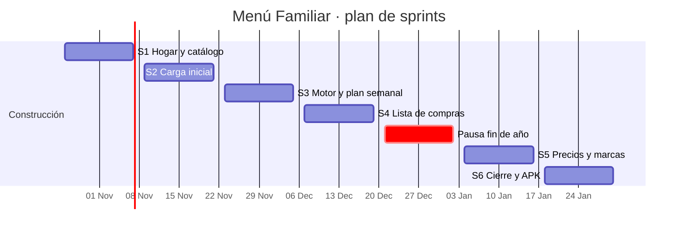

# Plan de sprints

Sprints de 2 semanas, de lunes a viernes de la semana siguiente. La revisión y la retrospectiva se hacen el último viernes; la planificación del siguiente sprint, el lunes de inicio.

## 1. Calendario

| Sprint | Fechas | Objetivo | Historias planificadas | Puntos |
|---|---|---|---|---|
| S0 | 2026-10-20 → 2026-10-22 | Fundaciones | — | — |
| S1 | 2026-10-26 → 2026-11-06 | Hogar, configuración y catálogo | HU-01, 02, 03, 05, 06, 07, 11, 12, 13 | 51 |
| S2 | 2026-11-09 → 2026-11-20 | Carga inicial del cuaderno | HU-04, 08, 15, 16, 17, 18 | 31 |
| S3 | 2026-11-23 → 2026-12-04 | Motor de sugerencias y plan semanal | HU-10, 14, 19–26 | 50 |
| S4 | 2026-12-07 → 2026-12-18 | Lista de compras con avance y precio real | HU-27, 28, 29, 30, 32, 43, 44 | 39 |
| — | 2026-12-21 → 2027-01-01 | Pausa de fin de año | — | — |
| S5 | 2027-01-04 → 2027-01-15 | Precios y marcas | HU-09, 31, 33–38 | 51 |
| S6 | 2027-01-18 → 2027-01-29 | Reportes, notificaciones, APK y cierre | HU-39–42 | 21 |

Cambio frente al SRS: HU-04 (recuperar contraseña) y HU-08 (inicio de semana) pasan de S1 a S2 para bajar el S1 de 56 a 51 puntos. Ambas son de prioridad "S" y no bloquean nada del S1. La pausa de fin de año es una propuesta; ajústala a tu calendario.

## 2. Sprint 1 — planificación

**Objetivo:** que el administrador cree su hogar con comensales y factores de porción, configure tiempos de comida y presupuesto con vista previa, y registre platillos con ingredientes del catálogo, todo desplegado en la VM de Oracle Cloud (D-11, ADR-009).

| Orden | HU | Historia | Puntos | Depende de |
|---|---|---|---|---|
| 1 | HU-01 | Registro e inicio de sesión | 5 | Base técnica S0 |
| 2 | HU-02 | Crear hogar e invitar | 8 | HU-01 · correo Gmail SMTP (D-13) |
| 3 | HU-03 | Comensales con factor de porción | 5 | HU-02 |
| 4 | HU-05 | Tiempos de comida parametrizables | 5 | HU-02 |
| 5 | HU-06 | Presupuesto y distribución | 5 | HU-05 |
| 6 | HU-07 | Recálculo con vista previa | 8 | HU-05, HU-06 |
| 7 | HU-13 | Catálogo de productos (semilla) | 5 | Migración inicial |
| 8 | HU-11 | Gestionar platillos | 5 | HU-02 |
| 9 | HU-12 | Ingredientes por porciones base | 5 | HU-11, HU-13 |
| | | **Total comprometido** | **51** | |

**Tareas técnicas del sprint (heredadas de S0):**

- [ ] Primera corrida de CI en GitHub: migración inicial con Drizzle ORM (D-15) contra PostgreSQL de servicio.
- [ ] Datos semilla: supermercados, unidades, categorías y reparto RN-06.
- [ ] Guard de aislamiento por hogar (RNF-06) con pruebas de autorización.
- [ ] Puesta en marcha de la VM Oracle Cloud Always Free ARM según el checklist de `docs/02-diseno/despliegue.md` §13 (DuckDNS, Caddy, `deploy/deploy.sh`; D-11, D-12).

**Flujo de trabajo:** una rama `feature/HU-nn-descripcion` por historia desde `develop`. Claude prepara los commits y tú haces el push y el merge a `develop`. Al cierre del sprint se hace merge a `main` y se etiqueta `v0.1.0`.

**Velocidad:** el S1 sirve para medir la velocidad real en puntos. Con ese dato se replanifican S2 a S6 en la revisión del 2026-11-06.
