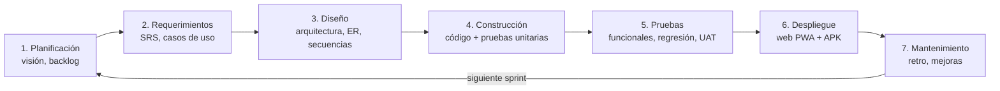
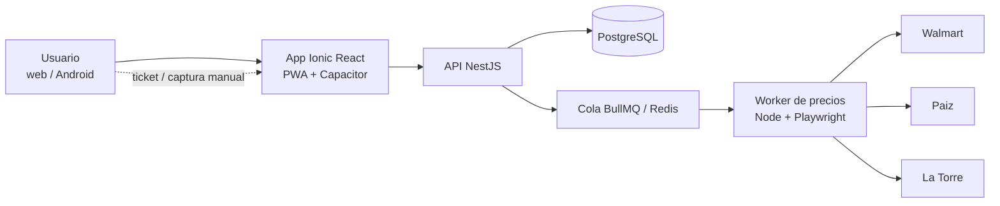
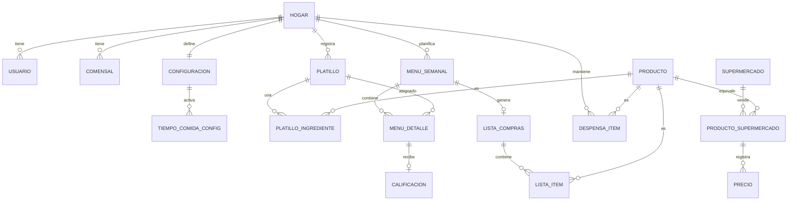
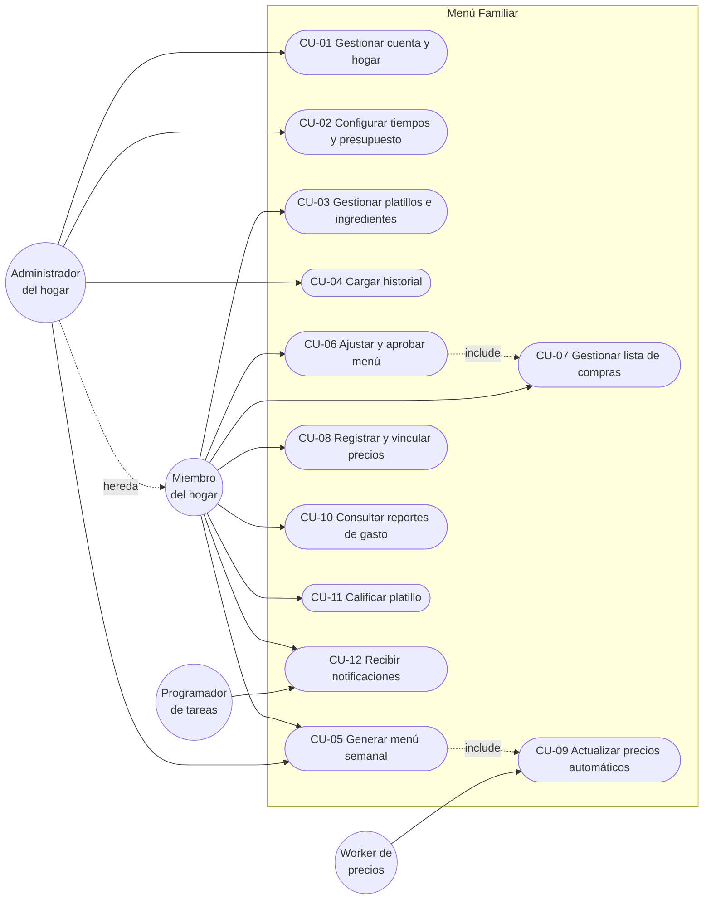

# Especificación de Requerimientos de Software (SRS)
## App de Menús Familiares — "Menú Familiar"

| Campo | Valor |
|---|---|
| Documento | SRS-MF-001 |
| Versión | 1.4 |
| Fecha | 2026-10-22 |
| Autor | Rene Rosales (Product Owner) · elaborado con Claude (arquitectura) |
| Estándar de referencia | ISO/IEC/IEEE 29148:2018 (adaptado) |
| Fase del ciclo de vida | 2. Análisis y especificación de requerimientos |
| Estado | Aprobado por el Product Owner (2026-10-22) |

### Control de versiones

| Versión | Fecha | Autor | Cambio |
|---|---|---|---|
| 0.1 | 2026-10-20 | Claude | Análisis de la solución (Sprint 0) |
| 1.0 | 2026-10-22 | Claude / Rene | SRS inicial con decisiones confirmadas: tiempos de comida parametrizables, compras = ingredientes + despensa, stack React+Ionic+NestJS, precio sugerido = mínimo y mediana |
| 1.1 | 2026-10-22 | Claude / Rene | Aprobado. Se agrega CU-12 Recibir notificaciones; CU-08 pasa a "Registrar y vincular precios"; casos de uso detallados por RF en `historias/` |
| 1.2 | 2026-10-22 | Claude / Rene | Decisiones del PO D-01 a D-09: reparto con desayuno, factor de porción por comensal, aprobación con exceso visible, hosting en servidor propio (RN-06, RN-07, RN-11, RNF-03, R-05, S-03, PA-01) |
| 1.3 | 2026-10-22 | Claude / Rene | Nuevos RF-43 avance de compra por comida y RF-44 precio real y promedio de compra (RN-12, RN-13), solicitados por el PO |
| 1.4 | 2026-10-22 | Claude / Rene | D-11 a D-15: Oracle Cloud ARM, DuckDNS, Gmail SMTP, ADR-004 aprobado, Drizzle ORM (R-01, R-05, S-03, RNF-03, IE-03, PA-01, RG-02) |

---

## 0. Ciclo de vida del software aplicado

Todo el proyecto sigue un ciclo de vida iterativo (Scrum) en el que cada sprint recorre las fases completas. Cada artefacto vive en el repositorio bajo `docs/` y se versiona con Git.



| Fase | Artefacto | Ruta en el repositorio |
|---|---|---|
| 1. Planificación | Visión, backlog, plan de sprints | `docs/00-planificacion/` |
| 2. Requerimientos | **Este SRS**, casos de uso, historias | `docs/01-requerimientos/` |
| 3. Diseño | Arquitectura, ER, secuencias, UI | `docs/02-diseno/` |
| 4. Construcción | Código fuente | `apps/`, `packages/` |
| 5. Pruebas | Plan y casos de prueba, reportes | `docs/03-pruebas/` |
| 6. Despliegue | Guía de despliegue, notas de versión | `docs/04-despliegue/` |
| 7. Usuario | Manual de usuario | `docs/05-manual-usuario/` |

---

## 1. Introducción

### 1.1 Propósito
Este documento define qué debe hacer la aplicación "Menú Familiar" y con qué calidad. Es la base para el diseño, la construcción, las pruebas y la aceptación de cada sprint.

### 1.2 Alcance del producto
Menú Familiar es una aplicación web (PWA) y Android que:

1. Sugiere el menú semanal (domingo a sábado) según el historial de la familia, sus preferencias y el presupuesto.
2. Permite configurar qué tiempos de comida se planifican (solo almuerzo, dos tiempos o tres tiempos).
3. Genera la lista de compras: ingredientes del menú más la despensa recurrente.
4. Consulta precios de La Torre, Paiz, Walmart y Super Fresh para estimar el costo y sugerir dónde comprar.
5. Carga como historial inicial las 16 semanas de menús del cuaderno familiar (abr 2025 – 2026).

**Fuera de alcance v1:** artículos de limpieza, compra en línea o pago, nutrición clínica o cálculo de calorías, publicación en Google Play (se entrega APK; la tienda se evalúa después), uso multi-familia comercial.

### 1.3 Definiciones y acrónimos

| Término | Definición |
|---|---|
| Hogar | Grupo familiar que comparte menú, presupuesto y lista de compras |
| Tiempo de comida | Desayuno, almuerzo o cena |
| Platillo | Comida con nombre (p. ej. "Pollo en crema") compuesta por ingredientes |
| Menú semanal | Asignación de platillos a cada día y tiempo de comida de una semana |
| Despensa | Productos recurrentes no ligados a un platillo (arroz, aceite, azúcar…) |
| Precio mínimo | Menor precio vigente de un producto entre los supermercados |
| Precio mediana | Mediana de los precios vigentes de un producto entre supermercados |
| PO | Product Owner |
| PWA | Progressive Web App |
| RF / RNF / RN | Requerimiento funcional / no funcional / regla de negocio |
| CU | Caso de uso |
| MoSCoW | Prioridad: Must, Should, Could, Won't |

### 1.4 Referencias
- Análisis y solución — Sprint 0 (doc del proyecto, 2026-10-20).
- Fotografías del cuaderno familiar, carpeta `imagenes/` (18 fotos: 16 semanas de menú + 2 listas).
- ISO/IEC/IEEE 29148:2018 — Requirements engineering.

---

## 2. Descripción general

### 2.1 Perspectiva del producto



### 2.2 Funciones principales
Gestión del hogar · configuración · catálogo de platillos e ingredientes · carga histórica · motor de sugerencias · plan semanal · lista de compras · precios · reportes de gasto · notificaciones.

### 2.3 Usuarios

| Perfil | Descripción | Permisos |
|---|---|---|
| Administrador del hogar | Crea el hogar, configura presupuesto y tiempos de comida (Rene) | Todo |
| Miembro del hogar | Participa en la planificación (esposa) | Planificar, editar menú y lista, registrar precios |
| Sistema (worker) | Proceso automático de precios | Escribir precios |

### 2.4 Restricciones
- **R-01** Stack: React + Ionic + Capacitor (frontend), NestJS (API), PostgreSQL + Drizzle ORM (D-15, ADR-010), BullMQ/Redis, Playwright, Docker, GitHub Actions.
- **R-02** Moneda: quetzales (GTQ); zona horaria America/Guatemala; idioma español.
- **R-03** La extracción de precios debe respetar los términos de uso de cada supermercado; si no se permite, se usa captura manual o ticket.
- **R-04** Claude no hace push al repositorio: prepara cambios y mensaje de commit; el PO ejecuta `git push`.
- **R-05** Hosting en **Oracle Cloud Always Free ARM** (VM Ampere A1, arm64, Ubuntu) con Docker Compose; la laptop del PO se usa para desarrollo y pruebas (D-11, ADR-009; reemplaza D-09/ADR-002).

### 2.5 Supuestos y dependencias
- **S-01** El gasto semanal típico de almuerzos es Q224 – Q265 (dato del cuaderno), usado como presupuesto inicial sugerido.
- **S-02** Los sitios de Walmart y Paiz publican precios consultables; La Torre después; Super Fresh solo manual o por ticket.
- **S-03** La VM de Oracle Cloud tiene una **IP pública reservada**; el acceso externo se publica en un subdominio gratuito **DuckDNS** con HTTPS automático (Caddy + Let's Encrypt), con solo los puertos 80/443 abiertos (D-12, ADR-009).

---

## 3. Requerimientos funcionales

Prioridad MoSCoW: **M** = Must, **S** = Should, **C** = Could. Sprint según plan del análisis (S0–S6).

### 3.1 M1 — Cuenta y hogar

| ID | Requerimiento | Prioridad | Sprint |
|---|---|---|---|
| RF-01 | El sistema debe permitir registrarse e iniciar sesión con correo y contraseña. | M | S1 |
| RF-02 | El sistema debe permitir crear un hogar e invitar miembros por correo o enlace. | M | S1 |
| RF-03 | El sistema debe permitir registrar a los comensales del hogar (nombre, adulto/niño). | M | S1 |
| RF-04 | El sistema debe permitir recuperar la contraseña por correo. | S | S1 |

### 3.2 M2 — Configuración

| ID | Requerimiento | Prioridad | Sprint |
|---|---|---|---|
| RF-05 | El sistema debe permitir parametrizar los tiempos de comida a planificar: solo almuerzo, dos tiempos (elegibles) o tres tiempos. | M | S1 |
| RF-06 | El sistema debe permitir definir el presupuesto semanal del hogar y su distribución por tiempo de comida (porcentaje o monto). | M | S1 |
| RF-07 | Al cambiar los tiempos de comida, el sistema debe recalcular la distribución del presupuesto y mostrar el impacto antes de guardar. | M | S1 |
| RF-08 | El sistema debe permitir definir el día de inicio de la semana (por defecto domingo) y el día de planificación. | S | S1 |
| RF-09 | El sistema debe permitir elegir los supermercados preferidos y marcas preferidas por producto. | S | S5 |
| RF-10 | El sistema debe permitir registrar restricciones y gustos (ingredientes excluidos, platillos favoritos). | S | S3 |

### 3.3 M3 — Catálogo de platillos e ingredientes

| ID | Requerimiento | Prioridad | Sprint |
|---|---|---|---|
| RF-11 | El sistema debe permitir crear, editar, buscar e inactivar platillos con nombre, tiempo(s) de comida aplicables, proteína principal y etiquetas. | M | S1 |
| RF-12 | El sistema debe permitir asociar ingredientes a cada platillo con cantidad y unidad para el número base de porciones. | M | S1 |
| RF-13 | El sistema debe mantener un catálogo de productos (ingredientes y despensa) con unidad de compra y presentación. | M | S1 |
| RF-14 | El sistema debe permitir calificar un platillo (1–5) después de comerlo. | S | S3 |

### 3.4 M4 — Carga histórica

| ID | Requerimiento | Prioridad | Sprint |
|---|---|---|---|
| RF-15 | El sistema debe permitir capturar menús de semanas pasadas (fecha, día, tiempo, platillo, gasto). | M | S2 |
| RF-16 | El sistema debe permitir importar el historial desde un archivo CSV/Excel con plantilla definida. | M | S2 |
| RF-17 | Al importar, el sistema debe detectar platillos nuevos y proponer crearlos o asociarlos a uno existente. | M | S2 |
| RF-18 | El sistema debe cargar las 16 semanas del cuaderno y las 2 listas sueltas como datos iniciales. | M | S2 |

### 3.5 M5 — Motor de sugerencias

| ID | Requerimiento | Prioridad | Sprint |
|---|---|---|---|
| RF-19 | El sistema debe generar una propuesta de menú semanal para los tiempos de comida configurados. | M | S3 |
| RF-20 | El puntaje de cada platillo debe ser: 0.40 Preferencia + 0.25 Novedad + 0.20 Ahorro + 0.15 Afinidad (pesos configurables por el administrador). | M | S3 |
| RF-21 | La propuesta debe respetar el presupuesto del tiempo de comida (ver RN-01). | M | S3 |
| RF-22 | El sistema debe mostrar por qué sugirió cada platillo (factores del puntaje). | S | S3 |
| RF-23 | El usuario debe poder pedir una alternativa para un día concreto sin regenerar toda la semana. | M | S3 |

### 3.6 M6 — Plan semanal

| ID | Requerimiento | Prioridad | Sprint |
|---|---|---|---|
| RF-24 | El usuario debe poder editar, mover (arrastrar) y fijar platillos del menú propuesto. | M | S3 |
| RF-25 | El usuario debe poder aprobar el menú; un menú aprobado genera la lista de compras. | M | S3 |
| RF-26 | El sistema debe mostrar el costo estimado por día, por tiempo y total vs. presupuesto. | M | S3 |
| RF-27 | El sistema debe permitir registrar el gasto real de la semana. | S | S4 |

### 3.7 M7 — Lista de compras

| ID | Requerimiento | Prioridad | Sprint |
|---|---|---|---|
| RF-28 | El sistema debe consolidar los ingredientes del menú aprobado, sumando cantidades del mismo producto y convirtiendo a unidad de compra. | M | S4 |
| RF-29 | El sistema debe agregar a la lista los productos de despensa que tocan esa semana según su frecuencia. | M | S4 |
| RF-30 | El usuario debe poder agregar, quitar y marcar productos como comprados (también sin conexión). | M | S4 |
| RF-31 | La lista debe agruparse por supermercado sugerido (precio mínimo) y por categoría. | S | S5 |
| RF-32 | El usuario debe poder compartir la lista (texto/WhatsApp). | C | S4 |
| RF-43 | La lista de ingredientes con check debe mostrar el avance de compra de cada comida programada (ingredientes comprados de su total) y marcarla "Lista para preparar" al completarse; también el avance general de la semana. Un ingrediente se puede marcar "Ya lo tengo" sin comprarlo. | M | S4 |
| RF-44 | Al marcar un producto como comprado, el usuario puede registrar el precio real pagado (opcional). El sistema debe calcular el precio promedio de compra por producto y prellenar el gasto real de la semana con la suma de precios reales. | M | S4 |

### 3.8 M8 — Precios

| ID | Requerimiento | Prioridad | Sprint |
|---|---|---|---|
| RF-33 | El worker debe obtener precios de Walmart y Paiz cada sábado y domingo a las 21:00 (GT); La Torre en una segunda fase. | M | S5 |
| RF-34 | El usuario debe poder registrar precios manualmente o desde la foto de un ticket (Super Fresh y otros). | M | S5 |
| RF-35 | El sistema debe vincular cada producto del catálogo con el producto equivalente de cada supermercado (marca y presentación). | M | S5 |
| RF-36 | El sistema debe calcular por producto el **precio mediana** (para presupuesto) y el **precio mínimo** con su supermercado (para sugerencia de compra). | M | S5 |
| RF-37 | El sistema debe guardar el histórico de precios y mostrar la variación. | S | S5 |
| RF-38 | Si una corrida de precios falla, el sistema debe usar el último precio válido y marcarlo con su fecha. | M | S5 |

### 3.9 M9 — Reportes

| ID | Requerimiento | Prioridad | Sprint |
|---|---|---|---|
| RF-39 | El sistema debe mostrar gasto semanal estimado vs. real y vs. presupuesto (últimas 12 semanas). | S | S6 |
| RF-40 | El sistema debe mostrar los platillos más frecuentes y los no preparados en más de 4 semanas. | C | S6 |

### 3.10 M10 — Notificaciones

| ID | Requerimiento | Prioridad | Sprint |
|---|---|---|---|
| RF-41 | El sistema debe recordar el día de planificación (por defecto domingo) que el menú está listo para revisar. | S | S6 |
| RF-42 | El sistema debe avisar si el costo estimado supera el presupuesto en más de 10 %. | S | S6 |

---

## 4. Reglas de negocio

| ID | Regla |
|---|---|
| RN-01 | Presupuesto de un tiempo de comida = presupuesto semanal × % asignado a ese tiempo. El costo estimado del menú usa el precio mediana. |
| RN-02 | No se repite la misma proteína principal en días consecutivos del mismo tiempo de comida. |
| RN-03 | No se repite un platillo dentro de la misma semana y tiempo de comida, salvo que el usuario lo fije. |
| RN-04 | Novedad: un platillo preparado hace menos de 2 semanas recibe puntaje de novedad 0. |
| RN-05 | Si el menú supera el presupuesto, el motor reemplaza el platillo de mayor costo por la mejor alternativa más barata hasta cumplir o hasta 3 intentos; si no cumple, avisa al usuario. |
| RN-06 | Distribución por defecto del presupuesto: solo almuerzo = 100 %; almuerzo + cena = 60/40; tres tiempos = 20/50/30 (desayuno/almuerzo/cena); desayuno + almuerzo = 29/71; desayuno + cena = 40/60. Editable (D-01). |
| RN-07 | Las cantidades escalan con la suma de factores de porción de los comensales: cantidad = cantidad base × Σ factores ÷ porciones base. Cada comensal tiene factor sugerido 1.0, editable de 0.25 a 2.0 en pasos de 0.25 (D-02). |
| RN-08 | La sugerencia de compra usa el precio mínimo vigente (máx. 14 días de antigüedad); si no hay precio vigente se muestra el último con advertencia. |
| RN-09 | La semana va de domingo a sábado salvo configuración distinta (RF-08). |
| RN-10 | Solo el administrador cambia presupuesto, tiempos de comida y pesos del motor. |
| RN-11 | Un menú que excede el presupuesto se puede aprobar; el exceso se muestra en rojo con el texto "Excede por Q__" en el menú, al aprobar y en la lista de compras, y queda registrado (D-03). |
| RN-12 | Precio promedio de compra de un producto = promedio de los precios reales pagados por el hogar, normalizados a la presentación del catálogo, en las últimas 12 semanas. Se muestra junto a la mediana y sirve de respaldo cuando no hay precio de mercado vigente (RN-08). |
| RN-13 | Una comida programada está "Lista para preparar" cuando todos sus ingredientes en la lista están marcados como comprados o "Ya lo tengo". Un producto compartido por varias comidas cuenta para todas al marcarse. |

---

## 5. Requerimientos no funcionales

| ID | Atributo | Requerimiento | Métrica de verificación |
|---|---|---|---|
| RNF-01 | Rendimiento | Generar el menú semanal en menos de 3 s. | p95 < 3 s con 300 platillos |
| RNF-02 | Rendimiento | Pantallas principales cargan en menos de 2 s en 4G. | Lighthouse ≥ 80 performance |
| RNF-03 | Disponibilidad | API disponible **99 % mensual** (Oracle Cloud, D-11); la lista y el menú aprobado siguen disponibles sin conexión (RNF-04). | Monitoreo de uptime externo |
| RNF-04 | Offline | Lista de compras y menú aprobado consultables sin conexión; sincroniza al reconectar. | Prueba en modo avión |
| RNF-05 | Seguridad | Contraseñas con hash bcrypt/argon2; JWT con expiración; HTTPS obligatorio. | Revisión de código, prueba |
| RNF-06 | Seguridad | Cada hogar solo ve sus datos (aislamiento por `hogar_id`). | Pruebas de autorización |
| RNF-07 | Usabilidad | Planificar la semana en 5 minutos o menos y en máximo 3 toques por cambio de platillo. | Prueba con usuarios (UAT) |
| RNF-08 | Compatibilidad | Chrome, Edge, Safari recientes; Android 10+. | Matriz de dispositivos |
| RNF-09 | Mantenibilidad | Cobertura de pruebas unitarias ≥ 70 % en API y motor. | Reporte CI |
| RNF-10 | Portabilidad | Despliegue con Docker Compose en un comando. | Guía de despliegue |
| RNF-11 | Respaldo | Backup diario de la base de datos con retención de 14 días. | Prueba de restauración |
| RNF-12 | Legal | Respetar robots.txt y términos de uso; máximo 1 solicitud/segundo por sitio. | Configuración del worker |
| RNF-13 | Accesibilidad | Contraste WCAG AA y textos escalables. | Auditoría Lighthouse ≥ 90 |

---

## 6. Requerimientos de datos (modelo conceptual)

Modelo conceptual. El ER detallado (atributos, tipos, índices) se entrega en la fase de diseño (`docs/02-diseno/`).



---

## 7. Interfaces externas

| ID | Interfaz | Descripción |
|---|---|---|
| IE-01 | Usuario | App Ionic responsiva (móvil primero), español, tema claro/oscuro. |
| IE-02 | Supermercados | Sitios web de Walmart, Paiz y La Torre consultados por Playwright. |
| IE-03 | Correo | **Gmail SMTP** (`smtp.gmail.com:587`, STARTTLS) con contraseña de aplicación para invitaciones y recuperación de contraseña; cambiable por configuración (D-13). |
| IE-04 | Notificaciones | Web Push (PWA) y Firebase Cloud Messaging (Android). |
| IE-05 | Archivos | Importación CSV/XLSX; exportación de lista en texto. |

---

## 8. Casos de uso

### 8.1 Diagrama de casos de uso



### 8.2 Especificación de casos de uso principales

**CU-02 Configurar tiempos y presupuesto**

| Campo | Detalle |
|---|---|
| Actor | Administrador del hogar |
| Precondición | Sesión iniciada; hogar creado |
| Flujo principal | 1. Abre Configuración. 2. Elige tiempos: solo almuerzo / dos tiempos / tres tiempos. 3. Ingresa presupuesto semanal. 4. El sistema propone la distribución (RN-06) y muestra el impacto. 5. Ajusta porcentajes (deben sumar 100 %). 6. Guarda. |
| Flujo alterno | 5a. Los porcentajes no suman 100 % → el sistema bloquea guardar y lo indica. |
| Postcondición | Los siguientes menús se generan con la nueva configuración; los aprobados no cambian. |
| Requerimientos | RF-05, RF-06, RF-07, RN-01, RN-06, RN-10 |

**CU-05 Generar menú semanal**

| Campo | Detalle |
|---|---|
| Actor | Administrador o miembro |
| Precondición | Configuración completa; al menos 10 platillos por tiempo de comida activo |
| Flujo principal | 1. Selecciona la semana. 2. Pide "Sugerir menú". 3. El sistema puntúa platillos (RF-20), aplica RN-02 a RN-05 y llena cada día y tiempo activo. 4. Muestra costo estimado vs. presupuesto y el motivo de cada sugerencia. |
| Flujo alterno | 3a. No se logra cumplir el presupuesto → muestra el exceso y alternativas. 3b. Faltan platillos → indica cuántos faltan y ofrece ir al catálogo. |
| Postcondición | Menú en estado "Borrador". |
| Requerimientos | RF-19 a RF-23, RF-26, RN-01 a RN-05 |

**CU-07 Gestionar lista de compras**

| Campo | Detalle |
|---|---|
| Actor | Miembro del hogar |
| Precondición | Menú aprobado |
| Flujo principal | 1. Abre la lista. 2. El sistema muestra ingredientes consolidados + despensa de la semana, agrupados por supermercado sugerido. 3. El usuario marca productos comprados (o "Ya lo tengo"), anota el precio real si quiere y ve el avance de cada comida hasta "Lista para preparar". 4. Registra el gasto real al terminar. |
| Flujo alterno | 3a. Sin conexión → los cambios se guardan localmente y se sincronizan después. |
| Postcondición | Lista cerrada con gasto real registrado. |
| Requerimientos | RF-27 a RF-32, RF-43, RF-44, RN-07, RN-08, RN-11, RN-12, RN-13 |

**CU-09 Actualizar precios automáticos**

| Campo | Detalle |
|---|---|
| Actor | Worker de precios (programado) |
| Disparador | Sábado y domingo 21:00 GT |
| Flujo principal | 1. Toma los productos vinculados por supermercado. 2. Consulta cada sitio respetando RNF-12. 3. Guarda precio y fecha. 4. Recalcula mínimo y mediana. |
| Flujo alterno | 2a. Sitio no responde o cambió su estructura → registra error, conserva último precio (RF-38) y notifica al administrador. |
| Requerimientos | RF-33, RF-35 a RF-38 |

---

## 9. Historias de usuario y criterios de aceptación (muestra)

**HU-05 — Tiempos de comida parametrizables**
*Como* administrador *quiero* elegir si planifico solo almuerzos, dos o tres tiempos *para* que el menú y el presupuesto reflejen cómo come mi familia.

```gherkin
Escenario: Cambiar de solo almuerzo a almuerzo y cena
  Dado que el hogar tiene presupuesto semanal de Q500 y solo almuerzo activo
  Cuando activo "Cena" y acepto la distribución sugerida
  Entonces el presupuesto de almuerzo es Q300 y el de cena Q200
  Y el próximo menú sugerido incluye almuerzo y cena de domingo a sábado
```

**HU-36 — Precio sugerido**
*Como* miembro *quiero* ver el costo estimado con precio mediana y dónde está más barato cada producto *para* planificar con un número estable y ahorrar al comprar.

```gherkin
Escenario: Producto con precios en tres supermercados
  Dado que el arroz 2 lb cuesta Q12.50 en Walmart, Q13.00 en Paiz y Q14.25 en La Torre
  Cuando veo la lista de compras
  Entonces el costo estimado usa Q13.00 (mediana)
  Y el arroz aparece agrupado en Walmart con Q12.50 (mínimo)
```

**HU-21 — Menú dentro del presupuesto**
```gherkin
Escenario: Menú excede el presupuesto
  Dado un presupuesto de almuerzo de Q250
  Cuando el menú sugerido cuesta Q280
  Entonces el sistema reemplaza el platillo más caro por una alternativa más barata
  Y si tras 3 intentos sigue excedido muestra "Excede por Q__" con alternativas
```

---

## 10. Matriz de trazabilidad

| Módulo | RF | CU | Sprint | Pruebas (fase 5) |
|---|---|---|---|---|
| M1 Cuenta y hogar | RF-01 a RF-04 | CU-01.1–01.4 | S1 | PF-M1-xx |
| M2 Configuración | RF-05 a RF-10 | CU-02.1–02.6 | S1 (RF-09 S5, RF-10 S3) | PF-M2-xx |
| M3 Catálogo | RF-11 a RF-14 | CU-03.1–03.3, CU-11.1 | S1 / S3 | PF-M3-xx |
| M4 Carga histórica | RF-15 a RF-18 | CU-04.1–04.4 | S2 | PF-M4-xx |
| M5 Motor | RF-19 a RF-23 | CU-05.1–05.5 | S3 | PF-M5-xx + unitarias del motor |
| M6 Plan semanal | RF-24 a RF-27 | CU-06.1–06.4 | S3 / S4 | PF-M6-xx |
| M7 Lista de compras | RF-28 a RF-32, RF-43, RF-44 | CU-07.1–07.7 | S4 / S5 | PF-M7-xx |
| M8 Precios | RF-33 a RF-38 | CU-08.1–08.3, CU-09.1–09.3 | S5 | PF-M8-xx |
| M9 Reportes | RF-39, RF-40 | CU-10.1–10.2 | S6 | PF-M9-xx |
| M10 Notificaciones | RF-41, RF-42 | CU-12.1–12.2 | S6 | PF-M10-xx |

Cada sprint ejecuta además la suite de regresión acumulada de los módulos anteriores. El detalle por requerimiento (caso de uso, historia, criterios y subtareas) está en [`historias/`](historias/README.md).

---

## 11. Plan de entregas por sprint (2 semanas c/u)

| Sprint | Objetivo | Requerimientos | Entregables de ciclo de vida |
|---|---|---|---|
| S0 | Fundaciones | — | SRS, arquitectura, ER, repo, CI, Docker |
| S1 | Hogar, configuración y catálogo | RF-01–08, RF-11–13 | Diseño M1–M3, código, pruebas, manual cap. 1–2 |
| S2 | Carga inicial | RF-15–18 | Plantilla de importación, 16 semanas cargadas |
| S3 | Menú | RF-10, RF-14, RF-19–26 | Motor + plan semanal, pruebas del motor |
| S4 | Compras | RF-27–30, RF-32, RF-43, RF-44 | Lista offline, manual cap. compras |
| S5 | Precios y marcas | RF-09, RF-31, RF-33–38 | Worker, vinculación de productos |
| S6 | Android y cierre | RF-39–42 | APK, reportes, UAT, manual completo |

---

## 12. Preguntas abiertas y riesgos

| ID | Tema | Estado |
|---|---|---|
| PA-01 | Hosting definitivo | Cerrada: Oracle Cloud Always Free ARM (D-11, ADR-009; reemplaza D-09/ADR-002) |
| PA-02 | Términos de uso de Walmart/Paiz/La Torre para extracción automática | Revisar antes de S5; extracción apagada por sitio hasta revisarlos (D-07) |
| PA-03 | Frecuencia de cada producto de despensa (semanal, quincenal, mensual) | Confirmar con la lista de Q814 en S2 |
| PA-04 | Publicar en Google Play o solo APK | APK en v1; reevaluar en S6 |
| RG-01 | Cambios en la estructura de los sitios rompen el worker | Mitigación: RF-38 + alertas + captura manual |
| RG-02 | Oracle reclama la instancia Always Free por inactividad, suspende la cuenta o hay caída de OCI, y la app queda sin servicio | Mitigación: cuenta Pay As You Go con presupuesto (sin reclamo por inactividad), respaldos diarios fuera de la VM (Object Storage y laptop del PO, RNF-11), script de reconstrucción (`deploy/deploy.sh` + checklist, RTO 4 h), imágenes multi-arquitectura para mover a otro servidor, modo offline (RNF-04) |

---

## 13. Aprobación

| Rol | Nombre | Fecha | Firma / visto bueno |
|---|---|---|---|
| Product Owner | Rene Rosales | 2026-10-22 | Aprobado |
| Arquitecto de software | Claude | 2026-10-22 | Elaborado |
