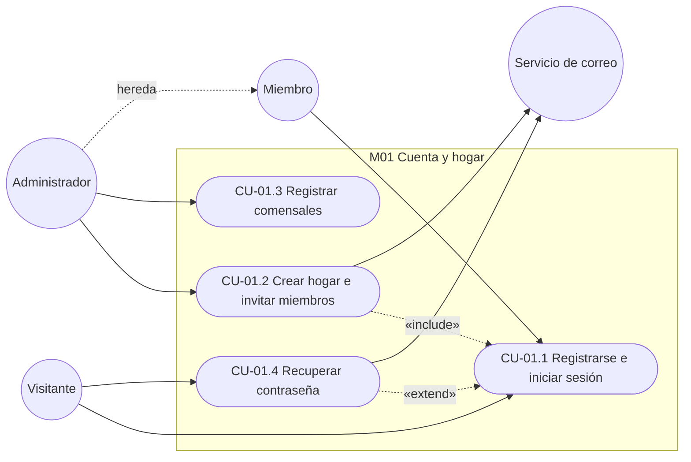
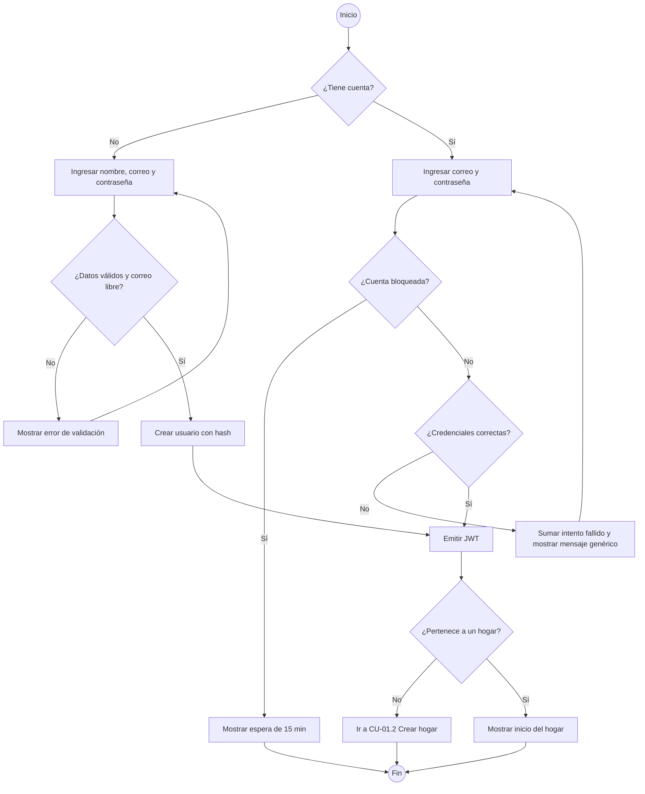
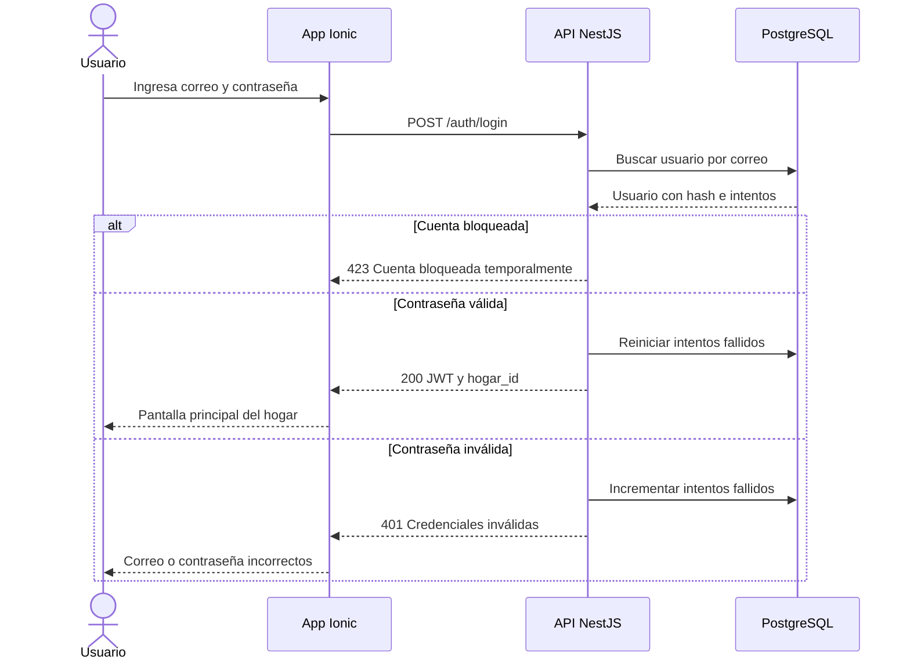
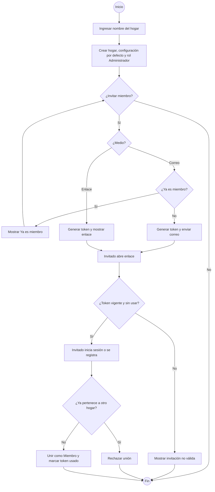
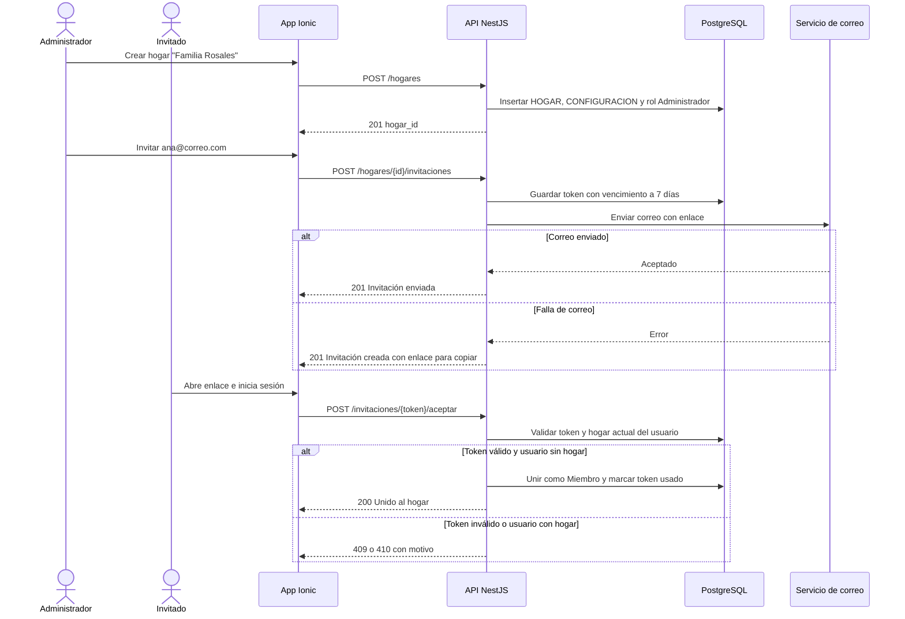
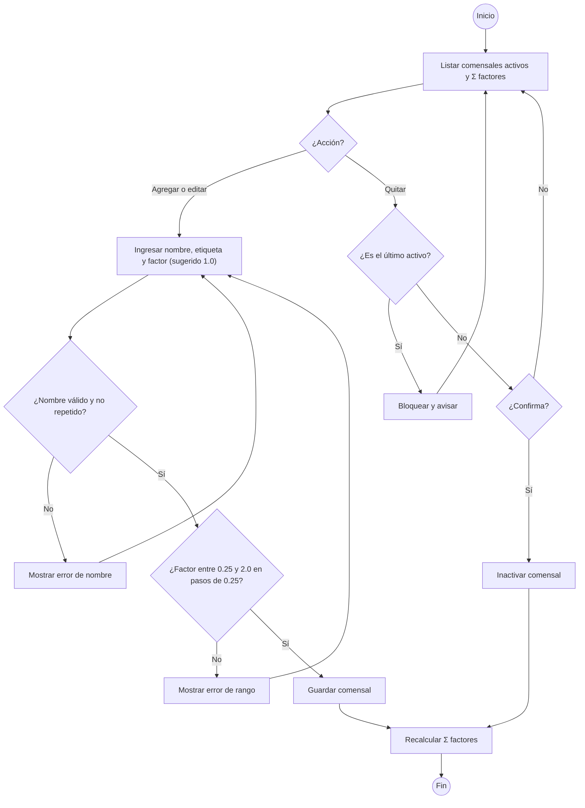
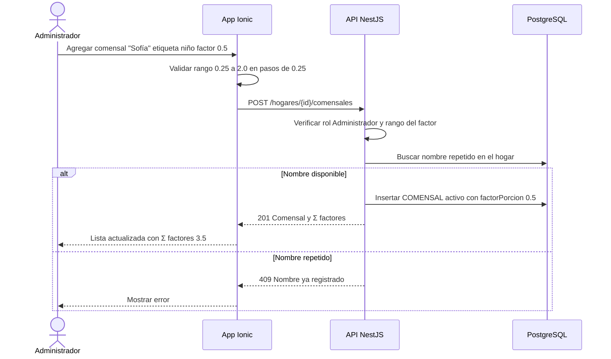
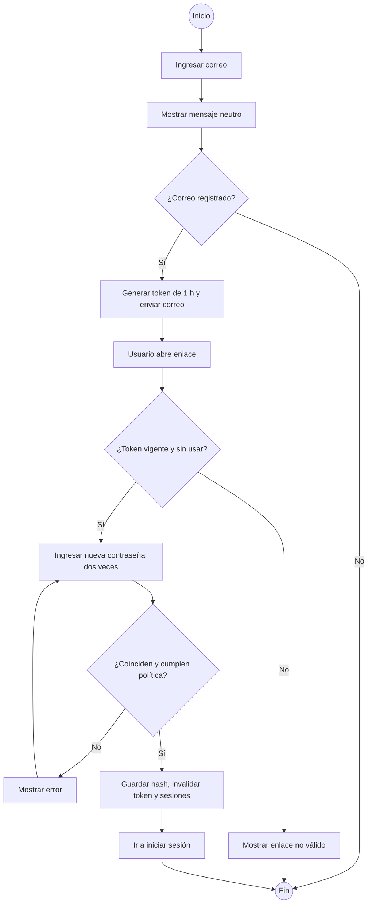
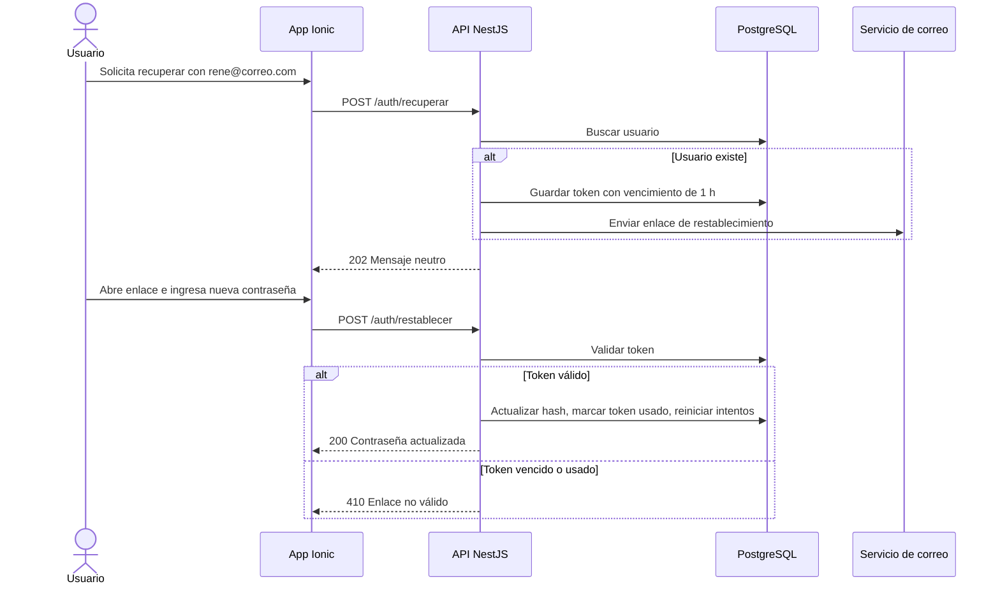

# M01 — Cuenta y hogar

| Campo | Valor |
|---|---|
| SRS | SRS-MF-001 v1.3 (aprobado 2026-10-22) |
| Requerimientos | RF-01 a RF-04 |
| Caso de uso macro | CU-01 Gestionar cuenta y hogar |
| Sprint(s) | S1 |
| Fase del ciclo de vida | 2. Requerimientos — análisis de casos de uso |

Permite que la familia tenga acceso seguro a la app, agrupe a sus integrantes en un hogar con datos aislados (RNF-06) y registre a los comensales, que después determinan las cantidades del menú y de la lista de compras (RN-07).

## 1. Diagrama de casos de uso del módulo



## 2. Casos de uso e historias

### CU-01.1 — Registrarse e iniciar sesión · RF-01 · HU-01

#### Especificación

| Campo | Detalle |
|---|---|
| Actor(es) | Visitante, Miembro, Administrador |
| Prioridad / Sprint | M · S1 |
| Precondiciones | El usuario tiene acceso a la app (web o Android) y conexión. |
| Disparador | El usuario abre la app sin sesión activa. |
| Flujo principal | **Registro:** 1. Elige "Crear cuenta".<br>2. Ingresa nombre, correo y contraseña.<br>3. El sistema valida formato, unicidad del correo y política de contraseña.<br>4. Guarda el usuario con la contraseña cifrada (argon2/bcrypt).<br>5. Inicia sesión y emite un JWT.<br>6. Si no pertenece a un hogar, lo lleva a CU-01.2.<br>**Inicio de sesión:** 7. Ingresa correo y contraseña.<br>8. El sistema verifica credenciales y emite el JWT.<br>9. Muestra la pantalla principal del hogar. |
| Flujos alternos | 3a. Correo ya registrado → muestra "Este correo ya tiene cuenta" y ofrece iniciar sesión.<br>8a. Credenciales inválidas → muestra mensaje genérico "Correo o contraseña incorrectos".<br>8b. 5 intentos fallidos en 15 min → bloquea el inicio de sesión de esa cuenta 15 min. |
| Excepciones | E1. Sin conexión → "Necesitas conexión para iniciar sesión".<br>E2. Token expirado durante el uso → pide volver a iniciar sesión. |
| Postcondiciones | Usuario registrado y/o sesión activa con JWT vigente. |
| Reglas y RNF | RNF-05, RNF-06, RNF-13 |

Supuesto: contraseña de mínimo 8 caracteres con al menos una letra y un número.
Supuesto: JWT de acceso con vigencia de 24 h; el bloqueo tras 5 intentos fallidos en 15 min es la medida anti fuerza bruta.

#### Diagrama de actividad



#### Diagrama de secuencia



#### Historia de usuario HU-01 · 5 puntos

> **Como** integrante de la familia, **quiero** crear una cuenta e iniciar sesión con mi correo y contraseña, **para** acceder de forma segura al menú y la lista de compras de mi hogar.

#### Criterios de aceptación

```gherkin
# language: es
Característica: Registro e inicio de sesión

  # CA-01.1 Flujo principal
  Escenario: Registro exitoso de un usuario nuevo
    Dado que no existe una cuenta con el correo "rene@correo.com"
    Cuando me registro con nombre "Rene", correo "rene@correo.com" y contraseña "Almuerzo2026"
    Entonces se crea la cuenta con la contraseña cifrada
    Y quedo con sesión iniciada
    Y la app me lleva a "Crear hogar"

  # CA-01.2 Flujo alterno
  Escenario: Registro con un correo ya existente
    Dado que existe una cuenta con el correo "rene@correo.com"
    Cuando intento registrarme con el correo "rene@correo.com"
    Entonces veo el mensaje "Este correo ya tiene cuenta"
    Y se me ofrece la opción "Iniciar sesión"

  # CA-01.3 Validación o error
  Escenario: Bloqueo por intentos fallidos
    Dado que la cuenta "rene@correo.com" tiene 4 intentos fallidos en los últimos 15 minutos
    Cuando inicio sesión con la contraseña "incorrecta1"
    Entonces veo el mensaje "Correo o contraseña incorrectos"
    Y la cuenta queda bloqueada para iniciar sesión durante 15 minutos

  # CA-01.4 Validación de contraseña
  Escenario: Contraseña que no cumple la política
    Cuando me registro con la contraseña "pollo"
    Entonces veo "La contraseña debe tener al menos 8 caracteres, una letra y un número"
    Y no se crea la cuenta
```

#### Subtareas

| ID | Tipo | Subtarea | Estimación (h) |
|---|---|---|---|
| ST-01.1 | DB | Tabla USUARIO (correo único, hash, intentos, bloqueado_hasta) y migración Prisma | 2 |
| ST-01.2 | BE | Endpoints POST /auth/registro y /auth/login con hash argon2 y bloqueo por intentos | 6 |
| ST-01.3 | BE | Emisión y validación de JWT (guard NestJS) con hogar_id en el token | 3 |
| ST-01.4 | FE | Pantallas de registro e inicio de sesión con validaciones y manejo de sesión | 5 |
| ST-01.5 | QA | Casos de prueba PF-M1-01.1..4 y prueba e2e automatizada | 4 |
| ST-01.6 | DOC | Manual de usuario: "Crear cuenta e iniciar sesión" | 1 |

---

### CU-01.2 — Crear hogar e invitar miembros · RF-02 · HU-02

#### Especificación

| Campo | Detalle |
|---|---|
| Actor(es) | Administrador; Miembro invitado; Servicio de correo |
| Prioridad / Sprint | M · S1 |
| Precondiciones | Sesión iniciada (CU-01.1). Para crear: el usuario no pertenece a un hogar. |
| Disparador | El usuario sin hogar elige "Crear hogar", o el administrador elige "Invitar miembro". |
| Flujo principal | 1. Ingresa el nombre del hogar.<br>2. El sistema crea el hogar, su CONFIGURACION por defecto y asigna al usuario como Administrador.<br>3. El administrador elige "Invitar" por correo o por enlace.<br>4. El sistema genera un token de invitación de un solo uso.<br>5a. Por correo: envía el enlace al correo indicado.<br>5b. Por enlace: muestra el enlace para copiar o compartir.<br>6. El invitado abre el enlace, inicia sesión o se registra (CU-01.1).<br>7. El sistema lo une al hogar con rol Miembro y marca la invitación como usada. |
| Flujos alternos | 5c. El correo ya pertenece a un miembro del hogar → muestra "Ya es miembro".<br>6a. El invitado ya pertenece a otro hogar → muestra "Tu cuenta ya pertenece a un hogar" y no lo une. |
| Excepciones | E1. Token vencido o ya usado → "Invitación no válida, pide una nueva".<br>E2. Falla el servicio de correo → la invitación queda creada y se ofrece copiar el enlace. |
| Postcondiciones | Hogar creado con un administrador; miembros unidos con rol Miembro; datos aislados por hogar_id. |
| Reglas y RNF | RN-10, RNF-05, RNF-06, IE-03 |

Supuesto: en v1 un usuario pertenece a un solo hogar (uso multi-familia fuera de alcance).
Supuesto: la invitación vence a los 7 días y es de un solo uso; solo el administrador invita.
Supuesto: la configuración por defecto al crear el hogar es solo almuerzo, presupuesto semanal Q250 (S-01), semana domingo a sábado.

#### Diagrama de actividad



#### Diagrama de secuencia



#### Historia de usuario HU-02 · 8 puntos

> **Como** administrador del hogar, **quiero** crear mi hogar e invitar a mi esposa por correo o enlace, **para** planificar juntos el menú y la lista de compras.

#### Criterios de aceptación

```gherkin
# language: es
Característica: Crear hogar e invitar miembros

  # CA-02.1 Flujo principal
  Escenario: Crear hogar e invitar por correo
    Dado que inicié sesión como "rene@correo.com" y no pertenezco a un hogar
    Cuando creo el hogar "Familia Rosales"
    Y invito a "ana@correo.com" por correo
    Entonces soy Administrador de "Familia Rosales"
    Y "ana@correo.com" recibe un correo con un enlace de invitación válido por 7 días

  # CA-02.2 Flujo alterno
  Escenario: Unirse con enlace compartido
    Dado que el administrador generó un enlace de invitación hace 2 días
    Y "ana@correo.com" no pertenece a ningún hogar
    Cuando Ana abre el enlace e inicia sesión
    Entonces Ana queda como Miembro de "Familia Rosales"
    Y el enlace ya no puede volver a usarse

  # CA-02.3 Validación o error
  Escenario: Invitación vencida
    Dado una invitación creada hace 8 días
    Cuando el invitado abre el enlace
    Entonces ve "Invitación no válida, pide una nueva"
    Y no se une al hogar

  # CA-02.4 Aislamiento
  Escenario: Usuario que ya pertenece a otro hogar
    Dado que "luis@correo.com" es miembro del hogar "Familia López"
    Cuando abre un enlace de invitación de "Familia Rosales"
    Entonces ve "Tu cuenta ya pertenece a un hogar"
    Y no puede ver datos de "Familia Rosales"
```

#### Subtareas

| ID | Tipo | Subtarea | Estimación (h) |
|---|---|---|---|
| ST-02.1 | DB | Tablas HOGAR, USUARIO_HOGAR (rol) e INVITACION (token, vence, usada) | 3 |
| ST-02.2 | BE | POST /hogares con configuración por defecto y rol Administrador | 4 |
| ST-02.3 | BE | Invitaciones: generar token, envío por correo, aceptar y validar | 6 |
| ST-02.4 | BE | Guard de autorización por hogar_id y rol (RN-10, RNF-06) | 3 |
| ST-02.5 | FE | Pantallas Crear hogar, Invitar (correo/enlace) y Aceptar invitación | 6 |
| ST-02.6 | QA | Casos de prueba PF-M1-02.1..4 y pruebas de autorización automatizadas | 4 |
| ST-02.7 | DOC | Manual de usuario: "Crear tu hogar e invitar miembros" | 1 |

---

### CU-01.3 — Registrar comensales · RF-03 · HU-03

#### Especificación

| Campo | Detalle |
|---|---|
| Actor(es) | Administrador |
| Prioridad / Sprint | M · S1 |
| Precondiciones | Sesión iniciada; hogar creado. |
| Disparador | El administrador abre "Comensales" en Configuración del hogar. |
| Flujo principal | 1. El sistema lista los comensales activos con su factor de porción y la suma de factores del hogar (Σ factores).<br>2. El administrador elige "Agregar".<br>3. Ingresa nombre, etiqueta opcional (adulto / niño) y factor de porción; el sistema lo sugiere en 1.0.<br>4. El sistema valida (factor entre 0.25 y 2.0, en pasos de 0.25) y guarda.<br>5. Actualiza la Σ factores usada para escalar cantidades (RN-07). |
| Flujos alternos | 2a. Editar: cambia nombre, etiqueta o factor y guarda; la Σ factores se recalcula.<br>2b. Quitar: el sistema pide confirmación e inactiva el comensal. |
| Excepciones | E1. Nombre vacío o repetido en el hogar → muestra error y no guarda.<br>E2. Intento de quitar el último comensal activo → se bloquea, debe existir al menos uno.<br>E3. Factor fuera de 0.25–2.0 o que no es múltiplo de 0.25 → muestra "El factor debe estar entre 0.25 y 2.0 en pasos de 0.25" y no guarda. |
| Postcondiciones | Comensales del hogar actualizados; los menús siguientes escalan con la nueva Σ factores. |
| Reglas y RNF | RN-07, RN-10, RNF-06 |

Decisión D-02: cada comensal tiene un factor de porción sugerido en 1.0 y editable de 0.25 a 2.0 en pasos de 0.25; las cantidades escalan con la suma de factores. La etiqueta adulto / niño es solo informativa y no cambia el cálculo.
Supuesto: solo el administrador gestiona comensales (el perfil Miembro del SRS §2.3 no incluye configuración del hogar).
Supuesto: quitar un comensal lo inactiva (no se borra) y no altera menús ya aprobados (D-04).

#### Diagrama de actividad



#### Diagrama de secuencia



#### Historia de usuario HU-03 · 5 puntos

> **Como** administrador, **quiero** registrar quiénes comen en casa con un factor de porción para cada uno, **para** que las cantidades del menú y de la lista de compras se ajusten a lo que realmente come mi familia.

#### Criterios de aceptación

```gherkin
# language: es
Característica: Registrar comensales del hogar

  # CA-03.1 Flujo principal
  Escenario: Agregar un comensal con el factor sugerido
    Dado que el hogar "Familia Rosales" tiene los comensales "Rene" 1.0, "Ana" 1.0 y "Diego" 1.0
    Cuando agrego a "Abuela Carmen" sin cambiar el factor
    Entonces "Abuela Carmen" queda con factor de porción 1.0
    Y el hogar tiene 4 comensales con Σ factores 4.0

  # CA-03.2 Flujo alterno
  Escenario: Quitar un comensal
    Dado que el hogar tiene 4 comensales activos
    Cuando quito a "Diego" y confirmo
    Entonces "Diego" queda inactivo
    Y el hogar tiene 3 comensales activos

  # CA-03.3 Validación o error
  Escenario: Nombre repetido
    Dado que existe el comensal "Ana"
    Cuando intento agregar otro comensal llamado "Ana"
    Entonces veo "Ya existe un comensal con ese nombre"
    Y no se guarda

  # CA-03.4 Permisos
  Escenario: Un miembro no puede modificar comensales
    Dado que inicié sesión como Miembro del hogar
    Cuando intento agregar el comensal "Abuela Carmen"
    Entonces el sistema rechaza la acción con "Solo el administrador puede modificar comensales"

  # CA-03.5 Factor de porción reducido
  Escenario: Comensal pequeño con factor 0.5
    Dado que el hogar tiene "Rene" 1.0, "Ana" 1.0 y "Diego" 1.0
    Cuando agrego a "Sofía" con etiqueta niño y factor de porción 0.5
    Entonces el hogar tiene Σ factores 3.5
    Y la etiqueta "niño" no cambia el cálculo de cantidades

  # CA-03.6 Validación del rango del factor
  Esquema del escenario: Factor fuera de rango o fuera de paso
    Dado que edito el comensal "Diego"
    Cuando cambio su factor de porción a <factor>
    Entonces veo "El factor debe estar entre 0.25 y 2.0 en pasos de 0.25"
    Y "Diego" conserva su factor 1.0

    Ejemplos:
      | factor |
      | 0      |
      | 2.25   |
      | 0.3    |
```

#### Subtareas

| ID | Tipo | Subtarea | Estimación (h) |
|---|---|---|---|
| ST-03.1 | DB | Tabla COMENSAL (nombre, etiqueta, factorPorcion decimal 1.0, activo, hogar_id) con índice único por hogar y CHECK de rango | 2 |
| ST-03.2 | BE | CRUD /hogares/{id}/comensales con validaciones, rango y paso del factor, inactivación y cálculo de Σ factores | 4 |
| ST-03.3 | FE | Pantalla de comensales: lista con Σ factores, agregar, editar (selector de factor en pasos de 0.25) y quitar | 5 |
| ST-03.4 | QA | Casos de prueba PF-M1-03.1..6 y prueba automatizada | 4 |
| ST-03.5 | DOC | Manual de usuario: "Registrar comensales y su factor de porción" | 1 |

---

### CU-01.4 — Recuperar contraseña · RF-04 · HU-04

#### Especificación

| Campo | Detalle |
|---|---|
| Actor(es) | Visitante; Servicio de correo |
| Prioridad / Sprint | S · S1 |
| Precondiciones | El usuario no tiene sesión activa. |
| Disparador | El usuario elige "¿Olvidaste tu contraseña?" en el inicio de sesión. |
| Flujo principal | 1. Ingresa su correo.<br>2. El sistema muestra siempre "Si el correo existe, recibirás un enlace".<br>3. Si existe la cuenta, genera un token de un solo uso y envía el enlace.<br>4. El usuario abre el enlace e ingresa la nueva contraseña dos veces.<br>5. El sistema valida la política, guarda el nuevo hash, invalida el token y las sesiones previas.<br>6. Muestra "Contraseña actualizada" y lleva a iniciar sesión. |
| Flujos alternos | 3a. El correo no existe → no envía nada (mismo mensaje del paso 2). |
| Excepciones | E1. Token vencido o usado → "El enlace no es válido, solicita uno nuevo".<br>E2. Contraseñas no coinciden o no cumplen la política → muestra error. |
| Postcondiciones | Contraseña actualizada; cuenta desbloqueada; token invalidado. |
| Reglas y RNF | RNF-05, IE-03 |

Supuesto: el enlace de recuperación vence en 1 hora; al restablecer se reinician los intentos fallidos y se cierra la sesión en otros dispositivos.

#### Diagrama de actividad



#### Diagrama de secuencia



#### Historia de usuario HU-04 · 3 puntos

> **Como** usuario que olvidó su contraseña, **quiero** restablecerla con un enlace enviado a mi correo, **para** recuperar el acceso sin perder la información de mi hogar.

#### Criterios de aceptación

```gherkin
# language: es
Característica: Recuperar contraseña

  # CA-04.1 Flujo principal
  Escenario: Restablecer contraseña con enlace vigente
    Dado que existe la cuenta "ana@correo.com"
    Y solicité recuperar la contraseña hace 20 minutos
    Cuando abro el enlace e ingreso dos veces "PepianDePollo9"
    Entonces veo "Contraseña actualizada"
    Y puedo iniciar sesión con "PepianDePollo9"
    Y el enlace ya no puede volver a usarse

  # CA-04.2 Flujo alterno
  Escenario: Correo no registrado
    Dado que no existe una cuenta con "nadie@correo.com"
    Cuando solicito recuperar la contraseña de "nadie@correo.com"
    Entonces veo "Si el correo existe, recibirás un enlace"
    Y no se envía ningún correo

  # CA-04.3 Validación o error
  Escenario: Enlace vencido
    Dado que solicité recuperar la contraseña hace 2 horas
    Cuando abro el enlace
    Entonces veo "El enlace no es válido, solicita uno nuevo"
```

#### Subtareas

| ID | Tipo | Subtarea | Estimación (h) |
|---|---|---|---|
| ST-04.1 | DB | Tabla TOKEN_RECUPERACION (hash del token, vence, usado) | 1 |
| ST-04.2 | BE | Endpoints /auth/recuperar y /auth/restablecer con envío de correo e invalidación de sesiones | 4 |
| ST-04.3 | FE | Pantallas Solicitar recuperación y Nueva contraseña | 3 |
| ST-04.4 | QA | Casos de prueba PF-M1-04.1..3 y prueba automatizada con correo simulado | 3 |
| ST-04.5 | DOC | Manual de usuario: "Recuperar tu contraseña" | 1 |

---

## 3. Resumen del módulo

| HU | RF | CU | Prioridad | Sprint | Puntos | Horas |
|---|---|---|---|---|---|---|
| HU-01 Registro e inicio de sesión | RF-01 | CU-01.1 | M | S1 | 5 | 21 |
| HU-02 Crear hogar e invitar | RF-02 | CU-01.2 | M | S1 | 8 | 27 |
| HU-03 Registrar comensales | RF-03 | CU-01.3 | M | S1 | 5 | 16 |
| HU-04 Recuperar contraseña | RF-04 | CU-01.4 | S | S1 | 3 | 12 |
| **Total** | | | | | **21** | **76** |
