# M02 — Configuración

| Campo | Valor |
|---|---|
| SRS | SRS-MF-001 v1.3 (aprobado 2026-10-22) |
| Requerimientos | RF-05 a RF-10 |
| Caso de uso macro | CU-02 Configurar tiempos y presupuesto |
| Sprint(s) | S1 (RF-05 a RF-08) · S3 (RF-10) · S5 (RF-09) |
| Fase del ciclo de vida | 2. Requerimientos — análisis de casos de uso |

Define cómo planifica el hogar: qué tiempos de comida se incluyen, cuánto se gasta y cómo se reparte el presupuesto entre ellos (RN-01, RN-06), cuándo empieza la semana y qué preferencias (supermercados, marcas, restricciones, favoritos) debe respetar el motor. Los cambios aplican a menús futuros; los menús aprobados no cambian.

## 1. Diagrama de casos de uso del módulo

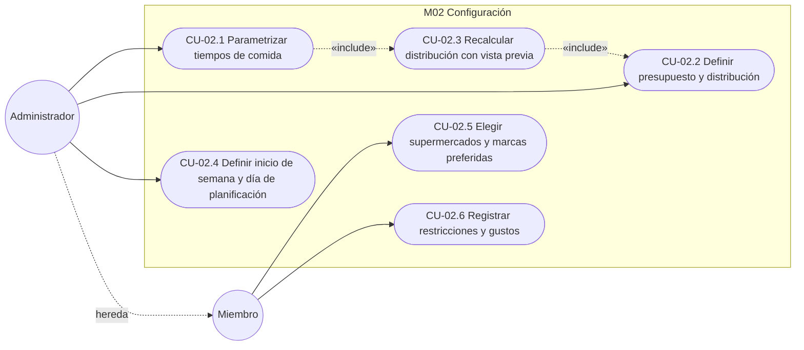

### Distribución por defecto del presupuesto (RN-06 y supuesto S-M02-1)

| Configuración de tiempos | Desayuno | Almuerzo | Cena | Origen |
|---|---|---|---|---|
| Solo almuerzo | — | 100 % | — | RN-06 |
| Almuerzo + cena | — | 60 % | 40 % | RN-06 |
| Desayuno + almuerzo | 29 % | 71 % | — | Supuesto S-M02-1 |
| Desayuno + cena | 40 % | — | 60 % | Supuesto S-M02-1 |
| Tres tiempos | 20 % | 50 % | 30 % | RN-06 |

Supuesto S-M02-1: RN-06 solo define la pareja almuerzo + cena; para las otras parejas se normaliza la proporción de tres tiempos (20/50/30) entre los dos tiempos activos y se redondea a enteros que suman 100 %.

## 2. Casos de uso e historias

### CU-02.1 — Parametrizar tiempos de comida · RF-05 · HU-05

> **Implementado en feature/HU-05-07** (HU-05): API `/hogar/configuracion` (api-contrato §2.2), pantalla Configuración → Tiempos y presupuesto y manual [03-configuracion.md](../../05-manual-usuario/03-configuracion.md).

#### Especificación

| Campo | Detalle |
|---|---|
| Actor(es) | Administrador |
| Prioridad / Sprint | M · S1 |
| Precondiciones | Sesión iniciada con rol Administrador; hogar creado con configuración (CU-01.2). |
| Disparador | El administrador abre Configuración → "Tiempos de comida". |
| Flujo principal | 1. El sistema muestra la opción vigente: solo almuerzo, dos tiempos o tres tiempos.<br>2. El administrador elige una opción.<br>3. Si eligió dos tiempos, marca exactamente dos entre desayuno, almuerzo y cena.<br>4. El sistema ejecuta CU-02.3 (recalcular y mostrar el impacto).<br>5. El administrador confirma.<br>6. El sistema guarda los tiempos activos (TIEMPO_COMIDA_CONFIG) y la nueva distribución. |
| Flujos alternos | 3a. Marca uno o tres tiempos con la opción "dos tiempos" → bloquea continuar con "Selecciona exactamente dos tiempos".<br>5a. Cancela en la vista previa → no se guarda nada. |
| Excepciones | E1. Usuario con rol Miembro → 403 "Solo el administrador puede cambiar los tiempos de comida".<br>E2. Error al guardar → se mantiene la configuración anterior y se muestra el error. |
| Postcondiciones | Tiempos activos actualizados; los menús no aprobados se generan con ellos; los aprobados no cambian. |
| Reglas y RNF | RN-06, RN-10, RNF-06, RNF-07 |

Supuesto: "solo un tiempo" se limita a almuerzo, tal como lo enuncia RF-05; no se ofrece solo desayuno ni solo cena.
Supuesto: la configuración inicial del hogar es solo almuerzo (100 %).

#### Diagrama de actividad

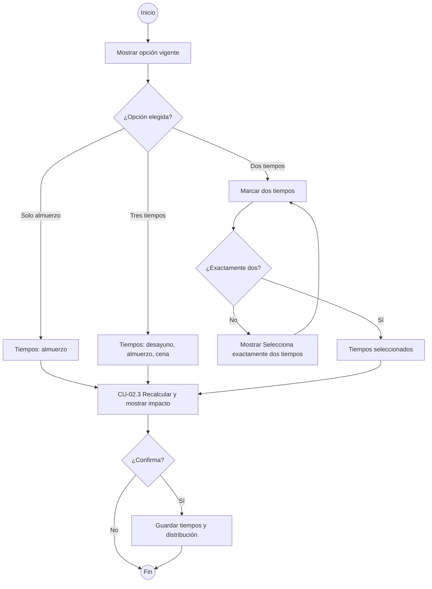

#### Diagrama de secuencia

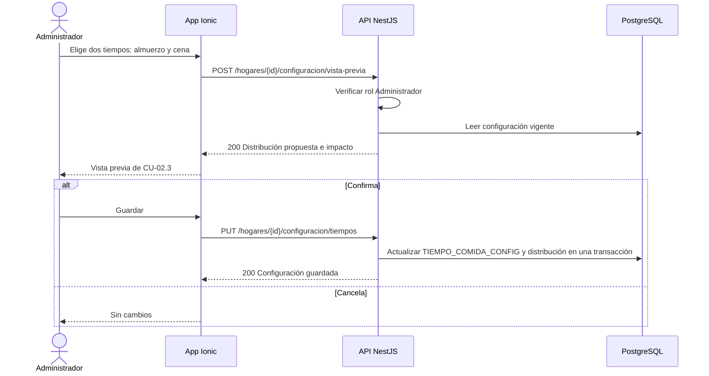

#### Historia de usuario HU-05 · 5 puntos

> **Como** administrador, **quiero** elegir si planifico solo almuerzos, dos tiempos que yo escoja o los tres tiempos, **para** que el menú y el presupuesto reflejen cómo come mi familia.

#### Criterios de aceptación

```gherkin
# language: es
Característica: Tiempos de comida parametrizables

  # CA-05.1 Flujo principal
  Escenario: Cambiar de solo almuerzo a almuerzo y cena
    Dado que el hogar tiene presupuesto semanal de Q500 y solo almuerzo activo
    Cuando activo "Cena" y acepto la distribución sugerida
    Entonces el presupuesto de almuerzo es Q300 y el de cena Q200
    Y el próximo menú sugerido incluye almuerzo y cena de domingo a sábado

  # CA-05.2 Flujo alterno: dos tiempos elegibles
  Escenario: Elegir desayuno y almuerzo
    Dado que el hogar tiene presupuesto semanal de Q500 y solo almuerzo activo
    Cuando elijo "Dos tiempos", marco "Desayuno" y "Almuerzo" y acepto la distribución sugerida
    Entonces el presupuesto de desayuno es Q145 y el de almuerzo Q355

  # CA-05.3 Validación o error
  Escenario: Opción dos tiempos con un solo tiempo marcado
    Dado que elegí "Dos tiempos"
    Cuando marco solo "Cena" e intento continuar
    Entonces veo "Selecciona exactamente dos tiempos"
    Y no se muestra la vista previa

  # CA-05.4 Permisos
  Escenario: Un miembro no puede cambiar los tiempos
    Dado que inicié sesión como Miembro del hogar
    Cuando intento activar "Desayuno"
    Entonces veo "Solo el administrador puede cambiar los tiempos de comida"
    Y la configuración no cambia
```

#### Subtareas

| ID | Tipo | Subtarea | Estimación (h) |
|---|---|---|---|
| ST-05.1 | DB | Tablas CONFIGURACION y TIEMPO_COMIDA_CONFIG, catálogo de tiempos y semilla "solo almuerzo" | 3 |
| ST-05.2 | BE | PUT /configuracion/tiempos con validación de combinaciones y rol (RN-10) | 4 |
| ST-05.3 | FE | Pantalla Tiempos de comida: selector de opción y casillas de dos tiempos | 4 |
| ST-05.4 | QA | Casos de prueba PF-M2-05.1..4 y prueba automatizada | 3 |
| ST-05.5 | DOC | Manual de usuario: "Elegir los tiempos de comida" | 1 |

---

### CU-02.2 — Definir presupuesto y distribución · RF-06 · HU-06

> **Implementado en feature/HU-05-07** (HU-06): API `/hogar/configuracion` (api-contrato §2.2), pantalla Configuración → Tiempos y presupuesto y manual [03-configuracion.md](../../05-manual-usuario/03-configuracion.md).

#### Especificación

| Campo | Detalle |
|---|---|
| Actor(es) | Administrador |
| Prioridad / Sprint | M · S1 |
| Precondiciones | Sesión iniciada con rol Administrador; al menos un tiempo activo. |
| Disparador | El administrador abre Configuración → "Presupuesto", o llega desde CU-02.3 para ajustar. |
| Flujo principal | 1. El sistema muestra el presupuesto semanal y la distribución por tiempo activo en % y en Q.<br>2. El administrador ingresa el presupuesto semanal en GTQ.<br>3. Elige el modo de distribución: porcentaje o monto.<br>4. Ajusta los valores de cada tiempo activo.<br>5. El sistema recalcula en línea el equivalente (Q ↔ %) según RN-01 y el saldo por asignar.<br>6. Si la suma es exacta (100 % o igual al presupuesto), habilita "Guardar".<br>7. Guarda presupuesto y distribución. |
| Flujos alternos | 4a. Pulsa "Usar distribución sugerida" → aplica los valores por defecto (RN-06 y S-M02-1).<br>6a. Porcentajes no suman 100 % → bloquea guardar e indica "Faltan n %" o "Sobran n %".<br>6b. Montos no suman el presupuesto → bloquea guardar e indica "Faltan Qn" o "Excede el presupuesto por Qn". |
| Excepciones | E1. Presupuesto vacío, cero, negativo o con más de 2 decimales → "Ingresa un presupuesto mayor a Q0.00".<br>E2. Usuario Miembro → 403. |
| Postcondiciones | Presupuesto y distribución vigentes; aplican a menús no aprobados (ver CU-02.3). |
| Reglas y RNF | RN-01, RN-06, RN-10, R-02 |

Supuesto: la distribución se almacena en porcentaje con 2 decimales; el modo monto convierte a porcentaje al guardar. Los montos se redondean a centavos y la diferencia de redondeo se asigna al almuerzo (o al tiempo de mayor %, si no hay almuerzo).
Supuesto: el presupuesto sugerido al crear el hogar es Q250 (rango S-01: Q224 – Q265).
Supuesto: cambiar solo el monto semanal conserva los porcentajes y recalcula los montos sin vista previa (RF-07 aplica a cambios de tiempos).

#### Diagrama de actividad

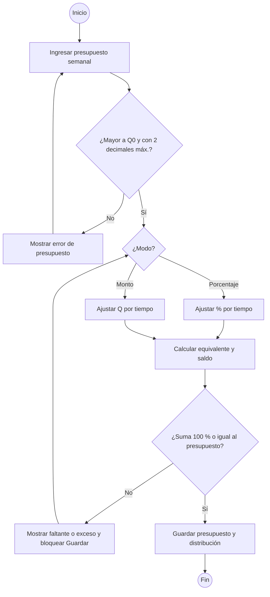

#### Diagrama de secuencia

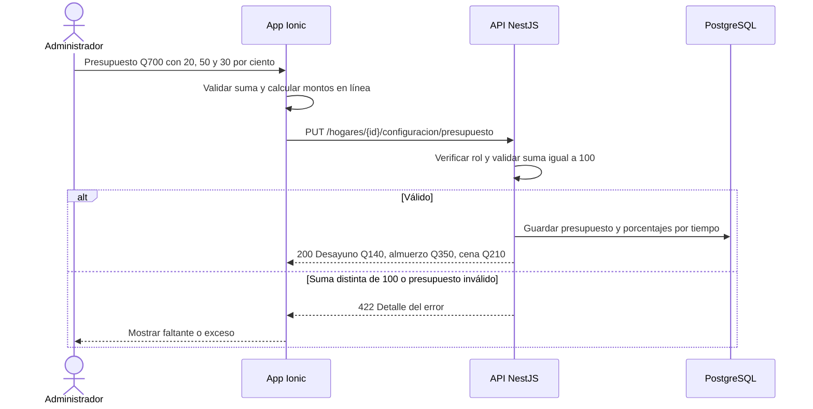

#### Historia de usuario HU-06 · 5 puntos

> **Como** administrador, **quiero** definir el presupuesto semanal y repartirlo por tiempo de comida en porcentaje o en quetzales, **para** que cada menú se ajuste a lo que puedo gastar.

#### Criterios de aceptación

```gherkin
# language: es
Característica: Presupuesto semanal y su distribución

  # CA-06.1 Flujo principal
  Escenario: Distribución por porcentaje con tres tiempos
    Dado que el hogar tiene desayuno, almuerzo y cena activos
    Cuando defino un presupuesto semanal de Q700 con 20 %, 50 % y 30 %
    Y guardo
    Entonces el presupuesto de desayuno es Q140.00, el de almuerzo Q350.00 y el de cena Q210.00

  # CA-06.2 Flujo alterno: distribución por monto
  Escenario: Distribución por monto con almuerzo y cena
    Dado que el hogar tiene almuerzo y cena activos y presupuesto semanal de Q500
    Cuando asigno Q320 al almuerzo y Q180 a la cena y guardo
    Entonces la distribución queda en 64 % almuerzo y 36 % cena

  # CA-06.3 Validación: porcentajes incompletos
  Escenario: Porcentajes que no suman 100 %
    Dado que el hogar tiene desayuno, almuerzo y cena activos
    Cuando asigno 20 %, 50 % y 25 %
    Entonces veo "Faltan 5 % por asignar"
    Y el botón "Guardar" está deshabilitado

  # CA-06.4 Validación: montos excedidos
  Escenario: Montos que exceden el presupuesto
    Dado que el presupuesto semanal es Q500 con almuerzo y cena activos
    Cuando asigno Q320 al almuerzo y Q200 a la cena
    Entonces veo "Excede el presupuesto por Q20.00"
    Y no se guarda la distribución
```

#### Subtareas

| ID | Tipo | Subtarea | Estimación (h) |
|---|---|---|---|
| ST-06.1 | DB | Campos presupuesto_semanal (decimal 10,2) y porcentaje por TIEMPO_COMIDA_CONFIG | 2 |
| ST-06.2 | BE | PUT /configuracion/presupuesto: validaciones, conversión monto ↔ %, redondeo a centavos | 5 |
| ST-06.3 | FE | Pantalla Presupuesto: modo %/Q, cálculo en línea, saldo por asignar y botón sugerido | 5 |
| ST-06.4 | QA | Casos de prueba PF-M2-06.1..4 y pruebas unitarias de cálculo y redondeo | 3 |
| ST-06.5 | DOC | Manual de usuario: "Definir presupuesto y distribución" | 1 |

---

### CU-02.3 — Recalcular distribución con vista previa · RF-07 · HU-07

> **Implementado en feature/HU-05-07** (HU-07): API `/hogar/configuracion` (api-contrato §2.2), pantalla Configuración → Tiempos y presupuesto y manual [03-configuracion.md](../../05-manual-usuario/03-configuracion.md).

#### Especificación

| Campo | Detalle |
|---|---|
| Actor(es) | Administrador |
| Prioridad / Sprint | M · S1 |
| Precondiciones | Incluido desde CU-02.1 con una nueva selección de tiempos distinta a la vigente. |
| Disparador | El administrador cambia los tiempos de comida y pulsa "Continuar". |
| Flujo principal | 1. El sistema calcula la distribución sugerida para los nuevos tiempos (RN-06 y S-M02-1) sobre el presupuesto semanal vigente.<br>2. Muestra la vista previa sin guardar: por tiempo, % y Q actuales vs. nuevos, tiempos que se agregan o se quitan.<br>3. Indica desde qué semana aplica y qué menús aprobados se conservan sin cambios.<br>4. El administrador puede ajustar los valores (CU-02.2).<br>5. Confirma y el sistema guarda tiempos y distribución en una sola transacción. |
| Flujos alternos | 4a. Ajusta porcentajes que no suman 100 % → se bloquea confirmar (CU-02.2, 6a).<br>5a. Cancela → se descarta la vista previa; la configuración vigente no cambia.<br>5b. Hay menús en estado Borrador de semanas futuras → se listan en la vista previa y, al confirmar, se marcan "Desactualizado" para regenerar. |
| Excepciones | E1. Otro administrador cambió la configuración mientras se veía la vista previa → 409 "La configuración cambió, revisa de nuevo" y se recalcula la vista previa. |
| Postcondiciones | Nueva configuración vigente para semanas sin menú aprobado; menús aprobados conservan sus tiempos, platillos y presupuesto. |
| Reglas y RNF | RN-01, RN-06, RN-10, RNF-07 |

Supuesto: la vista previa siempre propone la distribución por defecto de los nuevos tiempos (no conserva porcentajes personalizados anteriores); el administrador puede ajustarla antes de confirmar.
Supuesto: cada menú semanal guarda una copia de los tiempos y presupuesto con que se aprobó, de modo que un cambio posterior de configuración no lo altera.
Supuesto: los menús en Borrador no se modifican automáticamente; solo se marcan "Desactualizado" para que el usuario los regenere (CU-05).

#### Diagrama de actividad

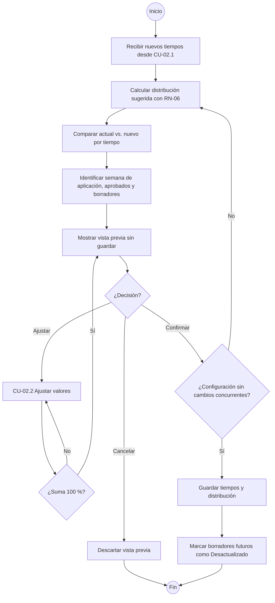

#### Diagrama de secuencia

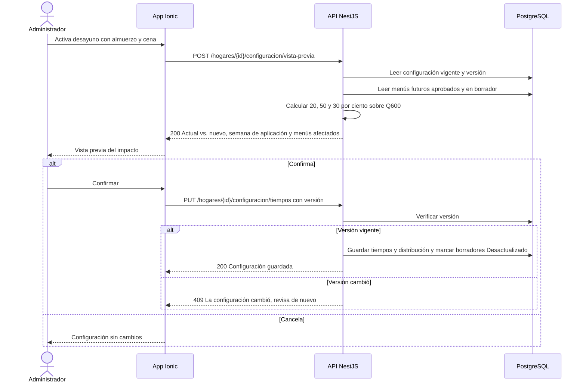

#### Historia de usuario HU-07 · 8 puntos

> **Como** administrador, **quiero** ver cómo cambia la distribución del presupuesto antes de guardar un cambio de tiempos de comida, **para** decidir con información y sin afectar los menús que ya aprobé.

#### Criterios de aceptación

```gherkin
# language: es
Característica: Recálculo de la distribución con vista previa

  # CA-07.1 Flujo principal
  Escenario: Vista previa al pasar de dos a tres tiempos
    Dado que el hogar tiene presupuesto semanal de Q600 con almuerzo 60 % (Q360) y cena 40 % (Q240)
    Cuando activo "Desayuno" y pulso "Continuar"
    Entonces la vista previa muestra:
      | Tiempo   | Actual | Nuevo |
      | Desayuno | —      | Q120  |
      | Almuerzo | Q360   | Q300  |
      | Cena     | Q240   | Q180  |
    Y no se ha guardado ningún cambio

  # CA-07.2 Los menús aprobados no cambian
  Escenario: Confirmar con un menú aprobado en la semana siguiente
    Dado que el menú de la semana del 2026-10-25 está aprobado con almuerzo y cena
    Y su almuerzo del lunes es "Pollo en crema" con presupuesto de almuerzo Q360
    Cuando confirmo la vista previa de tres tiempos
    Entonces el menú de la semana del 2026-10-25 conserva almuerzo y cena, "Pollo en crema" y el presupuesto Q360
    Y el menú de la semana del 2026-11-01 se sugiere con desayuno Q120, almuerzo Q300 y cena Q180

  # CA-07.3 Flujo alterno: cancelar
  Escenario: Cancelar desde la vista previa
    Dado que el hogar tiene solo almuerzo con Q250
    Cuando activo "Cena", veo la vista previa con almuerzo Q150 y cena Q100 y pulso "Cancelar"
    Entonces el hogar sigue con solo almuerzo y Q250

  # CA-07.4 Flujo alterno: menú en borrador
  Escenario: Borrador futuro queda desactualizado
    Dado que el menú de la semana del 2026-11-01 está en Borrador con solo almuerzo
    Cuando confirmo el cambio a almuerzo y cena
    Entonces ese menú se marca "Desactualizado" con la opción "Regenerar"
    Y sus platillos, como "Pepián de pollo" del martes, no se modifican automáticamente

  # CA-07.5 Validación o error
  Escenario: Ajuste en vista previa que no suma 100 %
    Dado que la vista previa propone 20 %, 50 % y 30 %
    Cuando cambio el almuerzo a 45 %
    Entonces veo "Faltan 5 % por asignar"
    Y el botón "Confirmar" está deshabilitado
```

#### Subtareas

| ID | Tipo | Subtarea | Estimación (h) |
|---|---|---|---|
| ST-07.1 | DB | Versión en CONFIGURACION y copia de tiempos/presupuesto en MENU_SEMANAL al aprobar; estado "Desactualizado" | 2 |
| ST-07.2 | BE | Servicio de distribución (RN-06 y S-M02-1) y endpoint POST /configuracion/vista-previa sin persistencia | 6 |
| ST-07.3 | BE | Guardado transaccional con control de versión (409) y marcado de borradores futuros | 4 |
| ST-07.4 | FE | Modal de vista previa: tabla actual vs. nuevo, menús afectados, ajustar, confirmar y cancelar | 6 |
| ST-07.5 | QA | Casos de prueba PF-M2-07.1..5, unitarias del servicio y regresión de menús aprobados | 5 |
| ST-07.6 | DOC | Manual de usuario: "Qué pasa con mi presupuesto al cambiar los tiempos" | 1 |

---

### CU-02.4 — Definir inicio de semana y día de planificación · RF-08 · HU-08

#### Especificación

| Campo | Detalle |
|---|---|
| Actor(es) | Administrador |
| Prioridad / Sprint | S · S1 |
| Precondiciones | Sesión iniciada con rol Administrador; hogar creado. |
| Disparador | El administrador abre Configuración → "Semana". |
| Flujo principal | 1. El sistema muestra día de inicio de semana y día de planificación (por defecto domingo y domingo).<br>2. El administrador elige el día de inicio (lunes a domingo).<br>3. Elige el día de planificación.<br>4. El sistema muestra cómo queda la próxima semana (fechas desde/hasta).<br>5. Guarda. |
| Flujos alternos | 2a. Hay un menú aprobado cuya semana termina después de hoy → la nueva semana inicia después de su fin; los días entre ese fin y el nuevo día de inicio forman una semana de transición corta. |
| Excepciones | E1. Usuario Miembro → 403. |
| Postcondiciones | Semanas futuras se calculan con el nuevo día de inicio (RN-09); el recordatorio de planificación (RF-41) usa el nuevo día. |
| Reglas y RNF | RN-09, RN-10, R-02 (America/Guatemala) |

Supuesto: este ajuste es exclusivo del administrador, por ser parte de la configuración del hogar.
Supuesto: el cambio de día de inicio genera, si es necesario, una semana de transición de 1 a 6 días para no alterar menús aprobados; se planifica igual que una semana normal.

#### Diagrama de actividad

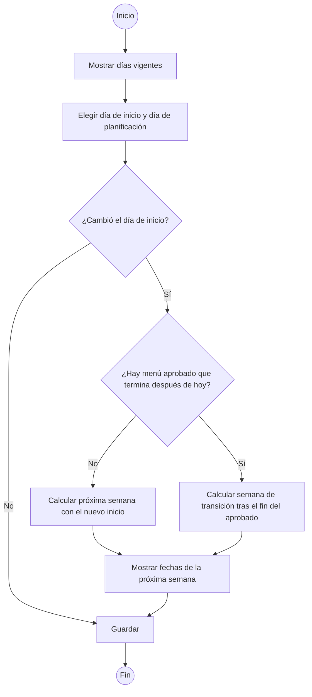

#### Diagrama de secuencia

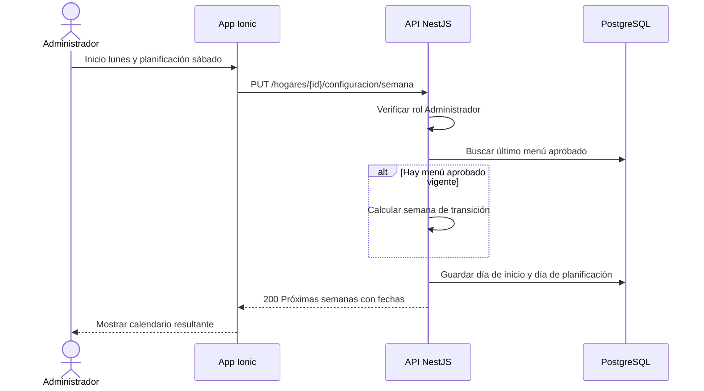

#### Historia de usuario HU-08 · 2 puntos

> **Como** administrador, **quiero** definir qué día empieza la semana del menú y qué día planificamos, **para** adaptar la app a nuestra rutina de compras.

#### Criterios de aceptación

```gherkin
# language: es
Característica: Inicio de semana y día de planificación

  # CA-08.1 Flujo principal: valores por defecto
  Escenario: Hogar nuevo usa domingo
    Dado que creo el hogar "Familia Rosales" el 2026-10-22
    Cuando abro Configuración → "Semana"
    Entonces el día de inicio es "Domingo" y el día de planificación es "Domingo"
    Y la próxima semana va del domingo 2026-10-25 al sábado 2026-10-31

  # CA-08.2 Flujo alterno: semana de transición
  Escenario: Cambiar inicio a lunes con un menú aprobado
    Dado que el menú del 2026-10-18 al 2026-10-24 está aprobado y hoy es 2026-10-22
    Cuando cambio el día de inicio a "Lunes" y guardo
    Entonces se crea una semana de transición de un día: domingo 2026-10-25
    Y la siguiente semana va del lunes 2026-10-26 al domingo 2026-11-01

  # CA-08.3 Día de planificación
  Escenario: Cambiar el día de planificación a sábado
    Dado que el día de planificación es "Domingo"
    Cuando lo cambio a "Sábado" y guardo
    Entonces el recordatorio de planificación se programa para el sábado 2026-10-24

  # CA-08.4 Permisos
  Escenario: Un miembro no puede cambiar la semana
    Dado que inicié sesión como Miembro
    Cuando intento cambiar el día de inicio a "Lunes"
    Entonces veo "Solo el administrador puede cambiar esta configuración"
```

#### Subtareas

| ID | Tipo | Subtarea | Estimación (h) |
|---|---|---|---|
| ST-08.1 | DB | Campos dia_inicio_semana y dia_planificacion en CONFIGURACION (por defecto domingo) | 1 |
| ST-08.2 | BE | PUT /configuracion/semana y utilidad de cálculo de semanas con transición (zona America/Guatemala) | 2 |
| ST-08.3 | FE | Pantalla Semana: selectores de día y vista de fechas resultantes | 2 |
| ST-08.4 | QA | Casos de prueba PF-M2-08.1..4 y unitarias del cálculo de semanas | 2 |
| ST-08.5 | DOC | Manual de usuario: "Configurar la semana" | 1 |

---

### CU-02.5 — Elegir supermercados y marcas preferidas · RF-09 · HU-09

#### Especificación

| Campo | Detalle |
|---|---|
| Actor(es) | Administrador, Miembro |
| Prioridad / Sprint | S · S5 |
| Precondiciones | Sesión iniciada; supermercados registrados (La Torre, Paiz, Walmart, Super Fresh); productos del catálogo vinculados a productos de supermercado (RF-35) para elegir marca. |
| Disparador | El usuario abre Configuración → "Supermercados y marcas". |
| Flujo principal | 1. El sistema lista los supermercados con su estado de preferencia.<br>2. El usuario marca los supermercados preferidos.<br>3. Busca un producto del catálogo (p. ej. "Aceite").<br>4. El sistema muestra las marcas y presentaciones vinculadas con su último precio.<br>5. El usuario elige la marca preferida.<br>6. Guarda. |
| Flujos alternos | 5a. Quita la marca preferida → el producto vuelve a "Cualquier marca".<br>4a. El producto no tiene equivalentes vinculados → muestra "Sin marcas vinculadas" y enlace a la vinculación (M8). |
| Excepciones | E1. Desmarca todos los supermercados → "Debes tener al menos un supermercado preferido" y no guarda. |
| Postcondiciones | La sugerencia de compra (precio mínimo, RF-31, RF-36) considera solo supermercados preferidos y la marca preferida de cada producto. |
| Reglas y RNF | RN-08, RNF-06 |

Supuesto: el precio mínimo sugerido se busca solo entre supermercados preferidos; el precio mediana para el presupuesto (RN-01) sigue usando todos los supermercados con precio vigente, para no sesgar el costo estimado.
Supuesto: administrador y miembro pueden editar estas preferencias (RN-10 solo restringe presupuesto, tiempos y pesos del motor).
Supuesto: si la marca preferida no tiene precio vigente, se muestra su último precio con advertencia (RN-08) en lugar de cambiar de marca.

#### Diagrama de actividad

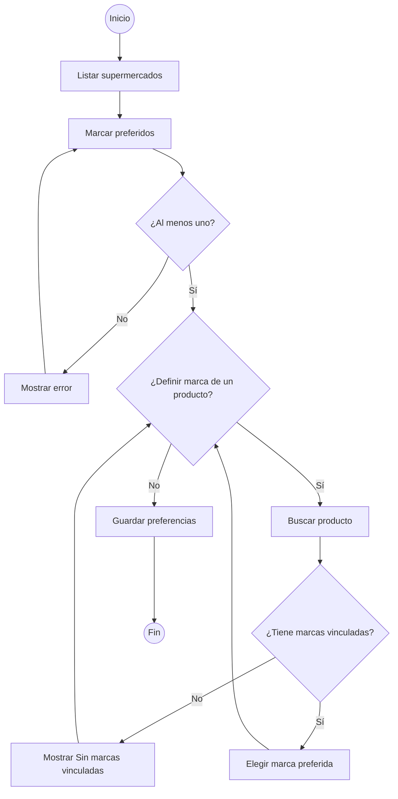

#### Diagrama de secuencia

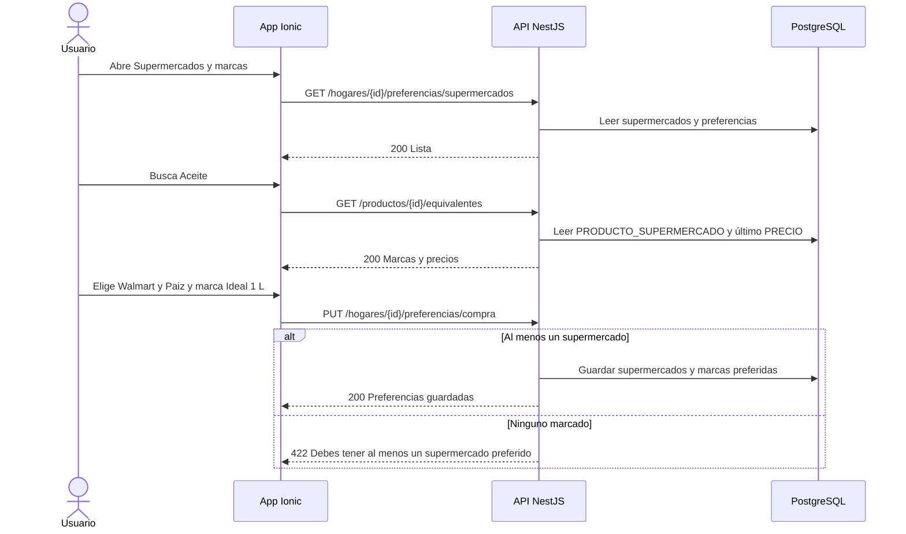

#### Historia de usuario HU-09 · 5 puntos

> **Como** miembro del hogar, **quiero** indicar en qué supermercados compro y qué marca prefiero de cada producto, **para** que la lista sugiera dónde comprar lo que realmente usamos.

#### Criterios de aceptación

```gherkin
# language: es
Característica: Supermercados y marcas preferidas

  # CA-09.1 Flujo principal
  Escenario: La sugerencia de compra respeta los supermercados preferidos
    Dado que mis supermercados preferidos son Walmart y Paiz
    Y el arroz 2 lb cuesta Q12.50 en Walmart, Q13.00 en Paiz y Q11.75 en La Torre
    Cuando veo la lista de compras
    Entonces el arroz aparece agrupado en Walmart con Q12.50
    Y el costo estimado usa Q12.50 como mediana de los tres supermercados

  # CA-09.2 Flujo alterno: marca preferida
  Escenario: Elegir marca preferida de aceite
    Dado que el producto "Aceite 1 L" tiene vinculadas las marcas "Ideal" y "Capullo"
    Cuando elijo "Ideal" como marca preferida y guardo
    Entonces la lista de compras sugiere "Aceite Ideal 1 L" en el supermercado preferido más barato

  # CA-09.3 Validación o error
  Escenario: Desmarcar todos los supermercados
    Dado que solo Walmart está marcado como preferido
    Cuando desmarco Walmart e intento guardar
    Entonces veo "Debes tener al menos un supermercado preferido"
    Y las preferencias no cambian

  # CA-09.4 Marca sin precio vigente
  Escenario: Marca preferida con precio antiguo
    Dado que la marca preferida "Ideal" tiene su último precio de Q24.90 del 2026-10-01
    Cuando veo la lista de compras el 2026-10-22
    Entonces se muestra Q24.90 con la advertencia "Precio del 01/10/2026"
```

#### Subtareas

| ID | Tipo | Subtarea | Estimación (h) |
|---|---|---|---|
| ST-09.1 | DB | Tablas HOGAR_SUPERMERCADO (preferido) y MARCA_PREFERIDA (producto → producto_supermercado) | 3 |
| ST-09.2 | BE | Endpoints de preferencias y equivalentes; filtro de preferidos en el cálculo de precio mínimo | 5 |
| ST-09.3 | FE | Pantalla Supermercados y marcas: casillas, buscador de producto y selector de marca | 6 |
| ST-09.4 | QA | Casos de prueba PF-M2-09.1..4 y regresión de la lista agrupada | 3 |
| ST-09.5 | DOC | Manual de usuario: "Supermercados y marcas preferidas" | 1 |

---

### CU-02.6 — Registrar restricciones y gustos · RF-10 · HU-10

#### Especificación

| Campo | Detalle |
|---|---|
| Actor(es) | Administrador, Miembro |
| Prioridad / Sprint | S · S3 |
| Precondiciones | Sesión iniciada; catálogo de productos y platillos cargado (RF-11, RF-13). |
| Disparador | El usuario abre Configuración → "Restricciones y gustos". |
| Flujo principal | 1. El sistema muestra ingredientes excluidos y platillos favoritos.<br>2. El usuario busca y agrega un ingrediente a excluir.<br>3. El sistema muestra cuántos platillos lo contienen y que dejarán de sugerirse.<br>4. El usuario busca y marca platillos favoritos.<br>5. Guarda. |
| Flujos alternos | 4a. Marca como favorito un platillo con un ingrediente excluido → aviso "Contiene un ingrediente excluido"; puede guardarlo, pero no se sugerirá mientras la exclusión exista.<br>2a. Quita una exclusión → los platillos vuelven a ser elegibles. |
| Excepciones | E1. Ingrediente o platillo inexistente o inactivo → no se puede agregar. |
| Postcondiciones | El motor (CU-05) no sugiere platillos con ingredientes excluidos y favorece los favoritos en el factor Preferencia (RF-20). |
| Reglas y RNF | RNF-06; se consume en RF-19 a RF-21 |

Supuesto: las restricciones y gustos son del hogar, no por comensal.
Supuesto: la exclusión prevalece sobre el favorito; el usuario aún puede asignar a mano un platillo excluido al editar el menú (RF-24).
Supuesto: administrador y miembro pueden editarlas (RN-10 no las restringe).

#### Diagrama de actividad

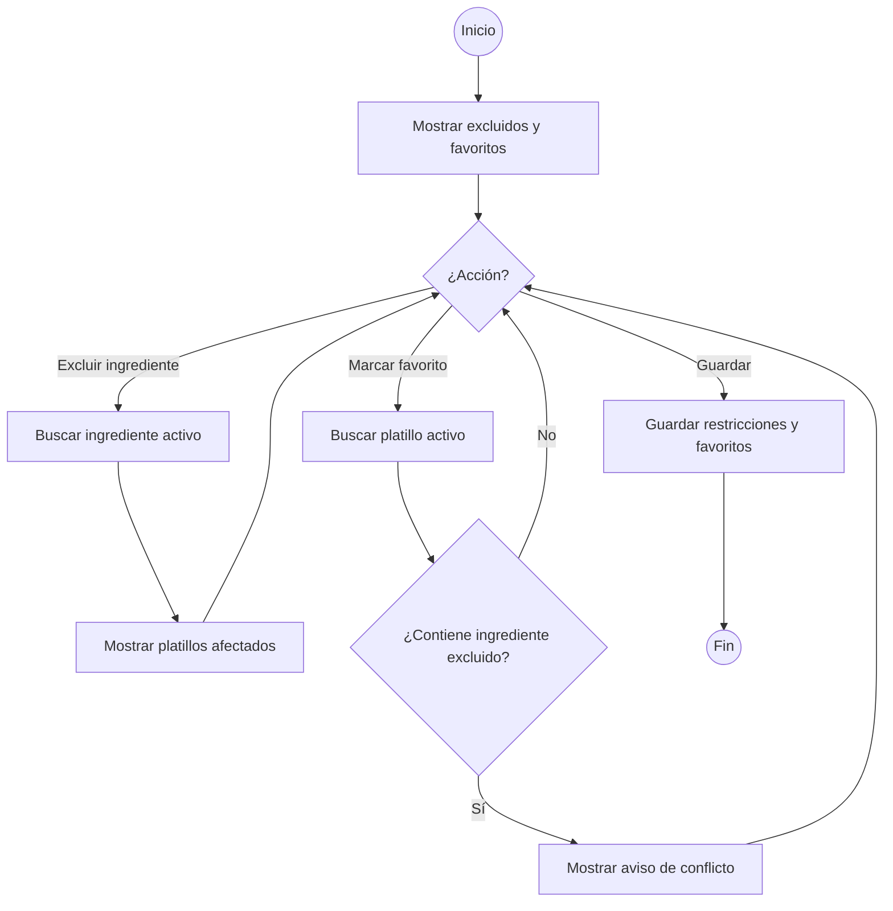

#### Diagrama de secuencia

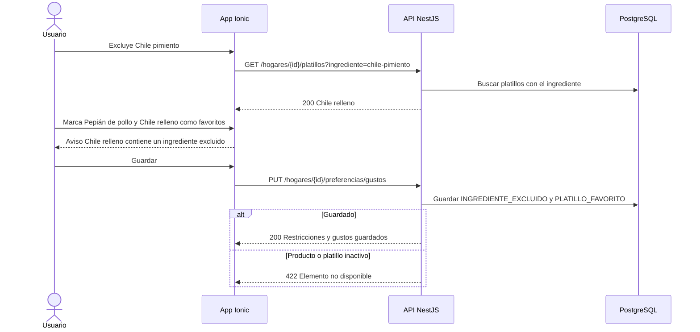

#### Historia de usuario HU-10 · 5 puntos

> **Como** miembro del hogar, **quiero** registrar ingredientes que no comemos y nuestros platillos favoritos, **para** que el menú sugerido evite lo que no nos gusta y repita lo que sí.

#### Criterios de aceptación

```gherkin
# language: es
Característica: Restricciones y gustos del hogar

  # CA-10.1 Flujo principal
  Escenario: Excluir un ingrediente
    Dado que "Chile relleno" lleva el ingrediente "Chile pimiento"
    Cuando excluyo "Chile pimiento" y guardo
    Entonces veo "1 platillo dejará de sugerirse: Chile relleno"
    Y el próximo menú sugerido no incluye "Chile relleno"

  # CA-10.2 Flujo alterno: favoritos
  Escenario: Marcar platillos favoritos
    Cuando marco "Pepián de pollo" y "Caldo de res" como favoritos y guardo
    Entonces ambos aparecen en la lista de favoritos
    Y el motor les suma el factor de preferencia por favorito

  # CA-10.3 Validación o conflicto
  Escenario: Favorito con ingrediente excluido
    Dado que "Chile pimiento" está excluido
    Cuando marco "Chile relleno" como favorito
    Entonces veo "Chile relleno contiene un ingrediente excluido: Chile pimiento"
    Y "Chile relleno" no se sugiere mientras la exclusión exista

  # CA-10.4 Quitar exclusión
  Escenario: Quitar una exclusión
    Dado que "Chile pimiento" está excluido
    Cuando quito la exclusión y guardo
    Entonces "Chile relleno" vuelve a ser elegible para el menú sugerido
```

#### Subtareas

| ID | Tipo | Subtarea | Estimación (h) |
|---|---|---|---|
| ST-10.1 | DB | Tablas INGREDIENTE_EXCLUIDO y PLATILLO_FAVORITO por hogar | 2 |
| ST-10.2 | BE | Endpoints de gustos, búsqueda de platillos por ingrediente y filtro expuesto al motor | 4 |
| ST-10.3 | FE | Pantalla Restricciones y gustos: buscadores, chips, platillos afectados y aviso de conflicto | 5 |
| ST-10.4 | QA | Casos de prueba PF-M2-10.1..4 y prueba de integración con el motor | 3 |
| ST-10.5 | DOC | Manual de usuario: "Restricciones y platillos favoritos" | 1 |

---

## 3. Resumen del módulo

| HU | RF | CU | Prioridad | Sprint | Puntos | Horas |
|---|---|---|---|---|---|---|
| HU-05 Tiempos de comida parametrizables | RF-05 | CU-02.1 | M | S1 | 5 | 15 |
| HU-06 Presupuesto y distribución | RF-06 | CU-02.2 | M | S1 | 5 | 16 |
| HU-07 Recálculo con vista previa | RF-07 | CU-02.3 | M | S1 | 8 | 24 |
| HU-08 Inicio de semana y planificación | RF-08 | CU-02.4 | S | S1 | 2 | 8 |
| HU-09 Supermercados y marcas preferidas | RF-09 | CU-02.5 | S | S5 | 5 | 18 |
| HU-10 Restricciones y gustos | RF-10 | CU-02.6 | S | S3 | 5 | 15 |
| **Total** | | | | | **30** | **96** |

Por sprint: S1 = 20 puntos / 63 h · S3 = 5 puntos / 15 h · S5 = 5 puntos / 18 h.
