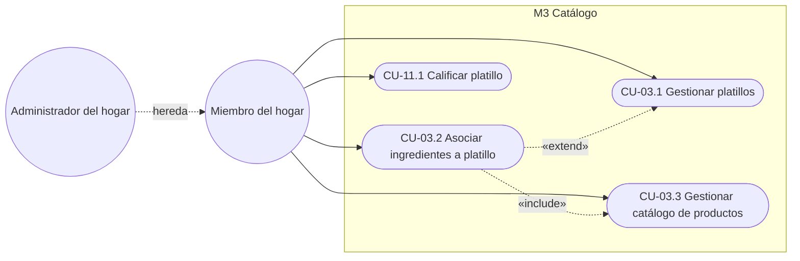
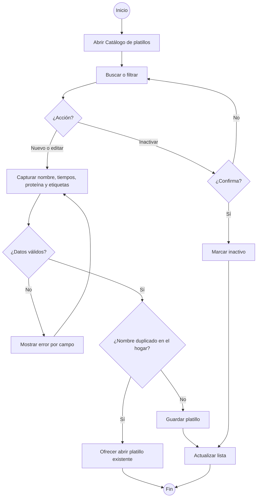
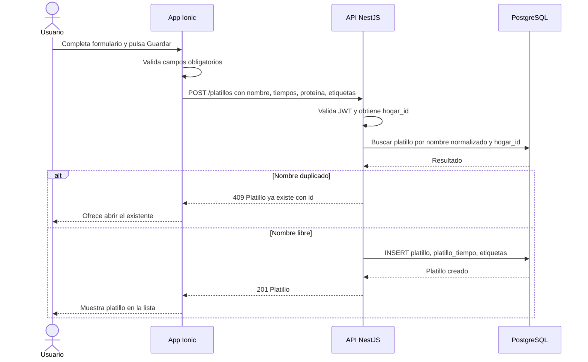
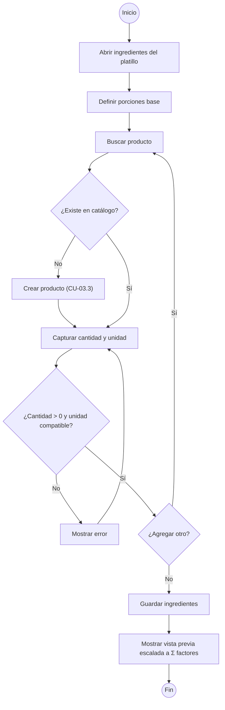
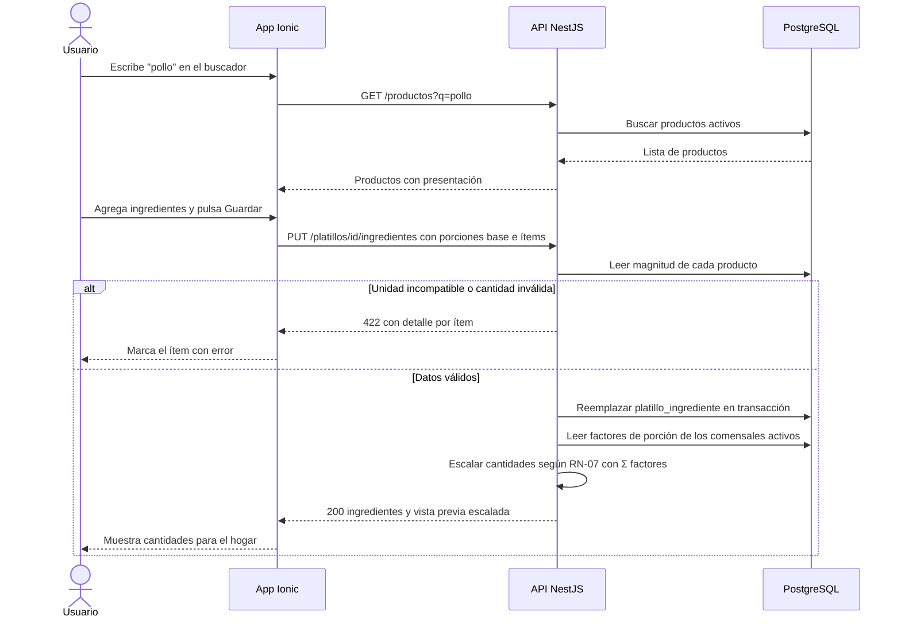
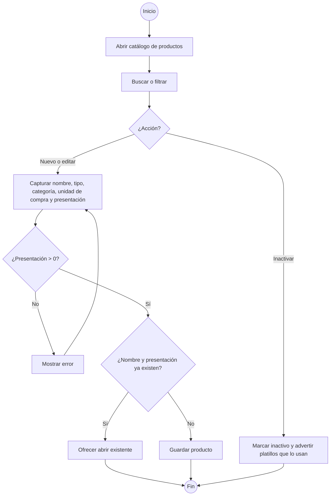
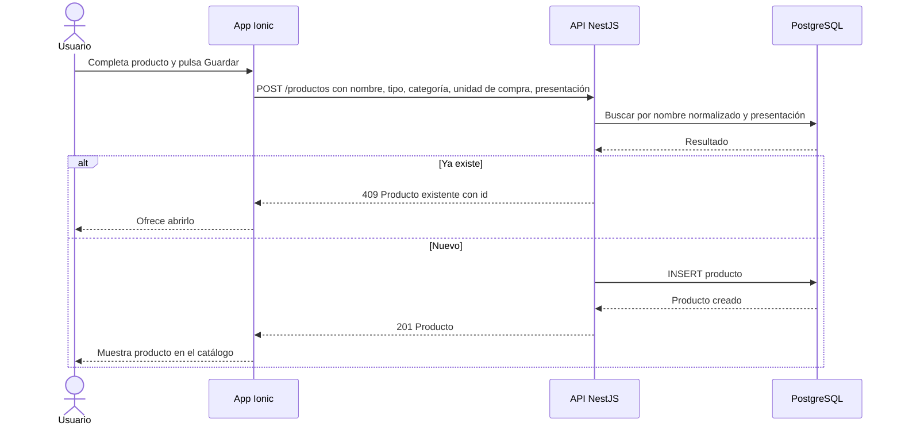
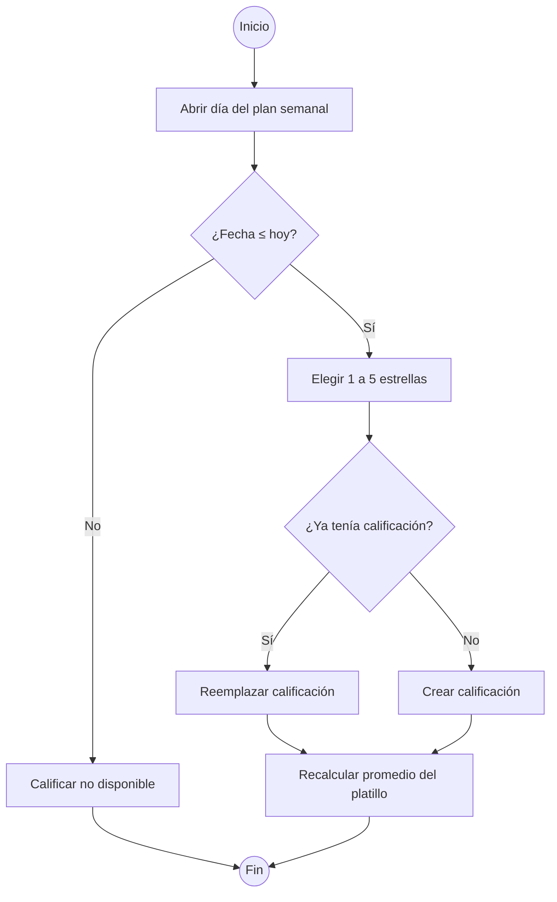
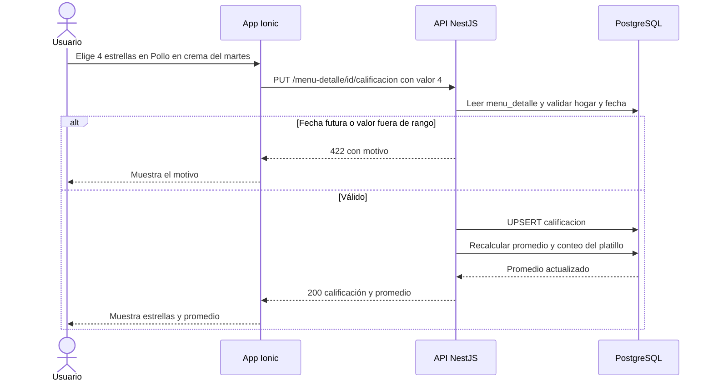

# M03 — Catálogo de platillos e ingredientes

| Campo | Valor |
|---|---|
| SRS | SRS-MF-001 v1.3 (aprobado 2026-10-22) |
| Requerimientos | RF-11 a RF-14 |
| Caso de uso macro | CU-03 (RF-11 a RF-13) · CU-11 (RF-14) |
| Sprint(s) | S1 (RF-11 a RF-13) · S3 (RF-14) |
| Fase del ciclo de vida | 2. Requerimientos — análisis de casos de uso |

Mantiene los platillos del hogar, sus ingredientes por porciones base y el catálogo de productos (ingredientes y despensa) con unidad de compra y presentación. Es la base del motor de sugerencias (M5), de la lista de compras (M7) y de los precios (M8). Incluye la calificación de platillos, que alimenta el factor Preferencia (RF-20).

## 1. Diagrama de casos de uso del módulo



## 2. Casos de uso e historias

### CU-03.1 — Gestionar platillos · RF-11 · HU-11

#### Especificación

| Campo | Detalle |
|---|---|
| Actor(es) | Miembro del hogar (el administrador hereda) |
| Prioridad / Sprint | M · S1 |
| Precondiciones | Sesión iniciada; usuario pertenece a un hogar |
| Disparador | El usuario abre Catálogo > Platillos |
| Flujo principal | 1. El sistema lista los platillos activos del hogar ordenados por nombre.<br>2. El usuario busca por texto o filtra por tiempo de comida, proteína principal o etiqueta.<br>3. Elige "Nuevo platillo" o un platillo existente.<br>4. Ingresa o edita nombre, tiempo(s) de comida aplicables, proteína principal y etiquetas.<br>5. Guarda.<br>6. El sistema valida, guarda y muestra el platillo en la lista. |
| Flujos alternos | 3a. Inactivar: el usuario elige "Inactivar" y confirma; el platillo deja de mostrarse en la lista activa y de proponerse en el motor, pero se conserva en el historial.<br>3b. Reactivar: con el filtro "Inactivos", el usuario elige "Reactivar".<br>2a. Sin resultados: el sistema muestra "Sin coincidencias" y ofrece crear el platillo con el texto buscado. |
| Excepciones | E1. Nombre vacío o mayor a 80 caracteres → no guarda e indica el campo.<br>E2. Ningún tiempo de comida seleccionado → no guarda.<br>E3. Nombre duplicado en el hogar → no guarda y ofrece abrir el existente. |
| Postcondiciones | Platillo creado, actualizado, inactivado o reactivado en el hogar. |
| Reglas y RNF | RN-02, RN-03 (usan proteína principal y nombre), RNF-02, RNF-06, RNF-07 |

Supuesto: el nombre es único por hogar comparando sin mayúsculas ni tildes ("Pepián de pollo" = "pepian de pollo").
Supuesto: proteína principal se elige de una lista fija: pollo, res, cerdo, pescado, huevo, embutido, vegetariana, otra. Etiquetas son texto libre (máx. 10 por platillo).
Supuesto: no hay eliminación física; solo inactivación, para no romper el historial (M4) ni las calificaciones.

#### Diagrama de actividad



#### Diagrama de secuencia



#### Historia de usuario HU-11 · 5 puntos

> **Como** miembro del hogar, **quiero** crear, editar, buscar e inactivar platillos con sus tiempos de comida, proteína y etiquetas, **para** tener un catálogo propio del que el sistema sugiera el menú.

#### Criterios de aceptación

```gherkin
# language: es
Característica: Gestionar platillos del hogar

  # CA-11.1 Flujo principal
  Escenario: Crear un platillo nuevo
    Dado que el hogar no tiene el platillo "Pepián de pollo"
    Cuando creo el platillo "Pepián de pollo" para "Almuerzo" con proteína "pollo" y etiquetas "típico, fin de semana"
    Entonces el platillo aparece en la lista de platillos activos
    Y al filtrar por proteína "pollo" el resultado incluye "Pepián de pollo"

  # CA-11.2 Flujo alterno
  Escenario: Inactivar un platillo
    Dado que el platillo "Pescado frito" está activo
    Cuando lo inactivo y confirmo
    Entonces "Pescado frito" no aparece en la lista de activos
    Y aparece con el filtro "Inactivos"
    Y no se considera para nuevas sugerencias de menú

  # CA-11.3 Validación o error
  Escenario: Nombre duplicado sin distinguir tildes ni mayúsculas
    Dado que existe el platillo "Carne guisada"
    Cuando intento crear el platillo "carne GUISADA"
    Entonces el sistema no lo guarda
    Y muestra "Ya existe el platillo Carne guisada" con la opción de abrirlo

  # CA-11.4 Validación o error
  Escenario: Platillo sin tiempo de comida
    Cuando intento guardar "Chile relleno" sin seleccionar ningún tiempo de comida
    Entonces el sistema no lo guarda e indica "Selecciona al menos un tiempo de comida"
```

#### Subtareas

| ID | Tipo | Subtarea | Estimación (h) |
|---|---|---|---|
| ST-11.1 | DB | Tablas `platillo`, `platillo_tiempo`, `etiqueta` con `hogar_id`, índice único por nombre normalizado | 3 |
| ST-11.2 | BE | CRUD `/platillos` con validaciones, aislamiento por hogar e inactivar/reactivar | 5 |
| ST-11.3 | BE | Búsqueda por texto y filtros (tiempo, proteína, etiqueta, estado) paginada | 3 |
| ST-11.4 | FE | Lista de platillos con buscador y filtros | 4 |
| ST-11.5 | FE | Formulario crear/editar e inactivar con confirmación | 5 |
| ST-11.6 | QA | Casos de prueba PF-M3-11.1..4 y prueba automatizada (API + e2e) | 4 |
| ST-11.7 | DOC | Manual de usuario: "Administrar platillos" | 1 |

> **Implementado en `feature/HU-11-13-catalogo-platillos`** (S1, pendiente de PR a `develop`). Todas las subtareas hechas:
>
> | ST | Estado | Dónde |
> |---|---|---|
> | ST-11.1 | Hecha (sin migración nueva: `platillo`, `platillo_tiempo`, `etiqueta` y `platillo_etiqueta` ya estaban en `0001_init` con el índice único `hogar_id` + `nombre_normalizado`) | `packages/db/src/schema/catalogo-menus.ts` |
> | ST-11.2 | Hecha: `GET/POST /platillos`, `GET/PATCH /platillos/{id}`, `POST /platillos/{id}/inactivar` y `/reactivar` con `HogarGuard` (otro hogar → 404) | `apps/api/src/catalogo/platillos.*` |
> | ST-11.3 | Hecha: `?q` (pg_trgm, sin tildes), `tiempo`, `proteina`, `etiqueta`, `ingrediente`, `estado=ACTIVO\|INACTIVO\|INCOMPLETO`, paginado | `platillos.repositorio.ts` |
> | ST-11.4 | Hecha | `apps/web/src/pages/Platillos.tsx` |
> | ST-11.5 | Hecha | `apps/web/src/pages/PlatilloDetalle.tsx` |
> | ST-11.6 | Hecha: CA-11.1..4 automatizados (integración API + Testing Library) | `apps/api/test/catalogo.e2e-spec.ts`, `apps/web/src/pages/Platillos.test.tsx`, `PlatilloDetalle.test.tsx` |
> | ST-11.7 | Hecha (faltan capturas) | `docs/05-manual-usuario/04-platillos-y-productos.md` |
>
> Decisiones: miembro y administrador gestionan platillos por igual (actor de CU-03.1). El nombre se normaliza con `normalizarNombreCatalogo` de `@menu/shared` (minúsculas, sin tildes, espacios simples); duplicado → 409 `PLATILLO_DUPLICADO` con `existenteId`. Las etiquetas se reutilizan por hogar y se quitan repetidas. "Incompleto" = sin ingredientes (lo mantiene el servicio al guardar ingredientes). El motor (M05) debe filtrar `activo = true` para cumplir el último paso de CA-11.2.

---

### CU-03.2 — Asociar ingredientes a platillo · RF-12 · HU-12

#### Especificación

| Campo | Detalle |
|---|---|
| Actor(es) | Miembro del hogar |
| Prioridad / Sprint | M · S1 |
| Precondiciones | Platillo existente (CU-03.1); productos en el catálogo (CU-03.3) |
| Disparador | El usuario abre la pestaña "Ingredientes" de un platillo |
| Flujo principal | 1. El sistema muestra las porciones base y los ingredientes actuales.<br>2. El usuario define las porciones base.<br>3. Busca un producto del catálogo y lo agrega.<br>4. Indica cantidad y unidad.<br>5. Repite 3–4 por cada ingrediente.<br>6. Guarda.<br>7. El sistema valida y muestra la vista previa escalada a la suma de factores de porción de los comensales activos del hogar (Σ factores, RN-07). |
| Flujos alternos | 3a. El producto no existe → el usuario lo crea desde el mismo buscador (CU-03.3) y continúa.<br>4a. Editar o quitar un ingrediente ya asociado. |
| Excepciones | E1. Cantidad ≤ 0 o vacía → no guarda.<br>E2. Unidad de otra magnitud que la presentación del producto (p. ej. ml para un producto en lb) → no guarda.<br>E3. Producto repetido en el mismo platillo → el sistema propone sumar la cantidad. |
| Postcondiciones | Platillo con lista de ingredientes y porciones base guardadas. |
| Reglas y RNF | RN-07, RNF-06, RNF-07 |

Supuesto: porciones base por defecto = 4; entero entre 1 y 20.
Supuesto: unidades agrupadas por magnitud — masa (g, kg, oz, lb), volumen (ml, l, taza, cucharada), conteo (unidad, manojo, diente); solo se permiten unidades de la misma magnitud que la presentación del producto. La conversión a unidad de compra se usa en RF-28 (S4).
Decisión D-02: escalado RN-07 = cantidad base × Σ factores de porción de los comensales activos ÷ porciones base. Cada comensal tiene factor sugerido 1.0, editable de 0.25 a 2.0 en pasos de 0.25 (CU-01.3); la etiqueta adulto / niño no interviene. Ejemplo: comensales 1.0 + 1.0 + 0.5 = 2.5 porciones; "Pechuga de pollo" 2 lb para 4 porciones base → 2 × 2.5 ÷ 4 = 1.25 lb.
Supuesto: un platillo sin ingredientes se puede guardar, pero se marca "Incompleto" (no tiene costo estimado).

#### Diagrama de actividad



#### Diagrama de secuencia



#### Historia de usuario HU-12 · 5 puntos

> **Como** miembro del hogar, **quiero** registrar los ingredientes de cada platillo con cantidad y unidad para sus porciones base, **para** que la lista de compras y el costo se calculen según cuántos comemos.

#### Criterios de aceptación

```gherkin
# language: es
Característica: Ingredientes del platillo por porciones base

  # CA-12.1 Flujo principal
  Escenario: Registrar ingredientes y ver el escalado
    Dado que el hogar tiene 6 comensales con factor 1.0 cada uno, Σ factores 6.0
    Y el platillo "Pollo en crema" tiene 4 porciones base
    Cuando agrego "Pechuga de pollo" 2 lb y "Crema" 250 ml y guardo
    Entonces el platillo queda con 2 ingredientes
    Y la vista previa muestra "Pechuga de pollo" 3 lb y "Crema" 375 ml

  # CA-12.2 Flujo alterno
  Escenario: Crear un producto desde el buscador de ingredientes
    Dado que "Miltomate" no existe en el catálogo de productos
    Cuando lo creo desde el buscador con unidad de compra "lb" y presentación 1 lb
    Y lo agrego a "Pepián de pollo" con 1 lb
    Entonces "Miltomate" aparece como ingrediente de "Pepián de pollo"

  # CA-12.3 Validación o error
  Escenario: Unidad de otra magnitud
    Dado que el producto "Carne de res para guisar" tiene presentación en lb
    Cuando lo agrego a "Carne guisada" con 500 ml
    Entonces el sistema no guarda y muestra "La unidad ml no es compatible con lb"

  # CA-12.4 Validación o error
  Escenario: Cantidad cero
    Cuando agrego "Arroz" con cantidad 0 a "Tortitas de carne"
    Entonces el sistema no guarda y muestra "La cantidad debe ser mayor que 0"

  # CA-12.5 Escalado con factores de porción
  Escenario: Vista previa con Σ factores fraccionaria
    Dado que el hogar tiene "Rene" 1.0, "Ana" 1.0 y "Sofía" 0.5, Σ factores 2.5
    Y el platillo "Pollo en crema" tiene 4 porciones base con "Pechuga de pollo" 2 lb y "Crema" 250 ml
    Cuando abro la vista previa de ingredientes
    Entonces veo "Pechuga de pollo" 1.25 lb y "Crema" 156.25 ml
```

#### Subtareas

| ID | Tipo | Subtarea | Estimación (h) |
|---|---|---|---|
| ST-12.1 | DB | Tabla `platillo_ingrediente` y campo `porciones_base` en `platillo` | 2 |
| ST-12.2 | BE | Endpoint PUT `/platillos/:id/ingredientes` con validación de magnitud y duplicados | 5 |
| ST-12.3 | BE | Servicio de escalado RN-07 con Σ factores de porción, reutilizable (M5, M6, M7), con pruebas unitarias | 3 |
| ST-12.4 | FE | Editor de ingredientes con autocompletado de productos y vista previa escalada | 5 |
| ST-12.5 | QA | Casos de prueba PF-M3-12.1..5 y prueba automatizada | 3 |
| ST-12.6 | DOC | Manual de usuario: "Ingredientes y porciones" | 1 |

> **Implementado en `feature/HU-11-13-catalogo-platillos`** (S1, pendiente de PR a `develop`). Todas las subtareas hechas:
>
> | ST | Estado | Dónde |
> |---|---|---|
> | ST-12.1 | Hecha (sin migración nueva: `platillo_ingrediente` y `porciones_base` ya estaban en `0001_init`/`0002`) | `packages/db/src/schema/catalogo-menus.ts` |
> | ST-12.2 | Hecha: `PUT /platillos/{id}/ingredientes` valida magnitud (o `producto_equivalencia`), cantidad > 0 con hasta 3 decimales, porciones 1–20 y producto repetido; errores 422 por ítem (`ingredientes.N.campo`) | `apps/api/src/catalogo/platillos.service.ts` |
> | ST-12.3 | Hecha: `escalarCantidad(cantidadBase, porcionesBase, sumaFactores)`, `unidadCompatible` y `convertirCantidad` puras en `@menu/shared` con pruebas; `GET /platillos/{id}/vista-previa?sumaFactores=` | `packages/shared/src/catalogo.ts` |
> | ST-12.4 | Hecha | `apps/web/src/pages/EditorIngredientes.tsx` |
> | ST-12.5 | Hecha: CA-12.1..5 automatizados | `packages/shared/src/catalogo.test.ts`, `apps/api/test/catalogo.e2e-spec.ts`, `apps/web/src/pages/EditorIngredientes.test.tsx` |
> | ST-12.6 | Hecha (faltan capturas) | `docs/05-manual-usuario/04-platillos-y-productos.md` |
>
> Decisiones: la Σ factores de la vista previa se lee de la tabla `comensal` (activos) sin depender de HU-03; si el hogar aún no tiene comensales, se muestra a las porciones base (`origen: PORCIONES_BASE`). El parámetro `sumaFactores` permite previsualizar otra suma. E3: la app avisa que el producto ya está y pide ajustar su cantidad; la API rechaza repetidos con 422 `PRODUCTO_REPETIDO`. Un producto inactivo no se puede agregar, pero uno que ya era ingrediente se conserva al volver a guardar.

---

### CU-03.3 — Gestionar catálogo de productos · RF-13 · HU-13

#### Especificación

| Campo | Detalle |
|---|---|
| Actor(es) | Miembro del hogar |
| Prioridad / Sprint | M · S1 |
| Precondiciones | Sesión iniciada |
| Disparador | El usuario abre Catálogo > Productos o crea un producto desde CU-03.2 |
| Flujo principal | 1. El sistema lista los productos activos con categoría, unidad de compra y presentación.<br>2. El usuario busca o filtra por tipo (ingrediente, despensa) y categoría.<br>3. Elige "Nuevo producto" o uno existente.<br>4. Ingresa nombre, tipo, categoría, unidad de compra y presentación (cantidad + unidad).<br>5. Guarda.<br>6. El sistema valida y guarda. |
| Flujos alternos | 3a. Inactivar producto: deja de aparecer en el buscador de ingredientes; los platillos que lo usan se conservan y se señalan con advertencia. |
| Excepciones | E1. Presentación con cantidad ≤ 0 → no guarda.<br>E2. Nombre + presentación ya existente → no guarda y ofrece abrir el existente. |
| Postcondiciones | Producto disponible para ingredientes (RF-12), despensa (RF-29) y vinculación con supermercados (RF-35). |
| Reglas y RNF | RN-07, RNF-02 |

Supuesto: el catálogo de productos es común a todos los hogares (el modelo conceptual no liga PRODUCTO a HOGAR y RF-35 lo vincula con supermercados); se entrega con unidades precargadas y un conjunto inicial de productos que se completa en S2 (M4).
Supuesto: unidad de compra = cómo se compra (bolsa, lb, unidad, frasco, caja); presentación = contenido de esa unidad (p. ej. bolsa de 2 lb). Un producto es de tipo "ingrediente", "despensa" o ambos.
Supuesto: categorías fijas iniciales: carnes, lácteos, verduras, frutas, granos, abarrotes, condimentos, panadería, otros.

#### Diagrama de actividad



#### Diagrama de secuencia



#### Historia de usuario HU-13 · 5 puntos

> **Como** miembro del hogar, **quiero** mantener un catálogo de productos con su unidad de compra y presentación, **para** usarlos como ingredientes y despensa y saber cuánto comprar.

#### Criterios de aceptación

```gherkin
# language: es
Característica: Catálogo de productos

  # CA-13.1 Flujo principal
  Escenario: Crear producto de despensa
    Cuando creo el producto "Arroz" tipo "despensa", categoría "granos", unidad de compra "bolsa" y presentación 2 lb
    Entonces "Arroz" aparece al filtrar por tipo "despensa"
    Y se muestra como "Arroz · bolsa 2 lb"

  # CA-13.2 Flujo alterno
  Escenario: Inactivar un producto usado en un platillo
    Dado que "Crema" es ingrediente de "Pollo en crema"
    Cuando inactivo "Crema"
    Entonces "Crema" no aparece en el buscador de ingredientes
    Y "Pollo en crema" muestra la advertencia "Ingrediente inactivo: Crema"

  # CA-13.3 Validación o error
  Escenario: Producto duplicado
    Dado que existe "Aceite · botella 900 ml"
    Cuando intento crear "aceite" con unidad de compra "botella" y presentación 900 ml
    Entonces el sistema no lo guarda y ofrece abrir "Aceite · botella 900 ml"

  # CA-13.4 Validación o error
  Escenario: Presentación inválida
    Cuando intento crear "Frijol negro" con presentación 0 lb
    Entonces el sistema no guarda y muestra "La presentación debe ser mayor que 0"
```

#### Subtareas

| ID | Tipo | Subtarea | Estimación (h) |
|---|---|---|---|
| ST-13.1 | DB | Tablas `producto`, `unidad` (con magnitud), `categoria`; índice único nombre + presentación | 3 |
| ST-13.2 | DB | Seed de unidades, categorías y productos básicos | 2 |
| ST-13.3 | BE | CRUD `/productos` con búsqueda, filtros e inactivación con advertencia | 5 |
| ST-13.4 | FE | Pantalla de catálogo de productos y formulario (también modal desde CU-03.2) | 5 |
| ST-13.5 | QA | Casos de prueba PF-M3-13.1..4 y prueba automatizada | 3 |
| ST-13.6 | DOC | Manual de usuario: "Catálogo de productos" | 1 |

> **Implementado en `feature/HU-11-13-catalogo-platillos`** (S1, pendiente de PR a `develop`). Todas las subtareas hechas:
>
> | ST | Estado | Dónde |
> |---|---|---|
> | ST-13.1 | Hecha (sin migración nueva: `producto`, `unidad`, `categoria` e índice único nombre + presentación ya estaban en `0001_init`) | `packages/db/src/schema/catalogo-menus.ts` |
> | ST-13.2 | Hecha: 45 productos básicos guatemaltecos idempotentes (solo inserta faltantes) | `packages/db/src/semilla.ts` |
> | ST-13.3 | Hecha: `GET/POST /productos`, `GET/PATCH /productos/{id}`, `POST /productos/{id}/inactivar` y `/reactivar` (con `platillosAfectados`), `GET /unidades`, `GET /categorias` | `apps/api/src/catalogo/productos.*` |
> | ST-13.4 | Hecha (catálogo y formulario reutilizado desde el editor de ingredientes) | `apps/web/src/pages/Productos.tsx`, `FormularioProducto.tsx` |
> | ST-13.5 | Hecha: CA-13.1..4 automatizados | `apps/api/test/catalogo.e2e-spec.ts`, `apps/web/src/pages/Productos.test.tsx` |
> | ST-13.6 | Hecha (faltan capturas) | `docs/05-manual-usuario/04-platillos-y-productos.md` |
>
> Decisión (D-05, pendiente de confirmar por el PO): como el catálogo es común a todos los hogares, **cualquier miembro crea** productos (CA-12.2, CA-13.1), pero **editar, inactivar y reactivar** lo hace solo el administrador del sistema (`usuario.esAdminSistema`, 403 `SOLO_ADMIN_SISTEMA`), para que un hogar no cambie el catálogo de los demás. Filtrar por tipo `DESPENSA` o `INGREDIENTE` incluye los de tipo `AMBOS`. La búsqueda usa pg_trgm (`LIKE` o `word_similarity` ≥ 0.5) sobre el nombre normalizado. Las equivalencias por producto (`PUT /productos/{id}/equivalencias`) quedan para RF-28 (S4).

---

### CU-11.1 — Calificar platillo · RF-14 · HU-14

#### Especificación

| Campo | Detalle |
|---|---|
| Actor(es) | Miembro del hogar |
| Prioridad / Sprint | S · S3 |
| Precondiciones | Existe un menú aprobado (CU-06) con el platillo asignado en una fecha igual o anterior a hoy |
| Disparador | El usuario abre el día en el plan semanal y pulsa "Calificar" |
| Flujo principal | 1. El sistema muestra el platillo del día y tiempo de comida.<br>2. El usuario elige de 1 a 5 estrellas.<br>3. El sistema guarda la calificación de ese día y tiempo.<br>4. Recalcula el promedio del platillo y lo muestra en el catálogo. |
| Flujos alternos | 2a. Ya calificado → el usuario cambia la calificación; se reemplaza la anterior y se recalcula el promedio. |
| Excepciones | E1. Fecha futura → el botón "Calificar" no está disponible y la API rechaza.<br>E2. Valor fuera de 1–5 → la API rechaza. |
| Postcondiciones | Calificación guardada; promedio del platillo disponible para el factor Preferencia (RF-20). |
| Reglas y RNF | RNF-06, RNF-07 |

Supuesto: una calificación por día y tiempo de comida (relación MENU_DETALLE 1–0..1 CALIFICACION del modelo conceptual); la última registrada por cualquier miembro reemplaza a la anterior.
Supuesto: se califican también los registros históricos cargados en M4 (fecha pasada).

#### Diagrama de actividad



#### Diagrama de secuencia



#### Historia de usuario HU-14 · 3 puntos

> **Como** miembro del hogar, **quiero** calificar de 1 a 5 un platillo después de comerlo, **para** que el sistema sugiera más seguido lo que nos gusta.

#### Criterios de aceptación

```gherkin
# language: es
Característica: Calificar platillo

  # CA-14.1 Flujo principal
  Escenario: Calificar un almuerzo ya comido
    Dado que hoy es jueves 2026-11-12
    Y el martes 2026-11-10 el almuerzo fue "Pollo en crema" sin calificación
    Cuando califico ese almuerzo con 4 estrellas
    Entonces la calificación queda en 4
    Y el catálogo muestra el promedio de "Pollo en crema" actualizado

  # CA-14.2 Flujo alterno
  Escenario: Cambiar una calificación
    Dado que "Caldo de res" tiene calificaciones 3 y 5 con promedio 4.0
    Cuando cambio la calificación de 3 a 5
    Entonces el promedio de "Caldo de res" es 5.0

  # CA-14.3 Validación o error
  Escenario: Intentar calificar un día futuro
    Dado que hoy es jueves 2026-11-12
    Y el sábado 2026-11-14 el almuerzo es "Spaghetti con carne"
    Cuando abro el sábado en el plan semanal
    Entonces la opción "Calificar" no está disponible

  # CA-14.4 Validación o error
  Escenario: Valor fuera de rango por API
    Cuando envío una calificación con valor 6
    Entonces la API responde 422 "La calificación debe estar entre 1 y 5"
```

#### Subtareas

| ID | Tipo | Subtarea | Estimación (h) |
|---|---|---|---|
| ST-14.1 | DB | Tabla `calificacion` (1 por `menu_detalle`) y campos de promedio y conteo en `platillo` | 1 |
| ST-14.2 | BE | Endpoint PUT `/menu-detalle/:id/calificacion` con validaciones y recálculo de promedio | 3 |
| ST-14.3 | FE | Control de estrellas en el plan semanal y promedio en el catálogo | 4 |
| ST-14.4 | QA | Casos de prueba PF-M3-14.1..4 y prueba automatizada | 2 |
| ST-14.5 | DOC | Manual de usuario: "Calificar platillos" | 1 |

---

## 3. Resumen del módulo

| HU | RF | CU | Prioridad | Sprint | Puntos | Horas |
|---|---|---|---|---|---|---|
| HU-11 Gestionar platillos | RF-11 | CU-03.1 | M | S1 | 5 | 25 |
| HU-12 Ingredientes por porciones base | RF-12 | CU-03.2 | M | S1 | 5 | 19 |
| HU-13 Catálogo de productos | RF-13 | CU-03.3 | M | S1 | 5 | 19 |
| HU-14 Calificar platillo | RF-14 | CU-11.1 | S | S3 | 3 | 11 |
| **Total** | | | | | **18** | **74** |

Por sprint: S1 = 15 puntos / 63 h · S3 = 3 puntos / 11 h.
