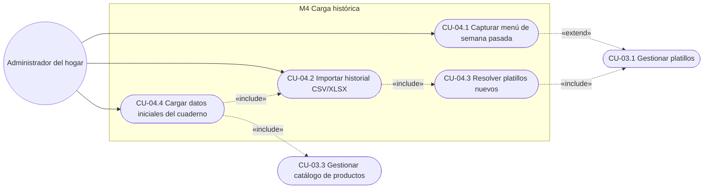
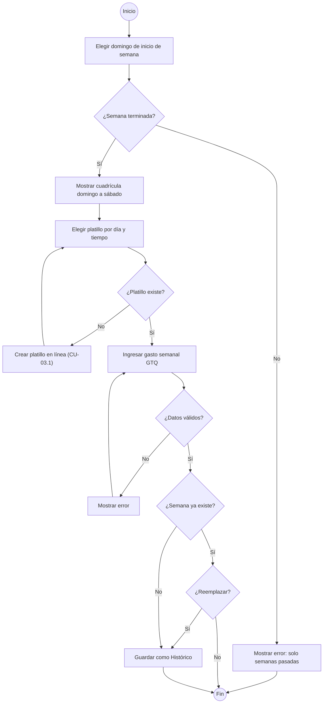
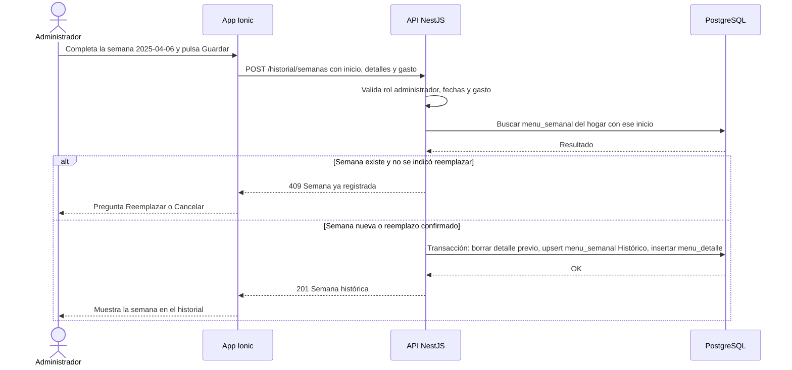
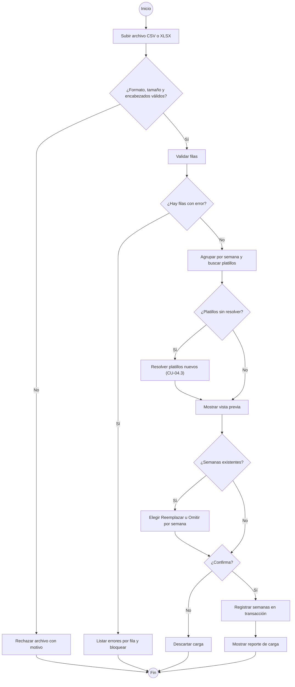
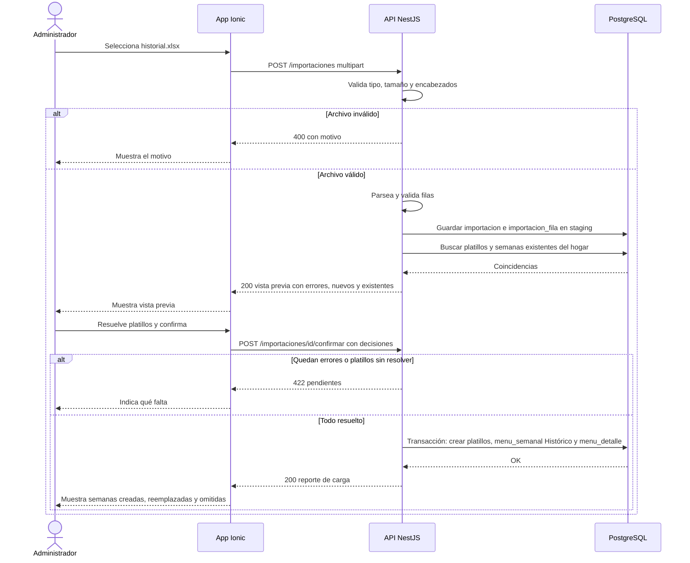
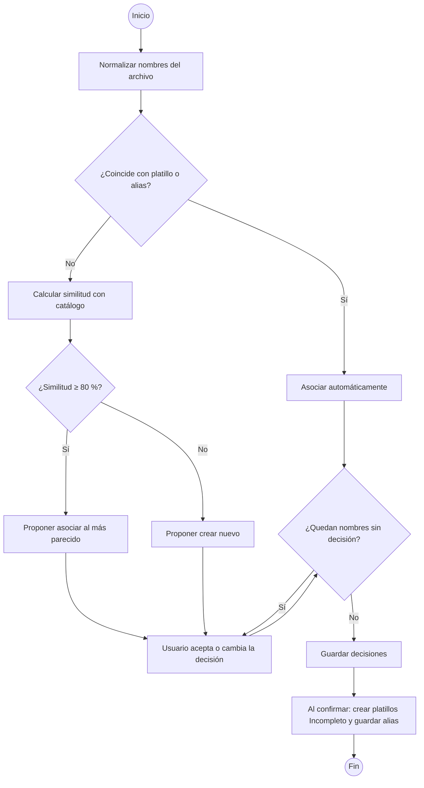
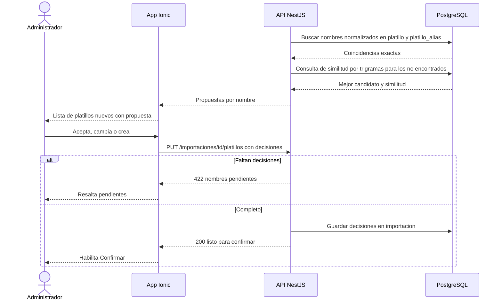
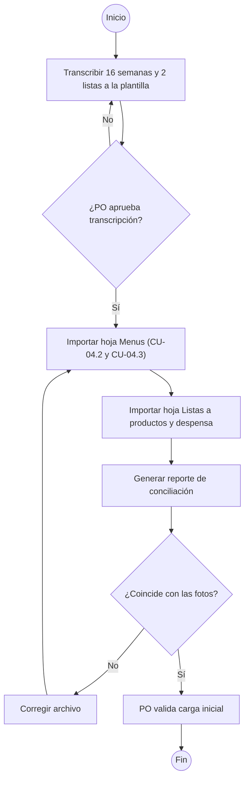
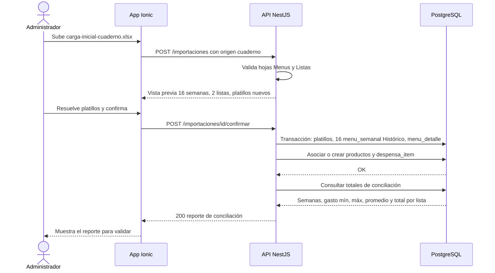

# M04 — Carga histórica

| Campo | Valor |
|---|---|
| SRS | SRS-MF-001 v1.3 (aprobado 2026-10-22) |
| Requerimientos | RF-15 a RF-18 |
| Caso de uso macro | CU-04 |
| Sprint(s) | S2 |
| Fase del ciclo de vida | 2. Requerimientos — análisis de casos de uso |

Permite registrar menús de semanas pasadas, a mano o por archivo CSV/XLSX, resolviendo platillos nuevos contra el catálogo. Con él se cargan como datos iniciales las 16 semanas del cuaderno familiar (abr 2025 – 2026) y las 2 listas sueltas, que dan al motor (M5) el historial para Novedad y Preferencia.

## 1. Diagrama de casos de uso del módulo



## 2. Casos de uso e historias

### CU-04.1 — Capturar menú de semana pasada · RF-15 · HU-15

#### Especificación

| Campo | Detalle |
|---|---|
| Actor(es) | Administrador del hogar |
| Prioridad / Sprint | M · S2 |
| Precondiciones | Sesión iniciada como administrador; hogar creado |
| Disparador | El usuario abre Historial > "Capturar semana" |
| Flujo principal | 1. El usuario elige la fecha de inicio de la semana (domingo, RN-09).<br>2. El sistema muestra la cuadrícula domingo–sábado por tiempo de comida.<br>3. Por cada día y tiempo, el usuario busca y elige un platillo del catálogo.<br>4. Ingresa el gasto de la semana en GTQ.<br>5. Guarda.<br>6. El sistema valida y registra la semana como menú "Histórico" con su gasto real. |
| Flujos alternos | 3a. El platillo no existe → el usuario lo crea en línea con nombre y tiempo (CU-03.1) y continúa.<br>3b. Días sin dato → se dejan vacíos.<br>5a. La semana ya existe en el historial → el sistema pregunta "Reemplazar" o "Cancelar". |
| Excepciones | E1. La semana no ha terminado (sábado ≥ hoy) → no guarda.<br>E2. Gasto negativo o no numérico → no guarda.<br>E3. Semana sin ningún platillo → no guarda. |
| Postcondiciones | MENU_SEMANAL en estado "Histórico" con sus MENU_DETALLE y gasto real; no genera lista de compras. |
| Reglas y RNF | RN-09, RNF-06, RNF-07 |

Supuesto: el gasto se captura por semana (como en el cuaderno), no por día; es opcional.
Supuesto: se permiten los tres tiempos de comida aunque la configuración actual solo tenga almuerzo activo.
Supuesto: la captura y la importación son exclusivas del administrador (actor de CU-04 en el SRS §8.1).

#### Diagrama de actividad



#### Diagrama de secuencia



#### Historia de usuario HU-15 · 5 puntos

> **Como** administrador del hogar, **quiero** capturar los menús y el gasto de semanas pasadas, **para** que el sistema conozca lo que ya comimos y cuánto gastamos.

#### Criterios de aceptación

```gherkin
# language: es
Característica: Capturar menú de semana pasada

  # CA-15.1 Flujo principal
  Escenario: Capturar una semana completa de almuerzos
    Dado que hoy es 2026-10-22
    Cuando capturo la semana que inicia el domingo 2025-04-06 con los almuerzos:
      | día       | platillo            |
      | domingo   | Pepián de pollo     |
      | lunes     | Pollo en crema      |
      | martes    | Tortitas de carne   |
      | miércoles | Spaghetti con carne |
      | jueves    | Caldo de res        |
      | viernes   | Pescado frito       |
      | sábado    | Chile relleno       |
    Y registro un gasto semanal de Q248.50
    Entonces la semana queda en estado "Histórico" con 7 almuerzos
    Y el gasto real de la semana es Q248.50

  # CA-15.2 Flujo alterno
  Escenario: Reemplazar una semana ya registrada
    Dado que la semana 2025-04-13 está registrada con gasto Q224.00
    Cuando la capturo de nuevo con gasto Q231.00 y elijo "Reemplazar"
    Entonces existe una sola semana 2025-04-13 con gasto Q231.00

  # CA-15.3 Validación o error
  Escenario: Semana que no ha terminado
    Dado que hoy es 2026-10-22
    Cuando intento capturar la semana que inicia el 2026-10-18
    Entonces el sistema no guarda y muestra "Solo se pueden capturar semanas terminadas"

  # CA-15.4 Validación o error
  Escenario: Gasto negativo
    Cuando capturo la semana 2025-05-04 con gasto -Q50
    Entonces el sistema no guarda y muestra "El gasto debe ser un monto positivo en quetzales"
```

#### Subtareas

| ID | Tipo | Subtarea | Estimación (h) |
|---|---|---|---|
| ST-15.1 | DB | Estado "Histórico", `gasto_real` y `origen` (manual, importación, cuaderno) en `menu_semanal` | 2 |
| ST-15.2 | BE | Endpoint POST `/historial/semanas` con validaciones, reemplazo y control de rol | 5 |
| ST-15.3 | FE | Pantalla de captura semanal (cuadrícula día × tiempo, autocompletar, gasto) | 6 |
| ST-15.4 | QA | Casos de prueba PF-M4-15.1..4 y prueba automatizada | 3 |
| ST-15.5 | DOC | Manual de usuario: "Capturar semanas pasadas" | 1 |

---

### CU-04.2 — Importar historial CSV/XLSX · RF-16 · HU-16

#### Especificación

| Campo | Detalle |
|---|---|
| Actor(es) | Administrador del hogar |
| Prioridad / Sprint | M · S2 |
| Precondiciones | Sesión iniciada como administrador; archivo con la plantilla definida |
| Disparador | El usuario abre Historial > "Importar" |
| Flujo principal | 1. El usuario descarga la plantilla (opcional) y sube el archivo CSV o XLSX.<br>2. El sistema valida formato, tamaño y encabezados.<br>3. Lee y valida cada fila.<br>4. Agrupa las filas por semana y busca los platillos en el catálogo.<br>5. Muestra la vista previa: semanas, filas, gasto por semana, platillos nuevos y semanas ya existentes.<br>6. Si hay platillos sin resolver, se ejecuta CU-04.3.<br>7. El usuario confirma.<br>8. El sistema registra todas las semanas en una sola transacción como "Histórico".<br>9. Muestra el reporte: semanas creadas, reemplazadas, omitidas y platillos creados. |
| Flujos alternos | 5a. Semanas que ya existen → el usuario elige por semana "Reemplazar" u "Omitir" (por defecto "Omitir").<br>7a. El usuario cancela → no se guarda nada y se descarta la carga. |
| Excepciones | E1. Extensión distinta de .csv/.xlsx o tamaño > 5 MB → rechaza el archivo.<br>E2. Falta una columna obligatoria → rechaza el archivo indicando cuál.<br>E3. Filas con errores → muestra número de fila, columna y motivo, y bloquea la confirmación.<br>E4. Gasto distinto en filas de la misma semana → error en esas filas. |
| Postcondiciones | Semanas históricas registradas; carga guardada con su resultado para auditoría. |
| Reglas y RNF | RN-09, RNF-01 (vista previa < 3 s para 500 filas), RNF-06 |

Supuesto: la importación es todo o nada: si una fila tiene error no se importa ninguna.
Supuesto: límites de 5 MB y 5,000 filas por archivo.
Supuesto: CSV en UTF-8 con separador coma y punto decimal; fechas AAAA-MM-DD (en XLSX también se aceptan celdas de tipo fecha).

#### Plantilla de importación (propuesta)

Archivo XLSX con dos hojas, o dos archivos CSV con los mismos nombres. La hoja `Menus` es la de RF-16; la hoja `Listas` es opcional y se usa en la carga inicial (CU-04.4).

**Hoja `Menus` (`menus.csv`)**

| Columna | Obligatoria | Formato | Ejemplo | Validación |
|---|---|---|---|---|
| `fecha` | Sí | AAAA-MM-DD | 2025-04-07 | Fecha válida en una semana terminada |
| `dia` | No | domingo…sábado | lunes | Si viene, debe coincidir con `fecha` |
| `tiempo_comida` | Sí | desayuno, almuerzo, cena | almuerzo | Valor de la lista |
| `platillo` | Sí | Texto ≤ 80 | Pollo en crema | No vacío; se resuelve en CU-04.3 |
| `proteina_principal` | No | Lista de CU-03.1 | pollo | Se usa solo si el platillo se crea |
| `gasto_semana_gtq` | No | Decimal ≥ 0 | 248.50 | Mismo valor en todas las filas de la semana que lo traigan |
| `notas` | No | Texto ≤ 200 | Cumpleaños | — |

La semana de cada fila se calcula como el domingo anterior o igual a `fecha` (RN-09). Fecha + tiempo de comida no se repite en el archivo.

**Hoja `Listas` (`listas.csv`)**

| Columna | Obligatoria | Formato | Ejemplo |
|---|---|---|---|
| `fecha` | Sí | AAAA-MM-DD | 2025-06-01 |
| `lista` | Sí | Texto | Despensa junio |
| `tipo` | Sí | despensa, compras | despensa |
| `producto` | Sí | Texto ≤ 80 | Arroz |
| `cantidad` | Sí | Decimal > 0 | 2 |
| `unidad_compra` | Sí | Texto | bolsa |
| `presentacion` | No | Cantidad + unidad | 2 lb |
| `precio_gtq` | No | Decimal ≥ 0 | 25.00 |
| `supermercado` | No | Texto | Paiz |

#### Diagrama de actividad



#### Diagrama de secuencia



#### Historia de usuario HU-16 · 8 puntos

> **Como** administrador del hogar, **quiero** importar el historial de menús desde un archivo CSV o Excel con una plantilla, **para** cargar muchas semanas de una vez sin capturarlas una por una.

#### Criterios de aceptación

```gherkin
# language: es
Característica: Importar historial desde CSV o XLSX

  # CA-16.1 Flujo principal
  Escenario: Importar tres semanas válidas
    Dado que todos los platillos del archivo existen en el catálogo
    Y el archivo "historial.xlsx" tiene 21 filas de almuerzo de las semanas 2025-04-06, 2025-04-13 y 2025-04-20
    Y los gastos de esas semanas son Q224.00, Q241.75 y Q265.00
    Cuando importo el archivo y confirmo
    Entonces se crean 3 semanas en estado "Histórico" con 7 almuerzos cada una
    Y el reporte muestra "3 semanas creadas, 0 reemplazadas, 0 omitidas"

  # CA-16.2 Flujo alterno
  Escenario: Omitir una semana que ya existe
    Dado que la semana 2025-04-13 ya está registrada con gasto Q224.00
    Cuando importo "historial.xlsx" y dejo esa semana en "Omitir"
    Entonces se crean 2 semanas
    Y la semana 2025-04-13 conserva el gasto Q224.00

  # CA-16.3 Validación o error
  Escenario: Filas con errores bloquean la importación
    Dado un archivo donde la fila 8 tiene tiempo_comida "almuerso" y la fila 12 tiene fecha "2025-02-30"
    Cuando lo importo
    Entonces la vista previa muestra "Fila 8, tiempo_comida: valor no permitido" y "Fila 12, fecha: fecha inválida"
    Y el botón "Confirmar" está deshabilitado
    Y no se registra ninguna semana

  # CA-16.4 Validación o error
  Escenario: Falta una columna obligatoria
    Dado un archivo "menus.csv" sin la columna "platillo"
    Cuando lo importo
    Entonces el sistema rechaza el archivo con "Falta la columna obligatoria: platillo"

  # CA-16.5 Validación o error
  Escenario: Gasto inconsistente en la misma semana
    Dado que las filas 2 y 5 son de la semana 2025-04-06 con gasto_semana_gtq 248.50 y 250.00
    Cuando importo el archivo
    Entonces la vista previa muestra "Semana 2025-04-06: gasto distinto en filas 2 y 5"
```

#### Subtareas

| ID | Tipo | Subtarea | Estimación (h) |
|---|---|---|---|
| ST-16.1 | DB | Tablas `importacion` e `importacion_fila` (staging, estado, errores por fila) | 3 |
| ST-16.2 | BE | Parser CSV/XLSX y validación de encabezados y filas | 6 |
| ST-16.3 | BE | Confirmación transaccional, decisiones Reemplazar/Omitir y reporte de carga | 5 |
| ST-16.4 | FE | Carga de archivo, vista previa, errores por fila y confirmación | 6 |
| ST-16.5 | DOC | Plantilla XLSX/CSV descargable con ejemplo y diccionario de columnas | 2 |
| ST-16.6 | QA | Archivos de prueba y casos PF-M4-16.1..5 con prueba automatizada | 4 |
| ST-16.7 | DOC | Manual de usuario: "Importar historial" | 1 |

---

### CU-04.3 — Resolver platillos nuevos · RF-17 · HU-17

#### Especificación

| Campo | Detalle |
|---|---|
| Actor(es) | Administrador del hogar |
| Prioridad / Sprint | M · S2 |
| Precondiciones | Importación en vista previa (CU-04.2) con nombres de platillo que no coinciden exactamente con el catálogo |
| Disparador | La vista previa detecta platillos sin resolver |
| Flujo principal | 1. El sistema normaliza cada nombre distinto del archivo (minúsculas, sin tildes, espacios simples).<br>2. Si coincide con un platillo o alias del hogar, lo asocia automáticamente.<br>3. Para el resto calcula la similitud con el catálogo.<br>4. Si la mejor similitud es ≥ 80 %, propone "Asociar a <platillo>"; si no, propone "Crear nuevo".<br>5. El usuario acepta o cambia cada propuesta (crear, o asociar a otro platillo buscándolo).<br>6. El sistema guarda las decisiones en la importación.<br>7. Al confirmar (CU-04.2 paso 8) crea los platillos nuevos y guarda los nombres asociados como alias. |
| Flujos alternos | 5a. El usuario aplica "Aceptar todas las propuestas".<br>5b. Al crear, el usuario corrige el nombre (p. ej. ortografía) antes de crearlo. |
| Excepciones | E1. Quedan nombres sin decisión → no se puede confirmar la importación. |
| Postcondiciones | Todas las filas apuntan a un platillo del catálogo; los platillos creados quedan en estado "Incompleto" (sin ingredientes). |
| Reglas y RNF | RN-03 (identidad de platillo), RNF-01, RNF-06 |

Supuesto: similitud por trigramas (pg_trgm) sobre el nombre normalizado; umbral de propuesta 80 % (configurable).
Supuesto: el nombre original asociado se guarda como alias del platillo para que futuras importaciones lo reconozcan sin preguntar.
Supuesto: el platillo creado toma el tiempo de comida de sus filas y la `proteina_principal` del archivo si viene; si no, "otra".

#### Diagrama de actividad



#### Diagrama de secuencia



#### Historia de usuario HU-17 · 8 puntos

> **Como** administrador del hogar, **quiero** que al importar el sistema detecte platillos que no están en el catálogo y me proponga crearlos o asociarlos a uno parecido, **para** no duplicar platillos por diferencias de escritura.

#### Criterios de aceptación

```gherkin
# language: es
Característica: Resolver platillos nuevos al importar

  # CA-17.1 Flujo principal
  Escenario: Coincidencia exacta tras normalizar
    Dado que el catálogo tiene "Pepián de pollo"
    Cuando importo un archivo con el platillo "pepian  de Pollo"
    Entonces la fila se asocia a "Pepián de pollo" sin pedir decisión

  # CA-17.2 Flujo alterno
  Escenario: Asociar a un platillo parecido y recordarlo
    Dado que el catálogo tiene "Tortitas de carne"
    Y la similitud calculada entre "Tortas de carne" y "Tortitas de carne" es 85 %
    Cuando importo un archivo con "Tortas de carne"
    Entonces el sistema propone "Asociar a Tortitas de carne (85 %)"
    Cuando acepto la propuesta y confirmo la importación
    Entonces las filas quedan asociadas a "Tortitas de carne"
    Y en una importación posterior "Tortas de carne" se asocia sin preguntar

  # CA-17.3 Flujo alterno
  Escenario: Crear un platillo sin parecido
    Dado que ningún platillo del catálogo supera 80 % de similitud con "Hilachas"
    Cuando importo un archivo con "Hilachas" en almuerzo y proteína "res"
    Entonces el sistema propone "Crear nuevo"
    Cuando acepto y confirmo la importación
    Entonces existe el platillo "Hilachas" para almuerzo, proteína "res" y estado "Incompleto"

  # CA-17.4 Validación o error
  Escenario: Confirmar con nombres sin resolver
    Dado una importación con 2 platillos sin decisión
    Cuando intento confirmar
    Entonces el sistema no importa y muestra "Faltan 2 platillos por resolver"
```

#### Subtareas

| ID | Tipo | Subtarea | Estimación (h) |
|---|---|---|---|
| ST-17.1 | DB | Tabla `platillo_alias`, extensión `pg_trgm` e índice de similitud | 2 |
| ST-17.2 | BE | Servicio de normalización y coincidencia aproximada con pruebas unitarias | 6 |
| ST-17.3 | BE | Endpoint de decisiones y creación de platillos "Incompleto" + alias al confirmar | 4 |
| ST-17.4 | FE | Pantalla de resolución (propuesta, buscar otro, crear, aceptar todas) | 5 |
| ST-17.5 | QA | Casos de prueba PF-M4-17.1..4 y prueba automatizada | 4 |
| ST-17.6 | DOC | Manual de usuario: "Platillos nuevos al importar" | 1 |

---

### CU-04.4 — Cargar datos iniciales del cuaderno · RF-18 · HU-18

#### Especificación

| Campo | Detalle |
|---|---|
| Actor(es) | Administrador del hogar (PO); equipo de desarrollo (transcripción y carga) |
| Prioridad / Sprint | M · S2 |
| Precondiciones | CU-04.2 y CU-04.3 operativos; hogar de la familia creado; 18 fotos disponibles en `imagenes/` |
| Disparador | Tarea de carga inicial del Sprint 2 |
| Flujo principal | 1. El equipo transcribe las 16 fotos de menús en la hoja `Menus` y las 2 listas en la hoja `Listas` del archivo `carga-inicial-cuaderno.xlsx`.<br>2. El PO revisa la transcripción contra las fotos y la aprueba.<br>3. Se importa la hoja `Menus` con CU-04.2, resolviendo platillos con CU-04.3.<br>4. Se importa la hoja `Listas`: cada producto se asocia o crea en el catálogo (CU-03.3) y se registra como ítem de despensa del hogar.<br>5. El sistema emite el reporte de conciliación: semanas cargadas, gasto por semana (mín., máx., promedio), productos y total por lista.<br>6. El PO valida el reporte. |
| Flujos alternos | 5a. Una cifra no coincide con la foto → se corrige el archivo y se vuelve a cargar con "Reemplazar" (la carga es repetible sin duplicar). |
| Excepciones | E1. Foto ilegible en algún dato → se marca la celda en `notas` y el PO completa el dato. |
| Postcondiciones | 16 semanas en estado "Histórico" con origen "cuaderno" y gasto real; productos y despensa de las 2 listas cargados. |
| Reglas y RNF | RN-09, S-01, PA-03, RNF-10 |

Supuesto: la transcripción de las fotos es manual (sin OCR) y la carga usa el mismo flujo de importación para probar la plantilla de punta a punta.
Supuesto: los productos de las listas se cargan como despensa con frecuencia provisional "mensual" hasta confirmar PA-03; el `precio_gtq` se conserva como dato de referencia de la carga (los precios formales llegan con M8 en S5).
Supuesto: el total de cada lista (p. ej. Q814) es la suma de `precio_gtq` de sus filas; si la foto no detalla precios por producto, se registra el total en `notas` de la lista.
Supuesto: la carga se ejecuta en cada ambiente con un comando reproducible sobre Docker Compose.

#### Diagrama de actividad



#### Diagrama de secuencia



#### Historia de usuario HU-18 · 5 puntos

> **Como** administrador del hogar, **quiero** que las 16 semanas del cuaderno y las 2 listas sueltas queden cargadas desde el inicio, **para** que las primeras sugerencias de menú ya consideren lo que comemos y gastamos.

#### Criterios de aceptación

```gherkin
# language: es
Característica: Carga inicial del cuaderno familiar

  # CA-18.1 Flujo principal
  Escenario: Cargar las 16 semanas del cuaderno
    Dado el archivo "carga-inicial-cuaderno.xlsx" aprobado por el PO
    Cuando lo importo con origen "cuaderno" y confirmo
    Entonces el historial del hogar tiene 16 semanas en estado "Histórico" entre abril 2025 y 2026
    Y el gasto de cada semana es igual al anotado en su foto
    Y el reporte muestra el gasto mínimo, máximo y promedio semanal

  # CA-18.2 Flujo principal
  Escenario: Cargar la lista de despensa de Q814
    Cuando se importa la hoja "Listas"
    Entonces cada producto de la lista de despensa existe en el catálogo
    Y está registrado como despensa del hogar con frecuencia "mensual"
    Y el reporte muestra el total de esa lista en Q814.00

  # CA-18.3 Flujo alterno
  Escenario: Repetir la carga no duplica datos
    Dado que la carga inicial ya se ejecutó
    Cuando se ejecuta de nuevo con "Reemplazar" en todas las semanas
    Entonces el historial sigue teniendo 16 semanas de origen "cuaderno"
    Y no hay productos de despensa duplicados

  # CA-18.4 Validación o error
  Escenario: Conciliación detecta una diferencia
    Dado que la foto de la semana 2025-04-06 indica gasto Q248.50
    Y el archivo tiene Q284.50 para esa semana
    Cuando el PO compara el reporte con la foto
    Entonces la semana 2025-04-06 se corrige a Q248.50 en el archivo y se recarga
    Y el reporte final muestra Q248.50
```

#### Subtareas

| ID | Tipo | Subtarea | Estimación (h) |
|---|---|---|---|
| ST-18.1 | DB | Transcribir las 16 fotos de menús a la hoja `Menus` | 6 |
| ST-18.2 | DB | Transcribir las 2 listas sueltas a la hoja `Listas` | 2 |
| ST-18.3 | BE | Importar hoja `Listas`: asociar o crear productos y registrar `despensa_item`; reporte de conciliación | 4 |
| ST-18.4 | DevOps | Comando reproducible de carga inicial en Docker Compose | 2 |
| ST-18.5 | QA | Conciliación contra fotos con el PO y casos PF-M4-18.1..4 | 4 |
| ST-18.6 | DOC | Manual de usuario: "Datos iniciales del cuaderno" | 1 |

---

## 3. Resumen del módulo

| HU | RF | CU | Prioridad | Sprint | Puntos | Horas |
|---|---|---|---|---|---|---|
| HU-15 Capturar semana pasada | RF-15 | CU-04.1 | M | S2 | 5 | 17 |
| HU-16 Importar CSV/XLSX | RF-16 | CU-04.2 | M | S2 | 8 | 27 |
| HU-17 Resolver platillos nuevos | RF-17 | CU-04.3 | M | S2 | 8 | 22 |
| HU-18 Carga inicial del cuaderno | RF-18 | CU-04.4 | M | S2 | 5 | 19 |
| **Total** | | | | | **26** | **85** |
