# M05 — Motor de sugerencias

| Campo | Valor |
|---|---|
| SRS | SRS-MF-001 v1.3 (aprobado 2026-10-22) |
| Requerimientos | RF-19 a RF-23 |
| Caso de uso macro | CU-05 Generar menú semanal |
| Sprint(s) | S3 |
| Fase del ciclo de vida | 2. Requerimientos — análisis de casos de uso |

Genera por reglas la propuesta de menú semanal (domingo a sábado) para los tiempos de comida configurados, puntuando cada platillo por Preferencia, Novedad, Ahorro y Afinidad, respetando el presupuesto de cada tiempo y explicando cada sugerencia.

## 1. Diagrama de casos de uso del módulo

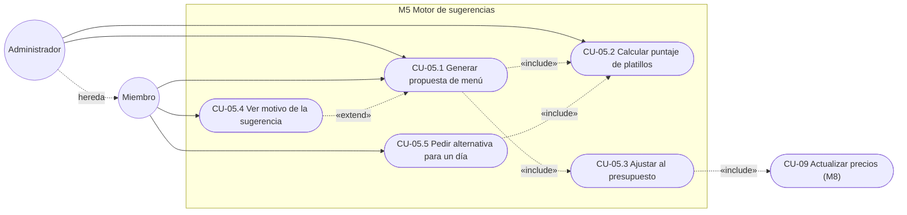

Nota: el administrador es el único que configura los pesos del puntaje (RN-10); ambos perfiles generan menús.

## 2. Casos de uso e historias

### CU-05.1 — Generar propuesta de menú · RF-19 · HU-19

#### Especificación

| Campo | Detalle |
|---|---|
| Actor(es) | Administrador o miembro del hogar |
| Prioridad / Sprint | M · S3 |
| Precondiciones | Sesión iniciada. Configuración completa (tiempos activos y presupuesto, CU-02). Al menos 10 platillos activos aplicables a cada tiempo de comida activo. La semana elegida no tiene un menú Aprobado. |
| Disparador | El usuario pulsa "Sugerir menú" para una semana. |
| Flujo principal | 1. El usuario selecciona la semana (domingo a sábado, RN-09).<br>2. Pulsa "Sugerir menú".<br>3. El sistema lee configuración, tiempos activos (solo almuerzo / dos / tres), platillos activos, historial, calificaciones, restricciones (RF-10) y precios mediana.<br>4. Calcula el puntaje de cada platillo (CU-05.2).<br>5. Para cada tiempo activo y cada día de domingo a sábado asigna el platillo de mayor puntaje que aplique a ese tiempo y cumpla RN-02 y RN-03.<br>6. Verifica el presupuesto de cada tiempo (CU-05.3).<br>7. Guarda el menú en estado Borrador con los factores de cada asignación.<br>8. Muestra la grilla día × tiempo con costo estimado vs. presupuesto. |
| Flujos alternos | 1a. Ya existe un Borrador de esa semana → el sistema pide confirmar la regeneración; los platillos fijados (RF-24) se conservan y solo se reemplazan los no fijados.<br>5a. Empate de puntaje → se elige el de menor costo y, si persiste, el primero en orden alfabético. |
| Excepciones | E1. Faltan platillos en algún tiempo → indica "Faltan N platillos de <tiempo>" y ofrece ir al catálogo (CU-03).<br>E2. La semana ya tiene un menú Aprobado → se bloquea la generación.<br>E3. Ningún candidato cumple RN-02/RN-03 para un día → el espacio queda vacío marcado "Sin sugerencia" y se avisa. |
| Postcondiciones | Existe un MENU_SEMANAL en estado Borrador con un MENU_DETALLE por día × tiempo activo (7, 14 o 21 registros). |
| Reglas y RNF | RN-01, RN-02, RN-03, RN-09, RNF-01 (p95 menor a 3 s con 300 platillos), RNF-06 |

Supuesto: se excluyen del cálculo los platillos con ingredientes marcados como excluidos (RF-10); la regeneración conserva los fijados; el desempate es por menor costo y luego alfabético.

#### Diagrama de actividad

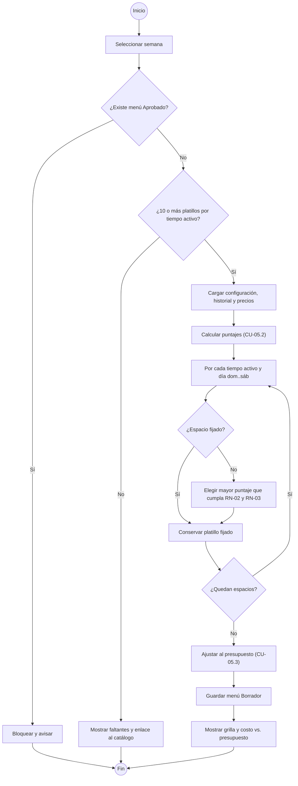

#### Diagrama de secuencia

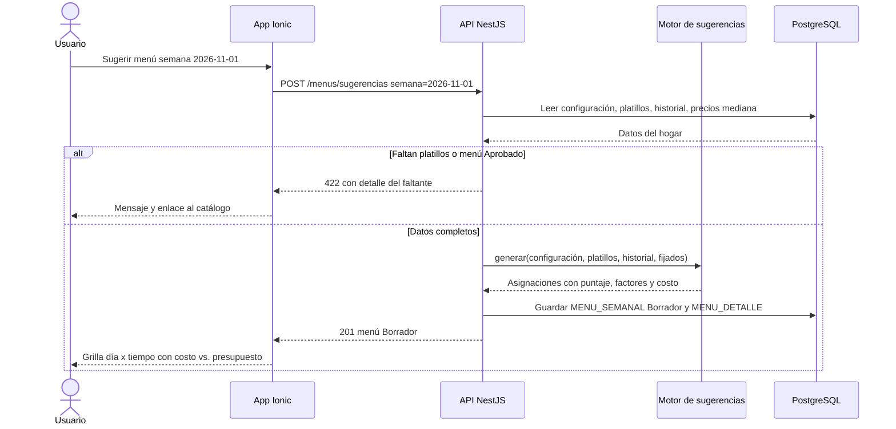

#### Historia de usuario HU-19 · 8 puntos

> **Como** miembro del hogar, **quiero** que la app me proponga el menú de la semana para los tiempos de comida que planificamos, **para** no tener que decidir cada día qué cocinar.

#### Criterios de aceptación

```gherkin
# language: es
Característica: Generar propuesta de menú semanal

  # CA-19.1 Flujo principal (solo almuerzo)
  Escenario: Generar menú con solo almuerzo activo
    Dado que el hogar tiene solo "Almuerzo" activo y presupuesto semanal de Q245.00
    Y tiene 25 platillos activos de almuerzo
    Cuando pido "Sugerir menú" para la semana del 2026-11-01 al 2026-11-07
    Entonces se crea un menú en estado "Borrador" con 7 almuerzos de domingo a sábado
    Y ningún platillo se repite en la semana
    Y no hay dos días consecutivos con la misma proteína principal

  # CA-19.2 Flujo alterno (dos tiempos y regeneración con fijado)
  Escenario: Regenerar un borrador de almuerzo y cena conservando un fijado
    Dado que el hogar tiene "Almuerzo" y "Cena" activos
    Y existe un borrador de la semana 2026-11-01 con "Pepián de pollo" fijado el domingo en almuerzo
    Cuando pido "Sugerir menú" y confirmo la regeneración
    Entonces el menú tiene 14 asignaciones
    Y el domingo en almuerzo sigue "Pepián de pollo"
    Y el lunes en almuerzo no tiene un platillo con proteína "pollo"

  # CA-19.3 Validación de platillos insuficientes
  Escenario: Faltan platillos de cena
    Dado que el hogar tiene "Almuerzo" y "Cena" activos
    Y tiene 12 platillos de almuerzo y 7 platillos de cena
    Cuando pido "Sugerir menú"
    Entonces no se crea ningún menú
    Y veo el mensaje "Faltan 3 platillos de Cena" con un enlace al catálogo

  # CA-19.4 Semana ya aprobada
  Escenario: No se regenera una semana aprobada
    Dado que la semana del 2026-11-01 tiene un menú "Aprobado"
    Cuando pido "Sugerir menú" para esa semana
    Entonces veo "Esta semana ya tiene un menú aprobado"
    Y el menú aprobado no cambia
```

#### Subtareas

| ID | Tipo | Subtarea | Estimación (h) |
|---|---|---|---|
| ST-19.1 | DB | Migración Prisma de MENU_SEMANAL (semana, estado, pesos usados) y MENU_DETALLE (día, tiempo, platillo, costo, factores, fijado) | 3 |
| ST-19.2 | BE | Servicio del motor: asignación por día y tiempo activo con RN-02, RN-03, exclusiones RF-10 y desempate | 8 |
| ST-19.3 | BE | Endpoint POST /menus/sugerencias: precondiciones, bloqueo de aprobados, regeneración que conserva fijados | 5 |
| ST-19.4 | FE | Pantalla "Sugerir menú": selector de semana, grilla día × tiempo, estados de carga y error | 6 |
| ST-19.5 | QA | Casos PF-M5-19.1..4, pruebas unitarias del motor y prueba de rendimiento RNF-01 con 300 platillos | 5 |
| ST-19.6 | DOC | Manual de usuario: "Generar el menú de la semana" | 1 |

---

### CU-05.2 — Calcular puntaje de platillos · RF-20 · HU-20

#### Especificación

| Campo | Detalle |
|---|---|
| Actor(es) | Sistema (motor); Administrador (configura pesos) |
| Prioridad / Sprint | M · S3 |
| Precondiciones | Pesos configurados (por defecto 0.40 / 0.25 / 0.20 / 0.15). Platillos activos con costo estimado. |
| Disparador | Inclusión desde CU-05.1 o CU-05.5; o el administrador abre "Pesos del motor". |
| Flujo principal | 1. Para cada platillo candidato el motor calcula cuatro factores en rango 0.00–1.00:<br>· Preferencia = 1.00 si es favorito (RF-10); si no, (promedio de calificaciones − 1) / 4; sin calificaciones = 0.50.<br>· Novedad = 0.00 si se preparó hace menos de 2 semanas (RN-04); si no, mín(semanas, 8) / 8; nunca preparado = 1.00.<br>· Ahorro = máx(0, 1 − costo del platillo / presupuesto por comida), con presupuesto por comida = presupuesto del tiempo / 7.<br>· Afinidad = veces preparado en las últimas 16 semanas / máximo de veces de cualquier platillo del mismo tiempo.<br>2. Puntaje = wP·Preferencia + wN·Novedad + wA·Ahorro + wF·Afinidad, redondeado a 4 decimales.<br>3. Devuelve la lista ordenada de mayor a menor con sus factores. |
| Flujos alternos | 1a. Configurar pesos: el administrador edita los cuatro pesos; el sistema muestra la suma en vivo y guarda solo si suma 1.00. |
| Excepciones | E1. Los pesos no suman 1.00 o alguno está fuera de 0.00–1.00 → se bloquea guardar.<br>E2. Un miembro intenta cambiar pesos → 403 (RN-10). |
| Postcondiciones | Cada candidato tiene puntaje y factores; los pesos usados quedan registrados en el menú. |
| Reglas y RNF | RN-04, RN-10, RNF-09 (cobertura ≥ 70 % del motor) |

Supuesto: el SRS no define cómo normalizar cada factor; se adoptan las fórmulas anteriores. "Semanas" = días completos desde la última preparación hasta el domingo de la semana planificada ÷ 7, truncado. La suma de pesos se valida con 2 decimales (tolerancia ±0.001). Afinidad se mide sobre el historial cargado (M4).

**Ejemplo numérico verificable** (solo almuerzo, presupuesto del tiempo Q245.00 → presupuesto por comida Q245.00 / 7 = Q35.00; máximo de veces en 16 semanas = 8; pesos por defecto):

| Platillo | Datos | Preferencia | Novedad | Ahorro | Afinidad | Puntaje |
|---|---|---|---|---|---|---|
| Pollo en crema | calif. 4.6, hace 4 sem., costo Q28.00, 6 veces | (4.6−1)/4 = 0.90 | 4/8 = 0.50 | 1 − 28/35 = 0.20 | 6/8 = 0.75 | 0.3600 + 0.1250 + 0.0400 + 0.1125 = **0.6375** |
| Carne guisada | calif. 4.0, hace 10 sem., costo Q31.50, 2 veces | (4.0−1)/4 = 0.75 | mín(10,8)/8 = 1.00 | 1 − 31.5/35 = 0.10 | 2/8 = 0.25 | 0.3000 + 0.2500 + 0.0200 + 0.0375 = **0.6075** |
| Pepián de pollo | calif. 5.0, hace 1 sem., costo Q42.00, 4 veces | (5.0−1)/4 = 1.00 | 0.00 (RN-04) | máx(0, 1 − 42/35) = 0.00 | 4/8 = 0.50 | 0.4000 + 0 + 0 + 0.0750 = **0.4750** |

Orden resultante: Pollo en crema > Carne guisada > Pepián de pollo.

#### Diagrama de actividad

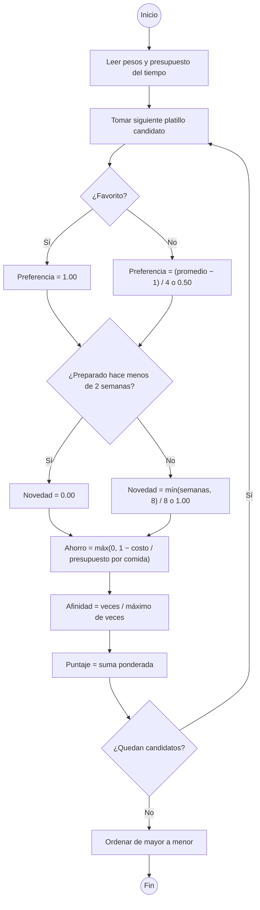

#### Diagrama de secuencia

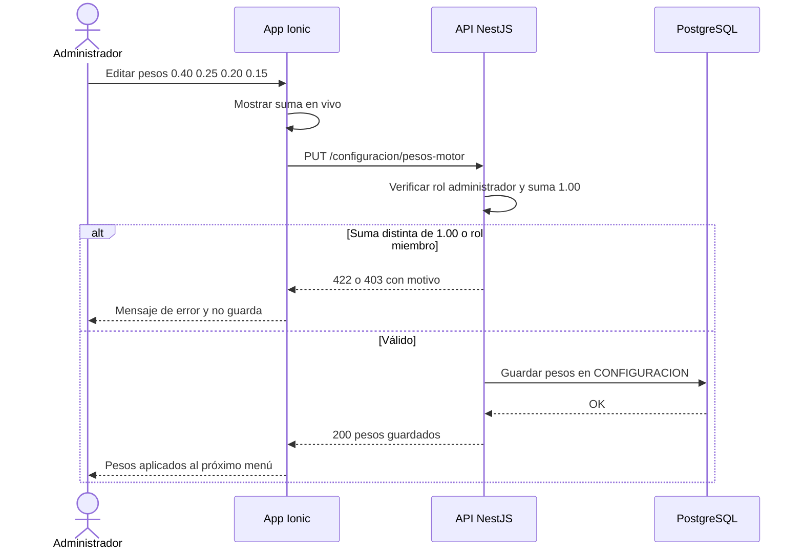

#### Historia de usuario HU-20 · 5 puntos

> **Como** administrador del hogar, **quiero** que cada platillo reciba un puntaje por preferencia, novedad, ahorro y afinidad con pesos que pueda ajustar, **para** que las sugerencias reflejen lo que más le importa a mi familia.

#### Criterios de aceptación

```gherkin
# language: es
Característica: Puntaje de platillos

  # CA-20.1 Flujo principal (cálculo con pesos por defecto)
  Escenario: Puntaje de Pollo en crema
    Dado pesos 0.40 Preferencia, 0.25 Novedad, 0.20 Ahorro y 0.15 Afinidad
    Y un presupuesto de almuerzo de Q245.00
    Y "Pollo en crema" con calificación promedio 4.6, preparado hace 4 semanas, costo Q28.00 y 6 veces en 16 semanas
    Y el platillo más frecuente del almuerzo se preparó 8 veces
    Cuando el motor calcula el puntaje
    Entonces los factores son Preferencia 0.90, Novedad 0.50, Ahorro 0.20 y Afinidad 0.75
    Y el puntaje es 0.6375

  # CA-20.2 Flujo alterno (novedad 0 y ahorro sin negativos)
  Escenario: Platillo preparado hace una semana y más caro que el presupuesto por comida
    Dado "Pepián de pollo" con calificación 5.0, preparado hace 1 semana, costo Q42.00 y 4 veces en 16 semanas
    Y el presupuesto por comida es Q35.00
    Cuando el motor calcula el puntaje
    Entonces Novedad es 0.00 y Ahorro es 0.00
    Y el puntaje es 0.4750
    Y queda por debajo de "Carne guisada" con 0.6075

  # CA-20.3 Validación de pesos
  Escenario: Pesos que no suman 1.00
    Dado que soy administrador
    Cuando ingreso pesos 0.50, 0.25, 0.20 y 0.15
    Entonces veo "Los pesos deben sumar 1.00 (suma actual 1.10)"
    Y el botón "Guardar" está deshabilitado

  # CA-20.4 Permiso
  Escenario: Un miembro no puede cambiar los pesos
    Dado que inicié sesión como miembro del hogar
    Cuando envío pesos 0.30, 0.30, 0.20 y 0.20
    Entonces la API responde 403
    Y los pesos siguen en 0.40, 0.25, 0.20 y 0.15
```

#### Subtareas

| ID | Tipo | Subtarea | Estimación (h) |
|---|---|---|---|
| ST-20.1 | DB | Campos de pesos del motor en CONFIGURACION con valores por defecto 0.40 / 0.25 / 0.20 / 0.15 | 2 |
| ST-20.2 | BE | Cálculo de Preferencia (calificaciones y favoritos) y Afinidad (historial 16 semanas) | 4 |
| ST-20.3 | BE | Cálculo de Novedad (RN-04) y Ahorro (presupuesto por comida) | 4 |
| ST-20.4 | BE | Endpoint PUT /configuracion/pesos-motor solo administrador (RN-10) con validación de suma 1.00 | 3 |
| ST-20.5 | FE | Pantalla "Pesos del motor" con suma en vivo y restaurar valores por defecto | 4 |
| ST-20.6 | QA | Casos PF-M5-20.1..4 y pruebas unitarias con el ejemplo numérico de este documento | 4 |
| ST-20.7 | DOC | Manual de usuario: "Cómo puntúa el motor y cómo ajustar los pesos" | 1 |

---

### CU-05.3 — Ajustar la propuesta al presupuesto · RF-21 · HU-21

#### Especificación

| Campo | Detalle |
|---|---|
| Actor(es) | Sistema (motor), incluido desde CU-05.1 |
| Prioridad / Sprint | M · S3 |
| Precondiciones | Propuesta completa con costo estimado por platillo. Presupuesto por tiempo configurado (RN-01, RN-06). |
| Disparador | Paso 6 de CU-05.1. |
| Flujo principal | 1. Para cada tiempo activo calcula su presupuesto = presupuesto semanal × % del tiempo (RN-01).<br>2. Calcula el costo de cada platillo = Σ (cantidad del ingrediente × Σ factores de porción / porciones base (RN-07, D-02)) × precio mediana.<br>3. Suma el costo de los 7 días del tiempo.<br>4. Si costo ≤ presupuesto, el tiempo cumple. |
| Flujos alternos | 4a. Costo > presupuesto (RN-05): reemplaza el platillo no fijado de mayor costo por el candidato de mayor puntaje con costo menor que cumpla RN-02 y RN-03; recalcula; repite hasta cumplir o hasta 3 intentos por tiempo. |
| Excepciones | E1. Tras 3 intentos sigue excedido → guarda el borrador y muestra "Excede por Q__" en ese tiempo con hasta 3 alternativas más baratas por día.<br>E2. No existe candidato más barato válido → cuenta como intento fallido y pasa al siguiente más caro. |
| Postcondiciones | Cada tiempo queda marcado "Dentro del presupuesto" o "Excede por Q__". |
| Reglas y RNF | RN-01, RN-02, RN-03, RN-05, RN-06, RN-07 |

Supuesto: el control de presupuesto y los 3 intentos se aplican por tiempo de comida, no sobre el total. Si un ingrediente no tiene precio, aporta Q0.00 y el platillo se marca "Costo incompleto"; hasta el sprint S5 (M8) los precios mediana provienen de datos semilla. Los platillos fijados nunca se reemplazan.

#### Diagrama de actividad

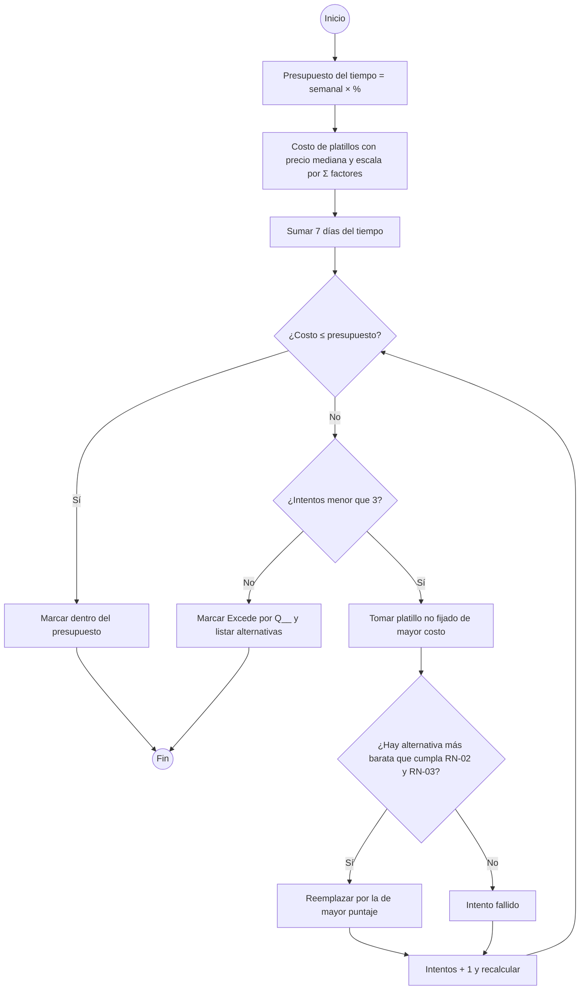

#### Diagrama de secuencia

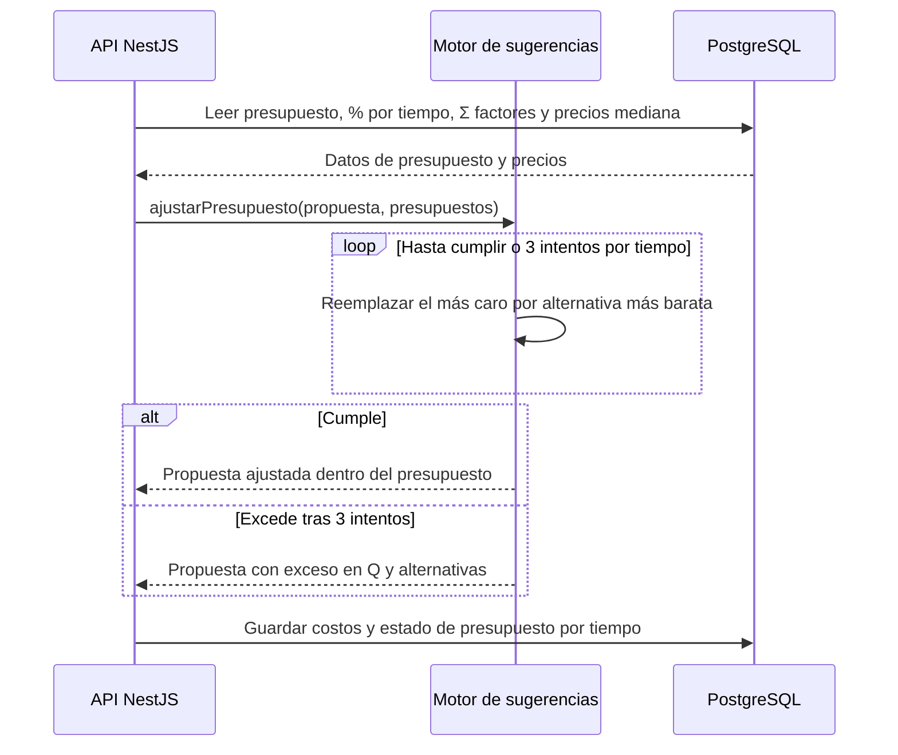

#### Historia de usuario HU-21 · 5 puntos

> **Como** miembro del hogar, **quiero** que el menú sugerido respete el presupuesto de cada tiempo de comida, **para** no gastar más de lo planificado.

#### Criterios de aceptación

```gherkin
# language: es
Característica: Menú dentro del presupuesto

  # CA-21.1 Flujo principal
  Escenario: Menú que cumple sin reemplazos
    Dado un presupuesto semanal de Q245.00 con solo almuerzo al 100 %
    Cuando el motor propone un menú con costo estimado de Q229.50
    Entonces no se hace ningún reemplazo
    Y el almuerzo aparece "Dentro del presupuesto" con Q15.50 disponibles

  # CA-21.2 Flujo alterno (reemplazos RN-05)
  Escenario: Menú excedido que se corrige en 2 intentos
    Dado un presupuesto de almuerzo de Q250.00
    Y la propuesta inicial cuesta Q280.00 con "Pepián de pollo" Q48.00 y "Caldo de res" Q45.00 como los más caros
    Cuando el motor ajusta al presupuesto
    Entonces reemplaza "Pepián de pollo" por "Tortitas de carne" de Q26.00 y el costo queda en Q258.00
    Y reemplaza "Caldo de res" por "Spaghetti con carne" de Q30.00 y el costo queda en Q243.00
    Y el almuerzo aparece "Dentro del presupuesto"

  # CA-21.3 Excepción (no cumple tras 3 intentos)
  Escenario: Presupuesto insuficiente
    Dado un presupuesto de almuerzo de Q150.00
    Y la propuesta inicial cuesta Q280.00
    Cuando el motor hace 3 reemplazos y el costo queda en Q205.00
    Entonces el menú se guarda en "Borrador"
    Y veo "Almuerzo: excede por Q55.00" con alternativas más baratas

  # CA-21.4 Presupuesto por tiempo
  Escenario: Tres tiempos con presupuesto por tiempo
    Dado un presupuesto semanal de Q700.00 con distribución 20/50/30
    Cuando el motor genera el menú
    Entonces controla desayuno contra Q140.00, almuerzo contra Q350.00 y cena contra Q210.00
```

#### Subtareas

| ID | Tipo | Subtarea | Estimación (h) |
|---|---|---|---|
| ST-21.1 | BE | Cálculo de costo por platillo: escala por Σ factores de porción (RN-07) × precio mediana, marca "Costo incompleto" | 4 |
| ST-21.2 | BE | Ciclo de reemplazo RN-05 por tiempo (máx. 3 intentos) y cálculo del exceso | 5 |
| ST-21.3 | FE | Indicador por tiempo y aviso "Excede por Q__" con alternativas más baratas | 3 |
| ST-21.4 | QA | Casos PF-M5-21.1..4 y pruebas unitarias del ajuste con montos de este documento | 4 |
| ST-21.5 | DOC | Manual de usuario: "Qué pasa cuando el menú supera el presupuesto" | 1 |

---

### CU-05.4 — Ver el motivo de la sugerencia · RF-22 · HU-22

#### Especificación

| Campo | Detalle |
|---|---|
| Actor(es) | Administrador o miembro del hogar |
| Prioridad / Sprint | S · S3 |
| Precondiciones | Menú en Borrador o Aprobado generado por el motor. |
| Disparador | El usuario toca "¿Por qué?" en un platillo de la grilla. |
| Flujo principal | 1. El usuario toca "¿Por qué?".<br>2. La app pide el detalle de la asignación.<br>3. El sistema devuelve los cuatro factores, los pesos usados al generar, el puntaje, el costo y las reglas aplicadas (p. ej. "reemplazo por presupuesto").<br>4. La app muestra el desglose con una frase resumen. |
| Flujos alternos | 3a. El platillo lo eligió o cambió el usuario → se muestra "Elegido por el usuario" sin factores. |
| Excepciones | E1. El detalle no pertenece al hogar → 404 (RNF-06). |
| Postcondiciones | Ninguna (consulta). |
| Reglas y RNF | RN-04, RN-05, RNF-06, RNF-07 |

Supuesto: los factores y pesos se guardan al generar; si el administrador cambia los pesos después, la explicación muestra los pesos usados en ese momento.

#### Diagrama de actividad

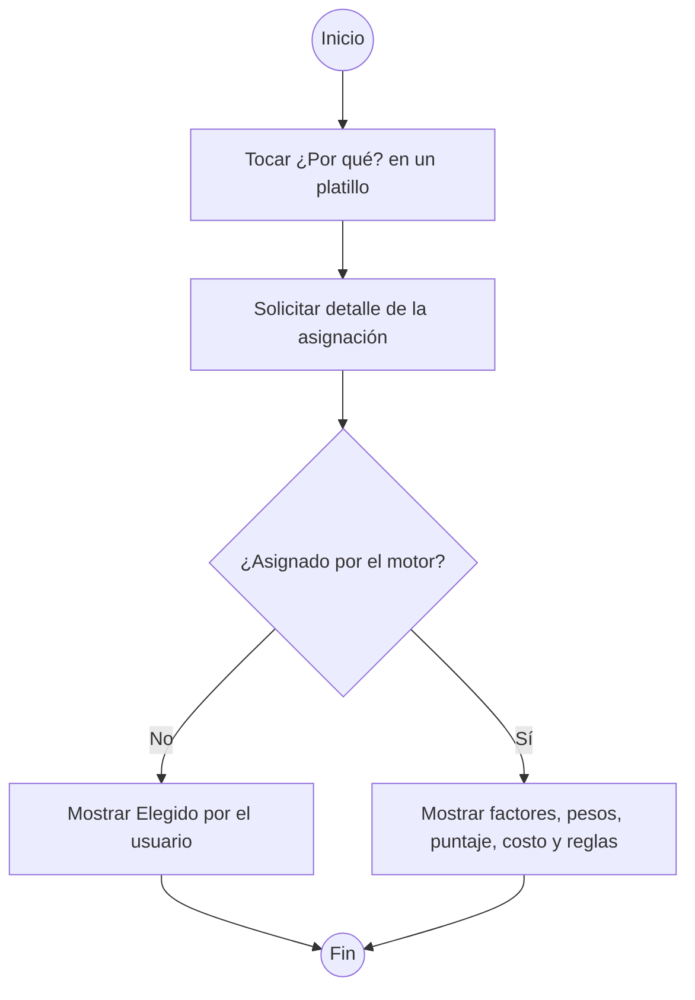

#### Diagrama de secuencia

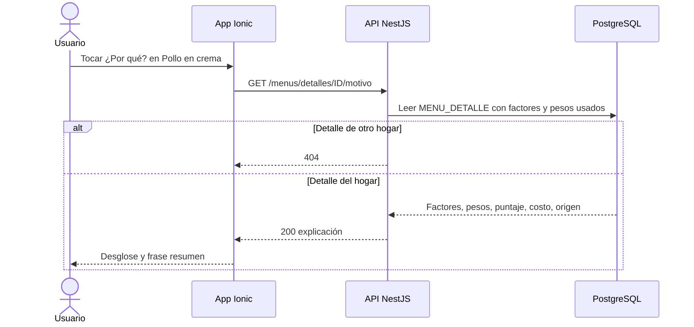

#### Historia de usuario HU-22 · 3 puntos

> **Como** miembro del hogar, **quiero** ver por qué se sugirió cada platillo, **para** confiar en la propuesta y decidir si la cambio.

#### Criterios de aceptación

```gherkin
# language: es
Característica: Motivo de la sugerencia

  # CA-22.1 Flujo principal
  Escenario: Ver factores de Pollo en crema
    Dado que el domingo en almuerzo el motor sugirió "Pollo en crema" con puntaje 0.6375
    Cuando toco "¿Por qué?"
    Entonces veo Preferencia 0.90, Novedad 0.50, Ahorro 0.20 y Afinidad 0.75
    Y veo los pesos 0.40, 0.25, 0.20 y 0.15
    Y veo "Costo estimado Q28.00"

  # CA-22.2 Flujo alterno (platillo del usuario)
  Escenario: Platillo cambiado por el usuario
    Dado que cambié el martes en almuerzo a "Chile relleno"
    Cuando toco "¿Por qué?"
    Entonces veo "Elegido por el usuario" sin factores

  # CA-22.3 Pesos cambiados después de generar
  Escenario: La explicación conserva los pesos usados
    Dado que el menú se generó con pesos 0.40, 0.25, 0.20 y 0.15
    Y después el administrador cambió los pesos a 0.30, 0.30, 0.25 y 0.15
    Cuando toco "¿Por qué?" en "Carne guisada"
    Entonces veo los pesos 0.40, 0.25, 0.20 y 0.15 y el puntaje 0.6075

  # CA-22.4 Reemplazo por presupuesto
  Escenario: Motivo de un reemplazo
    Dado que "Tortitas de carne" reemplazó a "Pepián de pollo" por presupuesto
    Cuando toco "¿Por qué?" en "Tortitas de carne"
    Entonces veo "Reemplazo por presupuesto: Q22.00 más barato"
```

#### Subtareas

| ID | Tipo | Subtarea | Estimación (h) |
|---|---|---|---|
| ST-22.1 | BE | Persistir factores, pesos usados, origen (motor, usuario, reemplazo) en MENU_DETALLE | 2 |
| ST-22.2 | BE | Endpoint GET de motivo con frase resumen y aislamiento por hogar | 2 |
| ST-22.3 | FE | Panel "¿Por qué este platillo?" con barras por factor | 4 |
| ST-22.4 | QA | Casos PF-M5-22.1..4 y prueba automatizada del panel | 2 |
| ST-22.5 | DOC | Manual de usuario: "Entender por qué se sugirió un platillo" | 1 |

---

### CU-05.5 — Pedir alternativa para un día · RF-23 · HU-23

#### Especificación

| Campo | Detalle |
|---|---|
| Actor(es) | Administrador o miembro del hogar |
| Prioridad / Sprint | M · S3 |
| Precondiciones | Menú en estado Borrador. El espacio (día y tiempo) no está fijado. |
| Disparador | El usuario toca "Otra opción" en un día y tiempo. |
| Flujo principal | 1. El usuario toca "Otra opción" en un espacio.<br>2. El sistema obtiene los candidatos del tiempo ordenados por puntaje (CU-05.2).<br>3. Descarta el platillo actual, los ya mostrados para ese espacio, los que ya están en la semana (RN-03) y los que repiten proteína con el día anterior o el siguiente (RN-02).<br>4. Asigna el mejor candidato restante solo en ese espacio.<br>5. Recalcula el costo del tiempo y el total y muestra si cumple el presupuesto. |
| Flujos alternos | 4a. La alternativa hace exceder el presupuesto del tiempo → se asigna igual y se muestra "Excede por Q__". |
| Excepciones | E1. No quedan candidatos → "No hay más alternativas para este día" y se mantiene el actual.<br>E2. Espacio fijado → la opción está deshabilitada; hay que desfijar primero.<br>E3. Menú Aprobado → la opción no está disponible. |
| Postcondiciones | Solo cambió el espacio elegido; el resto de la semana se mantiene. |
| Reglas y RNF | RN-02, RN-03, RN-05, RNF-07 (máx. 3 toques por cambio) |

Supuesto: la alternativa se pide por día y tiempo (no por día completo) para soportar dos o tres tiempos; las alternativas ya mostradas se excluyen mientras el menú siga en Borrador; pedir una alternativa no dispara reemplazos automáticos de RN-05 en otros días.

#### Diagrama de actividad

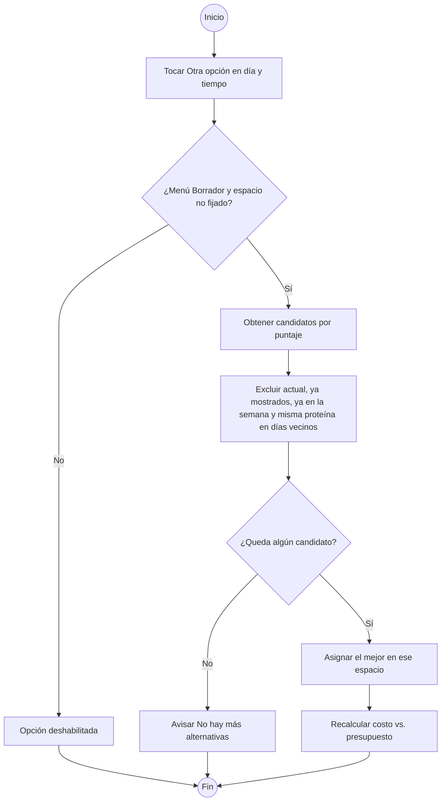

#### Diagrama de secuencia

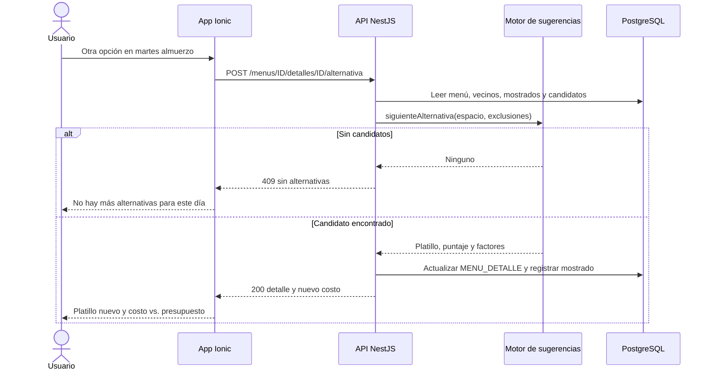

#### Historia de usuario HU-23 · 3 puntos

> **Como** miembro del hogar, **quiero** pedir otra opción para un día concreto sin regenerar toda la semana, **para** cambiar solo lo que no nos convence.

#### Criterios de aceptación

```gherkin
# language: es
Característica: Alternativa para un día

  # CA-23.1 Flujo principal
  Escenario: Cambiar solo el martes
    Dado un menú "Borrador" de solo almuerzo con lunes "Carne guisada" (res), martes "Pescado frito" (pescado) y miércoles "Tortitas de carne" (res)
    Cuando toco "Otra opción" en el martes
    Entonces el martes muestra el mejor candidato que no es de res ni de pescado y no está en la semana, por ejemplo "Pollo en crema"
    Y los otros 6 días no cambian
    Y el costo de la semana se recalcula

  # CA-23.2 Flujo alterno (alternativa excede presupuesto)
  Escenario: La alternativa supera el presupuesto
    Dado un menú con costo Q240.00 y presupuesto de almuerzo Q245.00
    Y el martes tiene "Tortitas de carne" de Q26.00
    Cuando pido otra opción y el sistema asigna "Caldo de res" de Q45.00
    Entonces el costo queda en Q259.00
    Y veo "Almuerzo: excede por Q14.00"

  # CA-23.3 Sin más alternativas
  Escenario: Se agotan los candidatos
    Dado que ya pedí todas las alternativas válidas para el jueves
    Cuando toco "Otra opción" en el jueves
    Entonces veo "No hay más alternativas para este día"
    Y el jueves conserva su platillo actual

  # CA-23.4 Espacio fijado
  Escenario: No se ofrece alternativa en un día fijado
    Dado que el domingo tiene "Pepián de pollo" fijado
    Entonces la opción "Otra opción" del domingo está deshabilitada
```

#### Subtareas

| ID | Tipo | Subtarea | Estimación (h) |
|---|---|---|---|
| ST-23.1 | BE | Endpoint POST de alternativa por día y tiempo con validación de estado y fijado | 4 |
| ST-23.2 | BE | Exclusiones: RN-02 con días vecinos, RN-03, alternativas ya mostradas | 3 |
| ST-23.3 | FE | Botón "Otra opción" (máx. 3 toques, RNF-07) con recálculo de costo en pantalla | 3 |
| ST-23.4 | QA | Casos PF-M5-23.1..4 y prueba automatizada de regresión de la grilla | 3 |
| ST-23.5 | DOC | Manual de usuario: "Pedir otra opción para un día" | 1 |

---

## 3. Resumen del módulo

| HU | RF | CU | Prioridad | Sprint | Puntos | Horas |
|---|---|---|---|---|---|---|
| HU-19 | RF-19 | CU-05.1 | M | S3 | 8 | 28 |
| HU-20 | RF-20 | CU-05.2 | M | S3 | 5 | 22 |
| HU-21 | RF-21 | CU-05.3 | M | S3 | 5 | 17 |
| HU-22 | RF-22 | CU-05.4 | S | S3 | 3 | 11 |
| HU-23 | RF-23 | CU-05.5 | M | S3 | 3 | 14 |
| **Total** | | | | | **24** | **92** |
