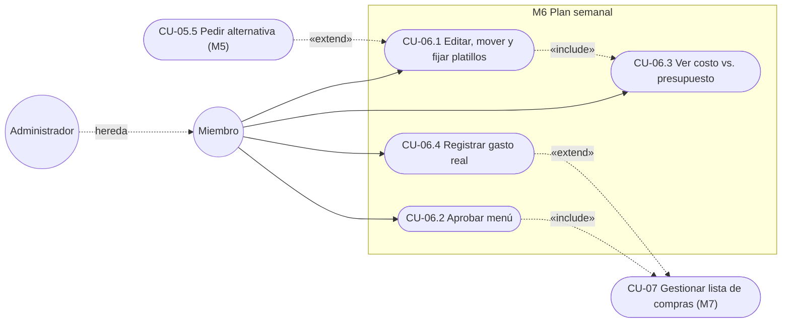
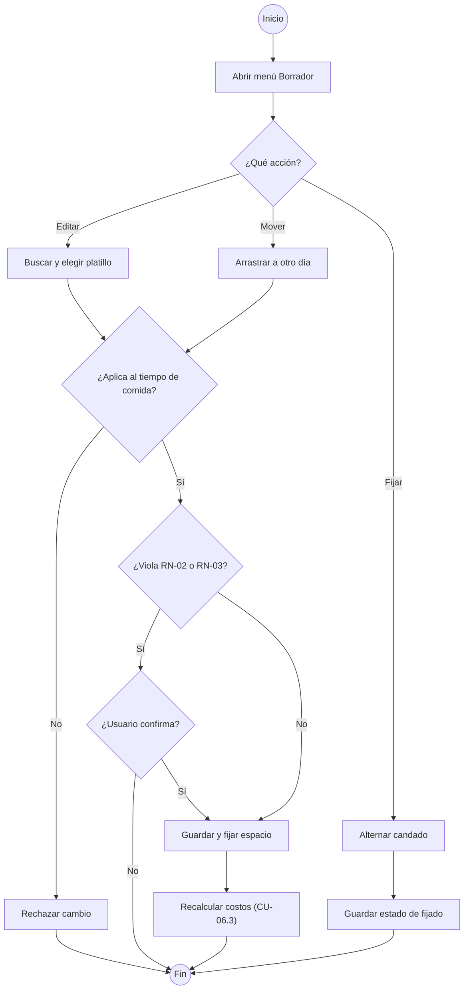
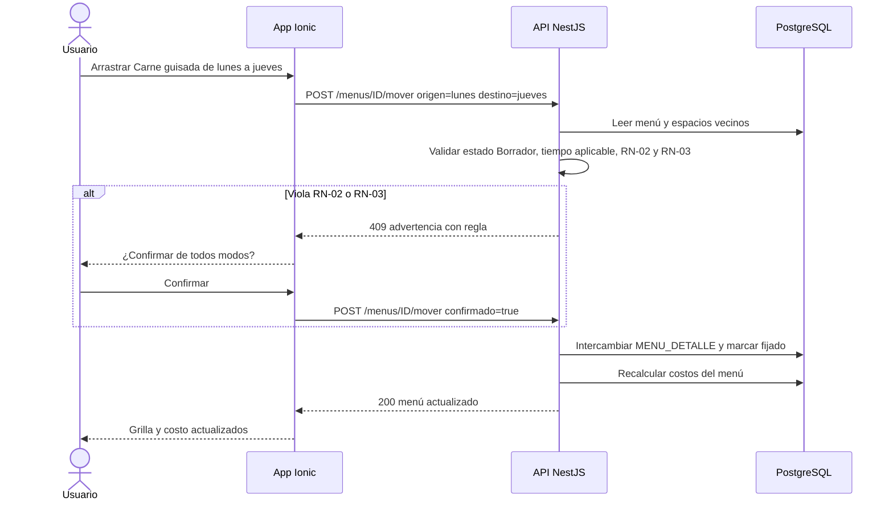
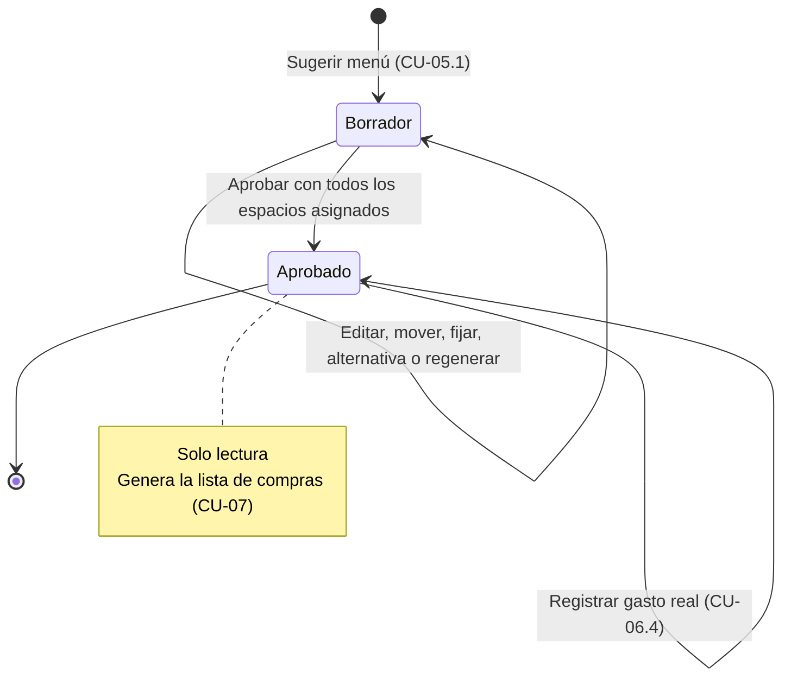
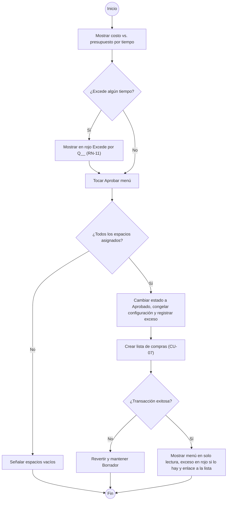
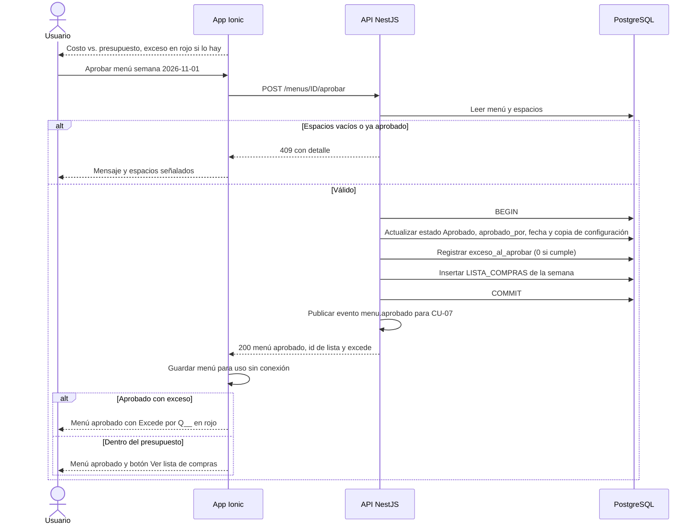
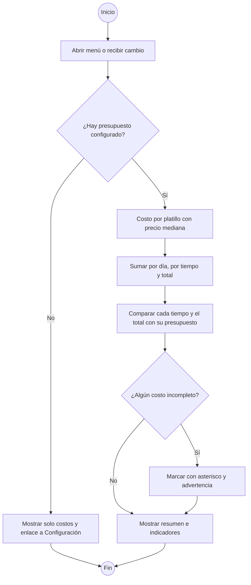
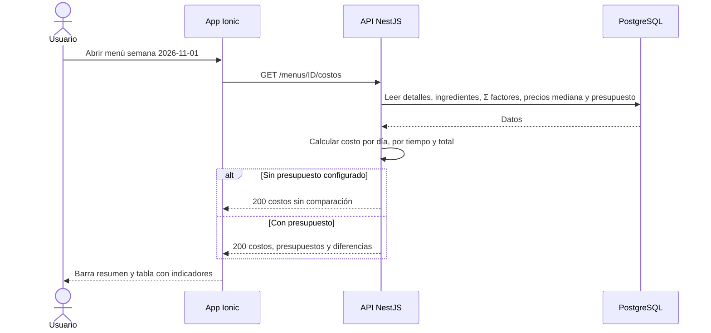
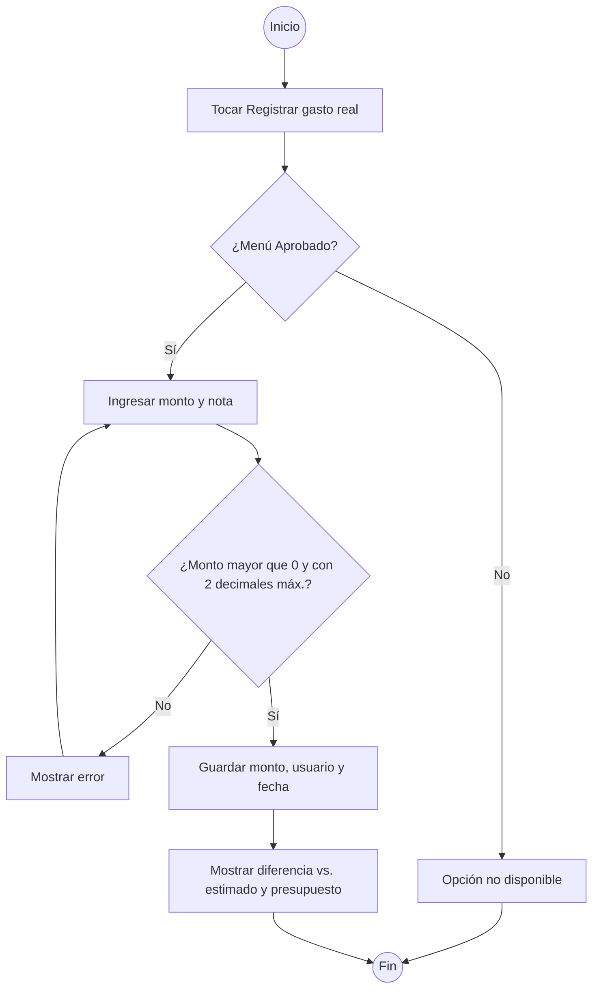
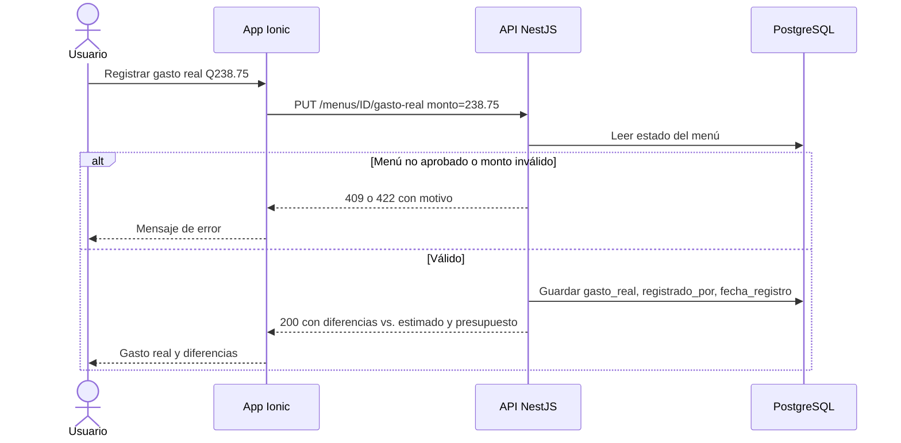

# M06 — Plan semanal

| Campo | Valor |
|---|---|
| SRS | SRS-MF-001 v1.3 (aprobado 2026-10-22) |
| Requerimientos | RF-24 a RF-27 |
| Caso de uso macro | CU-06 Ajustar y aprobar menú |
| Sprint(s) | S3 (RF-24 a RF-26) · S4 (RF-27) |
| Fase del ciclo de vida | 2. Requerimientos — análisis de casos de uso |

Permite a la familia ajustar el menú propuesto (editar, mover, fijar), ver su costo frente al presupuesto, aprobarlo para generar la lista de compras y registrar lo que realmente se gastó.

## 1. Diagrama de casos de uso del módulo



## 2. Casos de uso e historias

### CU-06.1 — Editar, mover y fijar platillos · RF-24 · HU-24

#### Especificación

| Campo | Detalle |
|---|---|
| Actor(es) | Administrador o miembro del hogar |
| Prioridad / Sprint | M · S3 |
| Precondiciones | Sesión iniciada. Menú de la semana en estado Borrador (CU-05.1). |
| Disparador | El usuario toca un platillo de la grilla o lo arrastra. |
| Flujo principal | 1. El usuario abre el menú Borrador.<br>2a. Editar: toca un espacio, busca un platillo aplicable a ese tiempo y lo elige.<br>2b. Mover: arrastra un platillo a otro día del mismo tiempo; si el destino está ocupado los platillos se intercambian.<br>2c. Fijar: toca el candado del espacio.<br>3. El sistema valida RN-02 y RN-03 y el tiempo aplicable del platillo (RF-11).<br>4. Guarda el cambio y recalcula costos (CU-06.3). |
| Flujos alternos | 3a. El cambio repite proteína en días consecutivos (RN-02) o repite platillo en la semana (RN-03) → muestra advertencia; si el usuario confirma, el cambio se guarda y el espacio queda fijado.<br>2c-a. Desfijar: toca de nuevo el candado; el espacio vuelve a ser reemplazable por el motor. |
| Excepciones | E1. El platillo no aplica a ese tiempo de comida (p. ej. moverlo de almuerzo a desayuno) → se rechaza el movimiento.<br>E2. Menú Aprobado → la grilla es de solo lectura.<br>E3. Dos usuarios editan el mismo espacio → gana el último guardado y el otro ve el valor actualizado al recargar. |
| Postcondiciones | El menú sigue en Borrador con los cambios, origen "usuario" en los espacios editados y costos recalculados. |
| Reglas y RNF | RN-02, RN-03, RNF-07 (máx. 3 toques por cambio), RNF-06 |

Supuesto: editar o mover un platillo manualmente lo deja fijado automáticamente (para que la regeneración no lo deshaga); mover solo se permite entre días del mismo tiempo de comida o hacia otro tiempo donde el platillo sea aplicable; concurrencia resuelta con "último guardado gana".

#### Diagrama de actividad



#### Diagrama de secuencia



#### Historia de usuario HU-24 · 8 puntos

> **Como** miembro del hogar, **quiero** cambiar, mover y fijar platillos del menú propuesto, **para** adaptarlo a los planes reales de la semana.

#### Criterios de aceptación

```gherkin
# language: es
Característica: Ajustar el menú propuesto

  # CA-24.1 Flujo principal (mover con intercambio)
  Escenario: Intercambiar lunes y jueves
    Dado un menú "Borrador" de solo almuerzo con lunes "Carne guisada" y jueves "Pepián de pollo"
    Y miércoles "Pescado frito" y viernes "Spaghetti con carne"
    Cuando arrastro "Carne guisada" al jueves
    Entonces veo la advertencia "Proteína res repetida en días consecutivos (jueves y viernes)"
    Y al confirmar el jueves queda "Carne guisada" fijado y el lunes "Pepián de pollo"

  # CA-24.2 Flujo alterno (editar y fijar)
  Escenario: Elegir un platillo manualmente
    Dado un menú "Borrador" con martes "Tortitas de carne"
    Cuando elijo "Chile relleno" para el martes
    Entonces el martes muestra "Chile relleno" con candado
    Y al regenerar el menú el martes sigue con "Chile relleno"

  # CA-24.3 Validación de tiempo aplicable
  Escenario: Mover un platillo a un tiempo no aplicable
    Dado que el hogar tiene tres tiempos activos
    Y "Caldo de res" solo aplica a "Almuerzo"
    Cuando arrastro "Caldo de res" del sábado almuerzo al sábado desayuno
    Entonces veo "Caldo de res no aplica a Desayuno"
    Y el menú no cambia

  # CA-24.4 Menú aprobado
  Escenario: No se edita un menú aprobado
    Dado que el menú de la semana 2026-11-01 está "Aprobado"
    Cuando intento cambiar el domingo
    Entonces la grilla está en solo lectura
```

#### Subtareas

| ID | Tipo | Subtarea | Estimación (h) |
|---|---|---|---|
| ST-24.1 | DB | Campos fijado, origen, modificado_por y fecha_modificacion en MENU_DETALLE | 1 |
| ST-24.2 | BE | Endpoints PATCH de detalle (editar), POST mover/intercambiar y POST fijar/desfijar | 5 |
| ST-24.3 | BE | Validaciones: estado Borrador, tiempo aplicable, advertencias RN-02 y RN-03 con confirmación | 3 |
| ST-24.4 | FE | Arrastrar y soltar en la grilla día × tiempo (táctil y ratón) | 6 |
| ST-24.5 | FE | Selector de platillo con búsqueda, candado de fijado y diálogo de advertencia | 4 |
| ST-24.6 | QA | Casos PF-M6-24.1..4 y prueba e2e de arrastrar y soltar | 4 |
| ST-24.7 | DOC | Manual de usuario: "Cambiar, mover y fijar platillos" | 1 |

---

### CU-06.2 — Aprobar menú · RF-25 · HU-25

#### Especificación

| Campo | Detalle |
|---|---|
| Actor(es) | Administrador o miembro del hogar |
| Prioridad / Sprint | M · S3 |
| Precondiciones | Menú en estado Borrador con todos los espacios (día × tiempo activo) asignados. |
| Disparador | El usuario toca "Aprobar menú". |
| Flujo principal | 1. La app muestra junto al botón "Aprobar menú" el costo estimado vs. presupuesto por tiempo (CU-06.3); si algún tiempo excede, el texto aparece en rojo "Excede por Q__" (RN-11).<br>2. El usuario toca "Aprobar menú" (sin diálogo adicional, D-03).<br>3. El sistema valida que no haya espacios vacíos.<br>4. En una transacción cambia el estado a Aprobado, registra usuario y fecha, congela presupuesto, tiempos y Σ factores (D-04), registra el exceso al aprobar (0 si está dentro del presupuesto) y crea la LISTA_COMPRAS de la semana (include CU-07).<br>5. Muestra el menú en solo lectura, el exceso en rojo si lo hay y el acceso a la lista de compras. |
| Flujos alternos | 1a. El costo excede el presupuesto de algún tiempo → el menú se aprueba igual, sin confirmación extra; el exceso queda registrado y se muestra en rojo "Excede por Q__" en el menú, al aprobar y en la lista de compras (RN-11, D-03). |
| Excepciones | E1. Hay espacios vacíos ("Sin sugerencia") → no se aprueba y se señalan los espacios.<br>E2. Falla la creación de la lista → se revierte la transacción y el menú sigue en Borrador.<br>E3. El menú ya fue aprobado por otro usuario → se informa y se muestra el aprobado. |
| Postcondiciones | Menú en estado Aprobado (solo lectura salvo el gasto real, CU-06.4) y LISTA_COMPRAS creada para la semana. |
| Reglas y RNF | RN-01, RN-05, RN-11, RNF-04 (menú aprobado consultable sin conexión), RNF-06 |

Decisión D-03: un menú que excede el presupuesto se puede aprobar; no se bloquea ni se pide diálogo de confirmación; el exceso se indica en rojo "Excede por Q__" en el menú, al aprobar y en la lista, y queda registrado.
Decisión D-04: el menú aprobado guarda una copia de la configuración con que se aprobó (tiempos, presupuesto y Σ factores).
Supuesto: el SRS solo define los estados Borrador y Aprobado; en v1 un menú aprobado no se puede reabrir. Hay un único menú por hogar y semana. En S3 la aprobación crea la LISTA_COMPRAS y publica el evento `menu.aprobado`; la consolidación de ingredientes y la despensa (RF-28, RF-29) se completan en CU-07 durante S4.

#### Diagrama de estados del menú



#### Diagrama de actividad



#### Diagrama de secuencia



#### Historia de usuario HU-25 · 5 puntos

> **Como** miembro del hogar, **quiero** aprobar el menú de la semana, **para** fijar lo que vamos a cocinar y obtener la lista de compras.

#### Criterios de aceptación

```gherkin
# language: es
Característica: Aprobar el menú semanal

  # CA-25.1 Flujo principal
  Escenario: Aprobar un menú dentro del presupuesto
    Dado un menú "Borrador" de la semana 2026-11-01 con 7 almuerzos asignados y costo Q229.50
    Y un presupuesto de almuerzo de Q245.00
    Cuando toco "Aprobar menú"
    Entonces el menú pasa a estado "Aprobado" con mi usuario y la fecha
    Y se crea la lista de compras de la semana 2026-11-01
    Y la grilla queda en solo lectura

  # CA-25.2 Flujo alterno (aprobar con exceso)
  Escenario: Aprobar con presupuesto excedido
    Dado un menú "Borrador" con costo de almuerzo Q262.00 y presupuesto Q245.00
    Y el botón "Aprobar menú" muestra en rojo "Almuerzo: Excede por Q17.00"
    Cuando toco "Aprobar menú"
    Entonces el menú pasa a "Aprobado" sin pedir confirmación adicional
    Y el menú aprobado muestra en rojo "Excede por Q17.00"
    Y la lista de compras de la semana muestra en rojo "Excede por Q17.00"
    Y queda registrado un exceso al aprobar de Q17.00

  # CA-25.3 Validación de espacios vacíos
  Escenario: No se aprueba con espacios vacíos
    Dado un menú "Borrador" de almuerzo y cena con la cena del viernes "Sin sugerencia"
    Cuando toco "Aprobar menú"
    Entonces veo "Asigna un platillo a: viernes cena"
    Y el menú sigue en "Borrador" y no se crea lista de compras

  # CA-25.4 Falla al crear la lista
  Escenario: Se revierte la aprobación si falla la lista
    Dado un menú "Borrador" completo
    Y la creación de la lista de compras falla
    Cuando toco "Aprobar menú"
    Entonces el menú sigue en "Borrador"
    Y veo "No se pudo aprobar, intenta de nuevo"
```

#### Subtareas

| ID | Tipo | Subtarea | Estimación (h) |
|---|---|---|---|
| ST-25.1 | DB | Campos estado, aprobado_por, fecha_aprobacion y restricción única (hogar, semana) en MENU_SEMANAL | 2 |
| ST-25.2 | BE | Endpoint POST aprobar transaccional con validación de espacios, copia de configuración (D-04) y registro del exceso (RN-11) | 4 |
| ST-25.3 | BE | Creación de LISTA_COMPRAS y publicación del evento menu.aprobado para CU-07 | 3 |
| ST-25.4 | FE | Botón "Aprobar" con costo vs. presupuesto y exceso en rojo, modo solo lectura y caché sin conexión del menú | 3 |
| ST-25.5 | QA | Casos PF-M6-25.1..4, prueba de reversión y prueba en modo avión (RNF-04) | 4 |
| ST-25.6 | DOC | Manual de usuario: "Aprobar el menú y abrir la lista de compras" | 1 |

---

### CU-06.3 — Ver costo estimado vs. presupuesto · RF-26 · HU-26

#### Especificación

| Campo | Detalle |
|---|---|
| Actor(es) | Administrador o miembro del hogar |
| Prioridad / Sprint | M · S3 |
| Precondiciones | Menú de la semana en Borrador o Aprobado. |
| Disparador | Apertura del menú o cualquier cambio (include desde CU-06.1). |
| Flujo principal | 1. El sistema calcula el costo de cada platillo con precio mediana (RN-01, RN-07).<br>2. Agrega por día, por tiempo de comida y total de la semana.<br>3. Compara cada tiempo con su presupuesto y el total con el presupuesto semanal.<br>4. La app muestra una barra resumen (total vs. presupuesto) y una tabla por día y tiempo con indicador verde (cumple) o rojo (excede) y la diferencia en Q. |
| Flujos alternos | 1a. Un platillo tiene ingredientes sin precio → su costo se marca "Costo incompleto" (*) y el total muestra la advertencia. |
| Excepciones | E1. No hay presupuesto configurado → se muestran solo costos y un enlace a Configuración (CU-02). |
| Postcondiciones | Ninguna (consulta). |
| Reglas y RNF | RN-01, RN-06, RN-07, RNF-02 |

Supuesto: montos en GTQ con 2 decimales; el indicador es binario (cumple / excede); el umbral del 10 % de RF-42 corresponde a notificaciones (S6) y no a esta vista.

#### Diagrama de actividad



#### Diagrama de secuencia



#### Historia de usuario HU-26 · 5 puntos

> **Como** miembro del hogar, **quiero** ver el costo estimado por día, por tiempo y total frente al presupuesto, **para** saber si el menú nos alcanza antes de aprobarlo.

#### Criterios de aceptación

```gherkin
# language: es
Característica: Costo estimado vs. presupuesto

  # CA-26.1 Flujo principal (solo almuerzo)
  Escenario: Costo semanal dentro del presupuesto
    Dado un presupuesto semanal de Q245.00 con solo almuerzo
    Y el menú tiene domingo "Pollo en crema" Q28.00, lunes "Carne guisada" Q31.50, martes "Pescado frito" Q38.00, miércoles "Tortitas de carne" Q26.00, jueves "Pepián de pollo" Q42.00, viernes "Spaghetti con carne" Q30.00 y sábado "Chile relleno" Q34.00
    Cuando abro el menú
    Entonces veo total Q229.50 de Q245.00 en verde
    Y veo "Disponible Q15.50"

  # CA-26.2 Flujo alterno (dos tiempos, un tiempo excede)
  Escenario: Total dentro pero almuerzo excedido
    Dado un presupuesto semanal de Q500.00 con almuerzo 60 % y cena 40 %
    Y el costo del almuerzo es Q310.00 y el de la cena Q170.00
    Cuando abro el menú
    Entonces veo almuerzo Q310.00 de Q300.00 en rojo con "Excede por Q10.00"
    Y veo cena Q170.00 de Q200.00 en verde
    Y veo total Q480.00 de Q500.00 en verde

  # CA-26.3 Costo incompleto
  Escenario: Ingrediente sin precio
    Dado que "Chile relleno" usa un ingrediente sin precio registrado
    Cuando abro el menú
    Entonces el sábado muestra "Q34.00*"
    Y veo "* Costo incompleto: hay ingredientes sin precio"

  # CA-26.4 Recalculo al editar
  Escenario: El costo se actualiza al cambiar un platillo
    Dado el menú del escenario CA-26.1 con total Q229.50
    Cuando cambio el miércoles de "Tortitas de carne" a "Caldo de res" de Q45.00
    Entonces el total pasa a Q248.50 en rojo con "Excede por Q3.50"
```

#### Subtareas

| ID | Tipo | Subtarea | Estimación (h) |
|---|---|---|---|
| ST-26.1 | BE | Servicio de costos agregados por día, tiempo y total (reutiliza el cálculo de ST-21.1) | 3 |
| ST-26.2 | BE | Endpoint GET de costos y recálculo tras cada edición | 2 |
| ST-26.3 | FE | Barra resumen, tabla día × tiempo, indicadores verde/rojo y marca de costo incompleto | 5 |
| ST-26.4 | QA | Casos PF-M6-26.1..4 con los montos de este documento | 3 |
| ST-26.5 | DOC | Manual de usuario: "Leer el costo del menú frente al presupuesto" | 1 |

---

### CU-06.4 — Registrar gasto real de la semana · RF-27 · HU-27

#### Especificación

| Campo | Detalle |
|---|---|
| Actor(es) | Administrador o miembro del hogar |
| Prioridad / Sprint | S · S4 |
| Precondiciones | Menú de la semana en estado Aprobado. |
| Disparador | El usuario toca "Registrar gasto real" en el menú aprobado o al cerrar la lista de compras (CU-07). |
| Flujo principal | 1. El usuario toca "Registrar gasto real".<br>2. Ingresa el monto total gastado en GTQ y una nota opcional.<br>3. El sistema valida el monto.<br>4. Guarda monto, usuario y fecha.<br>5. Muestra la diferencia contra el costo estimado y contra el presupuesto. |
| Flujos alternos | 2a. Ya existe un gasto registrado → se muestra para corregirlo; se guarda el último valor con quién y cuándo lo cambió.<br>2b. No hay gasto registrado y en la lista se anotaron precios reales (CU-07.7, RF-44) → el monto aparece prellenado con la suma de esos precios y el usuario puede cambiarlo antes de guardar. |
| Excepciones | E1. Monto vacío, cero, negativo o con más de 2 decimales → no se guarda.<br>E2. Menú en Borrador → la opción no está disponible. |
| Postcondiciones | El menú Aprobado tiene gasto real registrado, disponible para reportes (RF-39). |
| Reglas y RNF | RN-01, RNF-04, RNF-06 |

Supuesto: se registra un solo monto total por semana (sin desglose por supermercado ni por tiempo); se admite corrección posterior conservando el último valor; monto máximo Q99,999.99.

#### Diagrama de actividad



#### Diagrama de secuencia



#### Historia de usuario HU-27 · 3 puntos

> **Como** miembro del hogar, **quiero** registrar cuánto gastamos realmente en la semana, **para** comparar con lo estimado y mejorar el presupuesto.

#### Criterios de aceptación

```gherkin
# language: es
Característica: Registrar gasto real

  # CA-27.1 Flujo principal
  Escenario: Registrar el gasto de la semana
    Dado el menú "Aprobado" de la semana 2026-11-01 con costo estimado Q229.50 y presupuesto Q245.00
    Cuando registro un gasto real de Q238.75
    Entonces se guarda el gasto con mi usuario y la fecha
    Y veo "Q9.25 más que lo estimado"
    Y veo "Q6.25 por debajo del presupuesto"

  # CA-27.2 Flujo alterno (corrección)
  Escenario: Corregir un gasto ya registrado
    Dado que la semana 2026-11-01 tiene gasto real Q238.75
    Cuando lo corrijo a Q251.40
    Entonces el gasto real queda en Q251.40
    Y veo "Q6.40 por encima del presupuesto"

  # CA-27.3 Validación de monto
  Esquema del escenario: Montos inválidos
    Dado el menú "Aprobado" de la semana 2026-11-01
    Cuando registro un gasto real de "<monto>"
    Entonces veo "<mensaje>"
    Y no se guarda el gasto

    Ejemplos:
      | monto  | mensaje                                   |
      | 0      | El monto debe ser mayor que Q0.00         |
      | -15.00 | El monto debe ser mayor que Q0.00         |
      | 120.555| El monto admite como máximo 2 decimales   |

  # CA-27.4 Menú en borrador
  Escenario: No se registra gasto en un borrador
    Dado que el menú de la semana 2026-11-08 está en "Borrador"
    Entonces la opción "Registrar gasto real" no está disponible
```

#### Subtareas

| ID | Tipo | Subtarea | Estimación (h) |
|---|---|---|---|
| ST-27.1 | DB | Campos gasto_real, nota_gasto, registrado_por y fecha_registro en MENU_SEMANAL | 1 |
| ST-27.2 | BE | Endpoint PUT gasto-real con validaciones de estado y monto, y cálculo de diferencias | 3 |
| ST-27.3 | FE | Formulario de gasto real (también desde la lista de compras) con diferencias | 3 |
| ST-27.4 | QA | Casos PF-M6-27.1..4 y prueba automatizada del formulario | 2 |
| ST-27.5 | DOC | Manual de usuario: "Registrar lo que gastamos en la semana" | 1 |

---

## 3. Resumen del módulo

| HU | RF | CU | Prioridad | Sprint | Puntos | Horas |
|---|---|---|---|---|---|---|
| HU-24 | RF-24 | CU-06.1 | M | S3 | 8 | 24 |
| HU-25 | RF-25 | CU-06.2 | M | S3 | 5 | 17 |
| HU-26 | RF-26 | CU-06.3 | M | S3 | 5 | 14 |
| HU-27 | RF-27 | CU-06.4 | S | S4 | 3 | 10 |
| **Total** | | | | | **21** | **65** |
