# M07 — Lista de compras

| Campo | Valor |
|---|---|
| SRS | SRS-MF-001 v1.3 (aprobado 2026-10-22) |
| Requerimientos | RF-28 a RF-32, RF-43, RF-44 |
| Caso de uso macro | CU-07 |
| Sprint(s) | S4 (RF-28, RF-29, RF-30, RF-32, RF-43, RF-44) · S5 (RF-31) |
| Fase del ciclo de vida | 2. Requerimientos — análisis de casos de uso |

Convierte el menú aprobado en una lista de compras: ingredientes consolidados en unidad de compra y escalados por la suma de factores de porción de los comensales, más la despensa que toca esa semana. La lista se usa en el supermercado (también sin conexión), se agrupa por supermercado más barato y se comparte por WhatsApp. Al comprar muestra el avance de cada comida programada y permite anotar el precio real pagado para obtener el precio promedio de compra. No incluye artículos de limpieza (fuera de alcance v1). El registro del gasto real (RF-27) pertenece a M06.

## 1. Diagrama de casos de uso del módulo

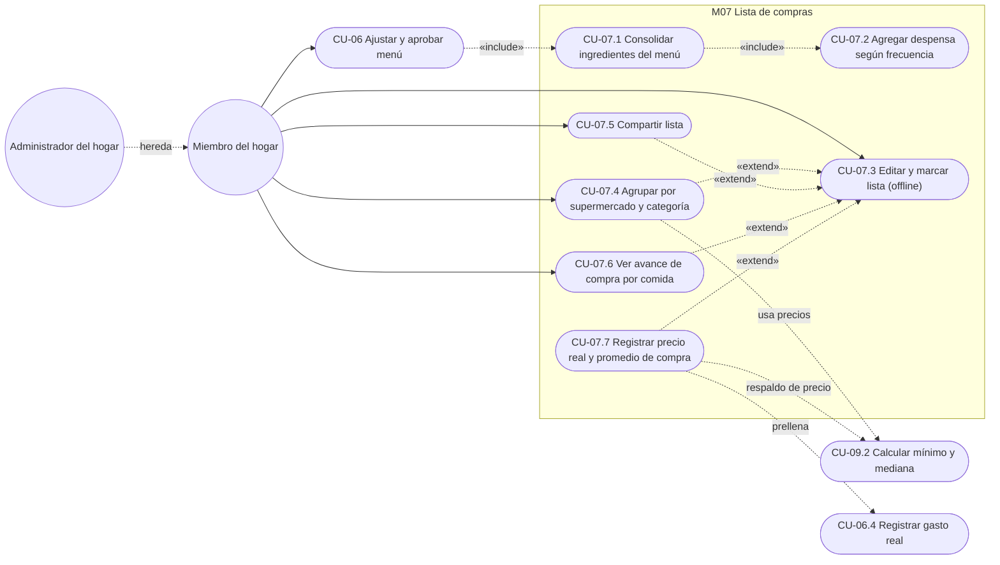

## 2. Casos de uso e historias

### CU-07.1 — Consolidar ingredientes del menú aprobado · RF-28 · HU-28

#### Especificación

| Campo | Detalle |
|---|---|
| Actor(es) | Miembro del hogar (al aprobar el menú); API (ejecuta la consolidación) |
| Prioridad / Sprint | M · S4 |
| Precondiciones | Menú semanal en estado "Aprobado" (RF-25); comensales registrados (RF-03); platillos con ingredientes, cantidad y unidad (RF-12); productos con unidad de compra y presentación (RF-13) |
| Disparador | El usuario aprueba el menú semanal |
| Flujo principal | 1. La API lee los detalles del menú aprobado (todos los días y tiempos activos).<br>2. Por cada platillo calcula el factor de escala = Σ factores de porción de los comensales activos ÷ porciones base (RN-07, D-02).<br>3. Multiplica cada ingrediente por el factor.<br>4. Convierte cada cantidad a la unidad de la presentación de compra del producto.<br>5. Suma las cantidades del mismo producto.<br>6. Calcula presentaciones a comprar = redondeo hacia arriba de (cantidad total ÷ tamaño de presentación).<br>7. Incluye la despensa de la semana (CU-07.2).<br>8. Guarda la lista con origen "Menú" por ítem y, para cada ítem, las comidas programadas (detalles del menú) que lo originan y su cantidad, base del avance por comida (CU-07.6).<br>9. Muestra la lista; si el menú se aprobó con exceso, el encabezado indica en rojo "Excede por Q__" (RN-11). |
| Flujos alternos | 8a. Se edita la lista después de generada (agregar o quitar productos) → se conservan los ítems agregados manualmente y el estado (comprado, ya lo tengo, precio real) de los productos que siguen en la lista. En v1 un menú aprobado no se reabre (M06). |
| Excepciones | E1. Ingrediente sin equivalencia entre su unidad y la de compra → se agrega con la unidad de la receta y la marca "Sin conversión"; el resto de la lista se genera.<br>E2. Menú no aprobado → no se genera lista y se indica "Aprueba el menú para generar la lista". |
| Postcondiciones | Existe una LISTA_COMPRAS ligada al MENU_SEMANAL con sus LISTA_ITEM consolidados y el vínculo de cada ítem con las comidas que lo originan. |
| Reglas y RNF | RN-07, RN-11, RN-13, RNF-04 (la lista generada queda disponible offline), RNF-06 |

Decisión D-02: la escala usa la suma de factores de porción de los comensales activos (cada uno 0.25 a 2.0, sugerido 1.0); la etiqueta adulto / niño no interviene. Ejemplo: "Rene" 1.0 + "Ana" 1.0 + "Sofía" 0.5 = 2.5 porciones; "Pollo en crema" con 2 lb de pollo para 4 porciones base → 2 × 2.5 ÷ 4 = 1.25 lb. Se usa la Σ factores congelada al aprobar (D-04).
Decisión D-03: si el menú se aprobó excediendo el presupuesto, la lista muestra el mismo aviso en rojo "Excede por Q__"; no bloquea la generación.
Supuesto: la conversión usa equivalencias fijas de masa y volumen (g, kg, lb, oz; ml, L) y unidades enteras; otras unidades de receta (taza, cucharadita) requieren equivalencia registrada en el producto.
Supuesto: la cantidad se redondea hacia arriba a presentaciones enteras (no se compra media bolsa).

#### Diagrama de actividad

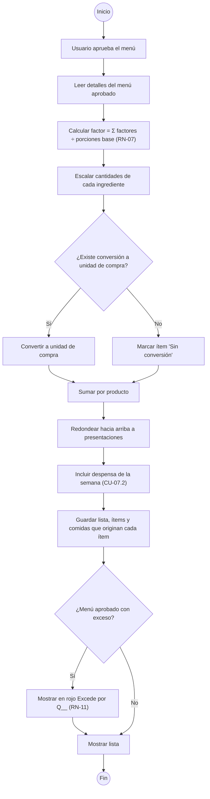

#### Diagrama de secuencia

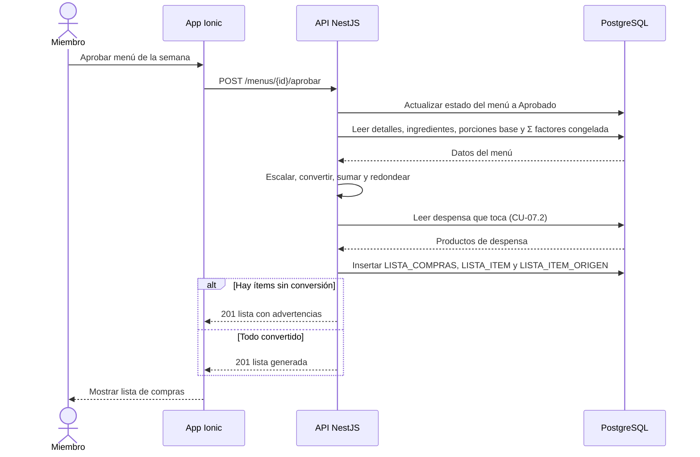

#### Historia de usuario HU-28 · 8 puntos

> **Como** miembro del hogar, **quiero** que al aprobar el menú se genere una lista con los ingredientes sumados y en la unidad en que se compran, **para** no calcular a mano cuánto comprar de cada producto.

#### Criterios de aceptación

```gherkin
# language: es
Característica: Consolidar ingredientes del menú aprobado

  # CA-28.1 Flujo principal: escalado y suma del mismo producto
  Escenario: Pollo usado en dos platillos para 6 comensales
    Dado un hogar con 6 comensales con factor 1.0 cada uno, Σ factores 6.0
    Y el menú de la semana del 25/10/2026 al 31/10/2026 con "Pollo en crema" el domingo y "Pepián de pollo" el miércoles
    Y "Pollo en crema" usa 2 lb de "Pollo en piezas" para 4 porciones base
    Y "Pepián de pollo" usa 2.5 lb de "Pollo en piezas" para 4 porciones base
    Y "Pollo en piezas" se compra en presentación de 1 lb
    Cuando apruebo el menú
    Entonces la lista contiene una sola línea "Pollo en piezas" con 6.75 lb requeridas
    Y la cantidad a comprar es 7 lb

  # CA-28.2 Conversión de gramos a unidad de compra
  Escenario: Tomate en gramos se convierte a libras
    Dado un hogar con 4 comensales con factor 1.0 cada uno, Σ factores 4.0
    Y el menú aprobado incluye "Carne guisada" con 500 g de tomate y "Tortitas de carne" con 300 g de tomate, ambos para 4 porciones base
    Y "Tomate" se compra por libra
    Cuando se genera la lista
    Entonces "Tomate" muestra 800 g requeridos equivalentes a 1.76 lb
    Y la cantidad a comprar es 2 lb

  # CA-28.3 Excepción: ingrediente sin conversión
  Escenario: Unidad de receta sin equivalencia
    Dado que "Spaghetti con carne" usa 1 cucharadita de "Orégano"
    Y "Orégano" se compra en sobre de 10 g sin equivalencia registrada para cucharadita
    Cuando se genera la lista
    Entonces "Orégano" aparece con "1 cucharadita" y la marca "Sin conversión"
    Y los demás productos de la lista se generan normalmente

  # CA-28.4 Validación: menú en borrador
  Escenario: Intentar generar la lista de un menú no aprobado
    Dado que el menú de la semana del 25/10/2026 está en estado "Borrador"
    Cuando abro la lista de compras de esa semana
    Entonces veo el mensaje "Aprueba el menú para generar la lista"
    Y no se crea ninguna lista

  # CA-28.5 Escalado con factores de porción
  Escenario: Hogar con un comensal de factor 0.5
    Dado un hogar con "Rene" 1.0, "Ana" 1.0 y "Sofía" 0.5, Σ factores 2.5
    Y el menú aprobado incluye "Pollo en crema" con 2 lb de "Pollo en piezas" para 4 porciones base
    Y "Pollo en piezas" se compra en presentación de 1 lb
    Cuando se genera la lista
    Entonces "Pollo en piezas" muestra 1.25 lb requeridas
    Y la cantidad a comprar es 2 lb

  # CA-28.6 Menú aprobado con exceso de presupuesto
  Escenario: La lista muestra el exceso aprobado
    Dado que el menú de la semana del 25/10/2026 se aprobó con almuerzo Q262.00 y presupuesto Q245.00
    Cuando abro la lista de compras de esa semana
    Entonces el encabezado muestra en rojo "Excede por Q17.00"
    Y la lista se puede usar normalmente
```

#### Subtareas

| ID | Tipo | Subtarea | Estimación (h) |
|---|---|---|---|
| ST-28.1 | DB | Tablas LISTA_COMPRAS, LISTA_ITEM (origen, cantidad requerida, cantidad a comprar, marca sin conversión) y LISTA_ITEM_ORIGEN (ítem ↔ detalle de menú) y migración Drizzle | 3 |
| ST-28.2 | BE | Servicio de consolidación: escalado RN-07 con Σ factores, suma por producto y registro de las comidas que originan cada ítem | 6 |
| ST-28.3 | BE | Conversión de unidades y redondeo a presentaciones; regeneración al reaprobar (8a) | 5 |
| ST-28.4 | FE | Pantalla de lista generada con advertencias "Sin conversión" y aviso en rojo "Excede por Q__" (RN-11) | 5 |
| ST-28.5 | QA | Casos PF-M7-28.1..6 y pruebas unitarias de escalado y conversión | 4 |
| ST-28.6 | DOC | Manual: "Cómo se genera tu lista de compras" | 1 |

---

### CU-07.2 — Agregar despensa según frecuencia · RF-29 · HU-29

#### Especificación

| Campo | Detalle |
|---|---|
| Actor(es) | Miembro del hogar (mantiene la despensa); API (la incluye en la lista) |
| Prioridad / Sprint | M · S4 |
| Precondiciones | Productos de despensa registrados con cantidad y frecuencia (DESPENSA_ITEM) |
| Disparador | Generación de la lista (incluido por CU-07.1) |
| Flujo principal | 1. El miembro registra en Despensa: producto, cantidad y frecuencia (semanal, quincenal o mensual).<br>2. Al generar la lista, la API calcula las semanas transcurridas desde la última inclusión de cada producto.<br>3. Si las semanas transcurridas ≥ intervalo (1, 2 o 4), el producto "toca" esta semana.<br>4. Agrega los productos que tocan con origen "Despensa".<br>5. Actualiza la fecha de última inclusión con la semana de la lista. |
| Flujos alternos | 3a. Producto sin inclusión previa → toca en la primera lista generada.<br>4a. El producto ya está en la lista por ingredientes → suma las cantidades en una línea con origen "Menú + Despensa". |
| Excepciones | E1. Cantidad ≤ 0 o frecuencia vacía al registrar → no se guarda y se indica el campo. |
| Postcondiciones | La lista contiene la despensa de la semana; cada DESPENSA_ITEM incluido tiene su última inclusión actualizada. |
| Reglas y RNF | RN-09 (semanas de domingo a sábado), RNF-06 |

Supuesto: frecuencias en v1 = semanal (cada semana), quincenal (cada 2 semanas) y mensual (cada 4 semanas), contadas desde la última inclusión; los valores reales por producto se confirman con la lista de Q814 (PA-03).
Supuesto: el catálogo de despensa solo admite categorías de alimentos; no existe categoría de limpieza en v1.
Supuesto: si un menú se regenera para la misma semana, la despensa no avanza dos veces la última inclusión.

#### Diagrama de actividad

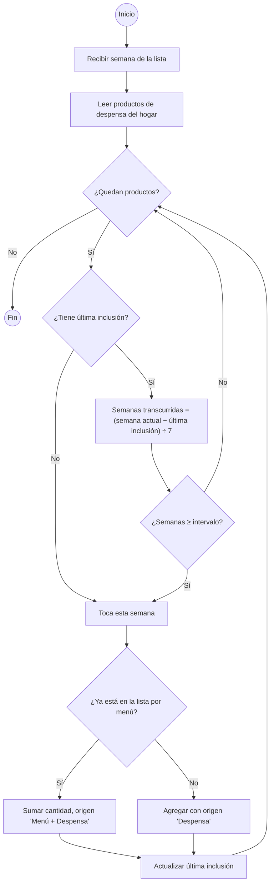

#### Diagrama de secuencia

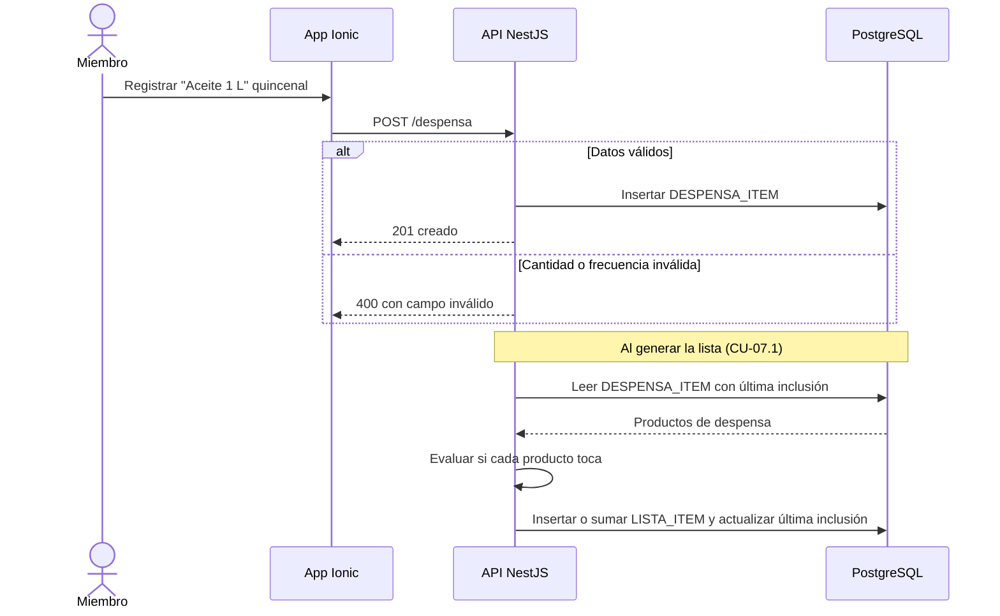

#### Historia de usuario HU-29 · 5 puntos

> **Como** miembro del hogar, **quiero** que la lista incluya automáticamente los productos de despensa que tocan esa semana, **para** no olvidar arroz, aceite o azúcar cuando se terminan.

#### Criterios de aceptación

```gherkin
# language: es
Característica: Agregar despensa según frecuencia

  # CA-29.1 Flujo principal
  Escenario: Solo se agregan los productos que tocan
    Dado la despensa del hogar:
      | Producto          | Cantidad | Frecuencia | Última inclusión |
      | Arroz blanco 2 lb | 2        | semanal    | 18/10/2026       |
      | Aceite 1 L        | 1        | quincenal  | 11/10/2026       |
      | Azúcar 5 lb       | 1        | mensual    | 04/10/2026       |
    Cuando se genera la lista de la semana del 25/10/2026
    Entonces la lista incluye "Arroz blanco 2 lb" x2 y "Aceite 1 L" x1 con origen "Despensa"
    Y no incluye "Azúcar 5 lb" porque solo han pasado 3 de 4 semanas
    Y la última inclusión de arroz y aceite queda en 25/10/2026

  # CA-29.2 Flujo alterno: producto también usado en el menú
  Escenario: Aceite requerido por un platillo y por la despensa
    Dado que "Pescado frito" requiere 0.5 L de "Aceite" y se compra 1 botella de 1 L por el menú
    Y "Aceite 1 L" de despensa toca esta semana con cantidad 1
    Cuando se genera la lista
    Entonces aparece una sola línea "Aceite 1 L" con 2 botellas y origen "Menú + Despensa"

  # CA-29.3 Flujo alterno: producto nuevo en despensa
  Escenario: Producto sin inclusión previa
    Dado que agrego "Frijol negro 1 lb" x2 semanal a la despensa el 22/10/2026
    Cuando se genera la lista de la semana del 25/10/2026
    Entonces la lista incluye "Frijol negro 1 lb" x2

  # CA-29.4 Validación
  Escenario: Cantidad inválida
    Cuando intento guardar "Café 400 g" en la despensa con cantidad 0
    Entonces veo "La cantidad debe ser mayor que 0"
    Y el producto no se guarda
```

#### Subtareas

| ID | Tipo | Subtarea | Estimación (h) |
|---|---|---|---|
| ST-29.1 | DB | Tabla DESPENSA_ITEM (cantidad, frecuencia, última inclusión) y migración | 2 |
| ST-29.2 | BE | CRUD de despensa y regla "toca esta semana" con fusión a la lista | 4 |
| ST-29.3 | FE | Pantalla Despensa (alta, edición, frecuencia) | 4 |
| ST-29.4 | QA | Casos PF-M7-29.1..4 y unitarias de frecuencia | 3 |
| ST-29.5 | DOC | Manual: "Configurar tu despensa" | 1 |

---

### CU-07.3 — Editar y marcar la lista (también sin conexión) · RF-30 · HU-30

#### Especificación

| Campo | Detalle |
|---|---|
| Actor(es) | Miembro del hogar |
| Prioridad / Sprint | M · S4 |
| Precondiciones | Lista de compras generada y descargada al dispositivo al menos una vez |
| Disparador | El usuario abre la lista de compras |
| Flujo principal | 1. La app muestra la lista desde el almacén local.<br>2. El usuario agrega un producto (del catálogo o texto libre) con cantidad, quita un producto o marca/desmarca "comprado" o "Ya lo tengo" (CU-07.6); al marcar comprado puede anotar el precio pagado (CU-07.7).<br>3. La app aplica el cambio en el almacén local y lo encola con marca de tiempo.<br>4. Con conexión, envía la cola a la API.<br>5. La API aplica los cambios y devuelve la versión vigente de la lista.<br>6. La app actualiza el almacén local y el contador "comprados / total". |
| Flujos alternos | 4a. Sin conexión → los cambios quedan en cola con indicador "n cambios pendientes"; al reconectar se envían automáticamente (RNF-04).<br>5a. Dos dispositivos cambiaron el mismo ítem → gana el cambio con marca de tiempo más reciente; si un ítem eliminado recibe después una marca de "comprado", se restaura como comprado. |
| Excepciones | E1. Cantidad ≤ 0 al agregar → se rechaza en la app.<br>E2. La API rechaza un cambio (p. ej. lista de otro hogar, RNF-06) → se descarta de la cola y se avisa al usuario. |
| Postcondiciones | Lista igual en servidor y dispositivos tras sincronizar; cola vacía. |
| Reglas y RNF | RNF-04, RNF-06, RNF-07 |

Supuesto: los productos de texto libre se permiten para no bloquear el uso en tienda; no se cotizan.
Supuesto: resolución de conflictos por ítem con "última escritura gana" usando la hora del dispositivo; la sincronización es idempotente (cada cambio tiene un identificador único).

#### Diagrama de actividad

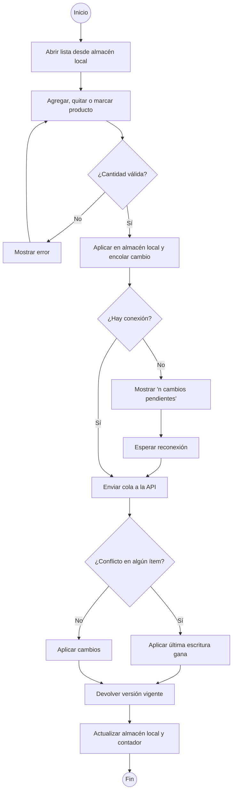

#### Diagrama de secuencia

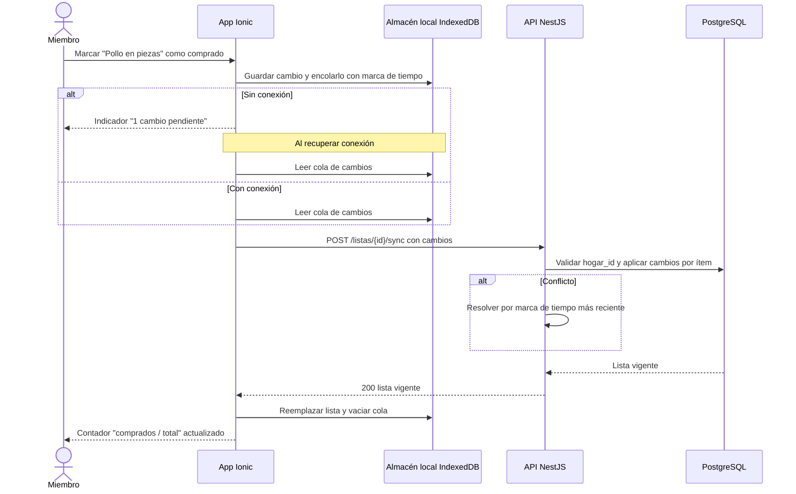

#### Historia de usuario HU-30 · 8 puntos

> **Como** miembro del hogar, **quiero** agregar, quitar y marcar productos comprados aunque no tenga señal en el supermercado, **para** llevar el control de la compra sin depender de la conexión.

#### Criterios de aceptación

```gherkin
# language: es
Característica: Editar y marcar la lista de compras

  # CA-30.1 Flujo principal con conexión
  Escenario: Marcar un producto como comprado
    Dado una lista con 12 productos y ninguno comprado
    Cuando marco "Pollo en piezas 7 lb" como comprado
    Entonces el producto aparece tachado
    Y el contador muestra "1 / 12 comprados"
    Y el cambio queda guardado en el servidor

  # CA-30.2 Flujo alterno sin conexión
  Escenario: Cambios en modo avión se sincronizan al reconectar
    Dado que el teléfono está en modo avión con la lista abierta
    Cuando marco 3 productos como comprados
    Y agrego "Tortillas" con cantidad 30
    Entonces veo "4 cambios pendientes"
    Y al desactivar el modo avión los 4 cambios se envían sin acción del usuario
    Y el indicador de pendientes desaparece

  # CA-30.3 Flujo alterno: conflicto entre dispositivos
  Escenario: Producto eliminado en un dispositivo y comprado en otro
    Dado que Rene quita "Azúcar 5 lb" de la lista a las 10:00 con conexión
    Y su esposa, sin conexión, marca "Azúcar 5 lb" como comprado a las 10:05
    Cuando el teléfono de su esposa se sincroniza
    Entonces "Azúcar 5 lb" vuelve a la lista marcado como comprado en ambos dispositivos

  # CA-30.4 Validación
  Escenario: Agregar producto con cantidad inválida
    Cuando agrego "Cebolla" con cantidad 0
    Entonces veo "La cantidad debe ser mayor que 0"
    Y el producto no se agrega
```

#### Subtareas

| ID | Tipo | Subtarea | Estimación (h) |
|---|---|---|---|
| ST-30.1 | DB | Campos de versión, actualizado_en, eliminado y texto libre en LISTA_ITEM | 2 |
| ST-30.2 | BE | Endpoints de ítems y endpoint de sincronización idempotente con resolución de conflictos | 6 |
| ST-30.3 | FE | UI de lista: agregar, quitar, marcar, contador | 5 |
| ST-30.4 | FE | Almacén local IndexedDB, cola de cambios y sincronización al reconectar (service worker) | 6 |
| ST-30.5 | QA | Casos PF-M7-30.1..4, prueba en modo avión y prueba con dos dispositivos | 5 |
| ST-30.6 | DOC | Manual: "Usar la lista en el supermercado sin conexión" | 1 |

---

### CU-07.4 — Agrupar por supermercado sugerido y categoría · RF-31 · HU-31

#### Especificación

| Campo | Detalle |
|---|---|
| Actor(es) | Miembro del hogar |
| Prioridad / Sprint | S · S5 |
| Precondiciones | Lista generada; precios mínimos calculados (CU-09.2) |
| Disparador | El usuario elige la vista "Por supermercado" |
| Flujo principal | 1. La app pide la lista agrupada.<br>2. La API obtiene por producto el precio mínimo vigente (≤ 14 días) y su supermercado (RN-08).<br>3. Asigna cada ítem al supermercado de precio mínimo.<br>4. Dentro de cada supermercado agrupa por categoría del producto.<br>5. Calcula costo por ítem = cantidad a comprar × precio mínimo, y subtotal por supermercado.<br>6. La app muestra grupos, categorías, precios y subtotales. |
| Flujos alternos | 2a. Sin precio vigente → usa el último precio conocido y su supermercado con la advertencia "Precio del dd/mm/aaaa" (RN-08).<br>2b. Sin ningún precio o ítem de texto libre → grupo "Sin precio"; no suma a subtotales.<br>3a. Empate de precio mínimo → se asigna al supermercado preferido del hogar (RF-09); si ninguno es preferido, al primero en orden alfabético. |
| Excepciones | E1. Sin conexión → muestra la última agrupación descargada con su fecha. |
| Postcondiciones | Lista visible por supermercado y categoría con subtotales. |
| Reglas y RNF | RN-08, RNF-02, RNF-04 |

Supuesto: la regla de desempate es la misma que usa CU-09.2.
Supuesto: la agrupación es una vista; no cambia los ítems ni las marcas de comprado.

#### Diagrama de actividad

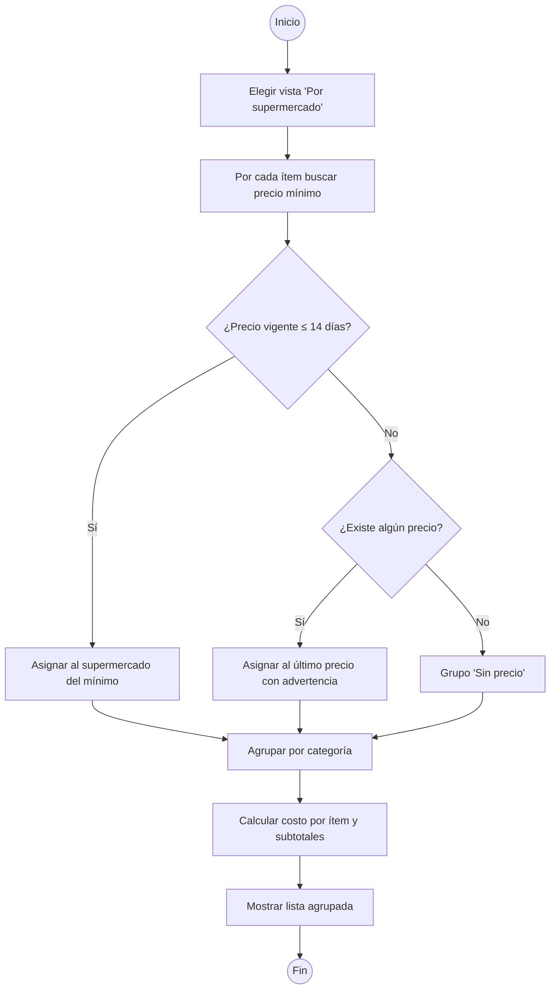

#### Diagrama de secuencia

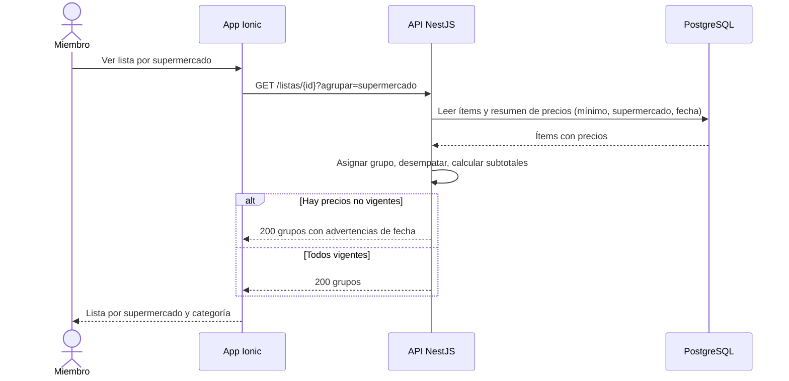

#### Historia de usuario HU-31 · 5 puntos

> **Como** miembro del hogar, **quiero** ver la lista agrupada por el supermercado donde cada producto está más barato y por categoría, **para** saber qué comprar en cada tienda y ahorrar.

#### Criterios de aceptación

```gherkin
# language: es
Característica: Agrupar lista por supermercado y categoría

  # CA-31.1 Flujo principal
  Escenario: Productos asignados al supermercado más barato
    Dado los precios vigentes al 24/10/2026:
      | Producto             | Walmart | Paiz   |
      | Arroz blanco 2 lb    | 12.50   | 13.00  |
      | Pollo en piezas (lb) | 22.50   | 21.90  |
      | Tomate (lb)          | 6.50    | 6.25   |
    Y la lista tiene Arroz blanco 2 lb x2, Pollo en piezas 7 lb y Tomate 2 lb
    Cuando veo la lista por supermercado
    Entonces el grupo Walmart contiene Arroz blanco 2 lb x2 por Q25.00 con subtotal Q25.00
    Y el grupo Paiz contiene Pollo en piezas 7 lb por Q153.30 en "Carnes" y Tomate 2 lb por Q12.50 en "Verduras"
    Y el subtotal de Paiz es Q165.80 y el total de la lista es Q190.80

  # CA-31.2 Flujo alterno: precio no vigente
  Escenario: Último precio con más de 14 días
    Dado que el único precio de "Aceite 1 L" es Q24.95 en Walmart del 03/10/2026
    Cuando veo la lista por supermercado el 24/10/2026
    Entonces "Aceite 1 L" aparece en Walmart con la advertencia "Precio del 03/10/2026"

  # CA-31.3 Flujo alterno: empate
  Escenario: Mismo precio en dos supermercados
    Dado que "Azúcar 5 lb" cuesta Q32.00 en Walmart y Q32.00 en Paiz
    Y el supermercado preferido del hogar es Paiz
    Cuando veo la lista por supermercado
    Entonces "Azúcar 5 lb" aparece en el grupo Paiz

  # CA-31.4 Sin precio
  Escenario: Producto sin ningún precio registrado
    Dado que "Tortillas" fue agregado como texto libre
    Cuando veo la lista por supermercado
    Entonces "Tortillas" aparece en el grupo "Sin precio"
    Y no suma a ningún subtotal
```

#### Subtareas

| ID | Tipo | Subtarea | Estimación (h) |
|---|---|---|---|
| ST-31.1 | BE | Endpoint de lista agrupada: asignación por mínimo, vigencia, desempate y subtotales | 4 |
| ST-31.2 | FE | Vista por supermercado y categoría con subtotales y advertencias | 4 |
| ST-31.3 | QA | Casos PF-M7-31.1..4 y prueba de regresión de la lista (CU-07.3) | 3 |
| ST-31.4 | DOC | Manual: "Dónde comprar cada producto" | 1 |

---

### CU-07.5 — Compartir la lista · RF-32 · HU-32

#### Especificación

| Campo | Detalle |
|---|---|
| Actor(es) | Miembro del hogar |
| Prioridad / Sprint | C · S4 |
| Precondiciones | Lista disponible en el dispositivo |
| Disparador | El usuario toca "Compartir" |
| Flujo principal | 1. La app arma un texto con encabezado "Lista de compras dd/mm–dd/mm" y los productos pendientes con cantidad, agrupados como en la vista actual.<br>2. Abre el menú nativo de compartir (Capacitor Share en Android, Web Share en PWA).<br>3. El usuario elige WhatsApp u otra app y envía. |
| Flujos alternos | 1a. El usuario activa "Incluir comprados" → el texto incluye todos los productos.<br>2a. El navegador no soporta compartir → copia el texto al portapapeles y muestra "Lista copiada". |
| Excepciones | E1. No hay productos pendientes → muestra "No hay productos pendientes" y ofrece "Incluir comprados". |
| Postcondiciones | Texto enviado o copiado; la lista no cambia. |
| Reglas y RNF | RNF-04 (funciona sin conexión), RNF-08 |

Supuesto: por defecto se comparten solo los productos pendientes; los precios no se incluyen en el texto.

#### Diagrama de actividad

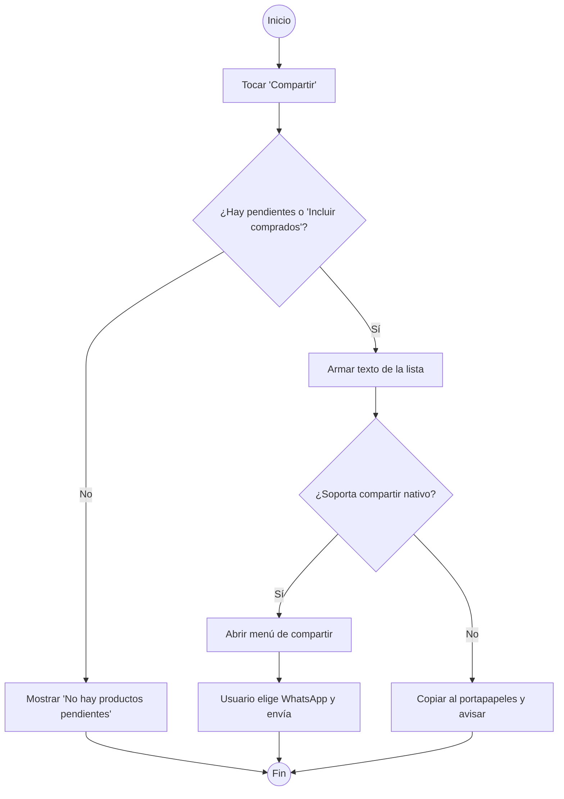

#### Diagrama de secuencia

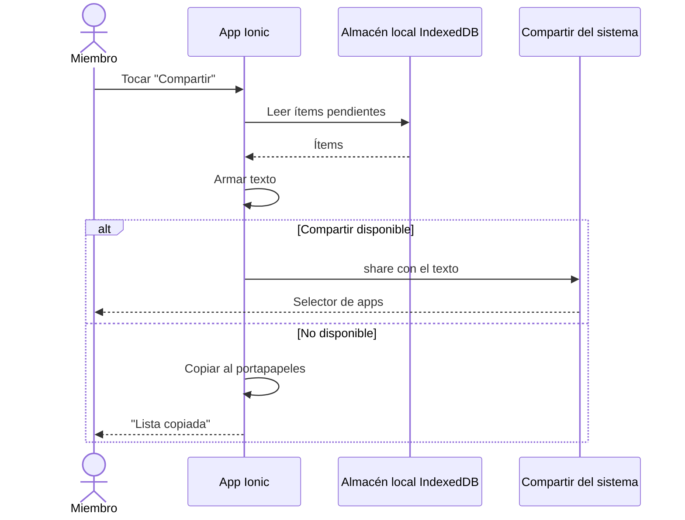

#### Historia de usuario HU-32 · 2 puntos

> **Como** miembro del hogar, **quiero** compartir la lista por WhatsApp, **para** que otra persona de la familia pueda hacer la compra.

#### Criterios de aceptación

```gherkin
# language: es
Característica: Compartir la lista de compras

  # CA-32.1 Flujo principal
  Escenario: Compartir pendientes por WhatsApp
    Dado una lista de la semana del 25/10/2026 con 12 productos y 4 marcados como comprados
    Cuando toco "Compartir" y elijo WhatsApp
    Entonces el mensaje inicia con "Lista de compras 25/10–31/10"
    Y contiene los 8 productos pendientes con su cantidad, por ejemplo "Pollo en piezas — 7 lb"

  # CA-32.2 Flujo alterno: sin conexión y sin compartir nativo
  Escenario: Navegador de escritorio sin compartir nativo
    Dado que uso la PWA en un navegador que no soporta compartir
    Y no tengo conexión
    Cuando toco "Compartir"
    Entonces el texto de la lista se copia al portapapeles
    Y veo "Lista copiada"

  # CA-32.3 Excepción: sin pendientes
  Escenario: Todos los productos comprados
    Dado que los 12 productos de la lista están marcados como comprados
    Cuando toco "Compartir"
    Entonces veo "No hay productos pendientes" y la opción "Incluir comprados"
```

#### Subtareas

| ID | Tipo | Subtarea | Estimación (h) |
|---|---|---|---|
| ST-32.1 | FE | Generador del texto de la lista (pendientes, agrupación, opción incluir comprados) | 3 |
| ST-32.2 | FE | Integración Capacitor Share / Web Share y respaldo al portapapeles | 2 |
| ST-32.3 | QA | Casos PF-M7-32.1..3 en Android y navegador | 2 |
| ST-32.4 | DOC | Manual: "Compartir la lista" | 1 |

---

### CU-07.6 — Ver el avance de compra por comida · RF-43 · HU-43

#### Especificación

| Campo | Detalle |
|---|---|
| Actor(es) | Miembro del hogar |
| Prioridad / Sprint | M · S4 |
| Precondiciones | Lista de compras generada desde un menú aprobado (CU-07.1) con el vínculo de cada ítem a las comidas que lo originan; lista descargada al dispositivo al menos una vez (CU-07.3). |
| Disparador | El usuario abre la pestaña "Por comida" de la lista o marca un ingrediente. |
| Flujo principal | 1. La app lee la lista y los vínculos ítem ↔ comida desde el almacén local.<br>2. Por cada comida programada (fecha, tiempo y platillo) cuenta sus ingredientes cubiertos, es decir marcados "Comprado" o "Ya lo tengo", sobre su total de ingredientes en la lista.<br>3. Muestra cada comida con su barra de avance, p. ej. "Pepián de pollo · miércoles almuerzo · 4 de 6".<br>4. Cuando una comida llega a "n de n" la marca "Lista para preparar" (RN-13).<br>5. Muestra arriba el avance general de la semana: productos cubiertos sobre productos de la lista, con porcentaje redondeado al entero, p. ej. "18 de 31 productos (58 %)".<br>6. El usuario toca una comida y ve sus ingredientes pendientes; puede marcar cada uno "Comprado" o "Ya lo tengo" (el cambio se guarda y sincroniza como en CU-07.3).<br>7. La app recalcula el avance de todas las comidas que usan ese producto. |
| Flujos alternos | 2a. Sin conexión → el avance se calcula en el dispositivo con el almacén local y los cambios quedan en cola (RNF-04).<br>6a. Producto compartido por varias comidas (p. ej. "Cebolla" en tres comidas) → al marcarlo una vez cuenta como cubierto en todas (RN-13).<br>6b. El usuario desmarca un ingrediente → la comida vuelve a "n−1 de n" y pierde la marca "Lista para preparar". |
| Excepciones | E1. Ítems agregados a mano, de texto libre o solo de despensa no pertenecen a ninguna comida → cuentan solo en el avance general.<br>E2. Comida cuyo platillo no tiene ingredientes registrados ("Incompleto", CU-03.2) → se muestra "Sin ingredientes registrados" y nunca se marca "Lista para preparar".<br>E3. Ítem eliminado de la lista → deja de contar en la comida y en el avance general. |
| Postcondiciones | Avance por comida y avance general visibles y consistentes en todos los dispositivos tras sincronizar. |
| Reglas y RNF | RN-13, RNF-04, RNF-06, RNF-02 |

Supuesto: "Ya lo tengo" no se cotiza ni suma al gasto real (CU-07.7); en la lista se muestra distinto de "Comprado" (texto "Ya lo tengo", sin tachar el precio).
Supuesto: el avance se calcula sobre ítems de la lista (productos consolidados), no sobre cantidades: un ítem marcado cuenta completo aunque se haya comprado menos de lo sugerido.

#### Diagrama de actividad

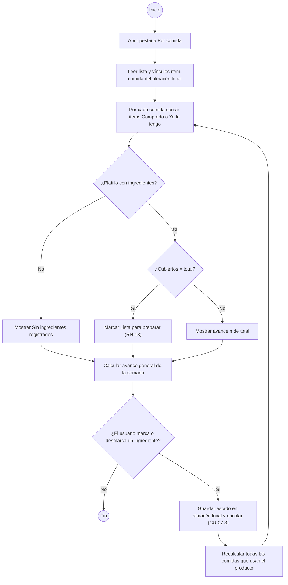

#### Diagrama de secuencia

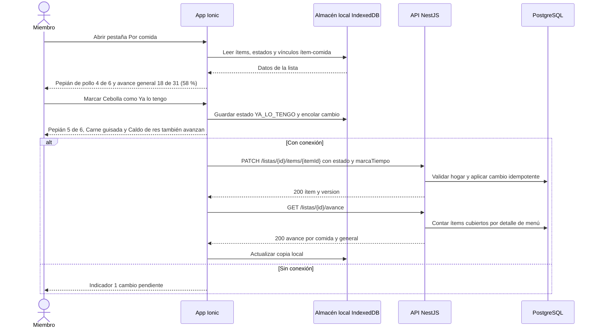

#### Historia de usuario HU-43 · 5 puntos

> **Como** miembro del hogar, **quiero** ver cuántos ingredientes de cada comida ya compré o ya tengo, **para** saber qué comidas de la semana están listas para preparar y cuánto me falta de la compra.

#### Criterios de aceptación

```gherkin
# language: es
Característica: Avance de compra por comida

  # CA-43.1 Flujo principal
  Escenario: Avance parcial de una comida
    Dado el menú aprobado de la semana del 25/10/2026 con "Pepián de pollo" el miércoles en el almuerzo
    Y "Pepián de pollo" tiene 6 ingredientes en la lista: "Pollo en piezas", "Miltomate", "Tomate", "Cebolla", "Pepitoria" y "Ajonjolí"
    Y están marcados como comprados "Pollo en piezas", "Miltomate", "Tomate" y "Cebolla"
    Cuando abro la pestaña "Por comida"
    Entonces veo "Pepián de pollo · miércoles almuerzo · 4 de 6"
    Y "Pepián de pollo" no muestra "Lista para preparar"

  # CA-43.2 Flujo alterno: Ya lo tengo completa la comida
  Escenario: Marcar Ya lo tengo cuenta como cubierto
    Dado que "Pepián de pollo" está en "4 de 6" y faltan "Pepitoria" y "Ajonjolí"
    Cuando marco "Pepitoria" como comprado
    Y marco "Ajonjolí" como "Ya lo tengo"
    Entonces veo "Pepián de pollo · 6 de 6" con la marca "Lista para preparar"
    Y "Ajonjolí" no suma al gasto real de la semana

  # CA-43.3 Flujo alterno: producto compartido
  Escenario: Un producto compartido cuenta para todas sus comidas
    Dado que "Cebolla" es ingrediente de "Pepián de pollo", "Carne guisada" y "Caldo de res"
    Y "Cebolla" está pendiente
    Y "Carne guisada" está en "2 de 5" y "Caldo de res" en "3 de 7"
    Cuando marco "Cebolla" como comprado una sola vez
    Entonces "Carne guisada" pasa a "3 de 5" y "Caldo de res" a "4 de 7"
    Y "Pepián de pollo" también suma ese ingrediente

  # CA-43.4 Avance general de la semana
  Escenario: Avance general con porcentaje redondeado
    Dado una lista con 31 productos activos
    Y 15 están comprados y 3 marcados "Ya lo tengo"
    Cuando abro la lista
    Entonces veo "18 de 31 productos (58 %)"

  # CA-43.5 Sin conexión
  Escenario: El avance se actualiza en modo avión
    Dado que el teléfono está en modo avión con la lista abierta
    Y "Tortitas de carne" está en "3 de 4"
    Cuando marco "Pan molido" como comprado
    Entonces veo "Tortitas de carne · 4 de 4" con la marca "Lista para preparar"
    Y veo "1 cambio pendiente"

  # CA-43.6 Validación: desmarcar quita la marca
  Escenario: Desmarcar un ingrediente de una comida lista
    Dado que "Pescado frito" está en "4 de 4" con la marca "Lista para preparar"
    Cuando desmarco "Limón"
    Entonces veo "Pescado frito · 3 de 4"
    Y "Pescado frito" ya no muestra "Lista para preparar"
```

#### Subtareas

| ID | Tipo | Subtarea | Estimación (h) |
|---|---|---|---|
| ST-43.1 | DB | Estado del ítem (PENDIENTE, COMPRADO, YA_LO_TENGO) en LISTA_ITEM e índice de LISTA_ITEM_ORIGEN por detalle de menú | 1 |
| ST-43.2 | BE | Operación MARCAR_YA_LO_TENGO en PATCH de ítem y en sincronización idempotente | 2 |
| ST-43.3 | BE | Endpoint GET /listas/{id}/avance: avance por comida y general (RN-13) | 3 |
| ST-43.4 | FE | Cálculo del avance en el dispositivo desde IndexedDB (también offline) | 3 |
| ST-43.5 | FE | Pestaña "Por comida" con barras, marca "Lista para preparar", avance general y acción "Ya lo tengo" | 4 |
| ST-43.6 | QA | Casos PF-M7-43.1..6, pruebas unitarias del cálculo y prueba en modo avión | 4 |
| ST-43.7 | DOC | Manual: "Ver qué comidas están listas para preparar" | 1 |

---

### CU-07.7 — Registrar el precio real y consultar el promedio de compra · RF-44 · HU-44

#### Especificación

| Campo | Detalle |
|---|---|
| Actor(es) | Miembro del hogar; API (calcula promedio y prellenado) |
| Prioridad / Sprint | M · S4 |
| Precondiciones | Lista de compras generada (CU-07.1) y abierta en el dispositivo (CU-07.3). |
| Disparador | El usuario marca un producto como "Comprado". |
| Flujo principal | 1. La app marca el ítem como comprado y muestra el campo opcional "Precio pagado (Q)", con la cantidad comprada prellenada en presentaciones del catálogo (p. ej. 1 bolsa de 2 lb) y, como referencia, el promedio de compra y la mediana del producto.<br>2. El usuario escribe el precio total pagado por ese ítem o lo omite.<br>3. La app valida el precio (mayor que Q0.00, máximo 2 decimales, hasta Q99,999.99).<br>4. Guarda el precio en el almacén local y lo encola para sincronizar (RNF-04).<br>5. La API guarda el precio real y el precio normalizado a la presentación del catálogo = precio pagado ÷ presentaciones compradas.<br>6. Recalcula el promedio de compra del producto: promedio de los precios normalizados del hogar en las últimas 12 semanas, redondeado a centavos (RN-12).<br>7. Recalcula la suma de precios reales de la lista y la propone como gasto real de la semana (RF-27), editable antes de guardarlo en CU-06.4.<br>8. El promedio se muestra junto a la mediana en la lista y en la ficha del producto, p. ej. "Promedio de compra Q27.20 (3 compras) · Mediana Q27.50". |
| Flujos alternos | 2a. El usuario no registra precio → el ítem queda comprado sin precio; no entra al promedio ni a la suma.<br>2b. Compró otra presentación (p. ej. bolsa de 5 lb en lugar de la de 2 lb del catálogo) → indica el contenido comprado y el sistema normaliza: precio × tamaño de la presentación del catálogo ÷ contenido comprado.<br>2c. Corrige el precio después → el último valor reemplaza al anterior (última escritura gana, CU-07.3).<br>6a. No hay precio de mercado vigente (ninguno de 14 días o menos, RN-08) → el costo estimado usa el promedio de compra como respaldo con la etiqueta "Precio de compra promedio"; si tampoco hay promedio, se usa el último precio con advertencia.<br>7a. Ya existe un gasto real guardado para la semana → no se sobrescribe; se muestra "Suma de precios registrados Q__" como sugerencia. |
| Excepciones | E1. Precio ≤ 0 → "El precio debe ser mayor que Q0.00" y no se guarda el precio (el ítem sigue comprado).<br>E2. Más de 2 decimales → "Usa máximo 2 decimales".<br>E3. Producto de texto libre → el precio suma al gasto real pero no genera promedio (no tiene producto de catálogo).<br>E4. El usuario desmarca el ítem o lo cambia a "Ya lo tengo" → el precio se descarta y sale del promedio y de la suma. |
| Postcondiciones | Precio real guardado y sincronizado; promedio de compra del producto actualizado; gasto real de la semana prellenado. |
| Reglas y RNF | RN-08, RN-12, RNF-04, RNF-06 |

Supuesto: el precio registrado es el total pagado por el ítem de la lista (todas sus presentaciones), no el precio unitario.
Supuesto: la ventana de 12 semanas se cuenta hacia atrás desde la fecha de consulta (84 días) usando la fecha en que se marcó comprado; los precios de compra no alimentan la mediana ni el mínimo de mercado (RF-36), para no mezclar precios de tienda con precios del hogar.

**Ejemplo numérico verificable** (producto "Pechuga de pollo", presentación del catálogo: bolsa de 2 lb; consulta el 25/10/2026; ventana desde el 02/08/2026):

| Fecha de compra | Pagado | Comprado | Normalizado a bolsa de 2 lb | ¿Entra? |
|---|---|---|---|---|
| 12/07/2026 | Q24.00 | 1 bolsa de 2 lb | Q24.00 | No, más de 12 semanas |
| 13/09/2026 | Q66.25 | bolsa de 5 lb | 66.25 × 2 ÷ 5 = Q26.50 | Sí |
| 04/10/2026 | Q54.00 | 2 bolsas de 2 lb | 54.00 ÷ 2 = Q27.00 | Sí |
| 18/10/2026 | Q28.10 | 1 bolsa de 2 lb | Q28.10 | Sí |

Promedio de compra = (26.50 + 27.00 + 28.10) ÷ 3 = 81.60 ÷ 3 = **Q27.20**.

#### Diagrama de actividad

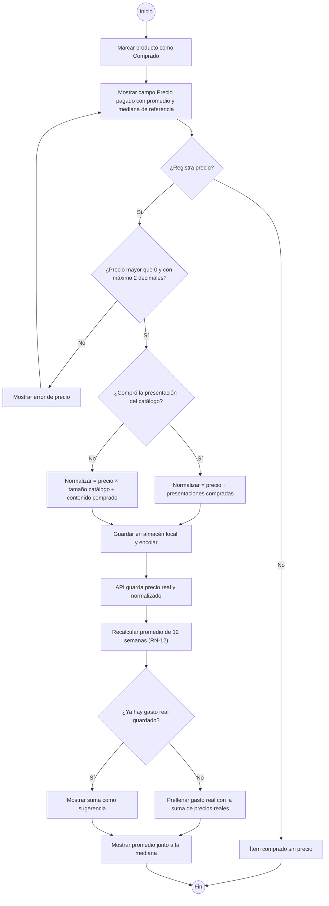

#### Diagrama de secuencia

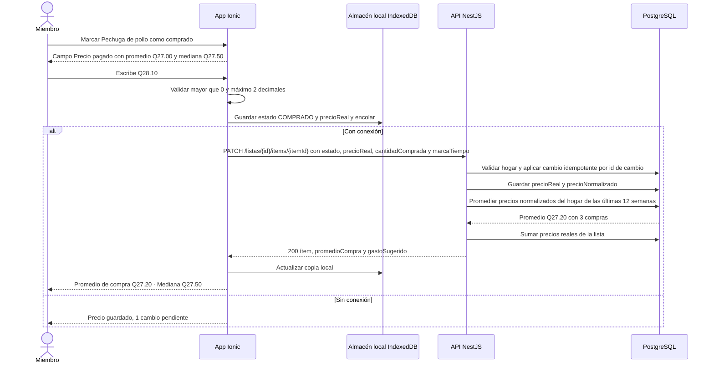

#### Historia de usuario HU-44 · 8 puntos

> **Como** miembro del hogar, **quiero** anotar cuánto pagué por cada producto al marcarlo como comprado, **para** conocer el precio promedio al que realmente compro y que el gasto de la semana se llene solo.

#### Criterios de aceptación

```gherkin
# language: es
Característica: Precio real y promedio de compra

  # CA-44.1 Flujo principal
  Escenario: Registrar precio y recalcular el promedio de 12 semanas
    Dado que "Pechuga de pollo" se compra en bolsa de 2 lb
    Y el hogar registró precios normalizados de Q26.50 el 13/09/2026 y Q27.00 el 04/10/2026
    Y registró Q24.00 el 12/07/2026
    Cuando el 25/10/2026 marco "Pechuga de pollo" como comprado con 1 bolsa y precio Q28.10
    Entonces el promedio de compra de "Pechuga de pollo" es Q27.20 con 3 compras
    Y veo "Promedio de compra Q27.20 · Mediana Q27.50"

  # CA-44.2 Flujo alterno: otra presentación
  Escenario: Normalizar el precio de una presentación distinta
    Dado que "Pechuga de pollo" tiene presentación de catálogo bolsa de 2 lb
    Cuando marco "Pechuga de pollo" como comprado indicando bolsa de 5 lb y precio Q66.25
    Entonces el precio normalizado guardado es Q26.50

  # CA-44.3 Flujo alterno: prellenado del gasto real
  Escenario: La suma de precios reales prellena el gasto de la semana
    Dado que en la lista de la semana del 25/10/2026 registré "Pollo en piezas" Q54.00, "Pechuga de pollo" Q27.00 y "Tomate" Q18.50
    Y marqué "Ajonjolí" como "Ya lo tengo"
    Y no hay gasto real guardado para la semana
    Cuando abro "Registrar gasto real"
    Entonces el monto aparece prellenado con Q99.50
    Y puedo cambiarlo a Q105.00 antes de guardar

  # CA-44.4 Respaldo cuando no hay precio vigente
  Escenario: El promedio de compra respalda el costo estimado
    Dado que el último precio de mercado de "Miltomate" es del 20/09/2026, con más de 14 días
    Y el promedio de compra de "Miltomate" es Q8.75
    Cuando se calcula el costo de "Pepián de pollo"
    Entonces "Miltomate" usa Q8.75 con la etiqueta "Precio de compra promedio"

  # CA-44.5 Validación de precio
  Esquema del escenario: Precio inválido
    Dado que marco "Cebolla" como comprado
    Cuando escribo el precio <precio>
    Entonces veo "<mensaje>"
    Y "Cebolla" queda comprado sin precio

    Ejemplos:
      | precio | mensaje                               |
      | 0      | El precio debe ser mayor que Q0.00    |
      | -5.00  | El precio debe ser mayor que Q0.00    |
      | 12.345 | Usa máximo 2 decimales                |

  # CA-44.6 Sin conexión
  Escenario: Precio registrado en modo avión
    Dado que el teléfono está en modo avión con la lista abierta
    Cuando marco "Arroz" como comprado con precio Q12.50
    Entonces veo "1 cambio pendiente"
    Y al reconectar el precio se sincroniza una sola vez aunque el envío se repita
```

#### Subtareas

| ID | Tipo | Subtarea | Estimación (h) |
|---|---|---|---|
| ST-44.1 | DB | Campos precioReal, cantidadComprada, contenidoComprado y precioNormalizado en LISTA_ITEM e índice por producto y fecha de compra | 2 |
| ST-44.2 | BE | PATCH de ítem y sync con precio: validación, normalización a la presentación del catálogo e idempotencia | 4 |
| ST-44.3 | BE | Promedio de compra de 12 semanas (RN-12), endpoint GET /productos/{id}/promedio-compra y respaldo en el costo estimado (RN-08) | 4 |
| ST-44.4 | BE | Suma de precios reales de la lista y gasto sugerido para RF-27 | 2 |
| ST-44.5 | FE | Campo "Precio pagado" al marcar comprado, otra presentación y referencia de promedio y mediana | 4 |
| ST-44.6 | FE | Promedio junto a la mediana en lista y ficha de producto; prellenado del gasto real en CU-06.4 | 3 |
| ST-44.7 | QA | Casos PF-M7-44.1..6, pruebas unitarias de normalización y promedio y prueba en modo avión | 5 |
| ST-44.8 | DOC | Manual: "Anotar lo que pagaste y ver tu precio promedio" | 1 |

---

## 3. Resumen del módulo

| HU | RF | CU | Prioridad | Sprint | Puntos | Horas |
|---|---|---|---|---|---|---|
| HU-28 | RF-28 | CU-07.1 | M | S4 | 8 | 24 |
| HU-29 | RF-29 | CU-07.2 | M | S4 | 5 | 14 |
| HU-30 | RF-30 | CU-07.3 | M | S4 | 8 | 25 |
| HU-31 | RF-31 | CU-07.4 | S | S5 | 5 | 12 |
| HU-32 | RF-32 | CU-07.5 | C | S4 | 2 | 8 |
| HU-43 | RF-43 | CU-07.6 | M | S4 | 5 | 18 |
| HU-44 | RF-44 | CU-07.7 | M | S4 | 8 | 25 |
| **Total** | | | | | **41** | **126** |

Por sprint: S4 = 36 puntos / 114 h; S5 = 5 puntos / 12 h.
