# M08 — Precios

| Campo | Valor |
|---|---|
| SRS | SRS-MF-001 v1.0 (aprobado 2026-10-22) |
| Requerimientos | RF-33 a RF-38 |
| Caso de uso macro | CU-08 (Registrar precio manual o ticket) · CU-09 (Actualizar precios automáticos) |
| Sprint(s) | S5 |
| Fase del ciclo de vida | 2. Requerimientos — análisis de casos de uso |

Mantiene precios de los productos por supermercado: el worker los obtiene de Walmart y Paiz los sábados y domingos a las 21:00 (La Torre en fase 2) y los usuarios registran los de Super Fresh u otros a mano o desde un ticket. Con esos precios calcula la mediana (presupuesto, RN-01) y el mínimo con su supermercado (sugerencia de compra, RN-08), guarda el histórico y conserva el último precio válido cuando una corrida falla. La extracción respeta robots.txt, términos de uso y 1 solicitud/segundo por sitio (RNF-12, R-03).

## 1. Diagrama de casos de uso del módulo

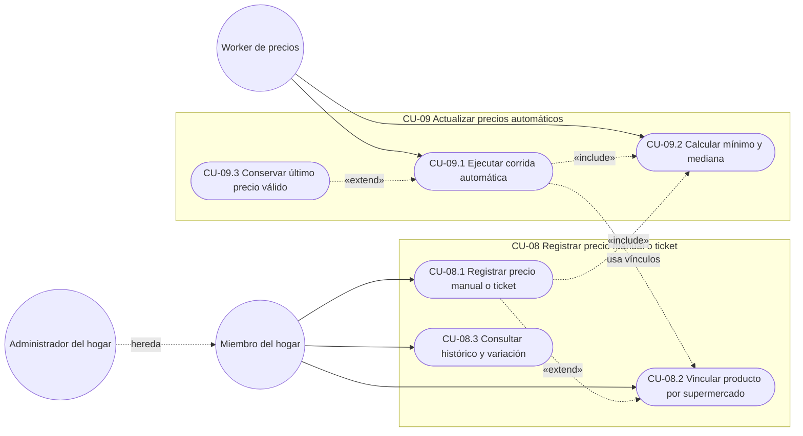

## 2. Casos de uso e historias

### CU-08.1 — Registrar precio manual o desde ticket · RF-34 · HU-34

#### Especificación

| Campo | Detalle |
|---|---|
| Actor(es) | Miembro del hogar |
| Prioridad / Sprint | M · S5 |
| Precondiciones | Sesión iniciada; producto en el catálogo (RF-13) |
| Disparador | El usuario abre "Registrar precio" o "Escanear ticket" |
| Flujo principal | **Manual:**<br>1. Elige supermercado, producto, precio (Q) y fecha de compra.<br>2. La app valida y envía.<br>3. La API guarda el PRECIO con origen "manual", hogar y fecha.<br>4. Encola el recálculo de mínimo y mediana del producto (CU-09.2).<br>**Ticket:**<br>5. Toma o sube la foto del ticket y elige supermercado y fecha.<br>6. La API guarda la foto y obtiene por OCR las líneas (descripción, precio).<br>7. La API propone el producto de cada línea comparando con el nombre en tienda de los vínculos (RF-35).<br>8. El usuario corrige, asigna o descarta líneas y confirma.<br>9. La API guarda los precios con origen "ticket" y la foto adjunta y encola el recálculo. |
| Flujos alternos | 1a. No existe vínculo del producto con ese supermercado → se crea un vínculo mínimo (supermercado, producto, presentación) desde CU-08.2.<br>7a. Línea sin coincidencia → queda "Sin asignar" para que el usuario elija el producto o la descarte.<br>6a. OCR no obtiene líneas legibles → mensaje "No se pudo leer el ticket" y pasa a captura manual con la foto visible. |
| Excepciones | E1. Precio ≤ 0 o con más de 2 decimales → se rechaza.<br>E2. Fecha de compra futura → se rechaza.<br>E3. Foto mayor a 10 MB o en formato distinto de JPG/PNG → se rechaza. |
| Postcondiciones | Precios guardados con origen, fecha y hogar; mínimo y mediana del producto recalculados. |
| Reglas y RNF | RN-08, RNF-05, RNF-06, R-03 |

Supuesto: el OCR solo propone; ningún precio de ticket se guarda sin confirmación del usuario. El motor OCR se elige en diseño.
Supuesto: los precios manuales y de ticket pertenecen al hogar que los registra (RNF-06) y solo entran en sus cálculos; los precios automáticos son comunes a todos los hogares.
Supuesto: límite de foto 10 MB, JPG o PNG.

#### Diagrama de actividad

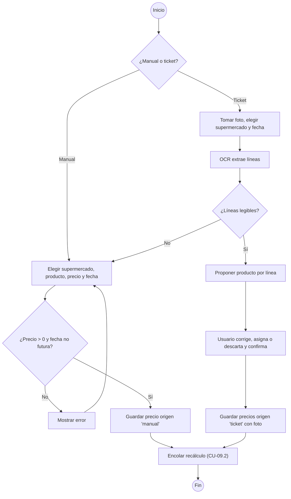

#### Diagrama de secuencia

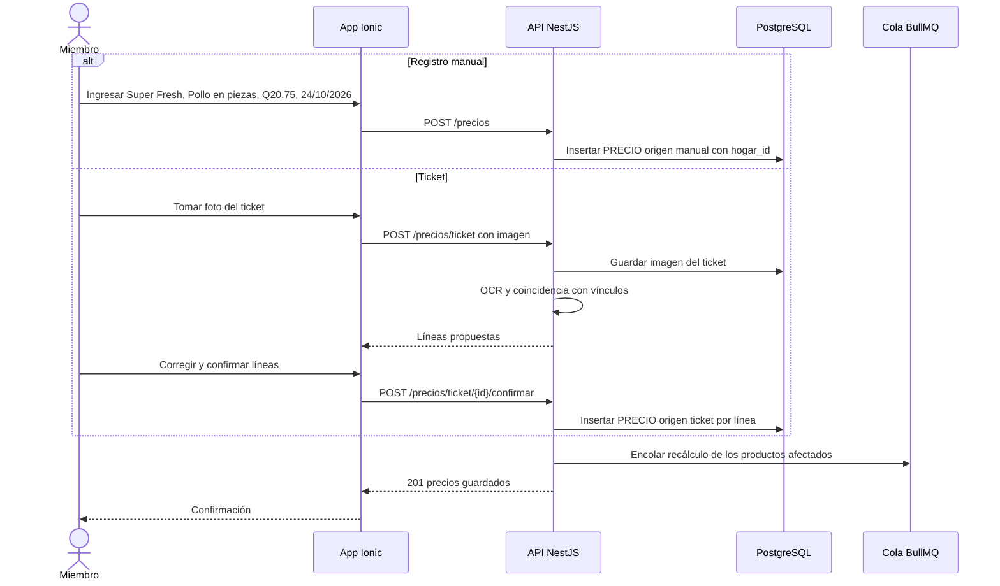

#### Historia de usuario HU-34 · 8 puntos

> **Como** miembro del hogar, **quiero** registrar precios a mano o tomando foto del ticket, **para** tener precios de Super Fresh y otras tiendas que no se consultan automáticamente.

#### Criterios de aceptación

```gherkin
# language: es
Característica: Registrar precio manual o desde ticket

  # CA-34.1 Flujo principal manual
  Escenario: Registrar precio de Super Fresh
    Dado que "Pollo en piezas (lb)" tiene precio vigente Q21.90 en Paiz y Q22.50 en Walmart
    Cuando registro "Pollo en piezas (lb)" en Super Fresh a Q20.75 con fecha 24/10/2026
    Entonces el precio se guarda con origen "manual"
    Y el precio mínimo del producto pasa a ser Q20.75 en Super Fresh

  # CA-34.2 Flujo principal ticket
  Escenario: Ticket con tres líneas
    Dado una foto de ticket de Super Fresh del 24/10/2026 con las líneas "POLLO PZ LB 20.75", "TOMATE LB 6.00" y "ARROZ 2LB 12.90"
    Cuando la subo
    Entonces veo 3 líneas propuestas: "Pollo en piezas (lb)" Q20.75, "Tomate (lb)" Q6.00 y "Arroz blanco 2 lb" Q12.90
    Cuando corrijo el tomate a Q6.10 y confirmo
    Entonces se guardan 3 precios con origen "ticket" y la foto adjunta

  # CA-34.3 Flujo alterno: ticket ilegible
  Escenario: OCR sin líneas legibles
    Dado una foto de ticket borrosa
    Cuando la subo
    Entonces veo "No se pudo leer el ticket"
    Y se abre la captura manual con la foto visible

  # CA-34.4 Validación
  Esquema del escenario: Datos inválidos
    Cuando registro "Arroz blanco 2 lb" en Super Fresh a <precio> con fecha <fecha>
    Entonces veo "<mensaje>" y no se guarda el precio

    Ejemplos:
      | precio | fecha      | mensaje                                   |
      | 0.00   | 24/10/2026 | El precio debe ser mayor que 0            |
      | 12.905 | 24/10/2026 | El precio admite como máximo 2 decimales  |
      | 12.90  | 30/10/2026 | La fecha de compra no puede ser futura    |
```

#### Subtareas

| ID | Tipo | Subtarea | Estimación (h) |
|---|---|---|---|
| ST-34.1 | DB | Tabla PRECIO (origen, fecha, hogar_id opcional, adjunto) y tabla de tickets | 2 |
| ST-34.2 | BE | Endpoint de precio manual con validaciones y encolado de recálculo | 4 |
| ST-34.3 | BE | Carga de foto, OCR, coincidencia con vínculos y confirmación de líneas | 6 |
| ST-34.4 | FE | Formulario de precio manual | 4 |
| ST-34.5 | FE | Flujo de ticket: cámara, revisión y confirmación de líneas | 5 |
| ST-34.6 | QA | Casos PF-M8-34.1..4 y pruebas con 5 tickets reales | 4 |
| ST-34.7 | DOC | Manual: "Registrar precios y escanear tickets" | 1 |

---

### CU-08.2 — Vincular producto con su equivalente por supermercado · RF-35 · HU-35

#### Especificación

| Campo | Detalle |
|---|---|
| Actor(es) | Miembro del hogar |
| Prioridad / Sprint | M · S5 |
| Precondiciones | Producto en el catálogo con unidad de compra y presentación (RF-13); supermercado registrado |
| Disparador | El usuario abre un producto y toca "Vincular supermercado" |
| Flujo principal | 1. Elige el supermercado.<br>2. Ingresa nombre en tienda, marca, presentación (cantidad y unidad) y, para Walmart, Paiz o La Torre, la URL o SKU del producto.<br>3. La API valida que la unidad de la presentación sea convertible a la unidad de compra.<br>4. Calcula el factor = presentación de la tienda ÷ presentación de compra del catálogo.<br>5. Guarda el PRODUCTO_SUPERMERCADO activo.<br>6. El worker lo incluye en la siguiente corrida (CU-09.1). |
| Flujos alternos | 2a. Super Fresh u otro supermercado sin consulta automática → URL/SKU no se pide.<br>5a. Ya existe un vínculo activo del producto en ese supermercado → se ofrece reemplazarlo; el anterior queda inactivo y conserva su histórico. |
| Excepciones | E1. Unidad no convertible (p. ej. litros para un producto en libras) → se rechaza.<br>E2. URL que no pertenece al dominio del supermercado elegido → se rechaza. |
| Postcondiciones | Vínculo activo con factor; los precios de ese vínculo se normalizan a la presentación de compra del catálogo. |
| Reglas y RNF | RN-08, RNF-06, RNF-12 |

Supuesto: un producto tiene como máximo un vínculo activo por supermercado.
Supuesto: precio normalizado = precio de la presentación en tienda ÷ factor; todos los cálculos (CU-09.2, CU-07.4) usan el precio normalizado.
Supuesto: los vínculos son comunes a todos los hogares (el catálogo de productos es global); la marca preferida por producto se configura en RF-09 (M02).
Supuesto: no hay búsqueda automática del producto en los sitios en v1; el usuario pega URL o SKU.

#### Diagrama de actividad

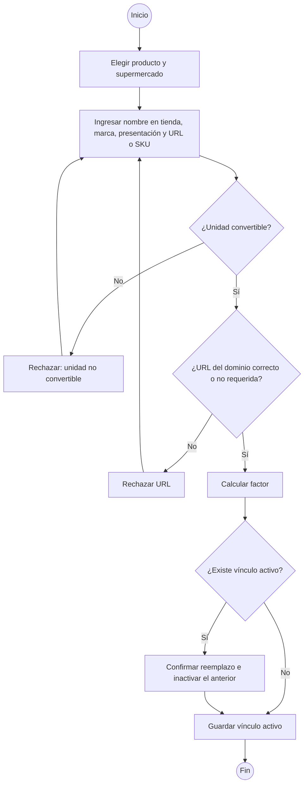

#### Diagrama de secuencia

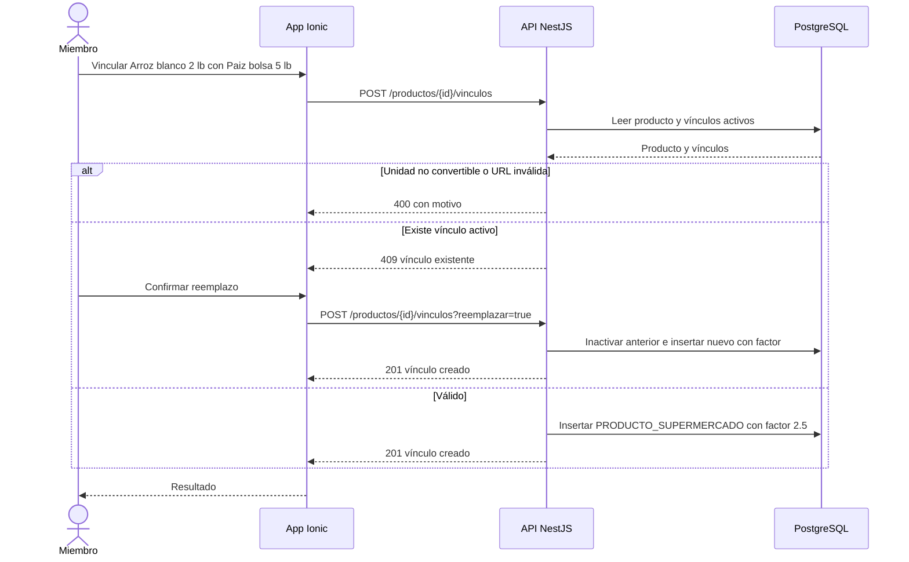

#### Historia de usuario HU-35 · 5 puntos

> **Como** miembro del hogar, **quiero** vincular cada producto con su equivalente en cada supermercado, **para** comparar precios de la misma marca y presentación.

#### Criterios de aceptación

```gherkin
# language: es
Característica: Vincular producto con su equivalente por supermercado

  # CA-35.1 Flujo principal
  Escenario: Vincular con la misma presentación
    Dado el producto "Arroz blanco 2 lb" con presentación de compra bolsa de 2 lb
    Cuando lo vinculo con Walmart, nombre en tienda "Arroz blanco 2 lb", presentación 2 lb y SKU de ejemplo "WM-000123"
    Entonces se guarda un vínculo activo con factor 1
    Y el producto se consulta en la siguiente corrida automática

  # CA-35.2 Presentación distinta
  Escenario: Paiz solo vende bolsa de 5 lb
    Dado el producto "Arroz blanco 2 lb" con presentación de compra bolsa de 2 lb
    Cuando lo vinculo con Paiz en presentación de 5 lb
    Entonces el factor es 2.5
    Y un precio de Q31.25 por la bolsa de 5 lb se normaliza a Q12.50

  # CA-35.3 Flujo alterno: vínculo existente
  Escenario: Reemplazar vínculo activo
    Dado que "Arroz blanco 2 lb" ya tiene vínculo activo en Walmart
    Cuando creo otro vínculo en Walmart y confirmo el reemplazo
    Entonces el vínculo anterior queda inactivo con su histórico de precios
    Y el nuevo queda activo

  # CA-35.4 Validación
  Escenario: Unidad no convertible
    Dado el producto "Pollo en piezas (lb)"
    Cuando intento vincularlo con presentación "1 L"
    Entonces veo "La unidad de la presentación no es convertible a libras"
    Y no se guarda el vínculo
```

#### Subtareas

| ID | Tipo | Subtarea | Estimación (h) |
|---|---|---|---|
| ST-35.1 | DB | Tabla PRODUCTO_SUPERMERCADO (nombre en tienda, marca, presentación, URL/SKU, factor, activo) | 2 |
| ST-35.2 | BE | Endpoints de vínculo: validación de unidad y dominio, factor, reemplazo | 4 |
| ST-35.3 | FE | Pantalla de vínculos por producto y formulario | 5 |
| ST-35.4 | QA | Casos PF-M8-35.1..4 | 3 |
| ST-35.5 | DOC | Manual: "Vincular productos con los supermercados" | 1 |

---

### CU-08.3 — Consultar histórico y variación de precios · RF-37 · HU-37

#### Especificación

| Campo | Detalle |
|---|---|
| Actor(es) | Miembro del hogar |
| Prioridad / Sprint | S · S5 |
| Precondiciones | Producto con al menos un precio registrado |
| Disparador | El usuario abre el detalle de precios de un producto |
| Flujo principal | 1. La app pide el histórico del producto.<br>2. La API devuelve los precios normalizados de las últimas 12 semanas por supermercado (automáticos + los del hogar).<br>3. Calcula por supermercado la variación vs. precio anterior = (actual − anterior) ÷ anterior × 100.<br>4. Calcula la variación del periodo = (actual − primero del periodo) ÷ primero × 100.<br>5. La app muestra gráfico de líneas por supermercado, tabla con fecha y origen, y las variaciones con 1 decimal (subida o baja). |
| Flujos alternos | 3a. Un solo precio en el periodo → variación "—".<br>2a. El usuario cambia el periodo a 4 semanas → se recalculan las variaciones del periodo. |
| Excepciones | E1. Producto sin precios → "Aún no hay precios para este producto". |
| Postcondiciones | Ninguna (consulta). |
| Reglas y RNF | RNF-02, RNF-06, RNF-13 |

Supuesto: periodo por defecto 12 semanas (igual que RF-39) con opción de 4 semanas; el histórico completo se conserva sin depuración en v1.

#### Diagrama de actividad

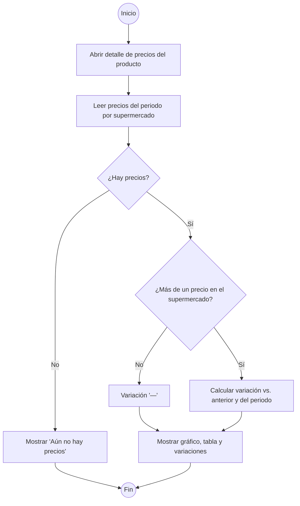

#### Diagrama de secuencia

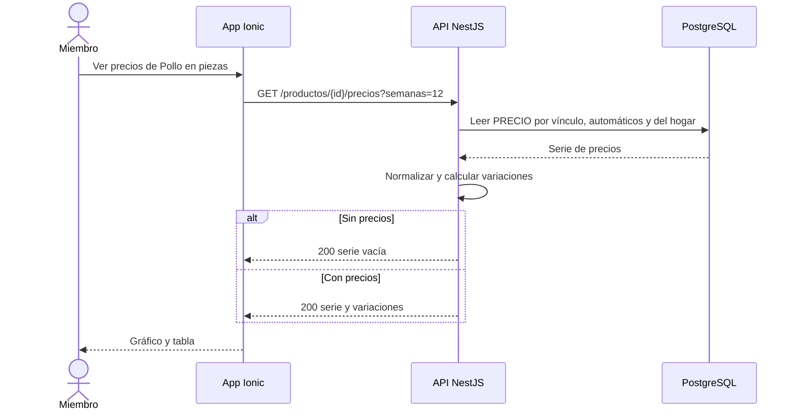

#### Historia de usuario HU-37 · 5 puntos

> **Como** miembro del hogar, **quiero** ver cómo ha cambiado el precio de un producto en cada supermercado, **para** detectar subidas y decidir dónde comprar.

#### Criterios de aceptación

```gherkin
# language: es
Característica: Histórico y variación de precios

  # CA-37.1 Flujo principal: subida
  Escenario: Pollo sube en Walmart
    Dado los precios de "Pollo en piezas (lb)" en Walmart: Q20.00 el 10/10/2026, Q21.00 el 17/10/2026 y Q22.00 el 24/10/2026
    Cuando abro el detalle de precios
    Entonces la variación vs. anterior en Walmart es "+4.8 %"
    Y la variación del periodo en Walmart es "+10.0 %"

  # CA-37.2 Baja
  Escenario: Tomate baja en Paiz
    Dado los precios de "Tomate (lb)" en Paiz: Q7.00 el 17/10/2026 y Q6.30 el 24/10/2026
    Cuando abro el detalle de precios
    Entonces la variación vs. anterior en Paiz es "−10.0 %" con indicador de baja

  # CA-37.3 Flujo alterno: un solo precio
  Escenario: Supermercado con un solo precio
    Dado que "Arroz blanco 2 lb" solo tiene Q12.90 en Super Fresh el 24/10/2026
    Cuando abro el detalle de precios
    Entonces la variación de Super Fresh se muestra como "—"

  # CA-37.4 Aislamiento
  Escenario: Precios manuales de otro hogar no se muestran
    Dado que otro hogar registró "Arroz blanco 2 lb" a Q11.00 en Super Fresh
    Cuando abro el detalle de precios en mi hogar
    Entonces no veo el precio Q11.00
```

#### Subtareas

| ID | Tipo | Subtarea | Estimación (h) |
|---|---|---|---|
| ST-37.1 | DB | Índice PRECIO (producto_supermercado, fecha) | 1 |
| ST-37.2 | BE | Endpoint de histórico con normalización y variaciones | 3 |
| ST-37.3 | FE | Pantalla de detalle: gráfico por supermercado, tabla y variaciones | 5 |
| ST-37.4 | QA | Casos PF-M8-37.1..4 | 3 |
| ST-37.5 | DOC | Manual: "Ver cómo cambian los precios" | 1 |

---

### CU-09.1 — Ejecutar corrida automática de precios · RF-33 · HU-33

#### Especificación

| Campo | Detalle |
|---|---|
| Actor(es) | Worker de precios |
| Prioridad / Sprint | M · S5 |
| Precondiciones | Vínculos activos con URL o SKU (CU-08.2); sitio habilitado y con extracción permitida por sus términos de uso (PA-02, R-03) |
| Disparador | Programación sábado y domingo 21:00 hora de Guatemala (UTC−6) |
| Flujo principal | 1. El programador encola la corrida y el worker crea un registro de corrida "En curso".<br>2. Toma los vínculos activos de los sitios habilitados (Walmart y Paiz).<br>3. Por cada sitio descarga robots.txt y verifica que las rutas de producto estén permitidas.<br>4. Consulta cada producto con Playwright, como máximo 1 solicitud por segundo por sitio (RNF-12).<br>5. Interpreta el precio de la presentación y guarda PRECIO con origen "automático" y fecha de la corrida.<br>6. Al terminar todos los sitios marca la corrida "Completada" con totales por sitio.<br>7. Encola el recálculo de mínimo y mediana (CU-09.2). |
| Flujos alternos | 2a. La Torre u otro sitio no habilitado (fase 2) → sus vínculos no se consultan y se registran como "Sitio no habilitado".<br>3a. robots.txt prohíbe la ruta o el sitio está marcado sin permiso de extracción → no se consulta, se registra "Bloqueado" y se aplica CU-09.3; el administrador ve aviso para capturar precios manualmente (R-03).<br>5a. Falla de consulta o precio no interpretable → CU-09.3. |
| Excepciones | E1. Ya hay una corrida "En curso" → la nueva se omite y se registra "Omitida".<br>E2. Sin conexión a la base de datos → la corrida se marca "Fallida" y se aplica CU-09.3 a todos los productos. |
| Postcondiciones | Precios del día guardados; corrida registrada con estado y totales; recálculo encolado. |
| Reglas y RNF | RNF-12, R-03, R-02, RN-08 |

Supuesto: los sitios se consultan en paralelo, cada uno con su propio límite de 1 solicitud/segundo.
Supuesto: el permiso de extracción por sitio es una configuración que el administrador activa tras revisar los términos de uso (PA-02); por defecto está desactivado.
Supuesto: el aviso al administrador en S5 es un aviso dentro de la app; las notificaciones push llegan con M10 (S6).
Supuesto: expresión de programación `0 21 * * 6,0` con zona America/Guatemala.

#### Diagrama de actividad

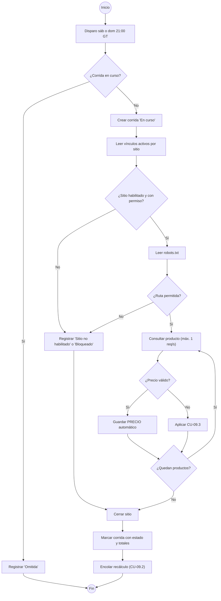

#### Diagrama de secuencia

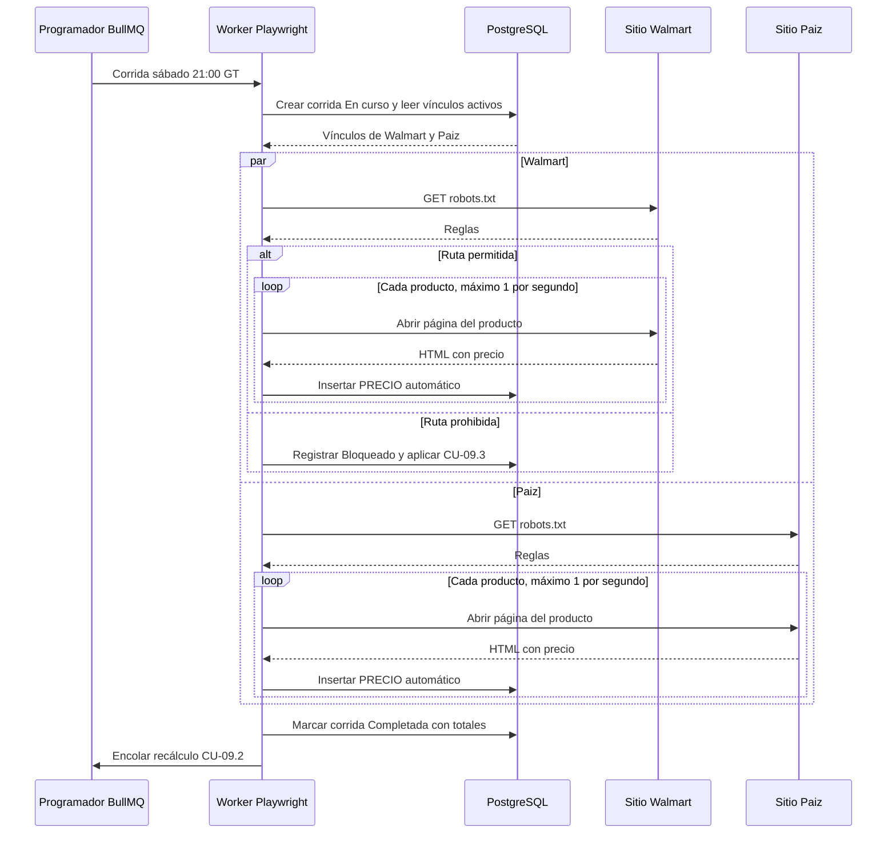

#### Historia de usuario HU-33 · 13 puntos

> **Como** miembro del hogar, **quiero** que los precios de Walmart y Paiz se actualicen solos cada fin de semana, **para** planificar el menú del domingo con precios recientes sin capturarlos a mano.

#### Criterios de aceptación

```gherkin
# language: es
Característica: Corrida automática de precios

  # CA-33.1 Flujo principal
  Escenario: Corrida del sábado
    Dado 70 vínculos activos de Walmart y 50 de Paiz con permiso de extracción
    Cuando llega el sábado 24/10/2026 a las 21:00 hora de Guatemala
    Entonces se crea una corrida que consulta los 120 productos
    Y se guardan 120 precios con origen "automático" y fecha 24/10/2026
    Y la corrida queda "Completada" con 70 de Walmart y 50 de Paiz
    Y se encola el recálculo de mínimo y mediana

  # CA-33.2 Límite de solicitudes
  Escenario: Respeto de 1 solicitud por segundo
    Dado 70 vínculos activos de Walmart
    Cuando se ejecuta la corrida
    Entonces el registro de solicitudes no muestra dos solicitudes a Walmart con menos de 1 segundo entre sí
    Y la consulta de Walmart dura al menos 70 segundos

  # CA-33.3 Flujo alterno: robots.txt prohíbe
  Escenario: Paiz prohíbe la ruta de productos
    Dado que el robots.txt de Paiz prohíbe la ruta de páginas de producto
    Cuando se ejecuta la corrida del domingo 25/10/2026
    Entonces no se consulta ningún producto de Paiz
    Y la corrida registra Paiz como "Bloqueado por robots.txt"
    Y se conservan los últimos precios válidos de Paiz
    Y el administrador ve el aviso "Paiz bloqueado: registra precios manualmente"

  # CA-33.4 Flujo alterno: La Torre en fase 2
  Escenario: Sitio no habilitado
    Dado 15 vínculos activos de La Torre y el sitio La Torre deshabilitado
    Cuando se ejecuta la corrida
    Entonces no se consulta La Torre
    Y la corrida registra La Torre como "Sitio no habilitado"

  # CA-33.5 Excepción: corrida en curso
  Escenario: Disparo con corrida anterior sin terminar
    Dado que la corrida del sábado 24/10/2026 sigue "En curso"
    Cuando se dispara otra corrida
    Entonces la nueva se registra como "Omitida"
```

#### Subtareas

| ID | Tipo | Subtarea | Estimación (h) |
|---|---|---|---|
| ST-33.1 | DB | Tablas CORRIDA y CORRIDA_SITIO (estado, totales, errores) y configuración por sitio (habilitado, permiso) | 2 |
| ST-33.2 | DevOps | Trabajo repetible BullMQ sáb y dom 21:00 America/Guatemala y contenedor del worker en Docker Compose | 3 |
| ST-33.3 | BE | Orquestador de corrida: lotes por sitio, ejecución paralela, control de corrida en curso | 6 |
| ST-33.4 | BE | Verificación de robots.txt y limitador de 1 solicitud/segundo por sitio | 4 |
| ST-33.5 | BE | Extractor Playwright de Walmart | 8 |
| ST-33.6 | BE | Extractor Playwright de Paiz | 8 |
| ST-33.7 | QA | Casos PF-M8-33.1..5 con sitios simulados (páginas grabadas) y prueba del limitador | 6 |
| ST-33.8 | DOC | Manual: "Cómo se actualizan los precios" | 1 |

---

### CU-09.2 — Calcular precio mínimo y mediana · RF-36 · HU-36

#### Especificación

| Campo | Detalle |
|---|---|
| Actor(es) | Worker de precios |
| Prioridad / Sprint | M · S5 |
| Precondiciones | Precios registrados y normalizados (CU-08.2) |
| Disparador | Fin de corrida (CU-09.1) o registro de precio manual o ticket (CU-08.1) |
| Flujo principal | 1. Por cada producto afectado toma, por supermercado, el precio normalizado más reciente con antigüedad ≤ 14 días (RN-08).<br>2. Ordena los precios de menor a mayor.<br>3. Mínimo = el primero, con su supermercado.<br>4. Mediana: si n es impar, el precio en la posición (n+1)/2; si n es par, el promedio de las posiciones n/2 y n/2+1, redondeado a centavos.<br>5. Guarda el resumen (mínimo, supermercado, mediana, n, fecha de cálculo).<br>6. El costo estimado del menú usa la mediana (RN-01) y la lista usa el mínimo (CU-07.4). |
| Flujos alternos | 1a. Ningún precio vigente → mínimo y mediana toman el último precio conocido de cada supermercado y el resumen se marca "Desactualizado" con su fecha (RN-08).<br>3a. Empate en el mínimo → supermercado preferido del hogar (RF-09); si no hay, el primero en orden alfabético.<br>1b. Un solo precio → mínimo = mediana = ese precio. |
| Excepciones | E1. Producto sin ningún precio → no se crea resumen; la app muestra "Sin precio". |
| Postcondiciones | Resumen de precios actualizado por producto (y por hogar cuando hay precios manuales). |
| Reglas y RNF | RN-01, RN-08, RNF-01, RNF-09 |

Supuesto: redondeo a centavos "mitad hacia arriba" con aritmética decimal (no de punto flotante).
Supuesto: se toma un solo precio por supermercado (el más reciente) para que un supermercado con muchos registros no sesgue la mediana.
Supuesto: el resumen se calcula por hogar combinando precios automáticos y los manuales de ese hogar (ver CU-08.1).

**Ejemplo numérico**

| Caso | Precios normalizados (ordenados) | n | Mínimo | Mediana |
|---|---|---|---|---|
| Impar — Arroz blanco 2 lb | Walmart 12.50 · Paiz 13.00 · La Torre 14.25 | 3 | Q12.50 Walmart | posición 2 = **Q13.00** |
| Par — Pollo en piezas (lb) | Super Fresh 20.75 · Walmart 21.50 · Paiz 22.90 · La Torre 23.40 | 4 | Q20.75 Super Fresh | (21.50 + 22.90) ÷ 2 = 44.40 ÷ 2 = **Q22.20** |
| Par con redondeo — Aceite 1 L | Walmart 24.95 · Paiz 26.50 | 2 | Q24.95 Walmart | (24.95 + 26.50) ÷ 2 = 51.45 ÷ 2 = 25.725 → **Q25.73** |

#### Diagrama de actividad

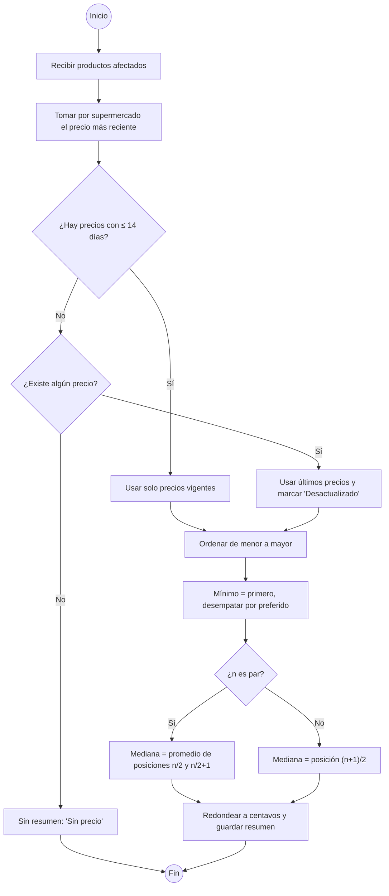

#### Diagrama de secuencia

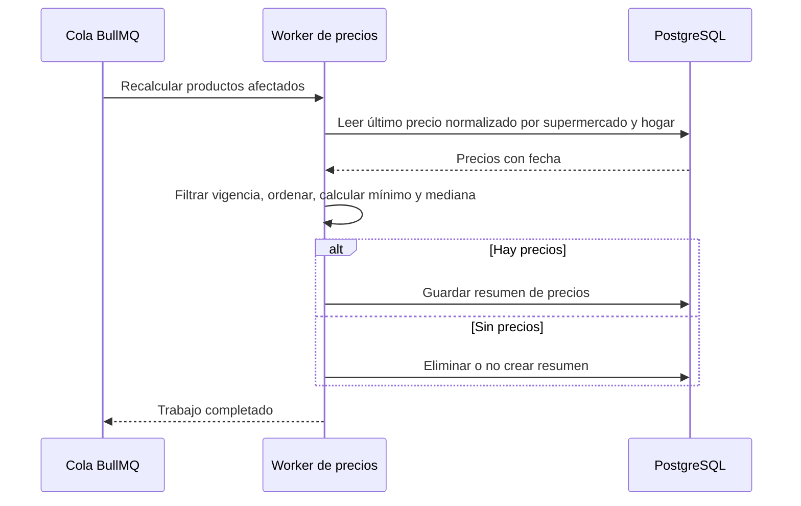

#### Historia de usuario HU-36 · 5 puntos

> **Como** miembro del hogar, **quiero** que el costo estimado use la mediana y que la compra sugiera el precio mínimo con su supermercado, **para** planificar con un número estable y ahorrar al comprar.

#### Criterios de aceptación

```gherkin
# language: es
Característica: Cálculo de precio mínimo y mediana

  # CA-36.1 Flujo principal: número impar de precios
  Escenario: Arroz con tres precios
    Dado que "Arroz blanco 2 lb" cuesta Q12.50 en Walmart, Q13.00 en Paiz y Q14.25 en La Torre, todos del 24/10/2026
    Cuando se recalcula el resumen
    Entonces la mediana es Q13.00
    Y el mínimo es Q12.50 en Walmart

  # CA-36.2 Número par de precios
  Escenario: Pollo con cuatro precios
    Dado que "Pollo en piezas (lb)" cuesta Q20.75 en Super Fresh, Q21.50 en Walmart, Q22.90 en Paiz y Q23.40 en La Torre, todos vigentes
    Cuando se recalcula el resumen
    Entonces la mediana es Q22.20
    Y el mínimo es Q20.75 en Super Fresh

  # CA-36.3 Par con redondeo
  Escenario: Aceite con dos precios
    Dado que "Aceite 1 L" cuesta Q24.95 en Walmart y Q26.50 en Paiz
    Cuando se recalcula el resumen
    Entonces la mediana es Q25.73

  # CA-36.4 Vigencia de 14 días
  Escenario: Precio antiguo excluido
    Dado que "Tomate (lb)" cuesta Q6.50 en Walmart del 24/10/2026 y Q5.90 en Paiz del 03/10/2026
    Cuando se recalcula el resumen el 24/10/2026
    Entonces se excluye el precio de Paiz por tener 21 días
    Y el mínimo y la mediana son Q6.50 en Walmart

  # CA-36.5 Empate
  Escenario: Mínimo empatado
    Dado que "Azúcar 5 lb" cuesta Q32.00 en Walmart y Q32.00 en Paiz y el hogar prefiere Paiz
    Cuando se recalcula el resumen
    Entonces el mínimo es Q32.00 en Paiz
```

#### Subtareas

| ID | Tipo | Subtarea | Estimación (h) |
|---|---|---|---|
| ST-36.1 | DB | Tabla PRECIO_RESUMEN (producto, hogar, mínimo, supermercado, mediana, n, desactualizado, fecha) | 2 |
| ST-36.2 | BE | Servicio de cálculo: vigencia, normalización, mínimo con desempate, mediana con decimales | 5 |
| ST-36.3 | BE | Disparo del recálculo tras corrida y tras precio manual o ticket | 2 |
| ST-36.4 | QA | Casos PF-M8-36.1..5 y pruebas unitarias (par, impar, redondeo, vigencia, empate) | 4 |
| ST-36.5 | DOC | Manual: "Qué significan precio mínimo y precio mediana" | 1 |

---

### CU-09.3 — Conservar el último precio válido ante fallas · RF-38 · HU-38

#### Especificación

| Campo | Detalle |
|---|---|
| Actor(es) | Worker de precios |
| Prioridad / Sprint | M · S5 |
| Precondiciones | Corrida en ejecución (CU-09.1) |
| Disparador | Falla al consultar un producto o un sitio: tiempo de espera, error HTTP, estructura de página cambiada, precio no interpretable o ruta bloqueada |
| Flujo principal | 1. El worker reintenta el producto hasta 2 veces respetando 1 solicitud/segundo.<br>2. Si sigue fallando, registra el error (producto, sitio, tipo, hora) en la corrida.<br>3. No guarda ningún precio nuevo; el último precio válido sigue vigente con su fecha original.<br>4. Al cerrar la corrida, si hubo fallas, la marca "Parcial" (o "Fallida" si no se obtuvo ningún precio).<br>5. Muestra al administrador un aviso con el sitio y el número de productos sin actualizar.<br>6. La app muestra esos precios con la etiqueta "Precio del dd/mm/aaaa". |
| Flujos alternos | 3a. El último precio válido tiene más de 14 días → se muestra además la advertencia "Desactualizado" (RN-08).<br>3b. El producto nunca tuvo precio → queda "Sin precio". |
| Excepciones | E1. Precio extraído no numérico o ≤ 0 → se descarta como inválido y se trata como falla. |
| Postcondiciones | Ningún precio se pierde ni se sobrescribe con un valor inválido; errores trazables por corrida. |
| Reglas y RNF | RN-08, RNF-12, RG-01 |

Supuesto: 2 reintentos por producto; si más del 50 % de los productos de un sitio fallan por estructura cambiada, se detienen las consultas a ese sitio en esa corrida para no generar tráfico inútil.

#### Diagrama de actividad

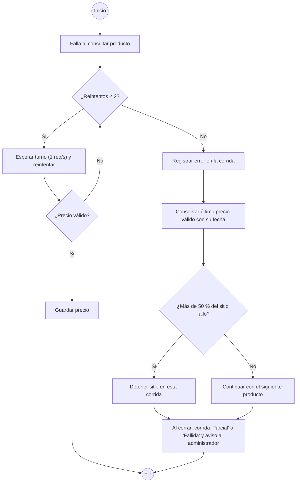

#### Diagrama de secuencia

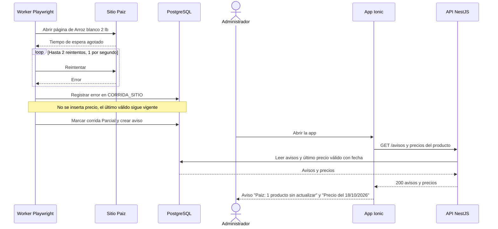

#### Historia de usuario HU-38 · 5 puntos

> **Como** miembro del hogar, **quiero** que si falla la consulta de precios se use el último precio válido indicando su fecha, **para** seguir planificando sin datos vacíos y saber qué tan reciente es cada precio.

#### Criterios de aceptación

```gherkin
# language: es
Característica: Conservar el último precio válido

  # CA-38.1 Flujo principal
  Escenario: Paiz no responde para un producto
    Dado que el último precio válido de "Arroz blanco 2 lb" en Paiz es Q13.00 del 18/10/2026
    Cuando la corrida del sábado 24/10/2026 agota el tiempo de espera en Paiz para ese producto 3 veces
    Entonces no se guarda un precio nuevo para ese producto
    Y la lista muestra "Q13.00 · Precio del 18/10/2026" para Paiz
    Y la corrida queda "Parcial" con el error registrado

  # CA-38.2 Cambio de estructura del sitio
  Escenario: Paiz cambió su página
    Dado 50 vínculos activos de Paiz
    Cuando en la corrida del 24/10/2026 los primeros 26 productos no muestran el precio en la ubicación esperada
    Entonces se detienen las consultas a Paiz en esa corrida
    Y se conservan los precios anteriores de los 50 productos
    Y el administrador ve "Paiz: 50 productos sin actualizar"

  # CA-38.3 Precio inválido
  Escenario: Precio no interpretable
    Dado que el último precio válido de "Tomate (lb)" en Walmart es Q6.50 del 18/10/2026
    Cuando la página devuelve el texto "Q--.--" como precio en los 3 intentos
    Entonces se descarta el valor
    Y se conserva Q6.50 del 18/10/2026

  # CA-38.4 Último precio con más de 14 días
  Escenario: Precio conservado desactualizado
    Dado que el último precio válido de "Aceite 1 L" en Paiz es Q26.50 del 04/10/2026
    Cuando la corrida del 24/10/2026 falla para ese producto
    Entonces se muestra "Q26.50 · Precio del 04/10/2026" con la advertencia "Desactualizado"
```

#### Subtareas

| ID | Tipo | Subtarea | Estimación (h) |
|---|---|---|---|
| ST-38.1 | DB | Tabla de errores por corrida y tabla de avisos al administrador | 1 |
| ST-38.2 | BE | Reintentos, validación del precio extraído, corte por sitio y estados Parcial/Fallida | 4 |
| ST-38.3 | BE | Generación de avisos al administrador y exposición de la fecha del precio en la API | 2 |
| ST-38.4 | FE | Etiqueta "Precio del dd/mm/aaaa", advertencia "Desactualizado" y panel de avisos | 3 |
| ST-38.5 | QA | Casos PF-M8-38.1..4 con fallas simuladas (tiempo de espera, HTML cambiado, precio inválido) | 4 |
| ST-38.6 | DOC | Manual: "Qué pasa cuando un precio no se actualiza" | 1 |

---

## 3. Resumen del módulo

| HU | RF | CU | Prioridad | Sprint | Puntos | Horas |
|---|---|---|---|---|---|---|
| HU-33 | RF-33 | CU-09.1 | M | S5 | 13 | 38 |
| HU-34 | RF-34 | CU-08.1 | M | S5 | 8 | 26 |
| HU-35 | RF-35 | CU-08.2 | M | S5 | 5 | 15 |
| HU-36 | RF-36 | CU-09.2 | M | S5 | 5 | 14 |
| HU-37 | RF-37 | CU-08.3 | S | S5 | 5 | 13 |
| HU-38 | RF-38 | CU-09.3 | M | S5 | 5 | 15 |
| **Total** | | | | | **41** | **121** |
