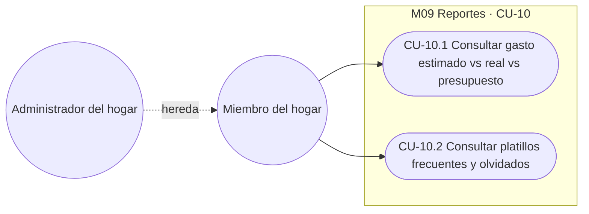
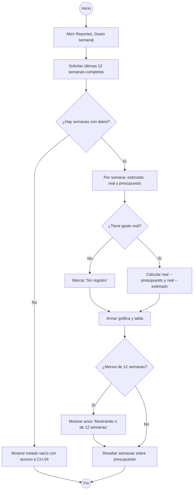
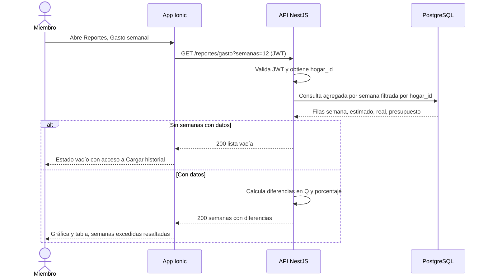
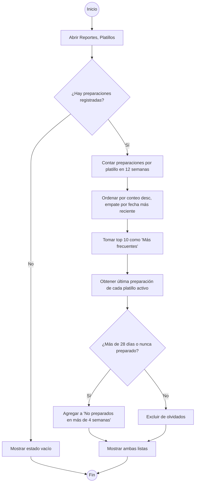
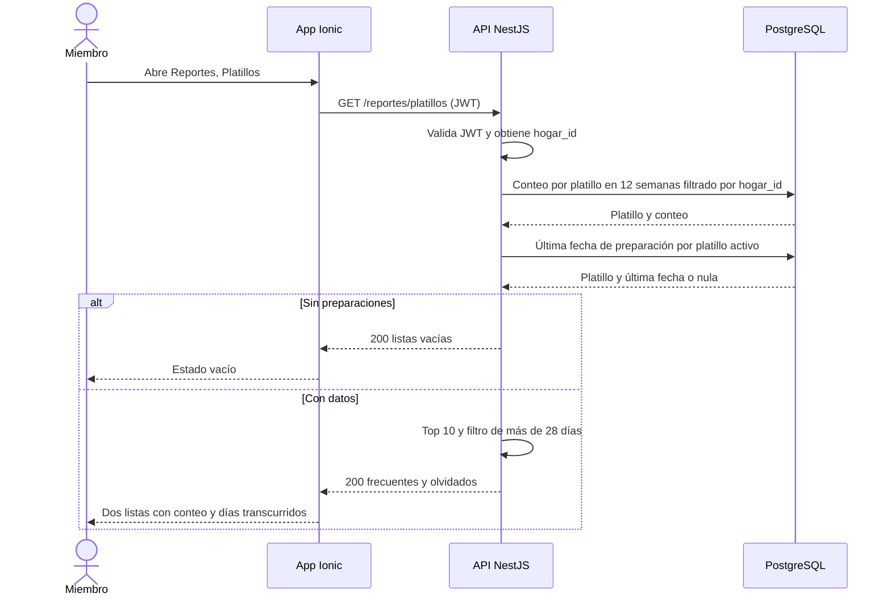

# M09 — Reportes

| Campo | Valor |
|---|---|
| SRS | SRS-MF-001 v1.0 (aprobado 2026-10-22) |
| Requerimientos | RF-39 a RF-40 |
| Caso de uso macro | CU-10 Consultar reportes de gasto |
| Sprint(s) | S6 |
| Fase del ciclo de vida | 2. Requerimientos — análisis de casos de uso |

Permite a la familia ver si está gastando lo planeado (estimado vs. real vs. presupuesto en las últimas 12 semanas) y qué platillos repite más u olvida, para ajustar presupuesto y variedad del menú.

## 1. Diagrama de casos de uso del módulo



## 2. Casos de uso e historias

### CU-10.1 — Consultar gasto estimado vs real vs presupuesto · RF-39 · HU-39

#### Especificación

| Campo | Detalle |
|---|---|
| Actor(es) | Miembro del hogar (el administrador hereda) |
| Prioridad / Sprint | S · S6 |
| Precondiciones | Sesión iniciada; el usuario pertenece a un hogar. |
| Disparador | El usuario abre Reportes → "Gasto semanal". |
| Flujo principal | 1. El usuario abre el reporte.<br>2. La App solicita a la API el gasto de las últimas 12 semanas.<br>3. La API obtiene por semana: costo estimado del menú aprobado (RF-26, precio mediana RN-01), gasto real registrado (RF-27) y presupuesto semanal.<br>4. La API calcula diferencias: real − presupuesto y real − estimado (Q y %).<br>5. La App muestra gráfica (3 series por semana) y tabla con las diferencias; semanas sobre presupuesto se resaltan.<br>6. El usuario toca una semana y ve el detalle de esa semana. |
| Flujos alternos | 3a. Semana sin gasto real registrado → columna "Real" muestra "Sin registro" y no se calculan sus diferencias.<br>3b. Semana histórica del cuaderno (RF-15/RF-18) sin menú aprobado → "Estimado" muestra "—".<br>3c. El hogar tiene menos de 12 semanas con datos → muestra solo las existentes con el aviso "Mostrando n de 12 semanas". |
| Excepciones | E1. Sin ninguna semana con datos → estado vacío "Aún no hay semanas registradas" con acceso a Cargar historial (CU-04).<br>E2. Error de red → mensaje "No se pudo cargar el reporte" y botón Reintentar. |
| Postcondiciones | Ninguna (consulta de solo lectura). |
| Reglas y RNF | RN-01, RN-09, RNF-02, RNF-06 |

Supuesto: "últimas 12 semanas" = las 12 semanas completas anteriores a la semana en curso (la semana en curso aún no tiene gasto real cerrado).
Supuesto: el presupuesto de cada semana es el vigente cuando se aprobó su menú (se guarda copia en MENU_SEMANAL); para semanas históricas sin menú aprobado se usa el presupuesto vigente del hogar.
Supuesto: el gasto real es el total registrado de la semana (RF-27), que puede incluir despensa; el reporte lo compara tal cual contra el estimado.

#### Diagrama de actividad



#### Diagrama de secuencia



#### Historia de usuario HU-39 · 5 puntos

> **Como** miembro del hogar, **quiero** ver por semana el gasto estimado, el real y el presupuesto de las últimas 12 semanas, **para** saber si estamos gastando lo planeado y ajustar el presupuesto.

#### Criterios de aceptación

```gherkin
# language: es
Característica: Reporte de gasto semanal estimado vs real vs presupuesto

  # CA-39.1 Flujo principal
  Escenario: Ver diferencias de una semana excedida
    Dado que hoy es jueves 2026-10-22 y el hogar tiene 12 semanas completas con datos
    Y la semana del 2026-10-11 al 2026-10-17 tiene estimado Q248.00, real Q262.40 y presupuesto Q250.00
    Cuando abro el reporte "Gasto semanal"
    Entonces veo 12 semanas, de la del 2026-07-26 a la del 2026-10-11
    Y la semana del 2026-10-11 muestra "Real vs presupuesto: +Q12.40 (+5.0 %)"
    Y muestra "Real vs estimado: +Q14.40 (+5.8 %)"
    Y la semana aparece resaltada como sobre presupuesto
    Y la semana en curso del 2026-10-18 no aparece

  # CA-39.2 Flujo alterno
  Escenario: Semana sin gasto real y hogar con pocas semanas
    Dado que el hogar solo tiene 3 semanas con datos
    Y la semana del 2026-10-04 tiene estimado Q240.00, presupuesto Q250.00 y no tiene gasto real
    Cuando abro el reporte "Gasto semanal"
    Entonces veo el aviso "Mostrando 3 de 12 semanas"
    Y la semana del 2026-10-04 muestra "Real: Sin registro" sin diferencias calculadas

  # CA-39.3 Validación o error
  Escenario: Aislamiento de datos entre hogares
    Dado que pertenezco al hogar "Rosales"
    Cuando solicito a la API el reporte de gasto con el hogar_id de otro hogar
    Entonces la API responde 403
    Y no se devuelve ningún monto de ese hogar

  # CA-39.4 Validación o error
  Escenario: Hogar sin semanas registradas
    Dado que el hogar no tiene menús aprobados ni historial cargado
    Cuando abro el reporte "Gasto semanal"
    Entonces veo "Aún no hay semanas registradas"
    Y un botón "Cargar historial"
```

#### Subtareas

| ID | Tipo | Subtarea | Estimación (h) |
|---|---|---|---|
| ST-39.1 | DB | Consulta/vista agregada por semana (estimado, real, presupuesto) e índice (hogar_id, fecha_inicio); copia del presupuesto en MENU_SEMANAL | 3 |
| ST-39.2 | BE | Endpoint GET /reportes/gasto con cálculo de diferencias Q y %, ventana de 12 semanas completas y aislamiento por hogar_id | 4 |
| ST-39.3 | FE | Pantalla con gráfica de 3 series y tabla, resaltado de semanas excedidas, detalle por semana | 5 |
| ST-39.4 | FE | Estados vacío, "Sin registro", aviso de semanas incompletas y error con reintento | 2 |
| ST-39.5 | QA | Casos de prueba PF-M9-39.1..4 y prueba automatizada (API + e2e), verificación RNF-02 | 3 |
| ST-39.6 | DOC | Sección del manual de usuario "Reporte de gasto semanal" | 1 |

---

### CU-10.2 — Consultar platillos frecuentes y no preparados en más de 4 semanas · RF-40 · HU-40

#### Especificación

| Campo | Detalle |
|---|---|
| Actor(es) | Miembro del hogar (el administrador hereda) |
| Prioridad / Sprint | C · S6 |
| Precondiciones | Sesión iniciada; el hogar tiene platillos en el catálogo (RF-11). |
| Disparador | El usuario abre Reportes → "Platillos". |
| Flujo principal | 1. El usuario abre el reporte.<br>2. La App solicita a la API frecuentes y olvidados.<br>3. La API cuenta preparaciones por platillo en las últimas 12 semanas (días con fecha ≤ hoy) y devuelve los 10 más frecuentes con su conteo.<br>4. La API obtiene la última fecha de preparación de cada platillo activo y devuelve los que tienen más de 28 días sin prepararse.<br>5. La App muestra dos listas: "Más frecuentes" (conteo) y "No preparados en más de 4 semanas" (última fecha y días transcurridos). |
| Flujos alternos | 3a. Empate en conteo → se ordena por fecha de preparación más reciente.<br>4a. Platillo activo nunca preparado → aparece en la lista de olvidados como "Nunca preparado". |
| Excepciones | E1. Sin preparaciones registradas → estado vacío "Aún no hay menús preparados".<br>E2. Error de red → mensaje y botón Reintentar. |
| Postcondiciones | Ninguna (consulta de solo lectura). |
| Reglas y RNF | RN-04 (relacionada: novedad), RNF-02, RNF-06 |

Supuesto: una "preparación" es un platillo asignado a un día con fecha ≤ hoy en un menú aprobado o en el historial cargado (RF-15/RF-18).
Supuesto: "más frecuentes" usa la misma ventana de 12 semanas que RF-39 y muestra el top 10.
Supuesto: "más de 4 semanas" = más de 28 días desde la última preparación (28 días exactos no aparece); los platillos inactivos se excluyen.

#### Diagrama de actividad



#### Diagrama de secuencia



#### Historia de usuario HU-40 · 3 puntos

> **Como** miembro del hogar, **quiero** ver los platillos que más repetimos y los que no preparamos hace más de 4 semanas, **para** variar el menú y recuperar platillos que nos gustan.

#### Criterios de aceptación

```gherkin
# language: es
Característica: Reporte de platillos frecuentes y olvidados

  # CA-40.1 Flujo principal
  Escenario: Ver los platillos más frecuentes
    Dado que hoy es 2026-10-22
    Y en las últimas 12 semanas se preparó "Pollo en crema" 6 veces, "Pepián de pollo" 5 veces y "Carne guisada" 4 veces
    Cuando abro el reporte "Platillos"
    Entonces "Más frecuentes" muestra en orden "Pollo en crema (6)", "Pepián de pollo (5)" y "Carne guisada (4)"

  # CA-40.2 Flujo alterno
  Escenario: Platillos no preparados en más de 4 semanas
    Dado que hoy es 2026-10-22
    Y "Caldo de res" se preparó por última vez el 2026-09-13
    Y "Carne guisada" se preparó por última vez el 2026-09-27
    Y "Chile relleno" está activo y nunca se ha preparado
    Cuando abro el reporte "Platillos"
    Entonces "No preparados en más de 4 semanas" muestra "Caldo de res — hace 39 días"
    Y muestra "Chile relleno — Nunca preparado"
    Y no muestra "Carne guisada"

  # CA-40.3 Validación o error
  Escenario: Límite exacto de 4 semanas y platillo inactivo
    Dado que hoy es 2026-10-22
    Y "Pescado frito" se preparó por última vez el 2026-09-24
    Y "Spaghetti con carne" está inactivo y se preparó por última vez el 2026-08-02
    Cuando abro el reporte "Platillos"
    Entonces "Pescado frito" no aparece en olvidados porque tiene exactamente 28 días
    Y "Spaghetti con carne" no aparece porque está inactivo
```

#### Subtareas

| ID | Tipo | Subtarea | Estimación (h) |
|---|---|---|---|
| ST-40.1 | DB | Índice en MENU_DETALLE (platillo_id, fecha) para conteo y última preparación | 1 |
| ST-40.2 | BE | Endpoint GET /reportes/platillos: top 10 en 12 semanas, olvidados más de 28 días, nunca preparados, excluir inactivos | 4 |
| ST-40.3 | FE | Pantalla con dos listas (conteo, última fecha y días transcurridos) y estado vacío | 4 |
| ST-40.4 | QA | Casos de prueba PF-M9-40.1..3 y prueba automatizada con fecha simulada (bordes 28/29 días) | 3 |
| ST-40.5 | DOC | Sección del manual de usuario "Reporte de platillos" | 1 |

---

## 3. Resumen del módulo

| HU | RF | CU | Prioridad | Sprint | Puntos | Horas |
|---|---|---|---|---|---|---|
| HU-39 | RF-39 | CU-10.1 | S | S6 | 5 | 18 |
| HU-40 | RF-40 | CU-10.2 | C | S6 | 3 | 13 |
| **Total** | | | | | **8** | **31** |
