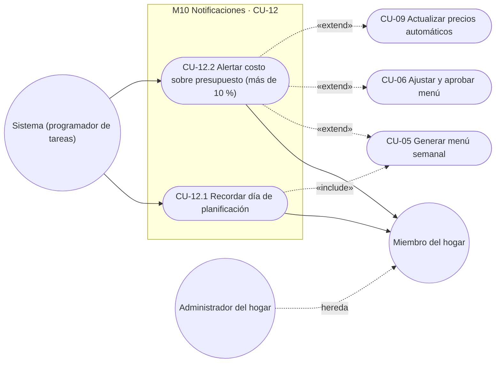
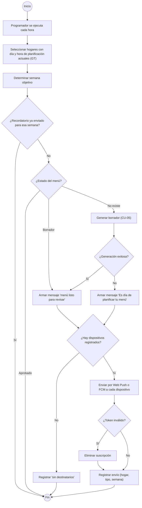
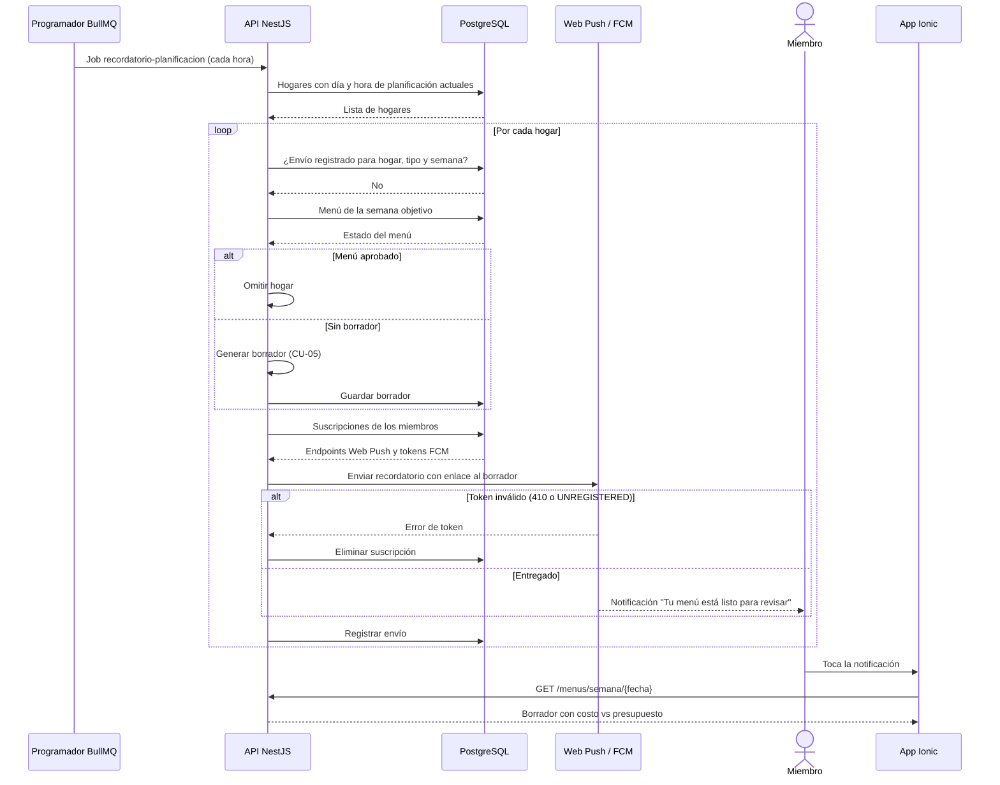
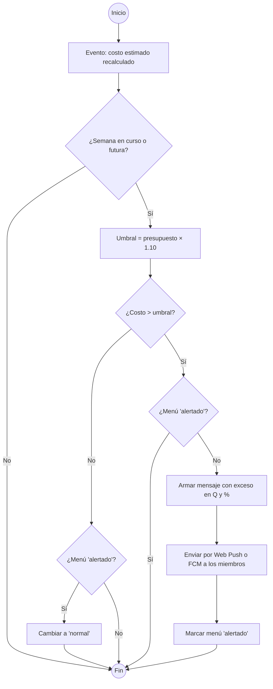
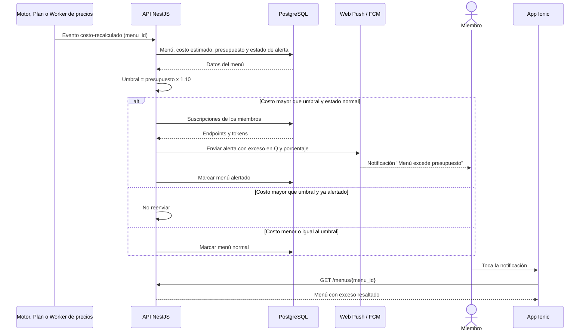

# M10 — Notificaciones

| Campo | Valor |
|---|---|
| SRS | SRS-MF-001 v1.0 (aprobado 2026-10-22) · CU-12 se incorpora en v1.1 |
| Requerimientos | RF-41 a RF-42 |
| Caso de uso macro | CU-12 Recibir notificaciones (nuevo) |
| Sprint(s) | S6 |
| Fase del ciclo de vida | 2. Requerimientos — análisis de casos de uso |

Avisa a los miembros del hogar, por Web Push (PWA) y Firebase Cloud Messaging (Android) según IE-04, cuándo revisar el menú de la semana y cuándo su costo estimado se dispara sobre el presupuesto.

> **Cambio al SRS (v1.1):** se agrega el macro **CU-12 Recibir notificaciones** al diagrama §8.1 (actor Sistema / programador de tareas; receptor Miembro del hogar) y se completa la matriz §10: M10 → CU-12.

## 1. Diagrama de casos de uso del módulo



## 2. Casos de uso e historias

### CU-12.1 — Recordar día de planificación · RF-41 · HU-41

#### Especificación

| Campo | Detalle |
|---|---|
| Actor(es) | Sistema (programador de tareas BullMQ) · Miembros del hogar (receptores) |
| Prioridad / Sprint | S · S6 |
| Precondiciones | Hogar con día de planificación configurado (RF-08, por defecto domingo).<br>Al menos un miembro aceptó el permiso de notificaciones y tiene un dispositivo registrado (Web Push o FCM). |
| Disparador | Día de planificación del hogar a las 08:00 (America/Guatemala). |
| Flujo principal | 1. El programador se ejecuta cada hora y selecciona los hogares cuyo día y hora de planificación coinciden.<br>2. Determina la semana objetivo (la que inicia en o después del día de planificación).<br>3. Verifica que no se haya enviado ya el recordatorio de esa semana.<br>4. Busca el menú de la semana objetivo en estado "Borrador".<br>5. Arma el mensaje "Tu menú del dd al dd de mes está listo para revisar" con costo estimado vs. presupuesto.<br>6. Envía a cada dispositivo registrado de los miembros por Web Push o FCM.<br>7. Registra el envío (hogar, tipo, semana).<br>8. El miembro toca la notificación y la App abre el borrador de esa semana. |
| Flujos alternos | 4a. No existe borrador → el sistema lo genera (include CU-05) y continúa en 5.<br>4b. La generación falla (faltan platillos, CU-05 3b) → envía "Es día de planificar tu menú" con enlace a Plan semanal.<br>4c. El menú de la semana ya está aprobado → no envía y termina. |
| Excepciones | E1. Web Push responde 404/410 o FCM responde UNREGISTERED → elimina esa suscripción y continúa con los demás dispositivos.<br>E2. Error transitorio del servicio de push → reintenta hasta 3 veces con espera exponencial.<br>E3. Ningún miembro con dispositivo registrado → registra "sin destinatarios" y termina. |
| Postcondiciones | Recordatorio enviado una sola vez por hogar y semana; borrador disponible para revisión. |
| Reglas y RNF | RN-09, RN-01, RNF-03, RNF-05, RNF-06, R-02 |

Supuesto: la hora de envío es 08:00 America/Guatemala (el SRS fija solo el día).
Supuesto: si no hay borrador, el sistema lo genera para que "el menú esté listo para revisar" (texto de RF-41); si ya está aprobado, no se recuerda.
Supuesto: semana objetivo = la que inicia en o después del día de planificación; con valores por defecto (domingo/domingo) es la semana que comienza ese mismo domingo.
Supuesto: cada usuario controla la recepción con el permiso del navegador o de Android; no se agregan preferencias propias en v1.

#### Diagrama de actividad



#### Diagrama de secuencia



#### Historia de usuario HU-41 · 8 puntos

> **Como** miembro del hogar, **quiero** recibir el día de planificación un aviso de que el menú de la semana está listo para revisar, **para** no olvidar planificar y aprobarlo a tiempo.

#### Criterios de aceptación

```gherkin
# language: es
Característica: Recordatorio del día de planificación

  # CA-41.1 Flujo principal
  Escenario: Recordatorio el domingo con borrador listo
    Dado que el hogar "Rosales" tiene día de planificación domingo
    Y Rene usa la PWA con Web Push y su esposa la app Android con FCM, ambos con permiso otorgado
    Y existe el borrador de la semana del 2026-10-25 al 2026-10-31 con costo estimado Q248.00 y presupuesto Q250.00
    Cuando el programador se ejecuta el domingo 2026-10-25 a las 08:00 hora de Guatemala
    Entonces ambos reciben "Tu menú del 25 al 31 de octubre está listo para revisar · Q248.00 de Q250.00"
    Y al tocarla la app abre el borrador de esa semana
    Y se registra un solo envío para el hogar y la semana del 2026-10-25

  # CA-41.2 Flujo alterno
  Escenario: Día de planificación cambiado a sábado y sin borrador
    Dado que el administrador cambió el día de planificación a sábado
    Y no existe borrador para la semana del 2026-10-25
    Cuando el programador se ejecuta el sábado 2026-10-24 a las 08:00 hora de Guatemala
    Entonces el sistema genera el borrador de la semana del 2026-10-25 al 2026-10-31
    Y envía el recordatorio a los miembros
    Y el domingo 2026-10-25 no se envía otro recordatorio

  # CA-41.3 Flujo alterno
  Escenario: Menú ya aprobado
    Dado que el menú de la semana del 2026-10-25 ya está aprobado
    Cuando el programador se ejecuta el domingo 2026-10-25 a las 08:00
    Entonces no se envía ninguna notificación de recordatorio

  # CA-41.4 Validación o error
  Escenario: Token de Android inválido y reintento del job
    Dado que el token FCM de la esposa fue revocado
    Cuando el programador envía el recordatorio del 2026-10-25
    Entonces FCM responde UNREGISTERED y el sistema elimina esa suscripción
    Y Rene sí recibe la notificación en la PWA
    Y si el job se reintenta ese mismo día no se envía un segundo recordatorio
```

#### Subtareas

| ID | Tipo | Subtarea | Estimación (h) |
|---|---|---|---|
| ST-41.1 | DB | Tablas SUSCRIPCION_PUSH (usuario, canal, endpoint/token) y NOTIFICACION_ENVIADA (hogar, tipo, semana, única) | 2 |
| ST-41.2 | DevOps | Claves VAPID y credenciales Firebase en secretos de entorno y CI | 2 |
| ST-41.3 | BE | Módulo de notificaciones: adaptadores Web Push y FCM, reintentos y limpieza de tokens inválidos | 5 |
| ST-41.4 | BE | Job BullMQ horario: selección de hogares por día de planificación en America/Guatemala, semana objetivo, generación de borrador e idempotencia | 5 |
| ST-41.5 | FE | Solicitud de permiso, registro de suscripción (service worker PWA y Capacitor Push en Android) y deep link al borrador | 6 |
| ST-41.6 | QA | Casos de prueba PF-M10-41.1..4 y prueba automatizada con reloj simulado y push simulado | 4 |
| ST-41.7 | DOC | Sección del manual de usuario "Activar notificaciones y recordatorio de planificación" | 1 |

---

### CU-12.2 — Alertar costo estimado sobre presupuesto (más de 10 %) · RF-42 · HU-42

#### Especificación

| Campo | Detalle |
|---|---|
| Actor(es) | Sistema (evaluador de presupuesto) · Miembros del hogar (receptores) |
| Prioridad / Sprint | S · S6 |
| Precondiciones | Menú de la semana en curso o de una semana futura (borrador o aprobado) con costo estimado (RN-01).<br>Módulo de notificaciones de HU-41 disponible. |
| Disparador | Se recalcula el costo estimado del menú: al generarlo (CU-05), al editarlo (CU-06) o al actualizar precios (CU-09). |
| Flujo principal | 1. El sistema recalcula el costo estimado total de la semana con precio mediana.<br>2. Calcula el umbral = presupuesto semanal × 1.10.<br>3. Si costo > umbral y el menú no está en estado "alertado", arma el mensaje con costo, presupuesto, exceso en Q y %.<br>4. Envía la alerta a los dispositivos de todos los miembros (Web Push / FCM).<br>5. Marca el menú como "alertado".<br>6. El miembro toca la alerta y la App abre el menú con el exceso resaltado. |
| Flujos alternos | 3a. Costo ≤ umbral → no envía; si el menú estaba "alertado", vuelve a "normal" (una nueva superación generará otra alerta).<br>3b. Costo > umbral y el menú ya está "alertado" → no reenvía. |
| Excepciones | E1. Token inválido → igual que CU-12.1 E1.<br>E2. Presupuesto semanal no configurado → no evalúa y registra advertencia. |
| Postcondiciones | Una alerta por cada vez que el costo cruza el umbral hacia arriba. |
| Reglas y RNF | RN-01, RN-05, RN-08, RNF-06 |

Supuesto: se compara el costo estimado total de la semana contra el presupuesto semanal (no por tiempo de comida); "más de 10 %" es estricto: con Q250 alerta solo si el costo > Q275.00.
Supuesto: solo se evalúan menús de la semana en curso y futuras; semanas pasadas no generan alertas.
Supuesto: la alerta push se envía a todos los miembros, incluido quien hizo el cambio; la app además muestra el exceso en pantalla (RF-26).

#### Diagrama de actividad



#### Diagrama de secuencia



#### Historia de usuario HU-42 · 5 puntos

> **Como** miembro del hogar, **quiero** recibir una alerta cuando el costo estimado del menú supere el presupuesto en más de 10 %, **para** ajustar platillos antes de ir al supermercado.

#### Criterios de aceptación

```gherkin
# language: es
Característica: Alerta de costo estimado sobre presupuesto

  # CA-42.1 Flujo principal
  Escenario: Edición que supera el umbral
    Dado que el presupuesto semanal es Q250.00 y el umbral de alerta es Q275.00
    Y el menú de la semana del 2026-10-25 cuesta Q262.00 y está en estado normal
    Cuando cambio "Tortitas de carne" por "Pescado frito" y el costo estimado sube a Q276.50
    Entonces los miembros reciben "El menú del 25 al 31 de octubre cuesta Q276.50 y excede el presupuesto de Q250.00 por Q26.50 (10.6 %)"
    Y el menú queda en estado alertado

  # CA-42.2 Flujo alterno
  Escenario: Subida de precios del worker sin alertas duplicadas
    Dado que el menú aprobado de la semana del 2026-10-25 cuesta Q262.00 con presupuesto Q250.00
    Cuando la corrida de precios del sábado 2026-10-24 a las 21:00 sube la mediana y el costo pasa a Q281.25
    Entonces los miembros reciben la alerta con exceso de Q31.25 (12.5 %)
    Y si la corrida del domingo deja el costo en Q284.00 no se envía otra alerta

  # CA-42.3 Validación o error
  Escenario: Exactamente 10 % no alerta
    Dado que el presupuesto semanal es Q250.00
    Cuando el costo estimado del menú queda en Q275.00
    Entonces no se envía ninguna alerta
    Y el menú permanece en estado normal

  # CA-42.4 Flujo alterno
  Escenario: Nueva alerta tras volver bajo el umbral
    Dado que el menú de la semana del 2026-10-25 está alertado con costo Q281.25 y presupuesto Q250.00
    Cuando cambio "Caldo de res" por "Pollo en crema" y el costo baja a Q270.00
    Entonces el menú vuelve a estado normal sin enviar notificación
    Y si luego el costo sube a Q278.00 los miembros reciben una nueva alerta con exceso de Q28.00 (11.2 %)
```

#### Subtareas

| ID | Tipo | Subtarea | Estimación (h) |
|---|---|---|---|
| ST-42.1 | DB | Campo estado_alerta_presupuesto (normal/alertado) en MENU_SEMANAL | 1 |
| ST-42.2 | BE | Evaluador de umbral (costo > presupuesto × 1.10) suscrito al evento costo-recalculado de CU-05, CU-06 y CU-09 | 4 |
| ST-42.3 | BE | Mensaje con exceso Q y % y envío reutilizando el módulo de notificaciones de HU-41 | 2 |
| ST-42.4 | FE | Deep link al menú con el exceso resaltado | 2 |
| ST-42.5 | QA | Casos de prueba PF-M10-42.1..4 y prueba automatizada de bordes (Q275.00 / Q275.01) | 3 |
| ST-42.6 | DOC | Sección del manual de usuario "Alerta de presupuesto" | 1 |

---

## 3. Resumen del módulo

| HU | RF | CU | Prioridad | Sprint | Puntos | Horas |
|---|---|---|---|---|---|---|
| HU-41 | RF-41 | CU-12.1 | S | S6 | 8 | 25 |
| HU-42 | RF-42 | CU-12.2 | S | S6 | 5 | 13 |
| **Total** | | | | | **13** | **38** |

Dependencia: HU-42 reutiliza el módulo de notificaciones y las suscripciones de HU-41; se planifica después en el sprint.
