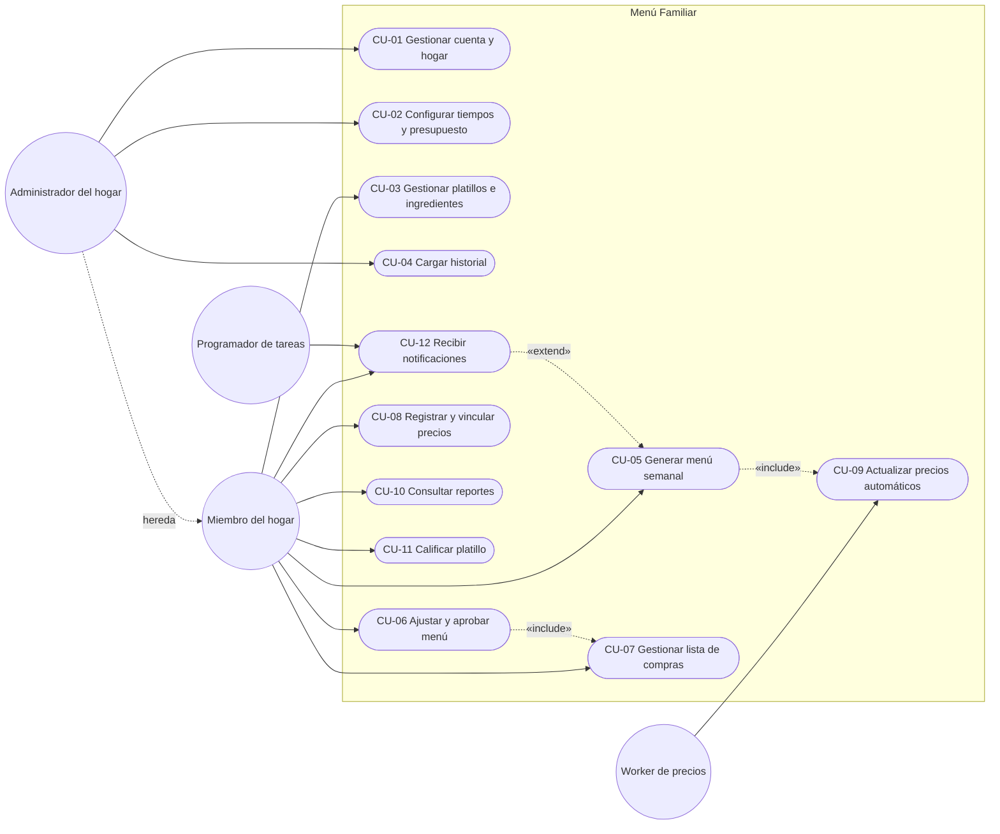
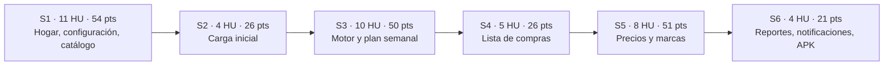

# Casos de uso e historias de usuario — Menú Familiar

| Campo | Valor |
|---|---|
| Documento | CUH-MF-001 |
| Versión | 1.0 (para aprobación del PO) |
| Fecha | 2026-10-22 |
| Base | SRS-MF-001 v1.1 (aprobado 2026-10-22) |
| Fase del ciclo de vida | 2. Requerimientos — análisis de casos de uso, historias y criterios de aceptación |
| Prototipo de referencia | [Prototipo App Menús Familiares](https://claude.ai/artifact/E5BNpQxh3ianZUmYpBmSLz) (2026-10-21) |

La especificación cubre los 42 requerimientos funcionales del SRS. Cada uno tiene su caso de uso detallado, una historia de usuario con criterios de aceptación en Gherkin y sus subtareas estimadas. En total son **42 casos de uso, 42 historias, 228 puntos y 757 horas estimadas**, con 99 diagramas Mermaid validados (todos renderizan sin errores).

## 1. Índice de documentos

| Archivo | Módulo | RF | Casos de uso | Sprint(s) | Puntos | Horas |
|---|---|---|---|---|---|---|
| [M01-cuenta-hogar.md](M01-cuenta-hogar.md) | Cuenta y hogar | RF-01–04 | CU-01.1–01.4 | S1 | 19 | 73 |
| [M02-configuracion.md](M02-configuracion.md) | Configuración | RF-05–10 | CU-02.1–02.6 | S1, S3, S5 | 30 | 96 |
| [M03-catalogo.md](M03-catalogo.md) | Catálogo de platillos | RF-11–14 | CU-03.1–03.3, CU-11.1 | S1, S3 | 18 | 74 |
| [M04-carga-historica.md](M04-carga-historica.md) | Carga histórica | RF-15–18 | CU-04.1–04.4 | S2 | 26 | 85 |
| [M05-motor-sugerencias.md](M05-motor-sugerencias.md) | Motor de sugerencias | RF-19–23 | CU-05.1–05.5 | S3 | 24 | 92 |
| [M06-plan-semanal.md](M06-plan-semanal.md) | Plan semanal | RF-24–27 | CU-06.1–06.4 | S3, S4 | 21 | 65 |
| [M07-lista-compras.md](M07-lista-compras.md) | Lista de compras | RF-28–32 | CU-07.1–07.5 | S4, S5 | 28 | 82 |
| [M08-precios.md](M08-precios.md) | Precios | RF-33–38 | CU-08.1–08.3, CU-09.1–09.3 | S5 | 41 | 121 |
| [M09-reportes.md](M09-reportes.md) | Reportes | RF-39–40 | CU-10.1–10.2 | S6 | 8 | 31 |
| [M10-notificaciones.md](M10-notificaciones.md) | Notificaciones | RF-41–42 | CU-12.1–12.2 | S6 | 13 | 38 |
| **Total** | | **42** | **42** | | **228** | **757** |

[_PLANTILLA.md](_PLANTILLA.md) define la estructura, los IDs y las reglas Mermaid que siguen todos los módulos.

## 2. Convenciones

| Elemento | Formato | Regla |
|---|---|---|
| Caso de uso macro | `CU-xx` | Los 11 del SRS §8 + **CU-12 Recibir notificaciones** (nuevo en SRS v1.1) |
| Caso de uso detallado | `CU-xx.y` | Uno por RF, dentro de su macro |
| Historia de usuario | `HU-nn` | nn = número del RF (RF-05 → HU-05) |
| Criterio de aceptación | `CA-nn.k` | Cada escenario Gherkin; origen del caso de prueba `PF-Mx-nn.k` (fase 5) |
| Subtarea | `ST-nn.k` | Tipos DB, BE, FE, QA, DOC, DevOps; 1–8 h |
| Estimación | Puntos Fibonacci | 1, 2, 3, 5, 8, 13 |

## 3. Diagrama general de casos de uso

## 4. Backlog priorizado por sprint

| Sprint | Historias | Puntos | Horas |
|---|---|---|---|
| S1 | HU-01, 02, 03, 04, 05, 06, 07, 08, 11, 12, 13 | 54 | 199 |
| S2 | HU-15, 16, 17, 18 | 26 | 85 |
| S3 | HU-10, 14, 19, 20, 21, 22, 23, 24, 25, 26 | 50 | 173 |
| S4 | HU-27, 28, 29, 30, 32 | 26 | 80 |
| S5 | HU-09, 31, 33, 34, 35, 36, 37, 38 | 51 | 151 |
| S6 | HU-39, 40, 41, 42 | 21 | 69 |
| **Total** | **42** | **228** | **757** |

**Riesgo de capacidad:** S1, S3 y S5 superan 150 h en 2 semanas. Si el equipo es una sola persona a medio tiempo (~40 h por sprint), hay que medir la velocidad real en S1 y replanificar: mover las HU "S" y "C" (HU-04, 08, 22, 32, 37, 40) a sprints posteriores o alargar el plan.

## 5. Definición de listo (DoR)

Una historia entra al sprint cuando:

- [ ] Tiene caso de uso con diagramas de actividad y de secuencia.
- [ ] Tiene al menos 3 criterios de aceptación en Gherkin con datos concretos.
- [ ] Está estimada en puntos y dividida en subtareas de máximo 8 h.
- [ ] Sus dependencias están terminadas o planificadas en el mismo sprint.
- [ ] El PO validó los supuestos marcados en su especificación.

## 6. Definición de terminado (DoD)

Una historia se cierra cuando:

- [ ] El código está revisado y fusionado en `develop` (el PO hace el push).
- [ ] Las pruebas unitarias pasan con cobertura ≥ 70 % en el módulo (RNF-09).
- [ ] Todos sus CA-nn.k pasan como pruebas funcionales y se agregan a la regresión.
- [ ] Cumple los RNF que cita (rendimiento, seguridad, offline, accesibilidad).
- [ ] La sección del manual de usuario está escrita (`docs/05-manual-usuario/`).
- [ ] El PO aceptó la historia en la revisión del sprint.

## 7. Trazabilidad con el prototipo

| Pantalla del prototipo | Historias que cubre | Brecha a diseñar en fase 3 |
|---|---|---|
| Móvil · Login | HU-01 | Registro y recuperación de contraseña (HU-04) |
| Móvil · Inicio (personas, presupuesto ±Q10) | HU-03, HU-06 | Selector de tiempos de comida y vista previa del reparto (HU-05, HU-07) |
| Móvil · Semana (fijar, cambiar con alternativas) | HU-19, HU-23, HU-24 | Motivo de la sugerencia (HU-22), aprobar con exceso de presupuesto (HU-25) |
| Móvil · Lista de compras con checks | HU-28, HU-30 | Despensa (HU-29), agrupación por supermercado (HU-31), compartir (HU-32) |
| Móvil · Platillos | HU-11 | Ingredientes por porción (HU-12), calificación (HU-14) |
| Web · Semana (costo vs presupuesto, Cambiar, Aceptar y generar lista) | HU-25, HU-26 | Vista de 2 o 3 tiempos por día |
| Web · Precios por tienda (mínimo y mediana) | HU-36 | Registro manual o por ticket (HU-34), vinculación (HU-35), histórico (HU-37) |
| Web · Semanas anteriores | HU-27, HU-39 | Gráfica de 12 semanas, frecuentes y olvidados (HU-40) |
| — sin pantalla — | HU-02, 08, 09, 10, 13, 15–18, 33, 38, 41, 42 | Hogar e invitaciones, configuración, importación, notificaciones |

El prototipo muestra solo almuerzos. Con la configuración de tiempos de comida (HU-05), la vista semanal debe poder mostrar 2 o 3 tiempos por día.

## 8. Supuestos que requieren validación del PO

Cada módulo lista sus supuestos bajo cada especificación. Estos son los que más cambian el diseño:

| # | Supuesto | Módulo |
|---|---|---|
| 1 | Reparto para dos tiempos no cubiertos por RN-06: desayuno + almuerzo = 29/71, desayuno + cena = 40/60 | M02 |
| 2 | Un menú aprobado guarda una copia de la configuración; cambiarla después no lo altera | M02, M06 |
| 3 | Fórmulas de los factores del motor (preferencia, novedad, ahorro, afinidad) definidas en M05 §CU-05.2 | M05 |
| 4 | Se permite aprobar un menú que excede el presupuesto, con confirmación | M06 |
| 5 | Cada comensal cuenta como una porción (sin factor adulto/niño) | M03, M07 |
| 6 | El catálogo de productos y los precios automáticos son comunes a todos los hogares; los precios manuales son del hogar | M03, M08 |
| 7 | La extracción por sitio queda apagada hasta que el administrador revise los términos de uso (PA-02) | M08 |
| 8 | Las fotos del cuaderno se transcriben a mano a la plantilla (sin OCR); la despensa entra con frecuencia mensual provisional (PA-03) | M04 |
| 9 | Recordatorio de planificación a las 08:00 del domingo; la alerta del 10 % es sobre el total semanal | M10 |

## 9. Siguiente fase

Con la aprobación de este documento se pasa a la fase 3, Diseño (`docs/02-diseno/`): arquitectura, ER detallado, diagramas de secuencia técnicos y diseño de las pantallas faltantes en el prototipo.
