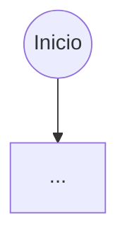

# Plantilla de documentación por módulo

Usa exactamente esta estructura para cada archivo `Mxx-*.md`. Todo en español. Fuente de verdad: `docs/01-requerimientos/SRS.md` (SRS-MF-001 v1.0, aprobado 2026-10-22).

## Convenciones de IDs

| Elemento | Formato | Ejemplo | Regla |
|---|---|---|---|
| Caso de uso macro | `CU-xx` | CU-02 | Los del SRS §8 (CU-01 a CU-11) + CU-12 Recibir notificaciones |
| Caso de uso detallado | `CU-xx.y` | CU-02.1 | Uno por requerimiento funcional, dentro de su macro |
| Historia de usuario | `HU-nn` | HU-05 | nn = número del RF (RF-05 → HU-05) |
| Subtarea | `ST-nn.k` | ST-05.3 | k consecutivo dentro de la historia |
| Escenario de aceptación | `CA-nn.k` | CA-05.2 | Se usa como base del caso de prueba `PF-Mx-nn.k` |

Puntos de historia: Fibonacci 1, 2, 3, 5, 8, 13. Subtareas en horas (1 a 8 h; si es más, dividir).
Tipos de subtarea: `DB`, `BE`, `FE`, `QA`, `DOC`, `DevOps`. Toda historia lleva al menos una `QA` (casos de prueba + automatización) y una `DOC` (sección del manual de usuario).

## Reglas Mermaid (para que rendericen en GitHub)

- Etiquetas con paréntesis, comas, signos o dos puntos van entre comillas: `A["Validar (montos)"]`, `D{"¿Suma 100 %?"}`, `U1(["CU-02.1 Parametrizar tiempos"])`.
- Actores: `ADM(("Administrador"))`. Casos de uso: `id(["CU-xx.y Nombre"])`.
- Relaciones include/extend: `A -. "«include»" .-> B`.
- No usar `end` en minúscula como id de nodo; usar `FIN`. Inicio `INI(("Inicio"))`, fin `FIN(("Fin"))`.
- `sequenceDiagram`: participantes `actor U as Usuario`, `participant APP as App Ionic`, `participant API as API NestJS`, `participant DB as PostgreSQL`; usar `alt/else/end` para alternos. No usar `;` dentro de mensajes.

## Estructura del archivo

````markdown
# Mxx — <Nombre del módulo>

| Campo | Valor |
|---|---|
| SRS | SRS-MF-001 v1.0 (aprobado 2026-10-22) |
| Requerimientos | RF-.. a RF-.. |
| Caso de uso macro | CU-xx |
| Sprint(s) | Sx |
| Fase del ciclo de vida | 2. Requerimientos — análisis de casos de uso |

<Una o dos frases: qué resuelve el módulo.>

## 1. Diagrama de casos de uso del módulo

```mermaid
flowchart LR
  ...actores a la izquierda, subgraph con los CU-xx.y, include/extend punteados
```

## 2. Casos de uso e historias

### CU-xx.y — <Nombre> · RF-nn · HU-nn

#### Especificación

| Campo | Detalle |
|---|---|
| Actor(es) | |
| Prioridad / Sprint | M · S1 |
| Precondiciones | |
| Disparador | |
| Flujo principal | 1. … 2. … (numerado, separado por `<br>`) |
| Flujos alternos | 3a. … |
| Excepciones | E1. … |
| Postcondiciones | |
| Reglas y RNF | RN-.., RNF-.. |

#### Diagrama de actividad



#### Diagrama de secuencia
(Obligatorio cuando intervienen App, API, BD o servicios externos; omitir solo en CU puramente de UI.)

```mermaid
sequenceDiagram
  ...
```

#### Historia de usuario HU-nn · <n> puntos

> **Como** <rol>, **quiero** <acción>, **para** <beneficio>.

#### Criterios de aceptación

```gherkin
# language: es
Característica: <nombre>

  # CA-nn.1 Flujo principal
  Escenario: ...
    Dado ...
    Cuando ...
    Entonces ...

  # CA-nn.2 Flujo alterno
  Escenario: ...

  # CA-nn.3 Validación o error
  Escenario: ...
```

Mínimo 3 escenarios con datos concretos (quetzales, platillos reales como Pollo en crema, Pepián de pollo, Carne guisada, Tortitas de carne, Caldo de res, Pescado frito, Spaghetti con carne, Chile relleno).

#### Subtareas

| ID | Tipo | Subtarea | Estimación (h) |
|---|---|---|---|
| ST-nn.1 | DB | … | 2 |
| ST-nn.2 | BE | … | 4 |
| ST-nn.3 | FE | … | 4 |
| ST-nn.4 | QA | Casos de prueba PF-Mx-nn.1..k y prueba automatizada | 3 |
| ST-nn.5 | DOC | Sección del manual de usuario | 1 |

---

(repetir por cada CU del módulo)

## 3. Resumen del módulo

| HU | RF | CU | Prioridad | Sprint | Puntos | Horas |
|---|---|---|---|---|---|---|
| … | | | | | | |
| **Total** | | | | | **n** | **n** |
````
