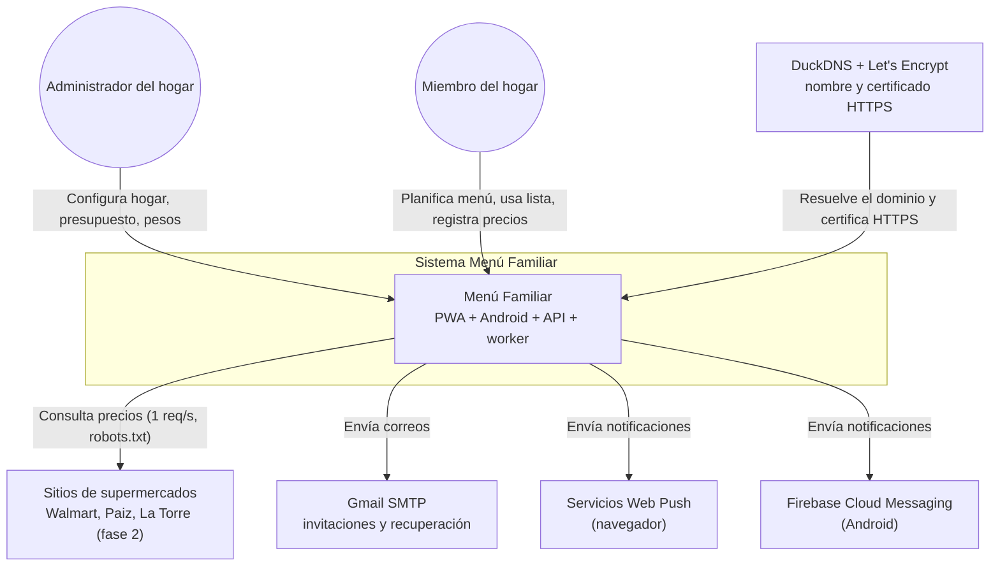
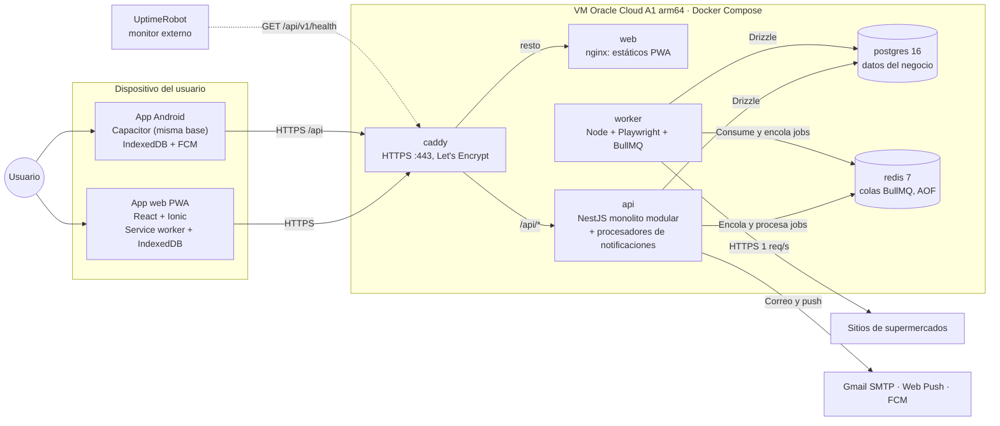
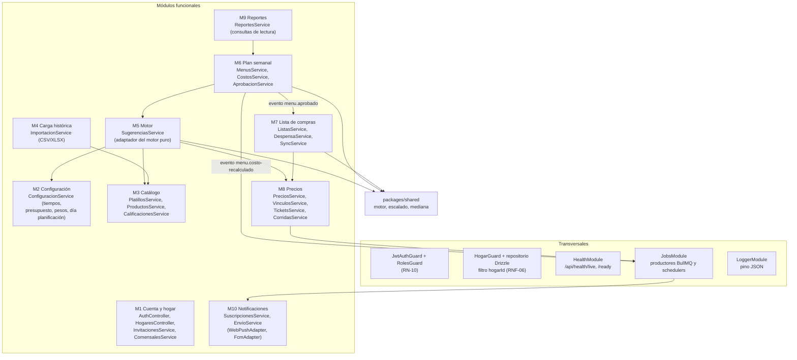
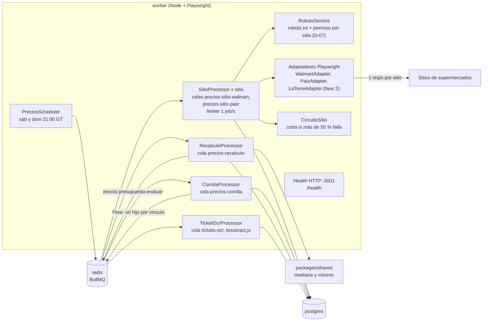
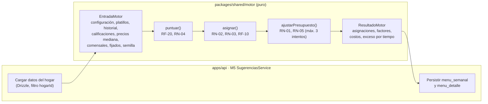

# Arquitectura de software — Menú Familiar

| Campo | Valor |
|---|---|
| Documento | ARQ-MF-001 |
| Versión | 1.1 (D-11 a D-15: Oracle Cloud ARM, DuckDNS + Caddy, Gmail SMTP, Drizzle ORM) |
| Fecha | 2026-10-22 |
| Base | SRS-MF-001 v1.4 · CUH-MF-001 v1.0 · Decisiones D-01 a D-15 |
| Fase del ciclo de vida | 3. Diseño |
| Documentos relacionados | [despliegue.md](despliegue.md) · [secuencias.md](secuencias.md) · [adr/](adr/README.md) |

## 1. Resumen de decisiones

| Tema | Decisión | ADR |
|---|---|---|
| Frontend | React + Ionic + Capacitor: una sola base de código para PWA y APK Android | [ADR-001](adr/ADR-001-stack.md) |
| Backend | API NestJS como **monolito modular** (un módulo por M1–M10) + **worker** Node separado para Playwright | [ADR-001](adr/ADR-001-stack.md) |
| Datos | PostgreSQL 16 + Drizzle ORM; Redis 7 + BullMQ para colas y tareas programadas | [ADR-001](adr/ADR-001-stack.md) · [ADR-010](adr/ADR-010-drizzle-orm.md) |
| Hosting | VM Oracle Cloud Always Free ARM (Ampere A1, arm64) con Docker Compose; Caddy con HTTPS automático (Let's Encrypt) en subdominio DuckDNS; imágenes multi-arquitectura en GHCR | [ADR-009](adr/ADR-009-hosting-oracle-cloud.md) (reemplaza ADR-002) |
| Repositorio | Monorepo pnpm + Turborepo | [ADR-003](adr/ADR-003-monorepo.md) |
| Autenticación | JWT de acceso 15 min + refresh token rotativo, argon2id | [ADR-004](adr/ADR-004-autenticacion.md) |
| Offline | IndexedDB + cola de cambios idempotente, último cambio gana por ítem | [ADR-005](adr/ADR-005-offline-sincronizacion.md) |
| Motor | Motor por reglas en `packages/shared`, TypeScript puro sin BD | [ADR-006](adr/ADR-006-motor-reglas.md) |
| Precios | Playwright en el worker, extracción **apagada por sitio** (D-07) y 1 req/s | [ADR-007](adr/ADR-007-extraccion-precios.md) |
| Notificaciones | Web Push (VAPID) en PWA + FCM en Android | [ADR-008](adr/ADR-008-notificaciones.md) |

## 2. Vista C4 — Nivel 1: Contexto

| Elemento | Tipo | Interfaz SRS |
|---|---|---|
| Administrador / Miembro | Persona | IE-01 |
| Supermercados | Sistema externo (solo lectura) | IE-02 |
| Gmail SMTP | Sistema externo | IE-03 (D-13) |
| Web Push / FCM | Sistema externo | IE-04 |
| DuckDNS / Let's Encrypt / Oracle Cloud | Infraestructura externa | R-05, S-03, RNF-05 (D-11, D-12) |

## 3. Vista C4 — Nivel 2: Contenedores

| Contenedor | Tecnología | Responsabilidad | Escala v1 |
|---|---|---|---|
| `caddy` | Caddy 2.8 alpine | Única entrada desde internet (80/443): HTTPS automático con Let's Encrypt para `DOMINIO` (DuckDNS); `/api/*` → `api:3000`, resto → `web:80`. Mismo origen: sin CORS para la PWA | 1 |
| `web` | nginx 1.27 alpine | Sirve el build de la PWA (`apps/web/dist`) con caché de estáticos y fallback de SPA | 1 réplica |
| `api` | NestJS 10, Node 22 | REST `/api/v1`, autenticación, reglas de negocio M1–M10, procesadores BullMQ livianos (notificaciones, recordatorio, evaluación de presupuesto) | 1 réplica |
| `worker` | Node 22 + Playwright Chromium | Corridas de precios, recálculo mínimo/mediana, OCR de tickets | 1 réplica, concurrencia 1 por sitio |
| `postgres` | PostgreSQL 16 | Fuente de verdad. Sin puerto expuesto al host | 1 |
| `redis` | Redis 7, `appendonly yes`, `maxmemory-policy noeviction` | Colas, jobs programados, contadores de corrida | 1 |
| App PWA / Android | React 18 + Ionic 8 + Capacitor 6, Vite, vite-plugin-pwa (Workbox), Dexie (IndexedDB) | UI móvil primero, offline de lista y menú aprobado, registro de push | — |

## 4. Estilo arquitectónico

**Monolito modular NestJS + worker separado.** Un solo despliegue de API (simple de operar por una sola persona) dividido en módulos con fronteras explícitas; el trabajo pesado y riesgoso (Chromium, scraping, OCR) vive en otro proceso para no afectar la latencia de la API (RNF-01, RNF-02).

| Regla de diseño | Cómo se aplica |
|---|---|
| Un módulo NestJS por módulo funcional | `apps/api/src/modulos/m01-cuenta` … `m10-notificaciones` |
| Fronteras | Un módulo solo usa a otro por su servicio exportado (`exports`) o por eventos; nunca lee tablas ajenas directo |
| Eventos internos | `@nestjs/event-emitter`: `menu.aprobado`, `menu.costo-recalculado`, `precio.registrado` |
| Trabajo asíncrono | BullMQ: la API encola, el worker o los procesadores consumen |
| Lógica pura en `packages/shared` | Motor de sugerencias, escalado de porciones (RN-07), mediana/mínimo (RF-36), reparto de presupuesto (RN-06), esquemas zod de DTO compartidos con el frontend |
| Persistencia | Drizzle ORM (esquema TypeScript único compartido por API y worker, migraciones SQL; ADR-010) |
| Capas dentro de cada módulo | `controller` (HTTP, validación) → `service` (caso de uso) → `repository` (Drizzle, filtro por `hogarId`) |

### 4.1 Estructura del monorepo

| Ruta | Contenido |
|---|---|
| `apps/web` | Ionic React + Capacitor (`android/`), service worker, IndexedDB |
| `apps/api` | NestJS: módulos M1–M10, transversales (auth, guards, health, jobs) |
| `apps/worker` | Procesadores BullMQ de precios y OCR, adaptadores Playwright por sitio |
| `packages/shared` | Motor, reglas de cálculo, tipos y esquemas zod, constantes (zona horaria, moneda) |
| `packages/db` | Esquema Drizzle, migraciones SQL, semillas (catálogo común, supermercados) (ubicación final según ADR-010) |
| `packages/config` | tsconfig, ESLint, Prettier, Vitest/Jest base |
| `infra/` | `compose.yml`, `compose.dev.yml`, `nginx.conf`, scripts de despliegue y respaldo |

## 5. Vista C4 — Nivel 3: Componentes de la API

| Módulo | Controladores (prefijo `/api/v1`) | Tablas propias (Drizzle) | Colas que usa |
|---|---|---|---|
| M1 Cuenta y hogar | `/auth/*`, `/hogares`, `/invitaciones`, `/comensales` | `usuario`, `refresh_token`, `hogar`, `invitacion`, `comensal` | — |
| M2 Configuración | `/configuracion`, `/configuracion/pesos-motor`, `/configuracion/supermercados` | `configuracion`, `tiempo_comida_config`, `preferencia_supermercado`, `restriccion` | — |
| M3 Catálogo | `/platillos`, `/productos`, `/calificaciones` | `platillo`, `platillo_ingrediente`, `producto`, `calificacion` | — |
| M4 Carga histórica | `/importaciones` | `importacion`, `importacion_fila` | — |
| M5 Motor | `/menus/sugerencias`, `/menus/:id/detalles/:det/alternativa`, `/menus/detalles/:id/motivo` | (escribe vía M6) | — |
| M6 Plan semanal | `/menus`, `/menus/:id/mover`, `/menus/:id/aprobar`, `/menus/:id/costos`, `/menus/:id/gasto-real` | `menu_semanal`, `menu_detalle` | `presupuesto-evaluar` (productor) |
| M7 Lista de compras | `/listas/:id`, `/listas/:id/items`, `/listas/:id/sync`, `/despensa` | `lista_compras`, `lista_item`, `lista_cambio`, `despensa_item` | — |
| M8 Precios | `/precios`, `/precios/ticket`, `/productos/:id/vinculos`, `/productos/:id/precios`, `/supermercados`, `/corridas` | `supermercado`, `producto_supermercado`, `precio`, `precio_resumen`, `ticket`, `corrida`, `corrida_sitio`, `aviso` | `precios-recalculo`, `tickets-ocr` (productor) |
| M9 Reportes | `/reportes/gasto`, `/reportes/platillos` | (solo lectura) | — |
| M10 Notificaciones | `/notificaciones/suscripciones` | `suscripcion_push`, `notificacion_enviada` | `recordatorio-planificacion`, `presupuesto-evaluar`, `notificaciones-envio` (procesador) |

## 6. Vista C4 — Nivel 3: Componentes del worker

| Cola BullMQ | Productor | Consumidor | Configuración |
|---|---|---|---|
| `precios-corrida` | Scheduler del worker (`upsertJobScheduler`, cron `0 21 * * 6,0`, tz `America/Guatemala`) | `CorridaProcessor` | 1 intento; crea el Flow de la corrida |
| `precios-sitio-<sitio>` | `CorridaProcessor` (FlowProducer, hijos) | `SitioProcessor` | `limiter {max:1, duration:1000}`, concurrencia 1, `attempts 3` (1 + 2 reintentos, RF-38), `ignoreDependencyOnFailure` |
| `precios-recalculo` | Fin de corrida, `PreciosService` (manual/ticket) | `RecalculoProcessor` | `jobId` = producto para deduplicar |
| `tickets-ocr` | `TicketsService` | `TicketOcrProcessor` | 2 intentos |
| `presupuesto-evaluar` | M6 (evento) y `RecalculoProcessor` | Procesador en `api` (M10) | `jobId` = menú + versión de costo |
| `recordatorio-planificacion` | Scheduler en `api` (cron `0 * * * *`, tz GT) | Procesador en `api` (M10) | Idempotente por `notificacion_enviada` único (hogar, tipo, semana) |
| `notificaciones-envio` | M10 | Procesador en `api` (M10) | `attempts 4`, backoff exponencial 2 s (CU-12.1 E2) |

## 7. Motor de sugerencias como paquete puro

El motor vive en `packages/shared/src/motor` y no conoce NestJS, el ORM ni HTTP. La API carga los datos, llama al motor y persiste el resultado.

| Aspecto | Diseño |
|---|---|
| Firma | `generarMenu(entrada: EntradaMotor): ResultadoMotor` y `alternativa(entrada, dia, tiempo): Asignacion \| null` |
| Determinismo | Misma entrada + misma `semilla` = mismo resultado; desempate por puntaje, luego costo menor, luego `platilloId` |
| Dinero | Montos en centavos enteros (`number` entero) para evitar errores de punto flotante; se formatean a GTQ solo en la UI |
| Escalado RN-07 | `cantidad = base × Σ factorPorcion ÷ porcionesBase`, función compartida con M7 |
| Pruebas | Vitest con tablas de casos (CA de HU-19 a HU-23), pruebas de propiedades (fast-check: nunca repite platillo en la semana sin fijar, nunca proteína consecutiva) y benchmark de 300 platillos (RNF-01) en CI |
| Cobertura | ≥ 90 % en `motor` (por encima del mínimo de RNF-09) |

## 8. Estrategia offline

Alcance (RNF-04): **lista de compras** (lectura y escritura) y **menú aprobado** (lectura). El resto de pantallas requiere conexión y lo indica.

| Pieza | PWA (navegador) | Android (Capacitor) |
|---|---|---|
| Shell de la app | Service worker Workbox: precache del build | Archivos locales del APK (no requiere SW) |
| Datos offline | IndexedDB con Dexie: `menus`, `listas`, `cola_cambios`, `meta` | Igual (IndexedDB del WebView) |
| Lecturas API | `NetworkFirst` con respaldo en IndexedDB para `GET /menus/:id` aprobado y `GET /listas/:id` | Igual, desde la capa de datos de la app |
| Disparo de sincronización | Evento `online`, apertura de la app, Background Sync donde exista (Chrome) | Evento `online` + `App.appStateChange` de Capacitor |
| Indicador | "n cambios pendientes" en la barra de la lista | Igual |

La lógica de cola vive en la **capa de datos de la app** (`apps/web/src/datos/sync`), no en el service worker, para que funcione igual en PWA y Android.

### 8.1 Modelo de cambio y resolución

| Campo del cambio | Uso |
|---|---|
| `cambioId` (UUID v7) | Idempotencia: la API guarda cada `cambioId` aplicado en `lista_cambio` (PK); un reenvío no se aplica dos veces |
| `itemId` | UUID generado en el dispositivo para ítems nuevos (permite crear sin conexión) |
| `op` | `agregar`, `actualizar`, `marcar`, `desmarcar`, `eliminar` |
| `valores` | Campos cambiados (cantidad, nombre libre, `estado` PENDIENTE/COMPRADO/YA_LO_TENGO, `precioReal`) |
| `ts` | Hora del dispositivo en ms |
| `dispositivoId` | Desempate determinista si `ts` es igual |

| Regla | Detalle |
|---|---|
| Último cambio gana por ítem (M07 CU-07.3) | Se aplica si `ts` ajustado > `lista_item.modificado_en_dispositivo`; si no, se descarta y se devuelve el valor vigente |
| Ajuste de reloj | La petición envía `ahoraDispositivo`; la API corrige `ts += ahoraServidor − ahoraDispositivo` para reducir errores por relojes desfasados |
| Borrado | Borrado lógico (`eliminado = true`, `ts`); un `marcar` posterior lo restaura como comprado (CU-07.3 5a) |
| Respuesta | Lista vigente completa + `version`; la app reemplaza su copia local y vacía de la cola los `cambioId` confirmados |
| Rechazos | Cambios de otra lista u otro hogar → `rechazados[]` con motivo; la app los saca de la cola y avisa (CU-07.3 E2) |
| Sesión vencida sin conexión | La cola se conserva; al volver la conexión se renueva el token con el refresh y luego se sincroniza |

## 9. Seguridad

| Control | Diseño | RNF |
|---|---|---|
| Transporte | HTTPS de extremo a extremo hasta Caddy en la VM (Let's Encrypt, TLS 1.2+, HTTP/3); HSTS en Caddy; Android sin tráfico en claro (`usesCleartextTraffic=false`) | RNF-05 |
| Contraseñas | argon2id (`memoryCost` 19 MiB, `timeCost` 2, `parallelism` 1); política mínima 8 caracteres; bloqueo 5 intentos en 15 min | RNF-05 |
| Token de acceso | JWT HS256, 15 min, claims `sub`, `hogarId`, `rol`; secreto en variable de entorno | RNF-05 |
| Refresh token | Opaco (32 bytes aleatorios), 30 días, guardado como hash SHA-256 en `refresh_token`, **rotación en cada uso** y detección de reutilización (revoca la familia). PWA: cookie `HttpOnly; Secure; SameSite=Strict; Path=/api/v1/auth`. Android: almacenamiento seguro del dispositivo | RNF-05 |
| Autorización por rol | `RolesGuard` con `@Roles('ADMIN')` en presupuesto, tiempos, pesos, invitaciones, sitios de precios | RN-10 |
| Aislamiento por hogar | `HogarGuard` toma el `hogarId` y el rol de `miembro_hogar` para el usuario del token (nunca de la ruta ni del cuerpo; las rutas son `/hogar/…`) y lo inyecta con `@HogarActual()`; los repositorios Drizzle agregan `where hogar_id` a las tablas del hogar; los datos comunes (D-05) son de solo lectura para usuarios. Pruebas de autorización por cada endpoint | RNF-06 |
| Validación | `ValidationPipe` global con DTO (class-validator) y esquemas zod compartidos | — |
| Cabeceras y abuso | Helmet; `@nestjs/throttler` (login 10/min por IP, API 120/min por usuario); límite de cuerpo 5 MB (tickets) | RNF-05 |
| Secretos | `.env` en el servidor con permisos 600, fuera del repo; en CI como GitHub Secrets | — |
| Superficie de red | Solo 80/443 abiertos (Security List de OCI + iptables) y publicados únicamente por Caddy; Postgres y Redis sin puertos al host; SSH solo desde la IP del PO con llave | RNF-05 |
| Datos de terceros | Worker con user-agent identificable, respeta robots.txt y permiso por sitio | RNF-12 |

## 10. Observabilidad

| Aspecto | Diseño |
|---|---|
| Logs | JSON con pino (`nestjs-pino`) en API y worker: `time`, `level`, `reqId`, `usuarioId`, `hogarId`, `ruta`, `ms`, `msg`; sin contraseñas ni tokens (redacción de campos) |
| Rotación | Driver `json-file` de Docker con `max-size 10m`, `max-file 5` por contenedor |
| Healthchecks | `api`: `/api/health/live` (proceso) y `/api/health/ready` (Postgres + Redis, Terminus). `worker`: `/health` en :3001 (Redis + último latido). `postgres`: `pg_isready`. `redis`: `redis-cli ping`. Todos como `healthcheck` de Compose |
| Monitoreo | UptimeRobot externo (keyword `"status":"ok"` en `/api/v1/health`, alerta de SSL) + healthchecks de Compose para medir RNF-03 (ver [despliegue.md](despliegue.md)) |
| Corridas | Tablas `corrida` y `corrida_sitio` con estado, totales y errores; aviso al administrador si es Parcial o Fallida |
| Colas | Bull Board en `/api/admin/colas`, solo rol ADMIN |
| Métricas de negocio | Tiempo de generación del motor registrado en log (`motor.ms`) para vigilar RNF-01 |

## 11. Cumplimiento de requerimientos no funcionales

| RNF | Requerimiento | Cómo lo cumple la arquitectura | Verificación |
|---|---|---|---|
| RNF-01 | Menú en < 3 s (p95, 300 platillos) | Motor puro en memoria con una sola carga de datos por petición (consultas agregadas con índices por `hogarId`); sin I/O dentro del motor | Benchmark del motor en CI + prueba de carga k6 del endpoint |
| RNF-02 | Pantallas < 2 s en 4G | Build Vite con división de código por ruta, precache Workbox, compresión gzip/zstd en Caddy y gzip en nginx, caché de estáticos inmutables | Lighthouse CI ≥ 80 |
| RNF-03 | 99 % mensual (≈ 7 h de caída tolerada) | VM en centro de datos de Oracle (D-11), `restart: unless-stopped`, healthchecks, `deploy.sh` con verificación y reversión, respaldos fuera de la VM y reconstrucción documentada, offline para lista y menú | Monitor externo de uptime (UptimeRobot) |
| RNF-04 | Offline de lista y menú aprobado | IndexedDB + cola idempotente + último cambio gana (sección 8) | Prueba en modo avión (CA-30.2, CA-30.3) |
| RNF-05 | Hash, JWT con expiración, HTTPS | argon2id, JWT 15 min + refresh rotativo, HTTPS por Caddy + Let's Encrypt (ADR-009) | Revisión de código + pruebas e2e de auth |
| RNF-06 | Aislamiento por hogar | `HogarGuard` + filtro Drizzle por `hogarId` + datos comunes de solo lectura | Suite de autorización: usuario del hogar A contra recursos del hogar B en todos los endpoints |
| RNF-07 | Planificar en ≤ 5 min, ≤ 3 toques por cambio | Motor da propuesta completa; "Otra opción" en 1 toque (CU-05.5); arrastrar y fijar | UAT |
| RNF-08 | Chrome, Edge, Safari, Android 10+ | Ionic (componentes adaptativos), Capacitor 6 (`minSdkVersion` 29 = Android 10) | Matriz de dispositivos |
| RNF-09 | Cobertura ≥ 70 % API y motor | Lógica pura en `packages/shared`, servicios con repositorios inyectables; umbral de cobertura en CI que falla el build | Reporte de cobertura en GitHub Actions |
| RNF-10 | Docker Compose en un comando | `docker-compose.yml` con todos los servicios; `./deploy/deploy.sh <versión>` (envuelve `docker compose up -d`) | Guía de despliegue |
| RNF-11 | Backup diario, 14 días | `deploy/backup.sh` diario (`pg_dump -Fc`), rotación 14 días, copia a Object Storage de OCI y a la laptop del PO, prueba de restauración mensual | Registro de la prueba de restauración |
| RNF-12 | robots.txt, términos, 1 req/s | Permiso por sitio apagado por defecto (D-07), `RobotsService`, limitador BullMQ por cola de sitio | Prueba con sitio simulado que mide intervalos |
| RNF-13 | WCAG AA, texto escalable | Tokens de color con contraste AA en claro/oscuro, unidades `rem`, componentes Ionic accesibles | Lighthouse accesibilidad ≥ 90 |

## 12. Ajustes a supuestos de requerimientos

| Supuesto en historias | Ajuste en diseño | Motivo |
|---|---|---|
| M01: JWT de acceso con vigencia 24 h | Acceso 15 min + refresh 30 días rotativo | Menor ventana de exposición sin pedir login seguido (ADR-004) |
| M06 CU-06.2 2a: confirmación explícita al aprobar con exceso | Sin diálogo extra; exceso en rojo "Excede por Q__" | D-03 prevalece |
| M08 CU-08.1: OCR en la API, "motor OCR en diseño" | OCR con tesseract.js (idioma `spa`) en el worker, cola `tickets-ocr`; la API responde 202 y la app consulta el resultado | No bloquear la API; sin costo ni envío de fotos a terceros |
| M07 CU-07.3: hora del dispositivo | Hora del dispositivo corregida con el desfase medido en cada sincronización | Relojes desfasados entre teléfonos |
