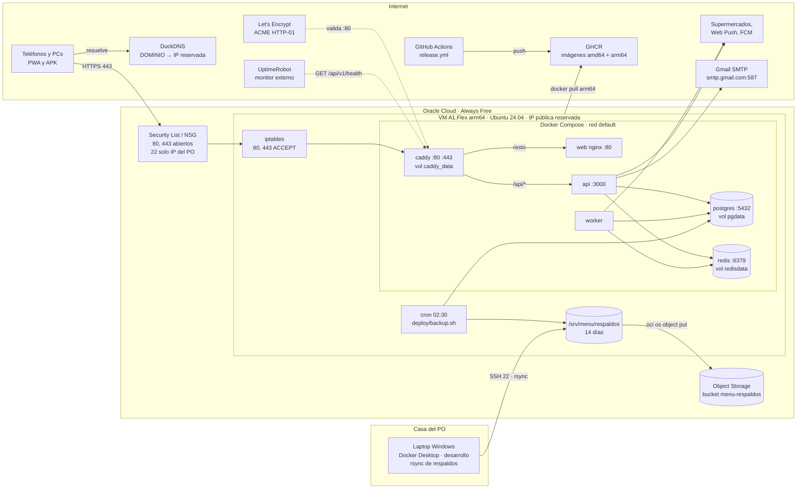
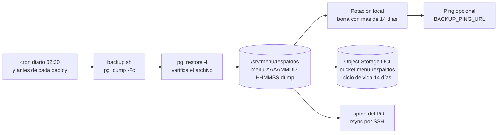
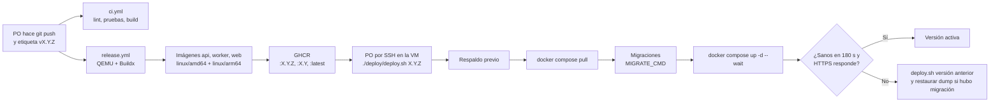

# Despliegue en Oracle Cloud Always Free ARM — Menú Familiar

| Campo | Valor |
|---|---|
| Documento | DEP-MF-001 |
| Versión | 2.0 |
| Fecha | 2026-10-22 |
| Base | SRS-MF-001 v1.4 (R-05, S-03, RNF-03, RNF-05, RNF-10, RNF-11, IE-03) · D-11, D-12, D-13 · [ADR-009](adr/ADR-009-hosting-oracle-cloud.md) (reemplaza a [ADR-002](adr/ADR-002-hosting-casa-cloudflare-tunnel.md)) |
| Fase del ciclo de vida | 3. Diseño (la bitácora operativa irá en `docs/04-despliegue/`) |
| Archivos | [`docker-compose.yml`](../../docker-compose.yml) · [`deploy/Caddyfile`](../../deploy/Caddyfile) · [`deploy/deploy.sh`](../../deploy/deploy.sh) · [`deploy/backup.sh`](../../deploy/backup.sh) · [`.env.example`](../../.env.example) · [`docker-compose.dev.yml`](../../docker-compose.dev.yml) |

### Control de versiones

| Versión | Fecha | Cambio |
|---|---|---|
| 1.0 | 2026-10-22 | Servidor en casa con Cloudflare Tunnel (ADR-002) |
| 2.0 | 2026-10-22 | Producción en Oracle Cloud Always Free ARM, DuckDNS, Caddy, Gmail SMTP; laptop para desarrollo (D-11 a D-13, ADR-009) |

## 1. Objetivo y alcance

| Meta | Valor |
|---|---|
| Disponibilidad | **99 % mensual** (≈ 7 h 18 min de caída tolerada al mes) (RNF-03, D-11) |
| Despliegue | Un comando: `./deploy/deploy.sh <versión>` (envuelve `docker compose up -d`, RNF-10) |
| Exposición | HTTPS con certificado Let's Encrypt automático en `https://<DOMINIO>` (DuckDNS, D-12) |
| Respaldo | Diario, fuera de la VM, retención 14 días, restauración probada cada mes (RNF-11) |
| Costo | US$0/mes (todo dentro del nivel Always Free y servicios gratuitos) |
| Usuarios | 1 hogar (2–6 personas); carga muy baja |

## 2. Infraestructura

| Elemento | Configuración |
|---|---|
| Proveedor | Oracle Cloud Infrastructure (OCI), región de origen de la cuenta (no se puede cambiar después; recomendado: la más cercana con capacidad A1, p. ej. `us-ashburn-1` o `mx-queretaro-1`) |
| Forma | `VM.Standard.A1.Flex` (Ampere Altra, **arm64**) · **4 OCPU / 24 GB RAM** (máximo Always Free) |
| Sistema operativo | Ubuntu 24.04 LTS (o 22.04) imagen de Canonical para aarch64 |
| Disco | Volumen de arranque 100 GB (Always Free permite hasta 200 GB de bloque en total) |
| Red | VCN con subred pública, Internet Gateway, **IP pública reservada** asignada a la VNIC |
| Dominio | `DOMINIO` = subdominio DuckDNS (p. ej. `menufamiliar.duckdns.org`) → IP reservada |
| Object Storage | Bucket privado `menu-respaldos` (Always Free: 20 GB) para copia de respaldos |
| Usuario | `ubuntu` (el de la imagen) o `menu` en grupo `docker`; sin contraseña, solo llave SSH |
| Rutas en la VM | `/srv/menu` (clon del repo o solo `docker-compose.yml`, `deploy/`, `.env`), `/srv/menu/respaldos` |
| Hora | `timedatectl set-timezone America/Guatemala` (cron de respaldos y BullMQ) |
| Parches | `unattended-upgrades` activo; reinicio automático domingo 04:00 |

### 2.1 Presupuesto de memoria (24 GB disponibles)

| Servicio | Uso típico | Pico |
|---|---|---|
| caddy | 20–40 MB | 80 MB |
| web (nginx) | 10 MB | 30 MB |
| api | 150–250 MB | 500 MB |
| worker (Chromium) | 100 MB en reposo | ~1.5 GB en corrida (sáb/dom 21:00) |
| postgres | 150–300 MB | 1 GB |
| redis | 20–50 MB | 256 MB |
| Sistema operativo + Docker | ~1 GB | 1.5 GB |
| **Total** | **~2 GB** | **~5 GB** (holgura amplia; no hace falta `mem_limit`) |

## 3. Diagrama de despliegue



## 4. Servicios de Docker Compose

Archivo: [`docker-compose.yml`](../../docker-compose.yml). Proyecto `menu-familiar`.

| Servicio | Imagen | Puertos al host | Volúmenes | Healthcheck | Depende de |
|---|---|---|---|---|---|
| `caddy` | `caddy:2.8-alpine` | **80, 443/tcp, 443/udp** (únicos publicados) | `./deploy/Caddyfile` (ro), `caddy_data` (certificados), `caddy_config` | `wget` a la API de administración `127.0.0.1:2019` | web, api (healthy) |
| `web` | `ghcr.io/devrenerosales/app_comidas-web:${IMAGE_TAG}` (nginx 1.27 alpine + build PWA) | ninguno | — | `wget http://127.0.0.1/` | api (healthy) |
| `api` | `ghcr.io/devrenerosales/app_comidas-api:${IMAGE_TAG}` (Node alpine) | ninguno | — | `wget http://127.0.0.1:3000/api/v1/health` | postgres, redis (healthy) |
| `worker` | `ghcr.io/devrenerosales/app_comidas-worker:${IMAGE_TAG}` (Node bookworm-slim + Chromium opcional) | ninguno | — | `pgrep -f 'node dist/main.js'` | postgres, redis (healthy) |
| `postgres` | `postgres:16-alpine` | ninguno | `pgdata` | `pg_isready` | — |
| `redis` | `redis:7-alpine` (`--appendonly yes --maxmemory-policy noeviction`) | ninguno | `redisdata` | `redis-cli ping` | — |
| `duckdns` (perfil `duckdns`, opcional) | `curlimages/curl:8.10.1` | ninguno | — | — | — |

Fuera de la arquitectura v2: `cloudflared` (sin túnel: Caddy publica directo) y `uptime-kuma` (se reemplaza por UptimeRobot externo y los healthchecks de Compose).

| Ajuste común | Valor |
|---|---|
| Reinicio | `restart: unless-stopped` en todos (vuelven solos tras reiniciar la VM) |
| Logs | `json-file`, `max-size 10m`, `max-file 5` (ancla `x-logging`) |
| Zona horaria | `TZ=America/Guatemala` |
| Secretos | `/srv/menu/.env` (permisos 600, fuera del repo). Ver [`.env.example`](../../.env.example): `POSTGRES_PASSWORD`, `JWT_*`, `VAPID_*`, `FCM_*`, `SMTP_*`, `DOMINIO`, `DUCKDNS_TOKEN`, `APP_URL`, `OCI_BUCKET` |
| Imágenes | Multi-arquitectura: Docker descarga sola la variante `arm64` en la VM y `amd64` en la laptop/CI |
| Migraciones | `deploy.sh` ejecuta `MIGRATE_CMD` (por defecto `npm run --if-present db:migrate`) en un contenedor efímero de la API antes de levantarla (Drizzle ORM, D-15/ADR-010) |

### 4.1 Caddyfile y rutas publicadas

Archivo: [`deploy/Caddyfile`](../../deploy/Caddyfile) (validado con `caddy validate` 2.8.4).

```caddyfile
{
	admin 127.0.0.1:2019
}

{$DOMINIO} {
	encode zstd gzip
	header {
		Strict-Transport-Security "max-age=31536000"
		X-Content-Type-Options "nosniff"
		Referrer-Policy "strict-origin-when-cross-origin"
		-Server
	}
	handle /api/* {
		header Cache-Control "no-store"
		reverse_proxy api:3000
	}
	handle {
		reverse_proxy web:80
	}
	log {
		output stdout
		format json
	}
}
```

| URL pública | Destino | Nota |
|---|---|---|
| `http://<DOMINIO>/*` | Caddy | Redirección automática a HTTPS (y reto ACME HTTP-01) |
| `https://<DOMINIO>/api/*` | `api:3000` | Sin caché (`no-store`) |
| `https://<DOMINIO>/` | `web:80` | nginx sirve la PWA; estáticos con hash: 1 año inmutable; `sw.js` y manifest sin caché |

El certificado se guarda en el volumen `caddy_data`: **no borrarlo** (Let's Encrypt limita a 5 certificados duplicados por semana). Para pruebas locales del compose de producción se puede usar `DOMINIO=localhost` (Caddy emite un certificado de su CA local).

## 5. Red y seguridad perimetral

### 5.1 Security List / NSG de OCI (reglas de entrada)

| # | Origen | Protocolo / puerto | Motivo |
|---|---|---|---|
| 1 | `0.0.0.0/0` | TCP 80 | Reto ACME HTTP-01 y redirección a HTTPS |
| 2 | `0.0.0.0/0` | TCP 443 | App (HTTPS) |
| 3 | `0.0.0.0/0` | UDP 443 | HTTP/3 (opcional) |
| 4 | `<IP pública del PO>/32` | TCP 22 | SSH solo desde la casa del PO |
| 5 | `0.0.0.0/0` | ICMP tipo 3, código 4 | Path MTU (regla por defecto de OCI) |

Salida: todo permitido (GHCR, Let's Encrypt, Gmail, supermercados, FCM, DuckDNS, Object Storage).

Si la IP de la casa del PO cambia (IP dinámica del proveedor), SSH deja de responder: actualizar la regla 4 desde la consola web de OCI, o entrar por **Cloud Shell** / la **consola serial** de la instancia, que no dependen de la regla.

### 5.2 iptables de Ubuntu en OCI

Las imágenes Ubuntu de OCI traen reglas `iptables` propias (`/etc/iptables/rules.v4`) que **rechazan todo excepto SSH** aunque la Security List lo permita. No usar `ufw` (entra en conflicto con estas reglas y con Docker). Abrir 80/443 antes de la regla `REJECT`:

```bash
# Ver la posición de la regla REJECT de INPUT
sudo iptables -L INPUT --line-numbers

# Insertar las reglas antes del REJECT (normalmente en la posición 6)
sudo iptables -I INPUT 6 -m state --state NEW -p tcp --dport 80 -j ACCEPT
sudo iptables -I INPUT 6 -m state --state NEW -p tcp --dport 443 -j ACCEPT
sudo iptables -I INPUT 6 -m state --state NEW -p udp --dport 443 -j ACCEPT

# Persistir tras reinicios
sudo netfilter-persistent save

# Comprobar desde fuera (laptop):  curl -I http://<DOMINIO>
```

Docker agrega sus propias cadenas (`DOCKER`, `DOCKER-USER`) para los puertos publicados; no se tocan. Postgres y Redis no publican puertos, así que no son alcanzables desde internet.

### 5.3 Endurecimiento de SSH y de la VM

| Control | Configuración |
|---|---|
| SSH | Solo llave (`PasswordAuthentication no`, `PermitRootLogin no`); llave generada en la laptop (`ssh-keygen -t ed25519 -f ~/.ssh/oci_menu`) |
| Usuarios | Solo `ubuntu` (o `menu`) en `sudo` y `docker` |
| Parches | `sudo apt install unattended-upgrades && sudo dpkg-reconfigure -plow unattended-upgrades` |
| Docker | Docker Engine + Compose v2 del repositorio oficial de Docker (arm64) |
| Secretos | `.env` con `chmod 600`; nunca en el repositorio |
| fail2ban (opcional) | Con SSH restringido por IP no es necesario |

## 6. DuckDNS

| Paso | Detalle |
|---|---|
| Cuenta | Entrar en <https://www.duckdns.org> con GitHub o Google; crear el subdominio (p. ej. `menufamiliar`) |
| Token | Copiar el token de la cuenta a `DUCKDNS_TOKEN` en `.env` |
| IP | Poner la **IP pública reservada** de OCI en el subdominio (la reserva no cambia al reiniciar ni al recrear la VM, mientras se reasigne la misma IP) |
| Actualización automática | No es estrictamente necesaria con IP reservada, pero se deja para cubrir una VM recreada con IP efímera. Elegir **una** de las dos opciones |
| Opción A: contenedor | `docker compose --profile duckdns up -d duckdns` (llama a la API de DuckDNS cada 5 min; DuckDNS detecta la IP de origen) |
| Opción B: cron | `*/5 * * * * curl -fsS "https://www.duckdns.org/update?domains=menufamiliar&token=<TOKEN>&ip=" >/dev/null 2>&1` en `crontab -e` |
| Comprobar | `nslookup <DOMINIO>` debe devolver la IP reservada |

Si DuckDNS dejara de funcionar, basta con apuntar otro nombre (otro DNS dinámico gratuito o un dominio propio) a la IP y cambiar `DOMINIO` y `APP_URL` en `.env`; Caddy pide el certificado nuevo solo. El APK debe recompilarse si cambia la URL de la API.

## 7. Correo (Gmail SMTP, D-13)

| Variable | Valor |
|---|---|
| `SMTP_HOST` | `smtp.gmail.com` |
| `SMTP_PORT` | `587` (STARTTLS) |
| `SMTP_USER` | Cuenta de Gmail del hogar |
| `SMTP_PASS` | **Contraseña de aplicación** (Cuenta de Google → Seguridad → Verificación en 2 pasos activa → Contraseñas de aplicaciones) |
| `SMTP_FROM` | `"Menú Familiar <cuenta@gmail.com>"` (Gmail reescribe el remitente a la cuenta autenticada) |
| `APP_URL` | `https://<DOMINIO>` (enlaces de invitación y recuperación) |
| Límite | ~500 correos/día: sobrado para un hogar |

Es cambiable por configuración (Brevo, Resend, etc.) sin tocar código.

## 8. Respaldos



| Elemento | Decisión |
|---|---|
| Qué se respalda | Base PostgreSQL (`pg_dump -Fc --no-owner`). El `.env` se guarda aparte en el gestor de contraseñas del PO |
| Qué no se respalda | Redis (las colas se reconstruyen; los schedulers se registran al arrancar), certificados (Caddy los vuelve a pedir), imágenes (están en GHCR) |
| Script | [`deploy/backup.sh`](../../deploy/backup.sh) `[diario|predeploy|manual]`: dump, verificación con `pg_restore -l`, rotación, copia a Object Storage y ping opcional |
| Frecuencia | Diaria 02:30 (fuera de las corridas de precios de 21:00) + automática antes de cada `deploy.sh` |
| Retención | 14 días en la VM (`BACKUP_RETENTION_DAYS`) y en el bucket (regla de ciclo de vida) (RNF-11) |
| Fuera de la VM — opción 1 | **Object Storage de OCI** (20 GB Always Free): `OCI_BUCKET=menu-respaldos` + CLI `oci` configurado en la VM. Nota: está en la misma cuenta de Oracle; si la cuenta se pierde, se pierde esta copia |
| Fuera de la VM — opción 2 (recomendada además) | **Laptop del PO** con `rsync` (WSL) programado en el Programador de tareas de Windows: protege contra la pérdida de la cuenta de OCI |
| Aviso | `BACKUP_PING_URL` (p. ej. Healthchecks.io gratis) avisa si el respaldo no corrió en 26 h |
| RPO / RTO | RPO 24 h · RTO 4 h (VM nueva + restauración) |

Cron en la VM (`crontab -e` del usuario del despliegue):

```cron
30 2 * * * /srv/menu/deploy/backup.sh diario >> /srv/menu/respaldos/backup.log 2>&1
```

Configuración de la copia a Object Storage (una vez):

```bash
# CLI de OCI en la VM (arm64 soportado)
bash -c "$(curl -L https://raw.githubusercontent.com/oracle/oci-cli/master/scripts/install/install.sh)" -- --accept-all-defaults
oci setup config            # usuario, tenancy, región y llave API (subir la llave pública en la consola)
oci os bucket create --name menu-respaldos --compartment-id <OCID_COMPARTIMENTO>
# En la consola: Bucket → Lifecycle Policy Rules → "Delete" objetos con más de 14 días
```

Copia a la laptop (WSL en Windows; programar diario con el Programador de tareas: `wsl rsync ...`):

```bash
rsync -avz --delete -e "ssh -i ~/.ssh/oci_menu" \
  ubuntu@<DOMINIO>:/srv/menu/respaldos/ /mnt/c/Respaldos/menu-familiar/
```

### 8.1 Prueba de restauración mensual (primer domingo)

```bash
cd /srv/menu
ULTIMO=$(ls -1t respaldos/menu-*.dump | head -n1)
docker run -d --name pg-restore -e POSTGRES_PASSWORD=prueba postgres:16-alpine
sleep 10
docker exec -i pg-restore createdb -U postgres restauracion
docker exec -i pg-restore pg_restore -U postgres -d restauracion --no-owner < "$ULTIMO"
docker exec -i pg-restore psql -U postgres -d restauracion -c \
  "select (select count(*) from hogar) hogares, (select count(*) from menu_semanal) menus, (select count(*) from precio) precios;"
docker rm -f pg-restore
```

Registrar fecha, archivo, conteos y resultado en `docs/04-despliegue/restauraciones.md`. Los conteos deben coincidir con producción (`docker compose exec postgres psql ...`).

## 9. Monitoreo

| Monitor | Herramienta | Objetivo | Aviso |
|---|---|---|---|
| URL pública | **UptimeRobot** (gratis, intervalo 5 min) tipo *Keyword* a `https://<DOMINIO>/api/v1/health` buscando `"status":"ok"` | Medir RNF-03 (99 %) y detectar BD/Redis caídos (la API responde `degraded`) | Correo y app móvil |
| Certificado | UptimeRobot (alerta de vencimiento SSL) | Renovación de Caddy fallida | Correo |
| Contenedores | Healthchecks de Compose + `restart: unless-stopped`; `docker compose ps` | Reinicio automático de contenedores caídos | — |
| Respaldo diario | `BACKUP_PING_URL` (Healthchecks.io gratis) | Confirmar que corrió | Correo |
| Corridas de precios | Tabla `corrida` + aviso en app | Parcial / Fallida | Aviso al administrador (CU-09.3) |
| Disco | `df -h` en la revisión mensual; alerta de UptimeRobot si la app cae por disco lleno | Disco < 80 % | — |
| Métricas de la VM | Consola de OCI (Monitoring → métricas de instancia, gratis) | CPU / memoria / red; vigilar el umbral de "instancia inactiva" (§12) | Alarma opcional por correo |

## 10. Actualizaciones (CI/CD)



| Paso | Detalle |
|---|---|
| Disparo | Claude prepara cambios y mensaje de commit; **el PO hace el push y la etiqueta** (R-04) |
| Build | [`release.yml`](../../.github/workflows/release.yml): `docker/setup-qemu-action` + `docker/setup-buildx-action`, `platforms: linux/amd64,linux/arm64`, caché GHA por app. La web compila en la plataforma nativa del runner (salida estática) y solo la etapa nginx es multi-arch |
| Chromium | El worker se construye sin navegadores hasta HU-33; con la variable del repositorio `INSTALL_BROWSERS=true` instala `npx playwright install --with-deps chromium` (Playwright publica Chromium para Linux arm64) |
| Acceso a GHCR | Si los paquetes son privados: en la VM `docker login ghcr.io -u devrenerosales` con un token de solo lectura (`read:packages`) |
| Despliegue | [`deploy/deploy.sh`](../../deploy/deploy.sh) `<versión>` (idempotente): fija `IMAGE_TAG` en `.env` (guarda `IMAGE_TAG_ANTERIOR`), respaldo previo, `pull`, postgres/redis, migraciones, `up -d --remove-orphans --wait`, verificación `https://<DOMINIO>/api/v1/health` |
| Revertir | `./deploy/deploy.sh <IMAGE_TAG_ANTERIOR>`; si la migración no era compatible hacia atrás, restaurar el dump `predeploy` |
| Migraciones | Solo hacia adelante y compatibles con la versión anterior (expandir/contraer) |
| App Android | El APK apunta a `https://<DOMINIO>/api/v1`; se instala desde el release |

## 11. Entornos

| Entorno | Dónde | Cómo se levanta | Datos | Precios |
|---|---|---|---|---|
| Desarrollo | **Laptop del PO** (Windows + Docker Desktop con backend WSL 2) | `docker compose -f docker-compose.dev.yml up -d` (postgres 5432, redis 6379) + `pnpm dev` (Turborepo: web, api, worker) | Semillas + CSV de las 16 semanas | Adaptadores simulados con HTML de prueba |
| Pruebas del compose de producción | Laptop | `.env` con `DOMINIO=localhost` y `docker compose up -d --build` (imágenes amd64 locales) | Semillas | Simulados |
| CI | GitHub Actions | Servicios postgres y redis del job | Semillas de prueba | Simulados |
| Producción | VM Oracle A1 (arm64) | `./deploy/deploy.sh <versión>` con imágenes de GHCR | Reales | Sitios reales solo si están habilitados (D-07) |

Notas para Windows: clonar el repositorio dentro del sistema de archivos de WSL (`\\wsl$\Ubuntu\home\...`) para que `pnpm` y los volúmenes sean rápidos; configurar Git con `core.autocrlf=input` (los scripts `deploy/*.sh` deben quedar con fin de línea LF).

No hay staging en v1; las pruebas de aceptación se hacen en la laptop.

## 12. Riesgo: reclamo de instancias Always Free inactivas

Oracle puede **detener (reclamar) instancias Always Free inactivas**: cuando durante 7 días seguidos el percentil 95 de uso de CPU, de red y (en A1) de memoria queda por debajo de 20 %. Una app familiar de baja carga puede caer en ese umbral. Además, Oracle puede suspender cuentas gratuitas por revisión o fraude, y la capacidad A1 a veces está agotada al crear o recrear la VM.

| Mitigación | Detalle |
|---|---|
| **Pasar la cuenta a Pay As You Go (recomendado)** | Las instancias de cuentas de pago no se reclaman por inactividad; los recursos Always Free siguen siendo gratis. Crear un **presupuesto** con alerta a US$1 para detectar cualquier cargo |
| Respaldos fuera de la VM | Diarios en Object Storage **y** en la laptop (la copia en la laptop cubre la pérdida de la cuenta) |
| Reconstrucción documentada | El checklist §13 recrea todo en ~2–4 h: VM, IP, `.env` (del gestor de contraseñas), `deploy.sh`, restaurar dump |
| Plan de contingencia | Las imágenes son multi-arch: el mismo `docker-compose.yml` corre en un VPS amd64 de pago (Hetzner/DigitalOcean) o temporalmente en la laptop, cambiando solo la IP en DuckDNS |
| Vigilancia | Métricas de la instancia en la consola de OCI; UptimeRobot avisa en minutos si la VM se detiene |

## 13. Checklist de puesta en marcha

| # | Tarea | Comando / detalle | Responsable | Hecho |
|---|---|---|---|---|
| 1 | Crear cuenta de Oracle Cloud (tarjeta solo para verificación); elegir región de origen | <https://www.oracle.com/cloud/free/> | PO | [ ] |
| 2 | (Recomendado) Pasar a Pay As You Go y crear presupuesto con alerta a US$1 | Billing → Upgrade; Budgets | PO | [ ] |
| 3 | Crear VCN con asistente "VCN with Internet Connectivity" | Networking → VCN Wizard | PO | [ ] |
| 4 | Generar llave SSH en la laptop | `ssh-keygen -t ed25519 -f ~/.ssh/oci_menu` | PO | [ ] |
| 5 | Crear instancia `VM.Standard.A1.Flex` 4 OCPU / 24 GB, Ubuntu 24.04 aarch64, disco 100 GB, subred pública, llave pública | Si dice "Out of capacity", reintentar otro dominio de disponibilidad u otra hora | PO | [ ] |
| 6 | Reservar IP pública y asignarla a la VNIC (reemplaza la efímera) | Networking → Reserved Public IPs; VNIC → IPv4 → Edit | PO | [ ] |
| 7 | Security List: abrir TCP 80/443 (y UDP 443) a `0.0.0.0/0`; limitar TCP 22 a `<IP del PO>/32` | §5.1 | PO | [ ] |
| 8 | Entrar por SSH | `ssh -i ~/.ssh/oci_menu ubuntu@<IP>` | PO | [ ] |
| 9 | Zona horaria, parches, iptables 80/443 | `sudo timedatectl set-timezone America/Guatemala`; `sudo apt update && sudo apt -y upgrade`; §5.2 | PO + Claude (guía) | [ ] |
| 10 | Instalar Docker Engine + Compose v2 | `curl -fsSL https://get.docker.com \| sudo sh && sudo usermod -aG docker $USER` (salir y volver a entrar) | PO | [ ] |
| 11 | Crear subdominio DuckDNS apuntando a la IP reservada | §6 | PO | [ ] |
| 12 | Gmail: activar verificación en 2 pasos y crear contraseña de aplicación | §7 | PO | [ ] |
| 13 | Crear proyecto Firebase (FCM) y claves VAPID | `npx web-push generate-vapid-keys` | PO + Claude (guía) | [ ] |
| 14 | Preparar `/srv/menu` | `sudo mkdir -p /srv/menu && sudo chown $USER /srv/menu && git clone <url-del-repositorio> /srv/menu` (o copiar `docker-compose.yml` y `deploy/`) | PO | [ ] |
| 15 | Crear `.env` desde `.env.example` con secretos reales, `NODE_ENV=production`, `DOMINIO`, `APP_URL`, `SMTP_*`, `CORS_ORIGIN=https://<DOMINIO>` | `cp .env.example .env && chmod 600 .env && nano .env` | PO | [ ] |
| 16 | Login a GHCR (si los paquetes son privados) | `echo <token> \| docker login ghcr.io -u devrenerosales --password-stdin` | PO | [ ] |
| 17 | Primer despliegue | `cd /srv/menu && ./deploy/deploy.sh <versión>` | PO | [ ] |
| 18 | Verificar HTTPS desde datos móviles | `https://<DOMINIO>` y `https://<DOMINIO>/api/v1/health` → `"status":"ok"` | PO | [ ] |
| 19 | Cron de respaldo y primera ejecución manual | §8; `./deploy/backup.sh manual` | PO | [ ] |
| 20 | Bucket de Object Storage con regla de 14 días y CLI `oci`; `OCI_BUCKET` en `.env` | §8 | PO | [ ] |
| 21 | Copia a la laptop con rsync programado | §8 | PO | [ ] |
| 22 | Probar restauración completa antes de cargar datos reales | §8.1 | PO | [ ] |
| 23 | UptimeRobot (keyword + SSL) y Healthchecks.io para el respaldo | §9 | PO | [ ] |
| 24 | Instalar PWA y APK; aceptar notificaciones | — | PO y familia | [ ] |
| 25 | Dejar la extracción de precios apagada en todos los sitios hasta revisar términos | D-07, PA-02 | PO | [ ] |
| 26 | Guardar en gestor de contraseñas: `.env`, llave SSH, acceso a OCI, token DuckDNS, keystore Android | — | PO | [ ] |

## 14. Preguntas abiertas para el PO

| ID | Pregunta | Opciones | Recomendación |
|---|---|---|---|
| PO-04 | ¿Destino del respaldo fuera de la VM? | Object Storage de OCI · laptop vía rsync · ambos | Ambos (OCI para restaurar rápido, laptop contra pérdida de la cuenta) |
| PO-07 | ¿Se pasa la cuenta de OCI a Pay As You Go para evitar el reclamo por inactividad? | Sí, con presupuesto y alerta a US$1 · No (aceptar el riesgo) | Sí |
| PO-08 | ¿Paquetes de GHCR públicos o privados? | Públicos (sin login en la VM) · Privados (token `read:packages`) | Privados si el repo es privado |
