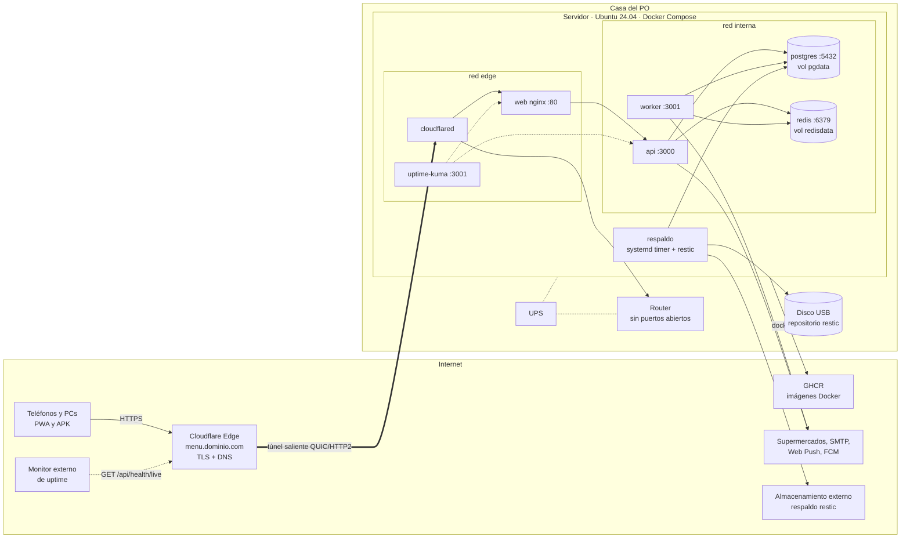
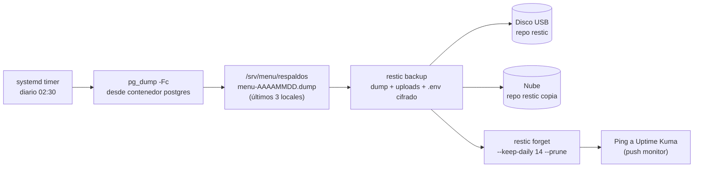
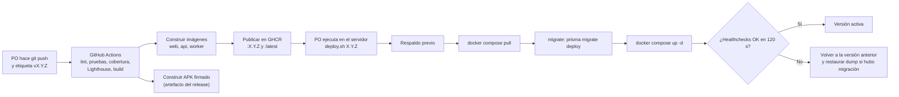

# Despliegue en servidor propio — Menú Familiar

| Campo | Valor |
|---|---|
| Documento | DEP-MF-001 |
| Versión | 1.0 (para aprobación del PO) |
| Fecha | 2026-10-22 |
| Base | SRS-MF-001 v1.2 (R-05, RNF-03, RNF-10, RNF-11) · D-09 · [ADR-002](adr/ADR-002-hosting-casa-cloudflare-tunnel.md) |
| Fase del ciclo de vida | 3. Diseño (la guía operativa paso a paso irá en `docs/04-despliegue/` en S0) |

## 1. Objetivo y alcance

| Meta | Valor |
|---|---|
| Disponibilidad | 95 % mensual (≈ 36 h de caída tolerada al mes) |
| Despliegue | Un comando: `docker compose up -d` (RNF-10) |
| Exposición | HTTPS sin abrir puertos en el router (S-03) |
| Respaldo | Diario, cifrado, fuera del servidor, 14 días (RNF-11) |
| Usuarios | 1 hogar (2–6 personas); carga muy baja |

## 2. Hardware mínimo

| Componente | Mínimo | Recomendado | Nota |
|---|---|---|---|
| Equipo | Laptop vieja x86_64 (2015+) | Mini PC Intel N100 / N150 (~US$150–200, 6–10 W) | La laptop trae "UPS" propio (batería), pero el router también necesita energía |
| CPU | 2 núcleos / 4 hilos | 4 núcleos | Chromium de Playwright es lo más pesado y corre solo sáb/dom 21:00 |
| RAM | 8 GB | 8–16 GB | Ver presupuesto de memoria abajo |
| Disco | SSD 128 GB | SSD 256 GB | No usar disco mecánico para Postgres |
| Red | Ethernet al router | Ethernet | Evitar Wi-Fi para el servidor |
| Respaldo | Disco USB externo ≥ 256 GB | Disco USB + destino en la nube | Destino externo: pregunta PO-04 |
| Energía | UPS 600 VA para servidor + router + módem | UPS 850 VA con USB (apagado ordenado con NUT) | Cubre cortes cortos; BIOS en "Power on after AC loss" |

### 2.1 Presupuesto de memoria

| Servicio | Límite (`mem_limit`) | Uso típico |
|---|---|---|
| postgres | 768 MB | 150–300 MB |
| redis | 256 MB | 20–50 MB |
| api | 512 MB | 150–250 MB |
| worker (con Chromium) | 1.5 GB | 100 MB en reposo, ~1 GB en corrida |
| web (nginx) | 64 MB | 10 MB |
| cloudflared | 128 MB | 30 MB |
| uptime-kuma | 256 MB | 100 MB |
| Sistema operativo + Docker | — | ~1 GB |
| **Total pico** | **~4.5 GB** | Holgura suficiente con 8 GB |

## 3. Sistema operativo y base

| Elemento | Configuración |
|---|---|
| SO | Ubuntu Server 24.04 LTS (sin escritorio) |
| Docker | Docker Engine + plugin Compose v2 (repositorio oficial de Docker) |
| Usuario | `menu` sin contraseña de root; en grupo `docker` |
| SSH | Solo llave, `PasswordAuthentication no`, escucha solo en LAN |
| Firewall | `ufw default deny incoming`; permitir SSH desde la subred LAN |
| Actualizaciones del SO | `unattended-upgrades` para parches de seguridad; reinicio automático domingo 04:00 |
| Hora | Zona `America/Guatemala`, NTP activo (necesario para cron de BullMQ y "último cambio gana") |
| Rutas | `/srv/menu` (compose, `.env`, scripts), `/srv/menu/datos` (volúmenes), `/srv/menu/respaldos` |

## 4. Diagrama de despliegue

## 5. Servicios de Docker Compose

| Servicio | Imagen | Redes | Volúmenes | Puertos al host | Healthcheck | Depende de |
|---|---|---|---|---|---|---|
| `web` | `ghcr.io/<owner>/menu-familiar-web:<versión>` (nginx 1.27 alpine + build PWA) | edge, interna | — | ninguno | `wget -qO- http://localhost/healthz` | api |
| `api` | `ghcr.io/<owner>/menu-familiar-api:<versión>` (Node 22 alpine) | interna | `uploads:/app/uploads` (tickets) | ninguno | `GET /api/health/ready` | postgres, redis (healthy) |
| `worker` | `ghcr.io/<owner>/menu-familiar-worker:<versión>` (base `mcr.microsoft.com/playwright` Node 22) | interna | `uploads:/app/uploads:ro` | ninguno | `GET :3001/health` | postgres, redis (healthy) |
| `postgres` | `postgres:16-alpine` | interna | `pgdata:/var/lib/postgresql/data` | ninguno | `pg_isready -U menu` | — |
| `redis` | `redis:7-alpine` con `--appendonly yes --maxmemory-policy noeviction` | interna | `redisdata:/data` | ninguno | `redis-cli ping` | — |
| `cloudflared` | `cloudflare/cloudflared:<versión fija>` con `tunnel run --token` | edge | — | ninguno | `cloudflared tunnel info` (o métricas :2000) | web |
| `uptime-kuma` | `louislam/uptime-kuma:1` | edge, interna | `kuma:/app/data` | `127.0.0.1:3001` (acceso por túnel SSH o Cloudflare Access) | integrado | — |

| Ajuste común | Valor |
|---|---|
| Reinicio | `restart: unless-stopped` en todos |
| Logs | `logging: json-file`, `max-size: 10m`, `max-file: 5` |
| Zona horaria | `TZ=America/Guatemala` en todos |
| Secretos | `.env` (600): `DATABASE_URL`, `REDIS_URL`, `JWT_SECRET`, `VAPID_PUBLIC_KEY`, `VAPID_PRIVATE_KEY`, `FCM_SERVICE_ACCOUNT` (JSON en archivo montado), `SMTP_*`, `CF_TUNNEL_TOKEN`, `RESTIC_PASSWORD` |
| Migraciones | Servicio único `migrate` (perfil `deploy`) que corre `prisma migrate deploy` antes de levantar `api` y `worker` |

### 5.1 Rutas publicadas

| URL pública | Destino | Nota |
|---|---|---|
| `https://menu.<dominio>/` | `web:80` (PWA) | Caché de estáticos con hash: 1 año inmutable |
| `https://menu.<dominio>/api/*` | `web` → `api:3000` | Regla de Cloudflare: sin caché para `/api/*` |
| `https://estado.<dominio>/` (opcional) | `uptime-kuma:3001` | Protegido con Cloudflare Access (correo del PO) |

## 6. Exposición: Cloudflare Tunnel (recomendado)

| Aspecto | Detalle |
|---|---|
| Cómo funciona | `cloudflared` abre una conexión **saliente** a Cloudflare; Cloudflare publica `menu.<dominio>` con certificado TLS válido y reenvía al servicio `web` |
| Puertos abiertos en el router | Ninguno. Sirve aunque el proveedor de internet use CGNAT o IP dinámica |
| Por qué HTTPS es obligatorio | Service worker y Web Push solo funcionan en contexto seguro; Android bloquea HTTP en claro; RNF-05 |
| Requisito | **Dominio propio** administrado en Cloudflare (DNS gratis, dominio ~US$10/año). Los túneles rápidos `trycloudflare.com` sin dominio cambian de URL en cada reinicio: no sirven para producción ni para el APK |
| Costo | Plan gratis de Cloudflare + dominio |
| Protección adicional | Cloudflare Access opcional para rutas de administración (`/api/admin/*`, Uptime Kuma) |

### 6.1 Alternativa: Tailscale (solo uso familiar)

| Aspecto | Cloudflare Tunnel | Tailscale (`tailscale serve`) |
|---|---|---|
| Dominio propio | Sí (~US$10/año) | No (usa `*.ts.net` con HTTPS) |
| Acceso | Cualquier dispositivo con internet | Solo dispositivos con Tailscale instalado y conectado |
| Web Push / FCM | Funciona | Funciona (el envío es saliente); la app abre solo si el VPN está activo |
| Uso en el supermercado | Directo | Requiere VPN activo en el teléfono (consume la ranura de VPN de Android) |
| Monitor externo de uptime | Posible | No (la URL no es pública) |
| Superficie expuesta | URL pública (protegida por login de la app) | Nula fuera de la red Tailscale |
| Recomendación | **Producción** | Si el PO no quiere dominio ni URL pública |

## 7. Respaldos

| Elemento | Decisión |
|---|---|
| Qué se respalda | Dump de Postgres (`pg_dump -Fc`), volumen `uploads` (fotos de tickets), `.env` y `compose.yml` |
| Qué no se respalda | Redis (las colas se reconstruyen; los schedulers se registran al arrancar), imágenes Docker (están en GHCR) |
| Frecuencia | Diaria 02:30 (fuera de corridas de precios 21:00) + respaldo previo a cada despliegue |
| Cifrado | restic (AES-256); contraseña en `.env` y **copia impresa guardada por el PO** |
| Destinos | Disco USB externo + copia fuera de casa (pregunta PO-04: Backblaze B2 / Cloudflare R2 / Google Drive vía rclone) |
| Retención | `--keep-daily 14` (RNF-11) |
| Alerta | Monitor "push" de Uptime Kuma: si el script no reporta en 26 h, avisa |
| Prueba de restauración | Mensual (primer domingo): `restore-test.sh` restaura el último snapshot en un contenedor `postgres-restore` temporal, corre conteos de control (hogares, menús, precios) y registra el resultado en `docs/04-despliegue/restauraciones.md` |
| RPO / RTO objetivo | RPO 24 h · RTO 4 h (equipo nuevo + restaurar) |

## 8. Energía y continuidad

| Riesgo | Mitigación |
|---|---|
| Corte de luz corto | UPS para servidor, router y módem |
| Corte largo | NUT apaga ordenadamente con 20 % de batería; BIOS enciende al volver la luz; Compose levanta todo (`unless-stopped`) |
| Caída de internet | La app sigue usable offline para lista y menú aprobado (RNF-04); el túnel se reconecta solo |
| Disco del servidor dañado | Restauración desde restic en otro equipo (RTO 4 h) |
| Corrida de precios perdida por caída | El scheduler de BullMQ no repite corridas vencidas; el administrador puede lanzar "Correr ahora" desde la app; RF-38 conserva el último precio |

## 9. Monitoreo

| Monitor | Herramienta | Objetivo | Aviso |
|---|---|---|---|
| Servicios internos (api ready, web, worker, postgres, redis) | Uptime Kuma (en el servidor) | Detectar contenedor caído | Telegram o correo |
| URL pública `/api/health/live` | Monitor externo gratis (UptimeRobot o similar) | Medir RNF-03 real, incluso si se cae toda la casa | Correo / app móvil |
| Respaldo diario | Uptime Kuma push | Confirmar que corrió | Telegram o correo |
| Corrida de precios | Tabla `corrida` + aviso en app | Parcial / Fallida | Aviso al administrador (CU-09.3) |
| Disco y RAM | Uptime Kuma (script push con `df` y `free`) | Disco > 80 % | Telegram o correo |

## 10. Actualizaciones (CI/CD)

| Paso | Detalle |
|---|---|
| Disparo | Claude prepara cambios y mensaje de commit; **el PO hace el push y la etiqueta** (R-04) |
| Workflows | `ci.yml` (cada PR a `develop`/`main`), `release.yml` (etiqueta `v*`): imágenes multi-etapa a GHCR y APK firmado con llave en GitHub Secrets |
| Acceso a GHCR | Paquetes privados; el servidor usa un token de solo lectura (`read:packages`) |
| Despliegue | Manual con `deploy.sh <versión>` (sin acceso entrante para CI). Opcional: Watchtower limitado a etiquetas fijas, no recomendado por las migraciones |
| Versión activa | `.env` guarda `APP_VERSION`; `deploy.sh` registra la anterior para revertir |
| Migraciones | Solo hacia adelante y compatibles con la versión anterior (expandir/contraer) para permitir revertir la imagen sin revertir la BD |
| App Android | El APK apunta a `https://menu.<dominio>/api`; se instala desde el release (PA-04) |

## 11. Entornos

| Entorno | Dónde | Cómo se levanta | Datos | Precios |
|---|---|---|---|---|
| Local (desarrollo) | PC del desarrollador | `docker compose -f infra/compose.dev.yml up -d` (postgres, redis) + `pnpm dev` (Turborepo: web, api, worker) | Semillas + CSV de las 16 semanas | Adaptadores simulados con HTML de prueba (sin tocar sitios reales) |
| CI | GitHub Actions | Servicios postgres y redis del job | Semillas de prueba | Simulados |
| Producción-casa | Servidor en casa | `docker compose up -d` con imágenes de GHCR | Reales | Sitios reales solo si están habilitados (D-07) |

No hay entorno de staging en v1; las pruebas de aceptación se hacen en local con datos de copia anonimizada si hace falta.

## 12. Checklist de puesta en marcha

| # | Tarea | Responsable | Hecho |
|---|---|---|---|
| 1 | Conseguir equipo (8 GB RAM, SSD), UPS y disco USB | PO | [ ] |
| 2 | Configurar BIOS: encender al volver la luz | PO | [ ] |
| 3 | Instalar Ubuntu Server 24.04, IP fija por DHCP en el router, zona `America/Guatemala` | PO | [ ] |
| 4 | Endurecer: usuario `menu`, SSH por llave, `ufw`, `unattended-upgrades` | PO + Claude (guía) | [ ] |
| 5 | Instalar Docker Engine + Compose v2 | PO | [ ] |
| 6 | Comprar dominio y pasar DNS a Cloudflare (pregunta PO-01) | PO | [ ] |
| 7 | Crear túnel en Cloudflare Zero Trust, ruta `menu.<dominio>` → `http://web:80`; regla sin caché `/api/*` | PO | [ ] |
| 8 | Crear proyecto Firebase (FCM) y generar claves VAPID | PO + Claude (guía) | [ ] |
| 9 | Configurar SMTP (pregunta PO-03) | PO | [ ] |
| 10 | Crear `/srv/menu/.env` con secretos (permisos 600) y token de lectura de GHCR | PO | [ ] |
| 11 | `docker login ghcr.io`, `deploy.sh <versión>` (incluye migraciones y semillas) | PO | [ ] |
| 12 | Verificar `https://menu.<dominio>` y `/api/health/ready` desde datos móviles | PO | [ ] |
| 13 | Instalar PWA en el teléfono y APK en Android; aceptar notificaciones | PO y familia | [ ] |
| 14 | Inicializar repositorio restic (USB + nube), activar timer diario, correr primer respaldo | PO | [ ] |
| 15 | Probar restauración completa una vez antes de cargar datos reales | PO | [ ] |
| 16 | Configurar Uptime Kuma (monitores internos y push de respaldo) y monitor externo | PO | [ ] |
| 17 | Configurar NUT con el UPS y probar apagado ordenado | PO | [ ] |
| 18 | Dejar extracción de precios apagada en todos los sitios hasta revisar términos (D-07, PA-02) | PO | [ ] |
| 19 | Imprimir y guardar: contraseña de restic, acceso a Cloudflare, llave del keystore Android | PO | [ ] |

## 13. Preguntas abiertas para el PO

| ID | Pregunta | Opciones | Recomendación |
|---|---|---|---|
| PO-01 | ¿Se compra un dominio propio para el túnel? | a) Dominio ~US$10/año + Cloudflare Tunnel · b) Sin dominio con Tailscale (solo dispositivos de la familia) | a) |
| PO-02 | ¿Qué equipo será el servidor? | Mini PC N100 nuevo · laptop existente | Mini PC por consumo y fiabilidad |
| PO-03 | ¿Qué servicio de correo se usa (invitaciones, recuperar contraseña)? | Gmail SMTP con contraseña de aplicación · Brevo o Resend (plan gratis, requiere dominio) | Brevo/Resend si hay dominio |
| PO-04 | ¿Destino del respaldo fuera de casa? | Backblaze B2 / Cloudflare R2 (gratis hasta 10 GB) · Google Drive con rclone · solo disco USB | R2 o B2 + USB |
| PO-05 | ¿Monitor externo de uptime? | UptimeRobot gratis · ninguno (sin medición real de RNF-03) | UptimeRobot gratis |
