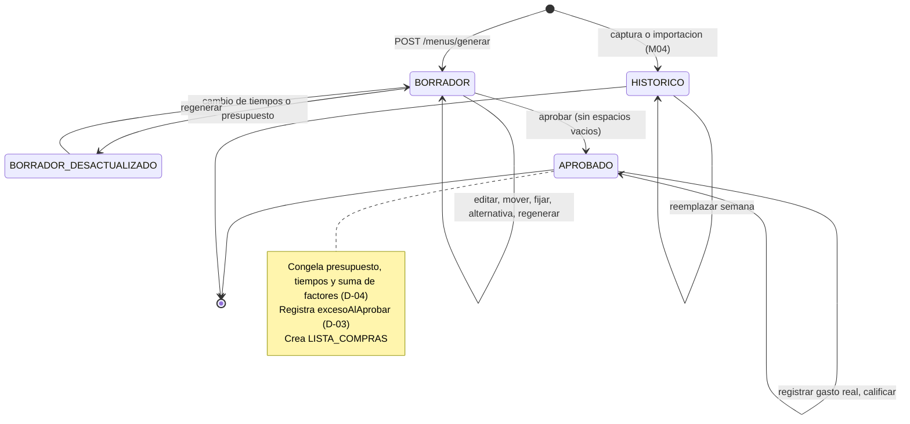
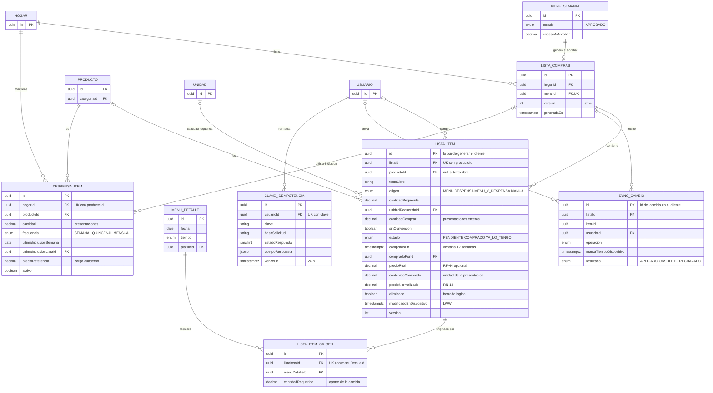
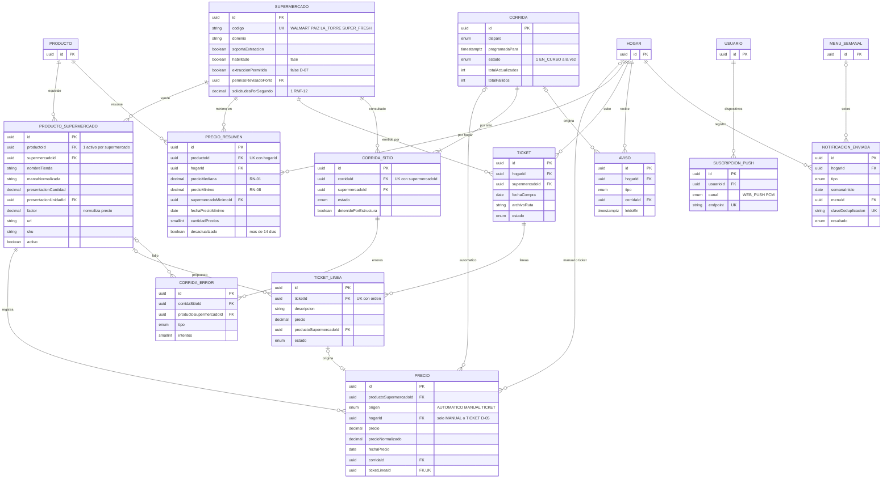

# Modelo de datos — Menú Familiar

> **Nota (2026-10-22, D-15 / [ADR-010](adr/ADR-010-drizzle-orm.md)):** la fuente de verdad del modelo es ahora el esquema **Drizzle ORM** en [`packages/db/src/schema/`](../../packages/db/src/schema/) (un archivo por dominio) y las migraciones SQL en [`packages/db/drizzle/`](../../packages/db/drizzle/). El antiguo `schema.prisma` se movió a [`historico/schema.prisma`](historico/schema.prisma) solo como referencia; la prueba `packages/db/test/fidelidad-prisma.test.ts` comprueba que el esquema Drizzle conserva sus tablas, columnas, tipos, nulabilidad, enums, únicos, índices y llaves foráneas. Los diagramas ER (§3) y el diccionario (§4) siguen vigentes; la columna **Campo** del diccionario es el nombre de la propiedad en Drizzle (`camelCase`).

| Campo | Valor |
|---|---|
| Documento | DIS-MF-002 |
| Versión | 1.2 (Drizzle ORM, D-15) |
| Fecha | 2026-10-22 |
| Fase del ciclo de vida | 3. Diseño |
| Fuente | SRS-MF-001 v1.3 §6, decisiones D-01 a D-09 y D-15, historias M01–M10 (incluye CU-07.6 y CU-07.7) |
| Esquema | [`packages/db/src/schema/*.ts`](../../packages/db/src/schema/) — PostgreSQL 16, Drizzle ORM 0.45.3 (`hogar-config`, `catalogo-menus`, `compras-despensa`, `precios-notificaciones`, `enums`) · Histórico: [`historico/schema.prisma`](historico/schema.prisma) |
| Migraciones | [`packages/db/drizzle/`](../../packages/db/drizzle/) — `0000_extensiones` (pg_trgm), `0001_init` (generada), `0002_reglas_integridad` (§6.1) |
| Contrato API | [`api-contrato.md`](api-contrato.md) |

## 1. Alcance y convenciones

- **49 modelos y 35 enums** en cuatro dominios: Hogar y configuración · Catálogo y menús (con importación) · Compras y despensa · Precios y notificaciones.
- **Nombres:** entidades en español PascalCase (tipos `MenuSemanal`, `MenuSemanalInsert`), tablas Drizzle y propiedades camelCase (`menuSemanal.fechaInicio`); tablas, columnas y tipos enum en snake_case. Ejemplo: `MenuSemanal.fechaInicio` → `menu_semanal.fecha_inicio`. Índices y llaves con nombre `<tabla>_<columnas>_idx|_key|_fkey`.
- **Identificadores:** `uuid` (v4). Las tablas puente puras (`platillo_tiempo`, `platillo_etiqueta`) usan PK compuesta. `ListaItem.id` y `SyncCambio.id` los puede generar el cliente para trabajar sin conexión.
- **Dinero:** `decimal(10,2)` en GTQ, redondeo "mitad hacia arriba" con aritmética decimal (nunca `float`). Porcentajes `decimal(5,2)`; pesos `decimal(3,2)`; factores del motor `decimal(5,4)`; cantidades `decimal(10,3)`.
- **Tiempo:** fechas de calendario (semana, día del menú, fecha de precio) en `date`; instantes en `timestamptz(3)` (UTC). La zona `America/Guatemala` (R-02) se aplica en el servicio para calcular semanas, días y la hora del recordatorio.
- **Auditoría:** `createdAt`/`updatedAt` en toda entidad mutable; las de solo inserción (precio, error de corrida, envío) solo tienen fecha de creación.
- **Aislamiento (RNF-06):** toda entidad del hogar tiene `hogarId` directo o heredado de su padre (`MenuDetalle` → `MenuSemanal`). El catálogo de productos, unidades, categorías, supermercados, vínculos y precios automáticos es **global** (D-05).
- **Baja lógica:** platillos, productos, comensales, vínculos y despensa se inactivan (`activo = false`); no se borran para no romper historial, calificaciones ni precios.

## 2. Decisiones de modelado

| # | Decisión | Motivo | Origen |
|---|---|---|---|
| DM-01 | Pertenencia por `MiembroHogar` con `usuarioId` único. | Un hogar por usuario en v1; quitar el `@unique` habilita multi-hogar sin migrar datos. | CU-01.2 |
| DM-02 | `Comensal.factorPorcion` (0.25–2.00); el escalado usa Σ factores ÷ porciones base. | Sustituye el supuesto "1 porción por comensal" de M03/M07. | D-02, RN-07 |
| DM-03 | `MenuSemanal.estado` = BORRADOR, APROBADO o HISTORICO; "Desactualizado" es una marca booleana sobre el borrador, no un estado. | Un borrador desactualizado sigue editable; evita duplicar transiciones. | CU-02.3, CU-04.1 |
| DM-04 | Al generar se copian a `MenuSemanal` y `MenuTiempo` el presupuesto, el % por tiempo, los pesos y Σ factores; al aprobar quedan congelados. | Los cambios de configuración posteriores no alteran menús aprobados ni el reporte RF-39. | D-04 |
| DM-05 | `MenuTiempo.exceso` por tiempo y `MenuSemanal.excesoAlAprobar` total. Aprobar con exceso se permite. | El exceso se muestra en menú, aprobación y lista, y queda registrado. | D-03, RN-11 |
| DM-06 | `MenuDetalle.platilloId` admite nulo ("Sin sugerencia") y guarda factores, puntaje, origen y reglas aplicadas. | RF-22 explica la sugerencia con los datos del momento. | CU-05.1 E3, CU-05.4 |
| DM-07 | Favorito es una columna de `Platillo` (el platillo ya es del hogar); exclusiones en `IngredienteExcluido`. | Menos joins en el motor. | RF-10 |
| DM-08 | `PlatilloAlias` + índice GIN `pg_trgm` sobre `nombreNormalizado`. | Resolver platillos al importar: exacto por alias, aproximado por similitud ≥ 0.80. | RF-17 |
| DM-09 | `Precio.hogarId` nulo para AUTOMATICO y obligatorio para MANUAL/TICKET (CHECK). | Precios automáticos comunes, manuales privados del hogar. | D-05 |
| DM-10 | `PrecioResumen` por (producto, hogar): mediana con todos los supermercados, mínimo solo con preferidos. | El mínimo depende de las preferencias del hogar (RF-09) y de sus precios manuales. | RF-36, CU-02.5, CU-09.2 |
| DM-11 | `ProductoSupermercado` guarda `factor`; `Precio.precioNormalizado` = precio ÷ factor. Un vínculo activo por (producto, supermercado) mediante índice parcial. | Comparar presentaciones distintas; conservar histórico al reemplazar. | RF-35, CU-08.2 |
| DM-12 | `Supermercado.extraccionPermitida = false` por defecto, separado de `habilitado` (fase) y `soportaExtraccion` (hay extractor). Lo cambia un usuario con `esAdminSistema`. | El supermercado es global; un ADMIN de hogar no debe decidir por todos. | D-07, PA-02, R-03 |
| DM-13 | `Corrida` → `CorridaSitio` → `CorridaError`; `Aviso` por hogar para administradores. | Trazabilidad de fallas y "último precio válido". | RF-33, RF-38 |
| DM-14 | `NotificacionEnviada.claveDeduplicacion` única. | Garantiza un recordatorio por hogar y semana, y una alerta por cada cruce del umbral. | CU-12.1, CU-12.2 |
| DM-15 | `ListaItem` con borrado lógico, `modificadoEnDispositivo` y `version`; `SyncCambio` con id del cliente. | Sincronización offline idempotente con "última escritura gana". | RF-30, RNF-04 |
| DM-16 | `ClaveIdempotencia` para la cabecera `Idempotency-Key`. | Reintentos seguros desde la app (aprobar, gasto real, precio manual). | RNF-04 |
| DM-17 | Refresh tokens rotativos con `familia` y `Usuario.sesionesInvalidasAntesDe`. | Cerrar sesiones en otros dispositivos al restablecer contraseña. | CU-01.4, RNF-05 |
| DM-18 | `DespensaItem.ultimaInclusionSemana` (fecha de la semana, no de generación). | Regenerar la lista de la misma semana no avanza la despensa dos veces. | CU-07.2 |
| DM-19 | `MarcaPreferida` guarda la marca como texto normalizado (no un vínculo concreto). | La marca aplica en todos los supermercados que la vendan. | RF-09 |
| DM-20 | `ListaItem.estado` (PENDIENTE, COMPRADO, YA_LO_TENGO) reemplaza el booleano `comprado`; `ListaItemOrigen` liga cada ítem consolidado con los `MenuDetalle` que lo originan. | El avance por comida cuenta ítems cubiertos por detalle con un solo `JOIN`; un producto compartido cuenta para todas sus comidas al marcarse una vez. La app replica el vínculo en IndexedDB y calcula el avance sin conexión. | RF-43, RN-13, RNF-04 |
| DM-21 | El precio real se guarda en el propio `ListaItem` (`precioReal`, `contenidoComprado`, `precioNormalizado`), no en `Precio` ni en una tabla de compras aparte. El promedio de compra se calcula al vuelo sobre `lista_item` + `lista_compras.hogar_id` de las últimas 12 semanas. | El ítem ya es la unidad que se sincroniza offline (LWW, idempotente), así que el precio viaja con la marca sin otra entidad ni otra cola. Hay un ítem por producto y semana (`UK listaId, productoId`), por lo que cada fila es una compra. `Precio` exige vínculo con supermercado y alimenta mediana y mínimo de mercado (RF-36, D-05); mezclar precios del hogar los sesgaría. Con ≤ 12 filas por producto y hogar el cálculo al vuelo es trivial y no hay caché que invalidar. | RF-44, RN-12, RN-08 |

## 3. Diagramas entidad-relación

Notación: `PK` llave primaria, `FK` llave foránea, `UK` única. Las entidades de otro dominio aparecen solo con su llave. El detalle completo de columnas está en el §4.

### 3.1 Hogar, cuenta y configuración (M01, M02)

```mermaid
erDiagram
    USUARIO ||--o| MIEMBRO_HOGAR : "pertenece"
    HOGAR ||--|{ MIEMBRO_HOGAR : "tiene"
    HOGAR ||--o{ INVITACION : "emite"
    USUARIO ||--o{ INVITACION : "crea o usa"
    USUARIO ||--o{ TOKEN_RECUPERACION : "solicita"
    USUARIO ||--o{ REFRESH_TOKEN : "sesiones"
    HOGAR ||--|{ COMENSAL : "registra"
    HOGAR ||--|| CONFIGURACION : "define"
    CONFIGURACION ||--|{ TIEMPO_COMIDA_CONFIG : "3 filas"
    HOGAR ||--o{ HOGAR_SUPERMERCADO : "prefiere"
    SUPERMERCADO ||--o{ HOGAR_SUPERMERCADO : "es preferido"
    HOGAR ||--o{ MARCA_PREFERIDA : "elige"
    PRODUCTO ||--o{ MARCA_PREFERIDA : "de"
    HOGAR ||--o{ INGREDIENTE_EXCLUIDO : "excluye"
    PRODUCTO ||--o{ INGREDIENTE_EXCLUIDO : "excluido"

    USUARIO {
        uuid id PK
        string correo UK "minusculas"
        string hashContrasena "argon2id"
        smallint intentosFallidos
        timestamptz bloqueadoHasta
        timestamptz sesionesInvalidasAntesDe
        boolean esAdminSistema "D-07"
    }
    HOGAR {
        uuid id PK
        string nombre
    }
    MIEMBRO_HOGAR {
        uuid id PK
        uuid hogarId FK
        uuid usuarioId FK, UK "1 hogar por usuario"
        enum rol "ADMIN o MIEMBRO"
    }
    INVITACION {
        uuid id PK
        uuid hogarId FK
        uuid creadaPorId FK
        uuid usadaPorId FK
        enum medio "CORREO o ENLACE"
        string tokenHash UK
        timestamptz venceEn "7 dias"
        timestamptz usadaEn
    }
    TOKEN_RECUPERACION {
        uuid id PK
        uuid usuarioId FK
        string tokenHash UK
        timestamptz venceEn "1 hora"
        timestamptz usadoEn
    }
    REFRESH_TOKEN {
        uuid id PK
        uuid usuarioId FK
        string tokenHash UK
        uuid familia "rotacion"
        uuid reemplazadoPorId FK, UK
        timestamptz venceEn
        timestamptz revocadoEn
    }
    COMENSAL {
        uuid id PK
        uuid hogarId FK "UK con nombreNormalizado"
        string nombreNormalizado
        enum tipo "ADULTO o NINO"
        decimal factorPorcion "0.25 a 2.00 D-02"
        boolean activo
    }
    CONFIGURACION {
        uuid id PK
        uuid hogarId FK, UK
        decimal presupuestoSemanal "GTQ"
        enum diaInicioSemana
        enum diaPlanificacion
        smallint horaPlanificacion "8 D-08"
        decimal pesoPreferencia "0.40"
        decimal pesoNovedad "0.25"
        decimal pesoAhorro "0.20"
        decimal pesoAfinidad "0.15"
        int version "bloqueo optimista"
    }
    TIEMPO_COMIDA_CONFIG {
        uuid id PK
        uuid configuracionId FK "UK con tiempo"
        enum tiempo
        boolean activo
        decimal porcentaje "suma 100"
    }
    HOGAR_SUPERMERCADO {
        uuid id PK
        uuid hogarId FK
        uuid supermercadoId FK
        boolean preferido
    }
    MARCA_PREFERIDA {
        uuid id PK
        uuid hogarId FK "UK con productoId"
        uuid productoId FK
        string marcaNormalizada
    }
    INGREDIENTE_EXCLUIDO {
        uuid id PK
        uuid hogarId FK "UK con productoId"
        uuid productoId FK
    }
    SUPERMERCADO {
        uuid id PK
        string codigo UK
    }
    PRODUCTO {
        uuid id PK
        string nombre
    }
```



### 3.2 Catálogo, menús e historial (M03, M04, M05, M06)

```mermaid
erDiagram
    CATEGORIA ||--o{ PRODUCTO : "agrupa"
    UNIDAD ||--o{ PRODUCTO : "presentacion"
    PRODUCTO ||--o{ PRODUCTO_EQUIVALENCIA : "convierte"
    UNIDAD ||--o{ PRODUCTO_EQUIVALENCIA : "unidad receta"
    HOGAR ||--o{ PLATILLO : "registra"
    PLATILLO ||--|{ PLATILLO_TIEMPO : "aplica a"
    PLATILLO ||--o{ PLATILLO_ETIQUETA : "etiquetado"
    ETIQUETA ||--o{ PLATILLO_ETIQUETA : "usa"
    PLATILLO ||--o{ PLATILLO_ALIAS : "alias"
    PLATILLO ||--o{ PLATILLO_INGREDIENTE : "usa"
    PRODUCTO ||--o{ PLATILLO_INGREDIENTE : "es"
    UNIDAD ||--o{ PLATILLO_INGREDIENTE : "mide"
    HOGAR ||--o{ MENU_SEMANAL : "planifica"
    MENU_SEMANAL ||--|{ MENU_TIEMPO : "copia config"
    MENU_SEMANAL ||--|{ MENU_DETALLE : "contiene"
    PLATILLO |o--o{ MENU_DETALLE : "asignado"
    MENU_DETALLE ||--o{ MENU_ALTERNATIVA_MOSTRADA : "ya mostro"
    MENU_DETALLE ||--o| CALIFICACION : "recibe"
    PLATILLO ||--o{ CALIFICACION : "promedia"
    HOGAR ||--o{ IMPORTACION : "carga"
    IMPORTACION ||--o{ IMPORTACION_FILA : "filas"
    IMPORTACION ||--o{ IMPORTACION_PLATILLO : "decide"
    IMPORTACION ||--o{ IMPORTACION_SEMANA : "decide"
    IMPORTACION |o--o{ MENU_SEMANAL : "crea historico"
    PLATILLO |o--o{ IMPORTACION_PLATILLO : "destino"

    CATEGORIA {
        uuid id PK
        string codigo UK
        smallint orden
    }
    UNIDAD {
        uuid id PK
        string codigo UK
        enum magnitud "MASA VOLUMEN CONTEO"
        decimal factorBase "a g ml unidad"
    }
    PRODUCTO {
        uuid id PK
        string nombreNormalizado "UK con presentacion y GIN trgm"
        enum tipo "INGREDIENTE DESPENSA AMBOS"
        uuid categoriaId FK
        string unidadCompra "bolsa lb frasco"
        decimal presentacionCantidad
        uuid presentacionUnidadId FK
        boolean activo
    }
    PRODUCTO_EQUIVALENCIA {
        uuid id PK
        uuid productoId FK "UK con unidadId"
        uuid unidadId FK
        decimal factor
    }
    PLATILLO {
        uuid id PK
        uuid hogarId FK "UK con nombreNormalizado"
        string nombreNormalizado "GIN trgm"
        enum proteinaPrincipal "RN-02"
        smallint porcionesBase "4"
        boolean activo
        boolean favorito "RF-10"
        boolean incompleto "sin ingredientes"
        decimal calificacionPromedio
    }
    PLATILLO_TIEMPO {
        uuid platilloId PK, FK
        enum tiempo PK
    }
    ETIQUETA {
        uuid id PK
        uuid hogarId FK
        string nombreNormalizado
    }
    PLATILLO_ETIQUETA {
        uuid platilloId PK, FK
        uuid etiquetaId PK, FK
    }
    PLATILLO_ALIAS {
        uuid id PK
        uuid hogarId FK "UK con aliasNormalizado"
        uuid platilloId FK
        string aliasNormalizado
    }
    PLATILLO_INGREDIENTE {
        uuid id PK
        uuid platilloId FK "UK con productoId"
        uuid productoId FK
        decimal cantidad "por porcionesBase"
        uuid unidadId FK
    }
    MENU_SEMANAL {
        uuid id PK
        uuid hogarId FK "UK con fechaInicio"
        date fechaInicio
        date fechaFin
        enum estado "BORRADOR APROBADO HISTORICO"
        boolean desactualizado
        enum origen
        decimal presupuestoSemanal "copia D-04"
        decimal sumaFactoresPorcion "RN-07"
        decimal costoEstimado
        decimal excesoAlAprobar "RN-11 D-03"
        enum estadoAlertaPresupuesto "RF-42"
        decimal gastoReal "RF-27"
        uuid aprobadoPorId FK
        uuid importacionId FK
    }
    MENU_TIEMPO {
        uuid id PK
        uuid menuId FK "UK con tiempo"
        enum tiempo
        decimal porcentaje
        decimal presupuesto
        decimal costoEstimado
        decimal exceso
        smallint intentosAjuste "max 3 RN-05"
    }
    MENU_DETALLE {
        uuid id PK
        uuid menuId FK "UK con fecha y tiempo"
        date fecha
        enum tiempo
        uuid platilloId FK "null sin sugerencia"
        boolean fijado
        enum origen
        decimal puntaje
        decimal costoEstimado
        string_array reglasAplicadas
    }
    MENU_ALTERNATIVA_MOSTRADA {
        uuid id PK
        uuid menuDetalleId FK "UK con platilloId"
        uuid platilloId FK
    }
    CALIFICACION {
        uuid id PK
        uuid menuDetalleId FK, UK
        uuid platilloId FK
        smallint valor "1 a 5"
    }
    IMPORTACION {
        uuid id PK
        uuid hogarId FK
        enum origen "ARCHIVO CUADERNO"
        enum estado
        int filasConError
        jsonb reporte
    }
    IMPORTACION_FILA {
        uuid id PK
        uuid importacionId FK
        enum hoja "MENUS LISTAS"
        int numeroFila
        jsonb datos
        jsonb errores
    }
    IMPORTACION_PLATILLO {
        uuid id PK
        uuid importacionId FK
        string nombreNormalizado
        enum decision "PENDIENTE ASOCIAR CREAR"
        uuid platilloId FK
        decimal similitud
    }
    IMPORTACION_SEMANA {
        uuid id PK
        uuid importacionId FK
        date semanaInicio
        enum decision "CREAR OMITIR REEMPLAZAR"
        decimal gastoSemana
    }
    HOGAR {
        uuid id PK
    }
```



Ciclo de vida de `MenuSemanal`:



### 3.3 Compras y despensa (M07)



### 3.4 Precios y notificaciones (M08, M10)



## 4. Diccionario de datos

Columnas: **Campo** (propiedad Drizzle) · **Columna** (PostgreSQL) · **Tipo** · **Nulo** · **Defecto** · **Regla / origen** (RF, RN, D, CU). Las relaciones (`relations()` de Drizzle) no son columnas y se omiten.

#### Usuario (`usuario`)

| Campo | Columna | Tipo | Nulo | Defecto | Regla / origen |
|---|---|---|---|---|---|
| `id` | `id` | uuid | No | uuid | PK uuid v4 generado por la BD (`gen_random_uuid()`) |
| `nombre` | `nombre` | varchar(80) | No | — | Obligatorio, ≤ 80 (RF-01) |
| `correo` | `correo` | varchar(254) | No | — | UK; minúsculas, formato correo (RF-01, CA-01.2) |
| `hashContrasena` | `hash_contrasena` | varchar(255) | No | — | argon2id; política ≥ 8 con letra y número (RNF-05) |
| `intentosFallidos` | `intentos_fallidos` | smallint | No | 0 | Se reinicia al iniciar sesión o restablecer (CU-01.1 8b) |
| `primerIntentoFallidoEn` | `primer_intento_fallido_en` | timestamptz | Sí | — | Inicio de la ventana de 15 min (CU-01.1 8b) |
| `bloqueadoHasta` | `bloqueado_hasta` | timestamptz | Sí | — | 5 fallos en 15 min → ahora + 15 min (CU-01.1 8b) |
| `sesionesInvalidasAntesDe` | `sesiones_invalidas_antes_de` | timestamptz | Sí | — | JWT con iat anterior se rechaza; se fija al restablecer contraseña (CU-01.4) |
| `esAdminSistema` | `es_admin_sistema` | boolean | No | false | Solo estos cambian el permiso de extracción por sitio (D-07) |
| `activo` | `activo` | boolean | No | true | Baja lógica |
| `createdAt` | `created_at` | timestamptz | No | now | Auditoría; UTC |
| `updatedAt` | `updated_at` | timestamptz | No | auto | Auditoría; `now()` al insertar y Drizzle lo actualiza en cada `update` |

#### Hogar (`hogar`)

| Campo | Columna | Tipo | Nulo | Defecto | Regla / origen |
|---|---|---|---|---|---|
| `id` | `id` | uuid | No | uuid | PK uuid v4 generado por la BD (`gen_random_uuid()`) |
| `nombre` | `nombre` | varchar(80) | No | — | Obligatorio, ≤ 80 (RF-02) |
| `createdAt` | `created_at` | timestamptz | No | now | Auditoría; UTC |
| `updatedAt` | `updated_at` | timestamptz | No | auto | Auditoría; `now()` al insertar y Drizzle lo actualiza en cada `update` |

#### MiembroHogar (`miembro_hogar`)

| Campo | Columna | Tipo | Nulo | Defecto | Regla / origen |
|---|---|---|---|---|---|
| `id` | `id` | uuid | No | uuid | PK uuid v4 generado por la BD (`gen_random_uuid()`) |
| `hogarId` | `hogar_id` | uuid | No | — | FK hogar; aislamiento por hogar (RNF-06) |
| `usuarioId` | `usuario_id` | uuid | No | — | FK usuario, UK: un hogar por usuario en v1 (CU-01.2) |
| `rol` | `rol` | enum RolHogar | No | MIEMBRO | ADMIN o MIEMBRO (RN-10); el creador es ADMIN |
| `createdAt` | `created_at` | timestamptz | No | now | Auditoría; UTC |
| `updatedAt` | `updated_at` | timestamptz | No | auto | Auditoría; `now()` al insertar y Drizzle lo actualiza en cada `update` |

#### Invitacion (`invitacion`)

| Campo | Columna | Tipo | Nulo | Defecto | Regla / origen |
|---|---|---|---|---|---|
| `id` | `id` | uuid | No | uuid | PK uuid v4 generado por la BD (`gen_random_uuid()`) |
| `hogarId` | `hogar_id` | uuid | No | — | FK hogar; aislamiento por hogar (RNF-06) |
| `creadaPorId` | `creada_por_id` | uuid | No | — | FK usuario ADMIN (solo el administrador invita) |
| `medio` | `medio` | enum MedioInvitacion | No | — | CORREO o ENLACE (RF-02) |
| `correo` | `correo` | varchar(254) | Sí | — | Obligatorio si medio = CORREO |
| `tokenHash` | `token_hash` | char(64) | No | — | UK; SHA-256 del token de un solo uso |
| `venceEn` | `vence_en` | timestamptz | No | — | createdAt + 7 días (supuesto M01) |
| `usadaEn` | `usada_en` | timestamptz | Sí | — | Se fija al aceptar; no reutilizable |
| `usadaPorId` | `usada_por_id` | uuid | Sí | — | FK usuario que aceptó |
| `revocadaEn` | `revocada_en` | timestamptz | Sí | — | Revocación manual por el ADMIN |
| `correoEnviado` | `correo_enviado` | boolean | No | false | false si falló el SMTP (CU-01.2 E2) |
| `createdAt` | `created_at` | timestamptz | No | now | Auditoría; UTC |
| `updatedAt` | `updated_at` | timestamptz | No | auto | Auditoría; `now()` al insertar y Drizzle lo actualiza en cada `update` |

#### TokenRecuperacion (`token_recuperacion`)

| Campo | Columna | Tipo | Nulo | Defecto | Regla / origen |
|---|---|---|---|---|---|
| `id` | `id` | uuid | No | uuid | PK uuid v4 generado por la BD (`gen_random_uuid()`) |
| `usuarioId` | `usuario_id` | uuid | No | — | FK usuario |
| `tokenHash` | `token_hash` | char(64) | No | — | UK; SHA-256 |
| `venceEn` | `vence_en` | timestamptz | No | — | createdAt + 1 h (CU-01.4) |
| `usadoEn` | `usado_en` | timestamptz | Sí | — | Un solo uso |
| `createdAt` | `created_at` | timestamptz | No | now | Auditoría; UTC |

#### RefreshToken (`refresh_token`)

| Campo | Columna | Tipo | Nulo | Defecto | Regla / origen |
|---|---|---|---|---|---|
| `id` | `id` | uuid | No | uuid | PK uuid v4 generado por la BD (`gen_random_uuid()`) |
| `usuarioId` | `usuario_id` | uuid | No | — | FK usuario |
| `tokenHash` | `token_hash` | char(64) | No | — | UK; SHA-256 del refresh token |
| `familia` | `familia` | uuid | No | — | Cadena de rotación; reutilizar uno rotado revoca toda la familia |
| `dispositivo` | `dispositivo` | varchar(120) | Sí | — | Etiqueta del dispositivo (User-Agent resumido) |
| `venceEn` | `vence_en` | timestamptz | No | — | createdAt + 30 días |
| `revocadoEn` | `revocado_en` | timestamptz | Sí | — | Logout, rotación o restablecimiento de contraseña |
| `reemplazadoPorId` | `reemplazado_por_id` | uuid | Sí | — | FK al token que lo reemplazó (UK) |
| `createdAt` | `created_at` | timestamptz | No | now | Auditoría; UTC |

#### Comensal (`comensal`)

| Campo | Columna | Tipo | Nulo | Defecto | Regla / origen |
|---|---|---|---|---|---|
| `id` | `id` | uuid | No | uuid | PK uuid v4 generado por la BD (`gen_random_uuid()`) |
| `hogarId` | `hogar_id` | uuid | No | — | FK hogar; aislamiento por hogar (RNF-06) |
| `nombre` | `nombre` | varchar(60) | No | — | Obligatorio, ≤ 60 (RF-03) |
| `nombreNormalizado` | `nombre_normalizado` | varchar(60) | No | — | UK con hogarId; repetido → 409 (CU-01.3 E1) |
| `tipo` | `tipo` | enum TipoComensal | No | — | ADULTO o NINO (RF-03) |
| `factorPorcion` | `factor_porcion` | decimal(3,2) | No | 1.00 | 0.25–2.00 en pasos de 0.25; por defecto 1.00 (D-02, RN-07) |
| `activo` | `activo` | boolean | No | true | Quitar = inactivar; debe quedar ≥ 1 activo (CU-01.3 E2) |
| `createdAt` | `created_at` | timestamptz | No | now | Auditoría; UTC |
| `updatedAt` | `updated_at` | timestamptz | No | auto | Auditoría; `now()` al insertar y Drizzle lo actualiza en cada `update` |

#### Configuracion (`configuracion`)

| Campo | Columna | Tipo | Nulo | Defecto | Regla / origen |
|---|---|---|---|---|---|
| `id` | `id` | uuid | No | uuid | PK uuid v4 generado por la BD (`gen_random_uuid()`) |
| `hogarId` | `hogar_id` | uuid | No | — | FK, UK: 1 configuración por hogar |
| `presupuestoSemanal` | `presupuesto_semanal` | decimal(10,2) | No | 250.00 | > 0, 2 decimales; Q250 por defecto (S-01, RF-06) |
| `diaInicioSemana` | `dia_inicio_semana` | enum DiaSemana | No | DOMINGO | Domingo por defecto (RF-08, RN-09) |
| `diaPlanificacion` | `dia_planificacion` | enum DiaSemana | No | DOMINGO | Domingo por defecto (RF-08, RF-41) |
| `horaPlanificacion` | `hora_planificacion` | smallint | No | 8 | 0–23, hora de Guatemala; 8 (D-08) |
| `pesoPreferencia` | `peso_preferencia` | decimal(3,2) | No | 0.40 | 0–1; suma de 4 pesos = 1.00 (RF-20, RN-10) |
| `pesoNovedad` | `peso_novedad` | decimal(3,2) | No | 0.25 | Ídem (RF-20) |
| `pesoAhorro` | `peso_ahorro` | decimal(3,2) | No | 0.20 | Ídem (RF-20) |
| `pesoAfinidad` | `peso_afinidad` | decimal(3,2) | No | 0.15 | Ídem (RF-20) |
| `umbralSimilitud` | `umbral_similitud` | decimal(3,2) | No | 0.80 | Umbral pg_trgm para proponer asociación (CU-04.3) |
| `version` | `version` | integer | No | 1 | Bloqueo optimista; distinto → 409 (CU-02.3 E1) |
| `actualizadoPorId` | `actualizado_por_id` | uuid | Sí | — | FK usuario ADMIN que guardó |
| `createdAt` | `created_at` | timestamptz | No | now | Auditoría; UTC |
| `updatedAt` | `updated_at` | timestamptz | No | auto | Auditoría; `now()` al insertar y Drizzle lo actualiza en cada `update` |

#### TiempoComidaConfig (`tiempo_comida_config`)

| Campo | Columna | Tipo | Nulo | Defecto | Regla / origen |
|---|---|---|---|---|---|
| `id` | `id` | uuid | No | uuid | PK uuid v4 generado por la BD (`gen_random_uuid()`) |
| `configuracionId` | `configuracion_id` | uuid | No | — | FK; UK con tiempo |
| `tiempo` | `tiempo` | enum TiempoComida | No | — | DESAYUNO, ALMUERZO, CENA |
| `activo` | `activo` | boolean | No | false | Combinaciones válidas: solo almuerzo, 2 o 3 tiempos (RF-05) |
| `porcentaje` | `porcentaje` | decimal(5,2) | No | 0 | Activos suman 100.00; inactivos 0 (RF-06, RN-06, D-01) |
| `createdAt` | `created_at` | timestamptz | No | now | Auditoría; UTC |
| `updatedAt` | `updated_at` | timestamptz | No | auto | Auditoría; `now()` al insertar y Drizzle lo actualiza en cada `update` |

#### HogarSupermercado (`hogar_supermercado`)

| Campo | Columna | Tipo | Nulo | Defecto | Regla / origen |
|---|---|---|---|---|---|
| `id` | `id` | uuid | No | uuid | PK uuid v4 generado por la BD (`gen_random_uuid()`) |
| `hogarId` | `hogar_id` | uuid | No | — | FK hogar; aislamiento por hogar (RNF-06) |
| `supermercadoId` | `supermercado_id` | uuid | No | — | FK; UK con hogarId |
| `preferido` | `preferido` | boolean | No | true | ≥ 1 preferido por hogar (CU-02.5 E1) |
| `createdAt` | `created_at` | timestamptz | No | now | Auditoría; UTC |
| `updatedAt` | `updated_at` | timestamptz | No | auto | Auditoría; `now()` al insertar y Drizzle lo actualiza en cada `update` |

#### MarcaPreferida (`marca_preferida`)

| Campo | Columna | Tipo | Nulo | Defecto | Regla / origen |
|---|---|---|---|---|---|
| `id` | `id` | uuid | No | uuid | PK uuid v4 generado por la BD (`gen_random_uuid()`) |
| `hogarId` | `hogar_id` | uuid | No | — | FK hogar; aislamiento por hogar (RNF-06) |
| `productoId` | `producto_id` | uuid | No | — | FK; UK con hogarId (RF-09) |
| `marca` | `marca` | varchar(60) | No | — | Texto mostrado |
| `marcaNormalizada` | `marca_normalizada` | varchar(60) | No | — | Se compara con ProductoSupermercado.marcaNormalizada |
| `createdAt` | `created_at` | timestamptz | No | now | Auditoría; UTC |
| `updatedAt` | `updated_at` | timestamptz | No | auto | Auditoría; `now()` al insertar y Drizzle lo actualiza en cada `update` |

#### IngredienteExcluido (`ingrediente_excluido`)

| Campo | Columna | Tipo | Nulo | Defecto | Regla / origen |
|---|---|---|---|---|---|
| `id` | `id` | uuid | No | uuid | PK uuid v4 generado por la BD (`gen_random_uuid()`) |
| `hogarId` | `hogar_id` | uuid | No | — | FK hogar; aislamiento por hogar (RNF-06) |
| `productoId` | `producto_id` | uuid | No | — | FK; UK con hogarId; prevalece sobre favorito (RF-10) |
| `createdAt` | `created_at` | timestamptz | No | now | Auditoría; UTC |

#### Unidad (`unidad`)

| Campo | Columna | Tipo | Nulo | Defecto | Regla / origen |
|---|---|---|---|---|---|
| `id` | `id` | uuid | No | uuid | PK uuid v4 generado por la BD (`gen_random_uuid()`) |
| `codigo` | `codigo` | varchar(10) | No | — | UK (g, kg, lb, oz, ml, l, taza, cda, cdta, unidad, manojo, diente) |
| `nombre` | `nombre` | varchar(30) | No | — | Nombre visible |
| `magnitud` | `magnitud` | enum MagnitudUnidad | No | — | MASA, VOLUMEN o CONTEO (CU-03.2) |
| `factorBase` | `factor_base` | decimal(14,6) | Sí | — | A g, ml o unidad; null = no convertible |
| `createdAt` | `created_at` | timestamptz | No | now | Auditoría; UTC |

#### Categoria (`categoria`)

| Campo | Columna | Tipo | Nulo | Defecto | Regla / origen |
|---|---|---|---|---|---|
| `id` | `id` | uuid | No | uuid | PK uuid v4 generado por la BD (`gen_random_uuid()`) |
| `codigo` | `codigo` | varchar(20) | No | — | UK; semilla fija (CU-03.3) |
| `nombre` | `nombre` | varchar(40) | No | — | Nombre visible (carnes, lácteos, verduras…) |
| `orden` | `orden` | smallint | No | 0 | Orden de pasillo en la lista (RF-31) |
| `createdAt` | `created_at` | timestamptz | No | now | Auditoría; UTC |

#### Producto (`producto`)

| Campo | Columna | Tipo | Nulo | Defecto | Regla / origen |
|---|---|---|---|---|---|
| `id` | `id` | uuid | No | uuid | PK uuid v4 generado por la BD (`gen_random_uuid()`) |
| `nombre` | `nombre` | varchar(80) | No | — | Obligatorio, ≤ 80 (RF-13) |
| `nombreNormalizado` | `nombre_normalizado` | varchar(80) | No | — | UK con presentación; índice GIN trigram (CU-03.3 E2) |
| `tipo` | `tipo` | enum TipoProducto | No | — | INGREDIENTE, DESPENSA o AMBOS (RF-13) |
| `categoriaId` | `categoria_id` | uuid | No | — | FK categoría (RF-31) |
| `unidadCompra` | `unidad_compra` | varchar(20) | No | — | Empaque: bolsa, lb, unidad, frasco… (RF-13) |
| `presentacionCantidad` | `presentacion_cantidad` | decimal(10,3) | No | — | > 0 (CU-03.3 E1) |
| `presentacionUnidadId` | `presentacion_unidad_id` | uuid | No | — | FK unidad; define la magnitud del producto |
| `activo` | `activo` | boolean | No | true | Inactivo: no aparece en buscador; platillos muestran advertencia |
| `createdAt` | `created_at` | timestamptz | No | now | Auditoría; UTC |
| `updatedAt` | `updated_at` | timestamptz | No | auto | Auditoría; `now()` al insertar y Drizzle lo actualiza en cada `update` |

#### ProductoEquivalencia (`producto_equivalencia`)

| Campo | Columna | Tipo | Nulo | Defecto | Regla / origen |
|---|---|---|---|---|---|
| `id` | `id` | uuid | No | uuid | PK uuid v4 generado por la BD (`gen_random_uuid()`) |
| `productoId` | `producto_id` | uuid | No | — | FK producto |
| `unidadId` | `unidad_id` | uuid | No | — | FK; UK con productoId |
| `factor` | `factor` | decimal(14,6) | No | — | > 0; cantidad en unidad de presentación por 1 unidadId (M07) |
| `createdAt` | `created_at` | timestamptz | No | now | Auditoría; UTC |

#### Platillo (`platillo`)

| Campo | Columna | Tipo | Nulo | Defecto | Regla / origen |
|---|---|---|---|---|---|
| `id` | `id` | uuid | No | uuid | PK uuid v4 generado por la BD (`gen_random_uuid()`) |
| `hogarId` | `hogar_id` | uuid | No | — | FK hogar; aislamiento por hogar (RNF-06) |
| `nombre` | `nombre` | varchar(80) | No | — | Obligatorio, ≤ 80 (RF-11) |
| `nombreNormalizado` | `nombre_normalizado` | varchar(80) | No | — | UK con hogarId; sin tildes ni mayúsculas; GIN trigram (CU-03.1, CU-04.3) |
| `proteinaPrincipal` | `proteina_principal` | enum ProteinaPrincipal | No | OTRA | Lista fija; usada por RN-02 |
| `porcionesBase` | `porciones_base` | smallint | No | 4 | 1–20; 4 por defecto (RF-12) |
| `activo` | `activo` | boolean | No | true | Sin borrado físico (RF-11) |
| `favorito` | `favorito` | boolean | No | false | Preferencia = 1.00 en el motor (RF-10, RF-20) |
| `incompleto` | `incompleto` | boolean | No | true | true si no tiene ingredientes; servicio lo mantiene (CU-03.2, CU-04.3) |
| `calificacionPromedio` | `calificacion_promedio` | decimal(3,2) | Sí | — | Promedio 1–5 desnormalizado (RF-14, RF-20) |
| `calificacionConteo` | `calificacion_conteo` | integer | No | 0 | Número de calificaciones |
| `createdAt` | `created_at` | timestamptz | No | now | Auditoría; UTC |
| `updatedAt` | `updated_at` | timestamptz | No | auto | Auditoría; `now()` al insertar y Drizzle lo actualiza en cada `update` |

#### PlatilloTiempo (`platillo_tiempo`)

| Campo | Columna | Tipo | Nulo | Defecto | Regla / origen |
|---|---|---|---|---|---|
| `platilloId` | `platillo_id` | uuid | No | — | PK compuesta; ≥ 1 tiempo por platillo (CU-03.1 E2) |
| `tiempo` | `tiempo` | enum TiempoComida | No | — | PK compuesta |

#### Etiqueta (`etiqueta`)

| Campo | Columna | Tipo | Nulo | Defecto | Regla / origen |
|---|---|---|---|---|---|
| `id` | `id` | uuid | No | uuid | PK uuid v4 generado por la BD (`gen_random_uuid()`) |
| `hogarId` | `hogar_id` | uuid | No | — | FK hogar; aislamiento por hogar (RNF-06) |
| `nombre` | `nombre` | varchar(30) | No | — | Texto libre ≤ 30 (RF-11) |
| `nombreNormalizado` | `nombre_normalizado` | varchar(30) | No | — | UK con hogarId; máx. 10 por platillo (servicio) |
| `createdAt` | `created_at` | timestamptz | No | now | Auditoría; UTC |

#### PlatilloEtiqueta (`platillo_etiqueta`)

| Campo | Columna | Tipo | Nulo | Defecto | Regla / origen |
|---|---|---|---|---|---|
| `platilloId` | `platillo_id` | uuid | No | — | PK compuesta |
| `etiquetaId` | `etiqueta_id` | uuid | No | — | PK compuesta |

#### PlatilloAlias (`platillo_alias`)

| Campo | Columna | Tipo | Nulo | Defecto | Regla / origen |
|---|---|---|---|---|---|
| `id` | `id` | uuid | No | uuid | PK uuid v4 generado por la BD (`gen_random_uuid()`) |
| `hogarId` | `hogar_id` | uuid | No | — | FK hogar; aislamiento por hogar (RNF-06) |
| `platilloId` | `platillo_id` | uuid | No | — | FK platillo |
| `alias` | `alias` | varchar(80) | No | — | Nombre original del archivo (RF-17) |
| `aliasNormalizado` | `alias_normalizado` | varchar(80) | No | — | UK con hogarId; resolución exacta en importación (RF-17) |
| `origen` | `origen` | enum OrigenAlias | No | IMPORTACION | IMPORTACION o MANUAL |
| `createdAt` | `created_at` | timestamptz | No | now | Auditoría; UTC |

#### PlatilloIngrediente (`platillo_ingrediente`)

| Campo | Columna | Tipo | Nulo | Defecto | Regla / origen |
|---|---|---|---|---|---|
| `id` | `id` | uuid | No | uuid | PK uuid v4 generado por la BD (`gen_random_uuid()`) |
| `platilloId` | `platillo_id` | uuid | No | — | FK; UK con productoId (repetido → sumar, CU-03.2 E3) |
| `productoId` | `producto_id` | uuid | No | — | FK producto (global) |
| `cantidad` | `cantidad` | decimal(10,3) | No | — | > 0 para porcionesBase (RF-12) |
| `unidadId` | `unidad_id` | uuid | No | — | Misma magnitud que el producto o con equivalencia (CU-03.2 E2) |
| `createdAt` | `created_at` | timestamptz | No | now | Auditoría; UTC |
| `updatedAt` | `updated_at` | timestamptz | No | auto | Auditoría; `now()` al insertar y Drizzle lo actualiza en cada `update` |

#### MenuSemanal (`menu_semanal`)

| Campo | Columna | Tipo | Nulo | Defecto | Regla / origen |
|---|---|---|---|---|---|
| `id` | `id` | uuid | No | uuid | PK uuid v4 generado por la BD (`gen_random_uuid()`) |
| `hogarId` | `hogar_id` | uuid | No | — | FK hogar; aislamiento por hogar (RNF-06) |
| `fechaInicio` | `fecha_inicio` | date | No | — | UK con hogarId; día de inicio configurado (RN-09) |
| `fechaFin` | `fecha_fin` | date | No | — | fechaInicio + 6 (o menos si esTransicion) |
| `esTransicion` | `es_transicion` | boolean | No | false | Semana corta de 1–6 días (CU-02.4) |
| `estado` | `estado` | enum EstadoMenu | No | BORRADOR | BORRADOR → APROBADO (irreversible v1); HISTORICO para M04 |
| `desactualizado` | `desactualizado` | boolean | No | false | Borrador afectado por cambio de configuración (CU-02.3 5b) |
| `origen` | `origen` | enum OrigenMenu | No | MOTOR | MOTOR, CAPTURA_MANUAL, IMPORTACION, CUADERNO (M04) |
| `configuracionVersion` | `configuracion_version` | integer | Sí | — | Versión de configuración usada |
| `presupuestoSemanal` | `presupuesto_semanal` | decimal(10,2) | Sí | — | Copia al generar; congelada al aprobar (D-04, RF-39) |
| `sumaFactoresPorcion` | `suma_factores_porcion` | decimal(5,2) | Sí | — | Σ factorPorcion de comensales activos; congelada al aprobar (RN-07) |
| `pesoPreferencia` | `peso_preferencia` | decimal(3,2) | Sí | — | Pesos usados al generar (RF-22) |
| `pesoNovedad` | `peso_novedad` | decimal(3,2) | Sí | — | Ídem |
| `pesoAhorro` | `peso_ahorro` | decimal(3,2) | Sí | — | Ídem |
| `pesoAfinidad` | `peso_afinidad` | decimal(3,2) | Sí | — | Ídem |
| `costoEstimado` | `costo_estimado` | decimal(10,2) | Sí | — | Σ costos con mediana (RN-01, RF-26) |
| `costoIncompleto` | `costo_incompleto` | boolean | No | false | Algún ingrediente sin precio |
| `generadoEn` | `generado_en` | timestamptz | Sí | — | Última generación del motor |
| `aprobadoPorId` | `aprobado_por_id` | uuid | Sí | — | FK usuario (RF-25) |
| `aprobadoEn` | `aprobado_en` | timestamptz | Sí | — | Fecha de aprobación |
| `excesoAlAprobar` | `exceso_al_aprobar` | decimal(10,2) | Sí | — | max(0, costo − presupuesto) al aprobar; queda registrado (RN-11, D-03) |
| `estadoAlertaPresupuesto` | `estado_alerta_presupuesto` | enum EstadoAlertaPresupuesto | No | NORMAL | NORMAL/ALERTADO; evita reenvío (RF-42) |
| `gastoReal` | `gasto_real` | decimal(10,2) | Sí | — | > 0, ≤ 99 999.99; solo APROBADO o HISTORICO (RF-27, RF-15) |
| `notaGasto` | `nota_gasto` | varchar(200) | Sí | — | Opcional (RF-27) |
| `gastoRegistradoPorId` | `gasto_registrado_por_id` | uuid | Sí | — | FK usuario del último registro |
| `gastoRegistradoEn` | `gasto_registrado_en` | timestamptz | Sí | — | Fecha del último registro |
| `importacionId` | `importacion_id` | uuid | Sí | — | FK importación que lo creó (M04) |
| `notas` | `notas` | varchar(500) | Sí | — | Notas del cuaderno |
| `version` | `version` | integer | No | 1 | Concurrencia (último guardado gana, CU-06.1 E3) |
| `createdAt` | `created_at` | timestamptz | No | now | Auditoría; UTC |
| `updatedAt` | `updated_at` | timestamptz | No | auto | Auditoría; `now()` al insertar y Drizzle lo actualiza en cada `update` |

#### MenuTiempo (`menu_tiempo`)

| Campo | Columna | Tipo | Nulo | Defecto | Regla / origen |
|---|---|---|---|---|---|
| `id` | `id` | uuid | No | uuid | PK uuid v4 generado por la BD (`gen_random_uuid()`) |
| `menuId` | `menu_id` | uuid | No | — | FK; UK con tiempo |
| `tiempo` | `tiempo` | enum TiempoComida | No | — | Tiempo activo al generar/aprobar (D-04) |
| `porcentaje` | `porcentaje` | decimal(5,2) | No | — | % copiado de la configuración (D-04) |
| `presupuesto` | `presupuesto` | decimal(10,2) | No | — | presupuestoSemanal × % (RN-01) |
| `costoEstimado` | `costo_estimado` | decimal(10,2) | Sí | — | Σ costo de los 7 días del tiempo |
| `exceso` | `exceso` | decimal(10,2) | No | 0 | max(0, costo − presupuesto); > 0 = 'Excede por Q__' (RN-05, RN-11) |
| `intentosAjuste` | `intentos_ajuste` | smallint | No | 0 | 0–3 (RN-05) |
| `createdAt` | `created_at` | timestamptz | No | now | Auditoría; UTC |
| `updatedAt` | `updated_at` | timestamptz | No | auto | Auditoría; `now()` al insertar y Drizzle lo actualiza en cada `update` |

#### MenuDetalle (`menu_detalle`)

| Campo | Columna | Tipo | Nulo | Defecto | Regla / origen |
|---|---|---|---|---|---|
| `id` | `id` | uuid | No | uuid | PK uuid v4 generado por la BD (`gen_random_uuid()`) |
| `menuId` | `menu_id` | uuid | No | — | FK; UK con fecha y tiempo |
| `fecha` | `fecha` | date | No | — | Dentro de [fechaInicio, fechaFin] |
| `tiempo` | `tiempo` | enum TiempoComida | No | — | Tiempo activo del menú |
| `platilloId` | `platillo_id` | uuid | Sí | — | FK; null = 'Sin sugerencia'; bloquea aprobar (CU-06.2 E1) |
| `fijado` | `fijado` | boolean | No | false | No lo reemplaza el motor (RF-24, RN-03) |
| `origen` | `origen` | enum OrigenAsignacion | No | MOTOR | MOTOR, REEMPLAZO_PRESUPUESTO, ALTERNATIVA, USUARIO, HISTORICO (RF-22) |
| `puntaje` | `puntaje` | decimal(6,4) | Sí | — | Σ pesos × factores, 4 decimales (RF-20) |
| `factorPreferencia` | `factor_preferencia` | decimal(5,4) | Sí | — | 0–1 (CU-05.2) |
| `factorNovedad` | `factor_novedad` | decimal(5,4) | Sí | — | 0–1; 0 si < 2 semanas (RN-04) |
| `factorAhorro` | `factor_ahorro` | decimal(5,4) | Sí | — | 0–1 (CU-05.2) |
| `factorAfinidad` | `factor_afinidad` | decimal(5,4) | Sí | — | 0–1 (CU-05.2) |
| `costoEstimado` | `costo_estimado` | decimal(10,2) | Sí | — | Escalado por Σ factores (RN-07) × mediana (RN-01) |
| `costoIncompleto` | `costo_incompleto` | boolean | No | false | Ingrediente sin precio (CU-05.3) |
| `reglasAplicadas` | `reglas_aplicadas` | text[] | No | [] | Códigos para el '¿Por qué?' (RF-22) |
| `notas` | `notas` | varchar(200) | Sí | — | Columna notas de la importación |
| `modificadoPorId` | `modificado_por_id` | uuid | Sí | — | FK usuario (CU-06.1) |
| `modificadoEn` | `modificado_en` | timestamptz | Sí | — | Fecha del cambio manual |
| `createdAt` | `created_at` | timestamptz | No | now | Auditoría; UTC |
| `updatedAt` | `updated_at` | timestamptz | No | auto | Auditoría; `now()` al insertar y Drizzle lo actualiza en cada `update` |

#### MenuAlternativaMostrada (`menu_alternativa_mostrada`)

| Campo | Columna | Tipo | Nulo | Defecto | Regla / origen |
|---|---|---|---|---|---|
| `id` | `id` | uuid | No | uuid | PK uuid v4 generado por la BD (`gen_random_uuid()`) |
| `menuDetalleId` | `menu_detalle_id` | uuid | No | — | FK; UK con platilloId (RF-23) |
| `platilloId` | `platillo_id` | uuid | No | — | FK platillo ya ofrecido |
| `createdAt` | `created_at` | timestamptz | No | now | Auditoría; UTC |

#### Calificacion (`calificacion`)

| Campo | Columna | Tipo | Nulo | Defecto | Regla / origen |
|---|---|---|---|---|---|
| `id` | `id` | uuid | No | uuid | PK uuid v4 generado por la BD (`gen_random_uuid()`) |
| `menuDetalleId` | `menu_detalle_id` | uuid | No | — | FK, UK: 1 por espacio; la última reemplaza (RF-14) |
| `platilloId` | `platillo_id` | uuid | No | — | FK; copia para promedio rápido |
| `valor` | `valor` | smallint | No | — | 1–5; fecha del detalle ≤ hoy (CU-11.1) |
| `usuarioId` | `usuario_id` | uuid | Sí | — | FK último usuario que calificó |
| `createdAt` | `created_at` | timestamptz | No | now | Auditoría; UTC |
| `updatedAt` | `updated_at` | timestamptz | No | auto | Auditoría; `now()` al insertar y Drizzle lo actualiza en cada `update` |

#### ListaCompras (`lista_compras`)

| Campo | Columna | Tipo | Nulo | Defecto | Regla / origen |
|---|---|---|---|---|---|
| `id` | `id` | uuid | No | uuid | PK uuid v4 generado por la BD (`gen_random_uuid()`) |
| `hogarId` | `hogar_id` | uuid | No | — | FK hogar; aislamiento por hogar (RNF-06) |
| `menuId` | `menu_id` | uuid | No | — | FK, UK: 1 lista por menú aprobado (RF-25) |
| `version` | `version` | integer | No | 1 | Se incrementa por cada cambio aplicado (RNF-04) |
| `generadaEn` | `generada_en` | timestamptz | No | now | Fecha de consolidación (RF-28) |
| `createdAt` | `created_at` | timestamptz | No | now | Auditoría; UTC |
| `updatedAt` | `updated_at` | timestamptz | No | auto | Auditoría; `now()` al insertar y Drizzle lo actualiza en cada `update` |

#### ListaItem (`lista_item`)

| Campo | Columna | Tipo | Nulo | Defecto | Regla / origen |
|---|---|---|---|---|---|
| `id` | `id` | uuid | No | — | PK uuid; lo puede generar el cliente offline (RF-30) |
| `listaId` | `lista_id` | uuid | No | — | FK; UK con productoId |
| `productoId` | `producto_id` | uuid | Sí | — | FK; null = texto libre |
| `textoLibre` | `texto_libre` | varchar(80) | Sí | — | Obligatorio si productoId null; no se cotiza |
| `origen` | `origen` | enum OrigenItemLista | No | — | MENU, DESPENSA, MENU_Y_DESPENSA, MANUAL (RF-28, RF-29) |
| `cantidadRequerida` | `cantidad_requerida` | decimal(12,3) | Sí | — | Escalada y sumada en unidad de receta/base (RN-07) |
| `unidadRequeridaId` | `unidad_requerida_id` | uuid | Sí | — | FK unidad de cantidadRequerida |
| `cantidadComprar` | `cantidad_comprar` | decimal(10,3) | No | — | > 0; presentaciones enteras (ceil) (RF-28) |
| `sinConversion` | `sin_conversion` | boolean | No | false | No hubo equivalencia (CU-07.1 E1) |
| `estado` | `estado` | enum EstadoItemLista | No | PENDIENTE | PENDIENTE, COMPRADO, YA_LO_TENGO; COMPRADO y YA_LO_TENGO cuentan como cubiertos (RF-30, RF-43, RN-13) |
| `compradoEn` | `comprado_en` | timestamptz | Sí | — | Hora del dispositivo al marcar COMPRADO o YA_LO_TENGO; null si PENDIENTE; base de la ventana de 12 semanas (RN-12) |
| `compradoPorId` | `comprado_por_id` | uuid | Sí | — | FK usuario que marcó |
| `precioReal` | `precio_real` | decimal(10,2) | Sí | — | Total pagado por el ítem en GTQ; > 0, 2 decimales; solo con estado COMPRADO (RF-44) |
| `contenidoComprado` | `contenido_comprado` | decimal(12,3) | Sí | — | Contenido comprado en la unidad de la presentación del catálogo; por defecto cantidadComprar × presentacionCantidad (CU-07.7 2b) |
| `precioNormalizado` | `precio_normalizado` | decimal(10,2) | Sí | — | precioReal × presentacionCantidad ÷ contenidoComprado, half-up; null para texto libre (RN-12) |
| `eliminado` | `eliminado` | boolean | No | false | Borrado lógico para sincronizar (RF-30) |
| `modificadoEnDispositivo` | `modificado_en_dispositivo` | timestamptz | No | — | Última escritura gana (CU-07.3 5a) |
| `version` | `version` | integer | No | 1 | Se incrementa en cada cambio |
| `createdAt` | `created_at` | timestamptz | No | now | Auditoría; UTC |
| `updatedAt` | `updated_at` | timestamptz | No | auto | Auditoría; `now()` al insertar y Drizzle lo actualiza en cada `update` |

#### ListaItemOrigen (`lista_item_origen`)

| Campo | Columna | Tipo | Nulo | Defecto | Regla / origen |
|---|---|---|---|---|---|
| `id` | `id` | uuid | No | uuid | PK uuid v4 generado por la BD (`gen_random_uuid()`) |
| `listaItemId` | `lista_item_id` | uuid | No | — | FK ítem (cascade); UK con menuDetalleId |
| `menuDetalleId` | `menu_detalle_id` | uuid | No | — | FK comida programada que requiere el producto (cascade) (RF-43) |
| `cantidadRequerida` | `cantidad_requerida` | decimal(12,3) | Sí | — | Cantidad escalada que aporta esa comida, en la unidad requerida del ítem (RN-07) |
| `createdAt` | `created_at` | timestamptz | No | now | Auditoría; UTC |

#### SyncCambio (`sync_cambio`)

| Campo | Columna | Tipo | Nulo | Defecto | Regla / origen |
|---|---|---|---|---|---|
| `id` | `id` | uuid | No | — | PK = id del cambio generado por el cliente (idempotencia) |
| `listaId` | `lista_id` | uuid | No | — | FK lista |
| `itemId` | `item_id` | uuid | No | — | Ítem afectado (sin FK: puede ser alta nueva) |
| `usuarioId` | `usuario_id` | uuid | Sí | — | FK usuario |
| `operacion` | `operacion` | enum OperacionSync | No | — | AGREGAR, ACTUALIZAR, MARCAR_COMPRADO, MARCAR_YA_LO_TENGO, DESMARCAR_COMPRADO, REGISTRAR_PRECIO, ELIMINAR |
| `datos` | `datos` | jsonb | Sí | — | Carga del cambio |
| `marcaTiempoDispositivo` | `marca_tiempo_dispositivo` | timestamptz | No | — | Para resolver conflictos |
| `resultado` | `resultado` | enum ResultadoSync | No | — | APLICADO, OBSOLETO (perdió LWW), RECHAZADO |
| `motivo` | `motivo` | varchar(200) | Sí | — | Motivo de rechazo (CU-07.3 E2) |
| `recibidoEn` | `recibido_en` | timestamptz | No | now | Hora del servidor |

#### DespensaItem (`despensa_item`)

| Campo | Columna | Tipo | Nulo | Defecto | Regla / origen |
|---|---|---|---|---|---|
| `id` | `id` | uuid | No | uuid | PK uuid v4 generado por la BD (`gen_random_uuid()`) |
| `hogarId` | `hogar_id` | uuid | No | — | FK hogar; aislamiento por hogar (RNF-06) |
| `productoId` | `producto_id` | uuid | No | — | FK; UK con hogarId |
| `cantidad` | `cantidad` | decimal(10,3) | No | — | > 0 presentaciones (CU-07.2 E1) |
| `frecuencia` | `frecuencia` | enum FrecuenciaDespensa | No | MENSUAL | SEMANAL=1, QUINCENAL=2, MENSUAL=4 semanas (RF-29, PA-03) |
| `activo` | `activo` | boolean | No | true | Baja lógica |
| `ultimaInclusionSemana` | `ultima_inclusion_semana` | date | Sí | — | Toca si semanas desde aquí ≥ intervalo; no avanza 2 veces la misma semana |
| `ultimaInclusionListaId` | `ultima_inclusion_lista_id` | uuid | Sí | — | FK lista que la incluyó |
| `precioReferencia` | `precio_referencia` | decimal(10,2) | Sí | — | Dato de la carga del cuaderno (RF-18); no es PRECIO |
| `notas` | `notas` | varchar(200) | Sí | — | Opcional |
| `createdAt` | `created_at` | timestamptz | No | now | Auditoría; UTC |
| `updatedAt` | `updated_at` | timestamptz | No | auto | Auditoría; `now()` al insertar y Drizzle lo actualiza en cada `update` |

#### Supermercado (`supermercado`)

| Campo | Columna | Tipo | Nulo | Defecto | Regla / origen |
|---|---|---|---|---|---|
| `id` | `id` | uuid | No | uuid | PK uuid v4 generado por la BD (`gen_random_uuid()`) |
| `codigo` | `codigo` | varchar(20) | No | — | UK: WALMART, PAIZ, LA_TORRE, SUPER_FRESH |
| `nombre` | `nombre` | varchar(40) | No | — | Nombre visible; desempate alfabético (CU-07.4 3a) |
| `dominio` | `dominio` | varchar(100) | Sí | — | Valida URLs de vínculos (CU-08.2 E2) |
| `soportaExtraccion` | `soporta_extraccion` | boolean | No | false | Existe extractor Playwright |
| `habilitado` | `habilitado` | boolean | No | false | Sitio activo en corridas (La Torre fase 2, RF-33) |
| `extraccionPermitida` | `extraccion_permitida` | boolean | No | false | false por defecto hasta revisar términos (D-07, PA-02) |
| `permisoRevisadoPorId` | `permiso_revisado_por_id` | uuid | Sí | — | FK usuario esAdminSistema |
| `permisoRevisadoEn` | `permiso_revisado_en` | timestamptz | Sí | — | Fecha de revisión |
| `notaTerminos` | `nota_terminos` | varchar(500) | Sí | — | Resumen/enlace a términos revisados |
| `solicitudesPorSegundo` | `solicitudes_por_segundo` | decimal(4,2) | No | 1.00 | ≤ 1 (RNF-12) |
| `activo` | `activo` | boolean | No | true | Baja lógica |
| `createdAt` | `created_at` | timestamptz | No | now | Auditoría; UTC |
| `updatedAt` | `updated_at` | timestamptz | No | auto | Auditoría; `now()` al insertar y Drizzle lo actualiza en cada `update` |

#### ProductoSupermercado (`producto_supermercado`)

| Campo | Columna | Tipo | Nulo | Defecto | Regla / origen |
|---|---|---|---|---|---|
| `id` | `id` | uuid | No | uuid | PK uuid v4 generado por la BD (`gen_random_uuid()`) |
| `productoId` | `producto_id` | uuid | No | — | FK; 1 activo por (producto, supermercado) — índice parcial |
| `supermercadoId` | `supermercado_id` | uuid | No | — | FK supermercado |
| `nombreTienda` | `nombre_tienda` | varchar(150) | No | — | Nombre en el sitio o ticket; usado para OCR (CU-08.1) |
| `marca` | `marca` | varchar(60) | Sí | — | Marca (RF-35, RF-09) |
| `marcaNormalizada` | `marca_normalizada` | varchar(60) | Sí | — | Comparación con MarcaPreferida |
| `presentacionCantidad` | `presentacion_cantidad` | decimal(10,3) | No | — | > 0 |
| `presentacionUnidadId` | `presentacion_unidad_id` | uuid | No | — | Convertible a la unidad del producto (CU-08.2 E1) |
| `factor` | `factor` | decimal(12,6) | No | — | presentación tienda ÷ presentación catálogo (CU-08.2) |
| `url` | `url` | varchar(500) | Sí | — | Obligatoria (o sku) si el supermercado soporta extracción; dominio validado |
| `sku` | `sku` | varchar(60) | Sí | — | Alternativa a url |
| `activo` | `activo` | boolean | No | true | Reemplazar inactiva el anterior y conserva su histórico |
| `inactivadoEn` | `inactivado_en` | timestamptz | Sí | — | Fecha de reemplazo |
| `creadoPorHogarId` | `creado_por_hogar_id` | uuid | Sí | — | FK hogar creador (auditoría) |
| `creadoPorUsuarioId` | `creado_por_usuario_id` | uuid | Sí | — | FK usuario creador |
| `createdAt` | `created_at` | timestamptz | No | now | Auditoría; UTC |
| `updatedAt` | `updated_at` | timestamptz | No | auto | Auditoría; `now()` al insertar y Drizzle lo actualiza en cada `update` |

#### Precio (`precio`)

| Campo | Columna | Tipo | Nulo | Defecto | Regla / origen |
|---|---|---|---|---|---|
| `id` | `id` | uuid | No | uuid | PK uuid v4 generado por la BD (`gen_random_uuid()`) |
| `productoSupermercadoId` | `producto_supermercado_id` | uuid | No | — | FK vínculo |
| `origen` | `origen` | enum OrigenPrecio | No | — | AUTOMATICO, MANUAL, TICKET (RF-33, RF-34) |
| `hogarId` | `hogar_id` | uuid | Sí | — | Null si AUTOMATICO; obligatorio si MANUAL/TICKET — CHECK (D-05) |
| `precio` | `precio` | decimal(10,2) | No | — | > 0, 2 decimales (CU-08.1 E1) |
| `precioNormalizado` | `precio_normalizado` | decimal(10,2) | No | — | precio ÷ factor, half-up a centavos (CU-08.2) |
| `fechaPrecio` | `fecha_precio` | date | No | — | ≤ hoy; fecha de compra o de corrida (RF-37, RF-38) |
| `corridaId` | `corrida_id` | uuid | Sí | — | FK corrida si AUTOMATICO |
| `ticketLineaId` | `ticket_linea_id` | uuid | Sí | — | FK, UK si TICKET |
| `registradoPorId` | `registrado_por_id` | uuid | Sí | — | FK usuario si MANUAL/TICKET |
| `createdAt` | `created_at` | timestamptz | No | now | Auditoría; UTC |

#### PrecioResumen (`precio_resumen`)

| Campo | Columna | Tipo | Nulo | Defecto | Regla / origen |
|---|---|---|---|---|---|
| `id` | `id` | uuid | No | uuid | PK uuid v4 generado por la BD (`gen_random_uuid()`) |
| `productoId` | `producto_id` | uuid | No | — | FK; UK con hogarId |
| `hogarId` | `hogar_id` | uuid | No | — | Resumen por hogar: automáticos + manuales del hogar (CU-09.2) |
| `precioMediana` | `precio_mediana` | decimal(10,2) | No | — | Mediana de 1 precio vigente por supermercado (RF-36, RN-01) |
| `precioMinimo` | `precio_minimo` | decimal(10,2) | No | — | Mínimo entre supermercados preferidos (RF-36, RN-08, RF-09) |
| `supermercadoMinimoId` | `supermercado_minimo_id` | uuid | No | — | FK; empate → preferido, luego alfabético |
| `fechaPrecioMinimo` | `fecha_precio_minimo` | date | No | — | Para 'Precio del dd/mm/aaaa' (RF-38) |
| `cantidadPrecios` | `cantidad_precios` | smallint | No | — | n usado en la mediana |
| `desactualizado` | `desactualizado` | boolean | No | false | Sin precio ≤ 14 días; usa el último (RN-08) |
| `fechaPrecioMasAntiguo` | `fecha_precio_mas_antiguo` | date | No | — | Antigüedad del dato más viejo usado |
| `calculadoEn` | `calculado_en` | timestamptz | No | now | Hora del recálculo |

#### Ticket (`ticket`)

| Campo | Columna | Tipo | Nulo | Defecto | Regla / origen |
|---|---|---|---|---|---|
| `id` | `id` | uuid | No | uuid | PK uuid v4 generado por la BD (`gen_random_uuid()`) |
| `hogarId` | `hogar_id` | uuid | No | — | FK hogar; aislamiento por hogar (RNF-06) |
| `supermercadoId` | `supermercado_id` | uuid | No | — | FK supermercado |
| `fechaCompra` | `fecha_compra` | date | No | — | ≤ hoy (CU-08.1 E2) |
| `archivoRuta` | `archivo_ruta` | varchar(300) | No | — | Archivo en volumen; JPG/PNG ≤ 10 MB (CU-08.1 E3) |
| `archivoMime` | `archivo_mime` | varchar(20) | No | — | image/jpeg o image/png |
| `archivoBytes` | `archivo_bytes` | integer | No | — | ≤ 10 485 760 |
| `estado` | `estado` | enum EstadoTicket | No | PROCESANDO | PROCESANDO → PENDIENTE_CONFIRMACION/SIN_LECTURA → CONFIRMADO/DESCARTADO |
| `textoOcr` | `texto_ocr` | text | Sí | — | Texto crudo del OCR |
| `subidoPorId` | `subido_por_id` | uuid | Sí | — | FK usuario |
| `confirmadoEn` | `confirmado_en` | timestamptz | Sí | — | Ningún precio sin confirmación (CU-08.1) |
| `createdAt` | `created_at` | timestamptz | No | now | Auditoría; UTC |
| `updatedAt` | `updated_at` | timestamptz | No | auto | Auditoría; `now()` al insertar y Drizzle lo actualiza en cada `update` |

#### TicketLinea (`ticket_linea`)

| Campo | Columna | Tipo | Nulo | Defecto | Regla / origen |
|---|---|---|---|---|---|
| `id` | `id` | uuid | No | uuid | PK uuid v4 generado por la BD (`gen_random_uuid()`) |
| `ticketId` | `ticket_id` | uuid | No | — | FK; UK con orden |
| `orden` | `orden` | smallint | No | — | Posición en el ticket |
| `descripcion` | `descripcion` | varchar(150) | No | — | Texto leído |
| `precio` | `precio` | decimal(10,2) | Sí | — | Editable por el usuario |
| `productoSupermercadoId` | `producto_supermercado_id` | uuid | Sí | — | FK vínculo propuesto/asignado |
| `similitud` | `similitud` | decimal(5,4) | Sí | — | 0–1 contra nombreTienda |
| `estado` | `estado` | enum EstadoLineaTicket | No | SIN_ASIGNAR | SIN_ASIGNAR, PROPUESTA, ASIGNADA, DESCARTADA |
| `createdAt` | `created_at` | timestamptz | No | now | Auditoría; UTC |
| `updatedAt` | `updated_at` | timestamptz | No | auto | Auditoría; `now()` al insertar y Drizzle lo actualiza en cada `update` |

#### Corrida (`corrida`)

| Campo | Columna | Tipo | Nulo | Defecto | Regla / origen |
|---|---|---|---|---|---|
| `id` | `id` | uuid | No | uuid | PK uuid v4 generado por la BD (`gen_random_uuid()`) |
| `disparo` | `disparo` | enum DisparoCorrida | No | PROGRAMADA | PROGRAMADA (sáb/dom 21:00 GT) o MANUAL |
| `programadaPara` | `programada_para` | timestamptz | No | — | Instante programado |
| `iniciadaEn` | `iniciada_en` | timestamptz | Sí | — | Inicio real |
| `finalizadaEn` | `finalizada_en` | timestamptz | Sí | — | Fin |
| `estado` | `estado` | enum EstadoCorrida | No | EN_CURSO | 1 EN_CURSO a la vez (índice parcial); OMITIDA si ya había otra (CU-09.1 E1) |
| `totalConsultados` | `total_consultados` | integer | No | 0 | Totales para el aviso |
| `totalActualizados` | `total_actualizados` | integer | No | 0 | Ídem |
| `totalFallidos` | `total_fallidos` | integer | No | 0 | Ídem |
| `createdAt` | `created_at` | timestamptz | No | now | Auditoría; UTC |
| `updatedAt` | `updated_at` | timestamptz | No | auto | Auditoría; `now()` al insertar y Drizzle lo actualiza en cada `update` |

#### CorridaSitio (`corrida_sitio`)

| Campo | Columna | Tipo | Nulo | Defecto | Regla / origen |
|---|---|---|---|---|---|
| `id` | `id` | uuid | No | uuid | PK uuid v4 generado por la BD (`gen_random_uuid()`) |
| `corridaId` | `corrida_id` | uuid | No | — | FK; UK con supermercadoId |
| `supermercadoId` | `supermercado_id` | uuid | No | — | FK supermercado |
| `estado` | `estado` | enum EstadoCorridaSitio | No | EN_CURSO | Incluye BLOQUEADO (robots/permiso) y NO_HABILITADO |
| `totalVinculos` | `total_vinculos` | integer | No | 0 | Vínculos a consultar |
| `totalOk` | `total_ok` | integer | No | 0 | Precios guardados |
| `totalFallidos` | `total_fallidos` | integer | No | 0 | Tras 2 reintentos (RF-38) |
| `detenidoPorEstructura` | `detenido_por_estructura` | boolean | No | false | > 50 % fallas de estructura (CU-09.3) |
| `iniciadaEn` | `iniciada_en` | timestamptz | Sí | — | Inicio |
| `finalizadaEn` | `finalizada_en` | timestamptz | Sí | — | Fin |

#### CorridaError (`corrida_error`)

| Campo | Columna | Tipo | Nulo | Defecto | Regla / origen |
|---|---|---|---|---|---|
| `id` | `id` | uuid | No | uuid | PK uuid v4 generado por la BD (`gen_random_uuid()`) |
| `corridaSitioId` | `corrida_sitio_id` | uuid | No | — | FK |
| `productoSupermercadoId` | `producto_supermercado_id` | uuid | Sí | — | FK vínculo (null = error de sitio) |
| `tipo` | `tipo` | enum TipoErrorExtraccion | No | — | TIEMPO_AGOTADO, HTTP, ESTRUCTURA, PRECIO_INVALIDO, ROBOTS, OTRO |
| `mensaje` | `mensaje` | varchar(500) | No | — | Detalle técnico |
| `intentos` | `intentos` | smallint | No | 1 | 1–3 |
| `ocurridoEn` | `ocurrido_en` | timestamptz | No | now | Hora |

#### Aviso (`aviso`)

| Campo | Columna | Tipo | Nulo | Defecto | Regla / origen |
|---|---|---|---|---|---|
| `id` | `id` | uuid | No | uuid | PK uuid v4 generado por la BD (`gen_random_uuid()`) |
| `hogarId` | `hogar_id` | uuid | No | — | FK hogar; aislamiento por hogar (RNF-06) |
| `tipo` | `tipo` | enum TipoAviso | No | — | CORRIDA_PARCIAL, CORRIDA_FALLIDA, SITIO_BLOQUEADO, PRESUPUESTO_NO_CONFIGURADO |
| `titulo` | `titulo` | varchar(120) | No | — | Texto corto |
| `mensaje` | `mensaje` | varchar(500) | No | — | Sitio y productos sin actualizar (CU-09.3 paso 5) |
| `datos` | `datos` | jsonb | Sí | — | Detalle estructurado |
| `corridaId` | `corrida_id` | uuid | Sí | — | FK corrida |
| `leidoEn` | `leido_en` | timestamptz | Sí | — | Marcado por un ADMIN |
| `leidoPorId` | `leido_por_id` | uuid | Sí | — | FK usuario |
| `createdAt` | `created_at` | timestamptz | No | now | Auditoría; UTC |

#### SuscripcionPush (`suscripcion_push`)

| Campo | Columna | Tipo | Nulo | Defecto | Regla / origen |
|---|---|---|---|---|---|
| `id` | `id` | uuid | No | uuid | PK uuid v4 generado por la BD (`gen_random_uuid()`) |
| `usuarioId` | `usuario_id` | uuid | No | — | FK usuario |
| `canal` | `canal` | enum CanalPush | No | — | WEB_PUSH o FCM (IE-04) |
| `endpoint` | `endpoint` | varchar(1000) | No | — | UK; URL Web Push o token FCM; 404/410/UNREGISTERED → borrar (CU-12.1 E1) |
| `p256dh` | `p256dh` | varchar(200) | Sí | — | Clave Web Push |
| `auth` | `auth` | varchar(100) | Sí | — | Secreto Web Push |
| `dispositivo` | `dispositivo` | varchar(120) | Sí | — | Etiqueta del dispositivo |
| `ultimoEnvioEn` | `ultimo_envio_en` | timestamptz | Sí | — | Último envío exitoso |
| `createdAt` | `created_at` | timestamptz | No | now | Auditoría; UTC |
| `updatedAt` | `updated_at` | timestamptz | No | auto | Auditoría; `now()` al insertar y Drizzle lo actualiza en cada `update` |

#### NotificacionEnviada (`notificacion_enviada`)

| Campo | Columna | Tipo | Nulo | Defecto | Regla / origen |
|---|---|---|---|---|---|
| `id` | `id` | uuid | No | uuid | PK uuid v4 generado por la BD (`gen_random_uuid()`) |
| `hogarId` | `hogar_id` | uuid | No | — | FK hogar; aislamiento por hogar (RNF-06) |
| `tipo` | `tipo` | enum TipoNotificacion | No | — | RECORDATORIO_PLANIFICACION, ALERTA_PRESUPUESTO |
| `semanaInicio` | `semana_inicio` | date | No | — | Semana objetivo |
| `menuId` | `menu_id` | uuid | Sí | — | FK menú |
| `claveDeduplicacion` | `clave_deduplicacion` | varchar(120) | No | — | UK; recordatorio 1 por hogar y semana (CU-12.1), alerta por cruce de umbral (CU-12.2) |
| `resultado` | `resultado` | enum ResultadoEnvio | No | — | ENVIADA, PARCIAL, SIN_DESTINATARIOS, FALLIDA |
| `destinatarios` | `destinatarios` | smallint | No | 0 | Dispositivos objetivo |
| `entregados` | `entregados` | smallint | No | 0 | Aceptados por el servicio push |
| `contenido` | `contenido` | jsonb | No | — | Título, cuerpo y enlace |
| `enviadaEn` | `enviada_en` | timestamptz | No | now | Hora |

#### Importacion (`importacion`)

| Campo | Columna | Tipo | Nulo | Defecto | Regla / origen |
|---|---|---|---|---|---|
| `id` | `id` | uuid | No | uuid | PK uuid v4 generado por la BD (`gen_random_uuid()`) |
| `hogarId` | `hogar_id` | uuid | No | — | FK hogar; aislamiento por hogar (RNF-06) |
| `usuarioId` | `usuario_id` | uuid | Sí | — | FK ADMIN (CU-04) |
| `origen` | `origen` | enum OrigenImportacion | No | ARCHIVO | ARCHIVO o CUADERNO (RF-16, RF-18) |
| `nombreArchivo` | `nombre_archivo` | varchar(200) | No | — | Nombre original |
| `formato` | `formato` | enum FormatoArchivo | No | — | CSV o XLSX |
| `tamanoBytes` | `tamano_bytes` | integer | No | — | ≤ 5 MB (CU-04.2 E1) |
| `estado` | `estado` | enum EstadoImportacion | No | — | CON_ERRORES, VISTA_PREVIA, CONFIRMADA, CANCELADA; todo o nada |
| `totalFilas` | `total_filas` | integer | No | 0 | ≤ 5 000 |
| `filasConError` | `filas_con_error` | integer | No | 0 | > 0 bloquea confirmar (CU-04.2 E3) |
| `reporte` | `reporte` | jsonb | Sí | — | Semanas creadas/reemplazadas/omitidas, platillos, conciliación (RF-18) |
| `confirmadaEn` | `confirmada_en` | timestamptz | Sí | — | Fecha |
| `createdAt` | `created_at` | timestamptz | No | now | Auditoría; UTC |
| `updatedAt` | `updated_at` | timestamptz | No | auto | Auditoría; `now()` al insertar y Drizzle lo actualiza en cada `update` |

#### ImportacionFila (`importacion_fila`)

| Campo | Columna | Tipo | Nulo | Defecto | Regla / origen |
|---|---|---|---|---|---|
| `id` | `id` | uuid | No | uuid | PK uuid v4 generado por la BD (`gen_random_uuid()`) |
| `importacionId` | `importacion_id` | uuid | No | — | FK; UK con hoja y numeroFila |
| `hoja` | `hoja` | enum HojaImportacion | No | — | MENUS o LISTAS |
| `numeroFila` | `numero_fila` | integer | No | — | Número en el archivo |
| `datos` | `datos` | jsonb | No | — | Fila parseada |
| `errores` | `errores` | jsonb | Sí | — | [{columna, motivo}] |
| `valida` | `valida` | boolean | No | — | Sin errores |
| `semanaInicio` | `semana_inicio` | date | Sí | — | Domingo ≤ fecha (RN-09) |

#### ImportacionPlatillo (`importacion_platillo`)

| Campo | Columna | Tipo | Nulo | Defecto | Regla / origen |
|---|---|---|---|---|---|
| `id` | `id` | uuid | No | uuid | PK uuid v4 generado por la BD (`gen_random_uuid()`) |
| `importacionId` | `importacion_id` | uuid | No | — | FK; UK con nombreNormalizado |
| `nombreOriginal` | `nombre_original` | varchar(80) | No | — | Texto del archivo |
| `nombreNormalizado` | `nombre_normalizado` | varchar(80) | No | — | Clave de agrupación |
| `platilloSugeridoId` | `platillo_sugerido_id` | uuid | Sí | — | FK; mejor candidato ≥ umbral |
| `similitud` | `similitud` | decimal(5,4) | Sí | — | pg_trgm 0–1 |
| `decision` | `decision` | enum DecisionPlatillo | No | PENDIENTE | PENDIENTE bloquea confirmar (CU-04.3 E1) |
| `platilloId` | `platillo_id` | uuid | Sí | — | FK destino (asociado o creado) |
| `nombreFinal` | `nombre_final` | varchar(80) | Sí | — | Nombre corregido al crear |
| `proteinaPrincipal` | `proteina_principal` | enum ProteinaPrincipal | Sí | — | Del archivo o OTRA |

#### ImportacionSemana (`importacion_semana`)

| Campo | Columna | Tipo | Nulo | Defecto | Regla / origen |
|---|---|---|---|---|---|
| `id` | `id` | uuid | No | uuid | PK uuid v4 generado por la BD (`gen_random_uuid()`) |
| `importacionId` | `importacion_id` | uuid | No | — | FK; UK con semanaInicio |
| `semanaInicio` | `semana_inicio` | date | No | — | Semana del archivo |
| `yaExiste` | `ya_existe` | boolean | No | false | Hay menú en esa semana |
| `decision` | `decision` | enum DecisionSemana | No | CREAR | CREAR; si existe OMITIR (defecto) o REEMPLAZAR |
| `gastoSemana` | `gasto_semana` | decimal(10,2) | Sí | — | Mismo valor en filas de la semana (CU-04.2 E4) |

#### ClaveIdempotencia (`clave_idempotencia`)

| Campo | Columna | Tipo | Nulo | Defecto | Regla / origen |
|---|---|---|---|---|---|
| `id` | `id` | uuid | No | uuid | PK uuid v4 generado por la BD (`gen_random_uuid()`) |
| `usuarioId` | `usuario_id` | uuid | No | — | FK; UK con clave |
| `clave` | `clave` | varchar(64) | No | — | Cabecera Idempotency-Key (uuid) |
| `metodo` | `metodo` | varchar(7) | No | — | POST/PUT/PATCH |
| `ruta` | `ruta` | varchar(200) | No | — | Ruta de la solicitud |
| `hashSolicitud` | `hash_solicitud` | char(64) | No | — | SHA-256 del cuerpo; distinto con misma clave → 422 |
| `estadoRespuesta` | `estado_respuesta` | smallint | No | — | Código HTTP guardado |
| `cuerpoRespuesta` | `cuerpo_respuesta` | jsonb | Sí | — | Respuesta repetida al reintento |
| `venceEn` | `vence_en` | timestamptz | No | — | createdAt + 24 h; job de limpieza |
| `createdAt` | `created_at` | timestamptz | No | now | Auditoría; UTC |

## 5. Índices

| Tabla | Índice | Tipo | Por qué |
|---|---|---|---|
| `usuario` | `correo` | UNIQUE | Login y unicidad (RF-01). |
| `miembro_hogar` | `usuario_id` · `(hogar_id, rol)` | UNIQUE · B-tree | Un hogar por usuario; guard de rol y lista de administradores para avisos. |
| `invitacion`, `token_recuperacion`, `refresh_token` | `token_hash` | UNIQUE | Búsqueda O(1) del token recibido. |
| `refresh_token` | `(usuario_id, revocado_en)` · `familia` | B-tree | Revocar sesiones del usuario; revocar familia ante reutilización. |
| `comensal` | `(hogar_id, nombre_normalizado)` · `(hogar_id, activo)` | UNIQUE · B-tree | Nombre único (CU-01.3 E1); Σ factores de activos (RN-07). |
| `tiempo_comida_config` | `(configuracion_id, tiempo)` | UNIQUE | Exactamente una fila por tiempo. |
| `producto` | `(nombre_normalizado, presentacion_cantidad, presentacion_unidad_id)` | UNIQUE | Duplicados (CU-03.3 E2). |
| `producto` | `nombre_normalizado gin_trgm_ops` | GIN | Buscador por texto y asociación de líneas de ticket. |
| `producto` | `(tipo, categoria_id, activo)` | B-tree | Filtros del catálogo (RF-13). |
| `platillo` | `(hogar_id, nombre_normalizado)` | UNIQUE | Nombre único sin tildes (CU-03.1). |
| `platillo` | `nombre_normalizado gin_trgm_ops` | GIN | Similitud de importación (RF-17) y búsqueda. |
| `platillo` | `(hogar_id, activo, proteina_principal)` | B-tree | Candidatos del motor (RNF-01 < 3 s con 300 platillos). |
| `platillo_tiempo` | `tiempo` | B-tree | Candidatos por tiempo de comida. |
| `platillo_alias` | `(hogar_id, alias_normalizado)` | UNIQUE | Resolución exacta por alias. |
| `platillo_ingrediente` | `(platillo_id, producto_id)` · `producto_id` | UNIQUE · B-tree | Sin duplicados; "platillos que contienen X" (RF-10). |
| `menu_semanal` | `(hogar_id, fecha_inicio)` | UNIQUE | Un menú por hogar y semana (CU-06.2). |
| `menu_semanal` | `(hogar_id, estado, fecha_inicio)` | B-tree | Reporte de 12 semanas (RF-39), recordatorio (RF-41), historial del motor. |
| `menu_detalle` | `(menu_id, fecha, tiempo)` | UNIQUE | Un platillo por espacio. |
| `menu_detalle` | `(platillo_id, fecha)` | B-tree | Novedad y Afinidad (RN-04, RF-20), frecuentes y olvidados (RF-40). |
| `calificacion` | `menu_detalle_id` · `platillo_id` | UNIQUE · B-tree | Una por espacio; promedio por platillo. |
| `lista_compras` | `menu_id` | UNIQUE | Una lista por menú. |
| `lista_item` | `(lista_id, producto_id)` · `(lista_id, eliminado)` | UNIQUE · B-tree | Consolidación por producto (RF-28); lectura de ítems vigentes. |
| `lista_item` | `(producto_id, comprado_en)` | B-tree | Promedio de compra de 12 semanas por producto (RN-12, RF-44). |
| `lista_item_origen` | `(lista_item_id, menu_detalle_id)` · `menu_detalle_id` | UNIQUE · B-tree | Un vínculo por ítem y comida; avance por comida (RF-43). |
| `sync_cambio` | PK `id` · `(lista_id, recibido_en)` | PK · B-tree | Idempotencia por id de cambio; auditoría de sync. |
| `despensa_item` | `(hogar_id, producto_id)` · `(hogar_id, activo)` | UNIQUE · B-tree | Un registro por producto; "qué toca esta semana". |
| `producto_supermercado` | `(producto_id, supermercado_id) WHERE activo` | UNIQUE parcial (SQL) | Máx. un vínculo activo (CU-08.2). |
| `producto_supermercado` | `(supermercado_id, activo)` | B-tree | Lote de la corrida por sitio (CU-09.1). |
| `precio` | `(producto_supermercado_id, fecha_precio DESC)` | B-tree | Último precio por vínculo y histórico (RF-37, ST-37.1). |
| `precio` | `(hogar_id, fecha_precio)` · `corrida_id` | B-tree | Precios manuales del hogar; precios de una corrida. |
| `precio_resumen` | `(producto_id, hogar_id)` | UNIQUE | Lectura directa de mediana y mínimo en costos y lista. |
| `corrida` | `(estado) WHERE estado = 'EN_CURSO'` | UNIQUE parcial (SQL) | Una sola corrida en curso (CU-09.1 E1). |
| `notificacion_enviada` | `clave_deduplicacion` | UNIQUE | Idempotencia del job horario (CU-12.1). |
| `suscripcion_push` | `endpoint` | UNIQUE | Upsert del dispositivo y borrado por token inválido. |
| `clave_idempotencia` | `(usuario_id, clave)` · `vence_en` | UNIQUE · B-tree | Reintentos; limpieza diaria. |
| `importacion_*` | `(importacion_id, …)` | UNIQUE | Una decisión por nombre y por semana; una fila por número. |

## 6. Reglas de integridad fuera del esquema Drizzle

### 6.1 SQL manual en la migración `0002_reglas_integridad`

Los `CHECK` y los índices únicos parciales no se declaran en el esquema Drizzle: viven en la migración manual [`packages/db/drizzle/0002_reglas_integridad.sql`](../../packages/db/drizzle/0002_reglas_integridad.sql) (creada con `drizzle-kit generate --custom`), que se aplica justo después de `0001_init`. La extensión `pg_trgm` se crea antes, en `0000_extensiones.sql`, porque `0001_init` ya crea los índices GIN `gin_trgm_ops`. Las migraciones posteriores no repiten este bloque; si una regla cambia, se agrega otra migración manual:

```sql
-- Unicidad parcial
CREATE UNIQUE INDEX producto_supermercado_activo_uk
  ON producto_supermercado (producto_id, supermercado_id) WHERE activo;
CREATE UNIQUE INDEX corrida_una_en_curso_uk
  ON corrida (estado) WHERE estado = 'EN_CURSO';

-- Hogar y configuración
ALTER TABLE usuario ADD CONSTRAINT usuario_correo_minusculas_ck CHECK (correo = lower(correo));
ALTER TABLE invitacion ADD CONSTRAINT invitacion_correo_ck CHECK (medio <> 'CORREO' OR correo IS NOT NULL);
ALTER TABLE comensal ADD CONSTRAINT comensal_factor_ck
  CHECK (factor_porcion BETWEEN 0.25 AND 2.00 AND mod(factor_porcion * 100, 25) = 0);
ALTER TABLE configuracion ADD CONSTRAINT configuracion_presupuesto_ck CHECK (presupuesto_semanal > 0);
ALTER TABLE configuracion ADD CONSTRAINT configuracion_hora_ck CHECK (hora_planificacion BETWEEN 0 AND 23);
ALTER TABLE configuracion ADD CONSTRAINT configuracion_pesos_ck CHECK (
  peso_preferencia BETWEEN 0 AND 1 AND peso_novedad BETWEEN 0 AND 1 AND
  peso_ahorro BETWEEN 0 AND 1 AND peso_afinidad BETWEEN 0 AND 1 AND
  abs(peso_preferencia + peso_novedad + peso_ahorro + peso_afinidad - 1) <= 0.001);
ALTER TABLE tiempo_comida_config ADD CONSTRAINT tcc_porcentaje_ck
  CHECK (porcentaje BETWEEN 0 AND 100 AND (activo OR porcentaje = 0));

-- Catálogo
ALTER TABLE producto ADD CONSTRAINT producto_presentacion_ck CHECK (presentacion_cantidad > 0);
ALTER TABLE producto_equivalencia ADD CONSTRAINT producto_equivalencia_factor_ck CHECK (factor > 0);
ALTER TABLE platillo ADD CONSTRAINT platillo_porciones_ck CHECK (porciones_base BETWEEN 1 AND 20);
ALTER TABLE platillo_ingrediente ADD CONSTRAINT platillo_ingrediente_cantidad_ck CHECK (cantidad > 0);
ALTER TABLE calificacion ADD CONSTRAINT calificacion_valor_ck CHECK (valor BETWEEN 1 AND 5);

-- Menús
ALTER TABLE menu_semanal ADD CONSTRAINT menu_fechas_ck
  CHECK (fecha_fin >= fecha_inicio AND fecha_fin - fecha_inicio <= 6);
ALTER TABLE menu_semanal ADD CONSTRAINT menu_gasto_ck
  CHECK (gasto_real IS NULL OR (gasto_real > 0 AND gasto_real <= 99999.99));
ALTER TABLE menu_semanal ADD CONSTRAINT menu_aprobado_ck
  CHECK (estado <> 'APROBADO' OR (aprobado_en IS NOT NULL AND presupuesto_semanal IS NOT NULL));
ALTER TABLE menu_semanal ADD CONSTRAINT menu_gasto_estado_ck
  CHECK (gasto_real IS NULL OR estado IN ('APROBADO', 'HISTORICO'));
ALTER TABLE menu_tiempo ADD CONSTRAINT menu_tiempo_ck
  CHECK (exceso >= 0 AND intentos_ajuste BETWEEN 0 AND 3 AND porcentaje BETWEEN 0 AND 100);
ALTER TABLE menu_detalle ADD CONSTRAINT menu_detalle_factores_ck CHECK (
  coalesce(factor_preferencia, 0) BETWEEN 0 AND 1 AND coalesce(factor_novedad, 0) BETWEEN 0 AND 1 AND
  coalesce(factor_ahorro, 0) BETWEEN 0 AND 1 AND coalesce(factor_afinidad, 0) BETWEEN 0 AND 1);

-- Compras y despensa
ALTER TABLE lista_item ADD CONSTRAINT lista_item_producto_o_texto_ck
  CHECK ((producto_id IS NOT NULL) <> (texto_libre IS NOT NULL));
ALTER TABLE lista_item ADD CONSTRAINT lista_item_cantidad_ck CHECK (cantidad_comprar > 0);
-- RF-43 / RF-44: precio solo en ítems comprados; montos positivos
ALTER TABLE lista_item ADD CONSTRAINT lista_item_precio_ck CHECK (
  (precio_real IS NULL OR (estado = 'COMPRADO' AND precio_real > 0)) AND
  (contenido_comprado IS NULL OR contenido_comprado > 0) AND
  (precio_normalizado IS NULL OR precio_normalizado > 0));
ALTER TABLE lista_item ADD CONSTRAINT lista_item_comprado_en_ck
  CHECK ((estado = 'PENDIENTE') = (comprado_en IS NULL));
ALTER TABLE lista_item_origen ADD CONSTRAINT lista_item_origen_cantidad_ck
  CHECK (cantidad_requerida IS NULL OR cantidad_requerida > 0);
ALTER TABLE despensa_item ADD CONSTRAINT despensa_cantidad_ck CHECK (cantidad > 0);

-- Precios (D-05)
ALTER TABLE precio ADD CONSTRAINT precio_valor_ck CHECK (precio > 0 AND precio_normalizado > 0);
ALTER TABLE precio ADD CONSTRAINT precio_origen_hogar_ck CHECK (
  (origen = 'AUTOMATICO' AND hogar_id IS NULL AND corrida_id IS NOT NULL) OR
  (origen = 'MANUAL'     AND hogar_id IS NOT NULL AND ticket_linea_id IS NULL) OR
  (origen = 'TICKET'     AND hogar_id IS NOT NULL AND ticket_linea_id IS NOT NULL));
ALTER TABLE producto_supermercado ADD CONSTRAINT vinculo_factor_ck
  CHECK (factor > 0 AND presentacion_cantidad > 0);
ALTER TABLE supermercado ADD CONSTRAINT supermercado_tasa_ck
  CHECK (solicitudes_por_segundo > 0 AND solicitudes_por_segundo <= 1);
ALTER TABLE ticket ADD CONSTRAINT ticket_archivo_ck
  CHECK (archivo_bytes <= 10485760 AND archivo_mime IN ('image/jpeg', 'image/png'));
ALTER TABLE importacion ADD CONSTRAINT importacion_tamano_ck CHECK (tamano_bytes <= 5242880);
```

### 6.2 Validaciones en servicio (NestJS)

Reglas que dependen de varias filas, del reloj o del rol. Cada una tiene prueba unitaria y caso funcional.

| Regla | Dónde | Origen |
|---|---|---|
| El `hogarId` siempre sale del JWT; nunca de la ruta ni del cuerpo. Toda consulta filtra por él. | Guard + repositorios | RNF-06 |
| Coherencia entre hogares: el platillo de un `MenuDetalle`, una calificación o un favorito debe ser del mismo hogar que el menú. | Servicio de menús | RNF-06 |
| Solo ADMIN cambia tiempos, presupuesto, pesos, día de semana, comensales, invita e importa historial. | Guard de rol | RN-10, CU-01.3, CU-04 |
| Combinación de tiempos válida: solo almuerzo, exactamente dos, o tres. Los activos suman 100.00 %; monto → % con redondeo y diferencia al almuerzo (o al tiempo de mayor %). | Servicio de configuración | RF-05, RF-06, RN-06, D-01 |
| `Configuracion.version` debe coincidir al guardar; si no, 409. Al confirmar tiempos se marcan `desactualizado` los borradores futuros. | Servicio de configuración | CU-02.3 |
| Al menos un comensal activo y al menos un supermercado preferido. | Servicios | CU-01.3 E2, CU-02.5 E1 |
| Invitación vigente (≤ 7 días), sin usar ni revocar; el invitado no debe tener hogar. | Servicio de invitaciones | CU-01.2 |
| Bloqueo: 5 fallos en 15 min → `bloqueadoHasta`; respuesta 423. | Servicio de autenticación | CU-01.1 8b |
| Normalización de nombres (minúsculas, sin tildes, espacios simples) antes de guardar `*Normalizado`. | Utilidad compartida | CU-03.1, CU-04.3 |
| Platillo: ≥ 1 tiempo de comida, ≤ 10 etiquetas; `incompleto` = sin ingredientes. | Servicio de catálogo | RF-11, CU-03.2 |
| Unidad del ingrediente de la misma magnitud que la presentación del producto, o con `ProductoEquivalencia`. | Servicio de catálogo | CU-03.2 E2 |
| RN-02 (proteína en días consecutivos) y RN-03 (platillo repetido en la semana): el motor los cumple; en edición manual se advierte y se confirma. | Motor y servicio de menús | RN-02, RN-03 |
| Generar solo si la semana no tiene menú APROBADO ni HISTORICO y hay ≥ 10 platillos activos por tiempo activo. | Servicio de menús | CU-05.1 |
| Aprobar: sin espacios vacíos; en una transacción cambia estado, congela copias, calcula exceso y crea la lista. Menú APROBADO es de solo lectura salvo gasto real y calificaciones. | Servicio de menús | RF-25, D-03, D-04 |
| `MenuDetalle.fecha` dentro de `[fechaInicio, fechaFin]`; tiempo dentro de los `MenuTiempo` del menú. | Servicio de menús | RN-09 |
| Calificar solo espacios con fecha ≤ hoy (America/Guatemala) de menús APROBADO o HISTORICO. | Servicio de calificaciones | CU-11.1 |
| Semana histórica terminada (sábado < hoy) y con al menos un platillo. | Servicio de historial | CU-04.1 |
| Importación todo o nada; ≤ 5 000 filas; sin decisiones PENDIENTE ni filas con error al confirmar. | Servicio de importación | CU-04.2, CU-04.3 |
| Despensa "toca" si semanas desde `ultimaInclusionSemana` ≥ 1/2/4; no avanza dos veces la misma semana. | Servicio de listas | CU-07.2 |
| Sync: se ignora un `SyncCambio.id` ya registrado; gana la `marcaTiempoDispositivo` más reciente por ítem. | Servicio de sync | CU-07.3 |
| `ListaItemOrigen` del mismo menú que la lista; al consolidar se registra un vínculo por (ítem, detalle) con la cantidad escalada. Ítems MANUAL, de texto libre o solo DESPENSA no tienen origen y cuentan solo en el avance general. | Servicio de listas | RF-43, CU-07.6 E1 |
| Avance por comida = ítems no eliminados con estado ≠ PENDIENTE ÷ ítems no eliminados del detalle; "Lista para preparar" si son iguales y el platillo tiene ingredientes. Avance general redondeado al entero (18/31 → 58 %). | Servicio de listas y app | RN-13, CU-07.6 |
| Precio real > 0, máx. 2 decimales, ≤ Q99,999.99; al pasar a PENDIENTE o YA_LO_TENGO se borran `precioReal`, `contenidoComprado` y `precioNormalizado`. | Servicio de listas | RF-44, CU-07.7 E1–E4 |
| Promedio de compra = media de `precioNormalizado` de ítems COMPRADO del hogar con `compradoEn` ≥ hoy − 84 días, half-up a centavos. Respaldo de costo: precio mínimo vigente → promedio de compra → último precio con advertencia. | Servicio de precios | RN-12, RN-08 |
| Gasto sugerido = Σ `precioReal` de la lista; prellena RF-27 solo si `MenuSemanal.gastoReal` es null. | Servicio de menús | RF-44, RF-27 |
| Precio > 0 con 2 decimales y fecha ≤ hoy; URL del vínculo dentro de `Supermercado.dominio`. | Servicio de precios | CU-08.1, CU-08.2 |
| Vigencia ≤ 14 días; mediana con un precio por supermercado; mínimo entre preferidos con desempate preferido → alfabético. | Worker de precios | RF-36, RN-08 |
| Solo `esAdminSistema` cambia `extraccionPermitida`/`habilitado`; el worker no consulta sitios sin permiso. | Guard + worker | D-07, R-03 |
| Alerta solo si costo > presupuesto × 1.10 (estricto) en semanas actuales o futuras. | Evaluador de presupuesto | RF-42 |

## 7. Estrategia de migraciones

1. **Herramienta:** Drizzle ORM + drizzle-kit ([ADR-010](adr/ADR-010-drizzle-orm.md)). El esquema vive en `packages/db/src/schema/*.ts` y es la fuente de verdad; este documento describe el diseño y sus reglas.
2. **Migraciones iniciales** con todo el modelo de los sprints S1–S6 (las tablas de módulos futuros quedan vacías, sin migraciones de ruptura después): `0000_extensiones` (manual, `CREATE EXTENSION pg_trgm`), `0001_init` (generada por `pnpm db:generate`: 35 enums, 49 tablas, índices y FK) y `0002_reglas_integridad` (manual, §6.1).
3. **Cambios posteriores:** se edita el esquema y se ejecuta `pnpm --filter @menu/db db:generate --name=<hu>_<descripcion>` (p. ej. `hu35_vinculo_sku`); drizzle-kit crea `NNNN_<nombre>.sql` y su snapshot en `drizzle/meta`. SQL que el esquema no declara (CHECK, índices parciales, datos): `pnpm --filter @menu/db db:generate --custom --name=<descripcion>`. Nunca se edita una migración ya aplicada en `main`. **No se usa `drizzle-kit push`**: borraría las reglas del §6.1.
4. **Cambios incompatibles** en dos pasos (expandir → migrar datos → contraer), cada uno en su propio despliegue.
5. **Ambientes:** desarrollo `pnpm db:migrate` + `pnpm db:seed` contra el PostgreSQL de `docker-compose.dev.yml`; CI levanta `postgres:16-alpine` como servicio, verifica que `pnpm db:generate` no produzca migraciones nuevas (deriva), aplica migraciones y semilla, y corre las pruebas de integración con `TEST_DATABASE_URL` (una base aislada por suite); producción ejecuta `npm run db:migrate` dentro de la imagen de la API antes de levantarla (RNF-10). El runner es solo hacia adelante, registra lo aplicado en `drizzle.__drizzle_migrations` y toma un candado consultivo para que dos procesos no migren a la vez.
6. **Respaldo:** `pg_dump` antes de cada migración en producción, además del respaldo diario con retención de 14 días (RNF-11).
7. **Extensiones:** `pg_trgm` requiere permiso de `CREATE EXTENSION` (dueño de la base o superusuario) en el usuario que migra.

## 8. Datos semilla

Módulo [`packages/db/src/semilla.ts`](../../packages/db/src/semilla.ts) idempotente (`INSERT … ON CONFLICT (codigo) DO UPDATE`), ejecutado con `pnpm db:seed` (o `npm run db:seed` en la imagen de la API) en cada ambiente. En supermercados existentes no se pisan `habilitado` ni `extraccionPermitida` (los decide el administrador del sistema). La carga de las 16 semanas del cuaderno **no** es semilla: usa el flujo de importación (RF-18, D-06).

### 8.1 Supermercados

| codigo | nombre | dominio | soportaExtraccion | habilitado | extraccionPermitida |
|---|---|---|---|---|---|
| `WALMART` | Walmart | por confirmar en S5 | true | true | **false** (D-07) |
| `PAIZ` | Paiz | por confirmar en S5 | true | true | **false** (D-07) |
| `LA_TORRE` | La Torre | por confirmar en S5 | false | false | false (fase 2) |
| `SUPER_FRESH` | Super Fresh | — | false | false | false (solo manual o ticket) |

Los dominios se registran al revisar los términos de uso (PA-02); hasta entonces no se validan URLs.

### 8.2 Unidades

| codigo | nombre | magnitud | factorBase |
|---|---|---|---|
| `g` | gramo | MASA | 1 |
| `kg` | kilogramo | MASA | 1000 |
| `lb` | libra | MASA | 453.592370 |
| `oz` | onza | MASA | 28.349523 |
| `ml` | mililitro | VOLUMEN | 1 |
| `l` | litro | VOLUMEN | 1000 |
| `taza` | taza | VOLUMEN | 240 |
| `cda` | cucharada | VOLUMEN | 15 |
| `cdta` | cucharadita | VOLUMEN | 5 |
| `unidad` | unidad | CONTEO | 1 |
| `manojo` | manojo | CONTEO | null |
| `diente` | diente | CONTEO | null |

### 8.3 Categorías

`carnes` (1), `lacteos` (2), `verduras` (3), `frutas` (4), `granos` (5), `abarrotes` (6), `condimentos` (7), `panaderia` (8), `otros` (9). El número es el `orden` de pasillo en la lista. No hay categoría de limpieza (fuera de alcance v1).

### 8.4 Distribución por defecto del presupuesto (RN-06, D-01)

Constante del servicio de configuración (no tabla, por eso no la carga `db:seed`), aplicada al crear el hogar y en la vista previa:

| Tiempos activos | Desayuno | Almuerzo | Cena |
|---|---|---|---|
| Solo almuerzo (al crear el hogar) | 0 | 100.00 | 0 |
| Almuerzo + cena | 0 | 60.00 | 40.00 |
| Desayuno + almuerzo | 29.00 | 71.00 | 0 |
| Desayuno + cena | 40.00 | 0 | 60.00 |
| Tres tiempos | 20.00 | 50.00 | 30.00 |

Al crear un hogar (CU-01.2) se insertan `Configuracion` (Q250.00, domingo/domingo, 08:00, pesos 0.40/0.25/0.20/0.15, umbral 0.80) y las tres filas de `TiempoComidaConfig` (solo ALMUERZO activo con 100.00) en la misma transacción que `Hogar` y `MiembroHogar` ADMIN.

### 8.5 Otros

- **Productos básicos** (45, `PRODUCTOS_SEMILLA` en `packages/db/src/semilla.ts`, HU-13): pechuga, pollo entero, carne de res para guisar, frijol negro, arroz, tortillas de maíz, tomate, cebolla, chile pimiento, güisquil, plátano, crema, queso fresco, huevos, aceite, azúcar, sal, consomé, entre otros, con su categoría y presentación habitual. Solo se insertan los que faltan (no pisa productos editados o inactivados); "Miltomate" no viene en la semilla (CA-12.2). Se completa con la lista de Q814 en S2.
- **Usuario administrador del sistema:** el seed marca `esAdminSistema = true` al correo indicado en la variable `SEED_ADMIN_SISTEMA_CORREO` si ya existe.
- **Datos de demostración** (solo desarrollo y pruebas, `SEED_DEMO=true`): hogar "Familia Demo", 4 comensales, 30 platillos con ingredientes y precios semilla para que el motor funcione antes de S5 (CU-05.3, supuesto de precios semilla).

## 9. Trazabilidad entidad → requerimientos

| Entidad | RF | RN / D | HU / CU |
|---|---|---|---|
| Usuario, RefreshToken, TokenRecuperacion | RF-01, RF-04 | RNF-05 | HU-01, HU-04 |
| Hogar, MiembroHogar, Invitacion | RF-02 | RN-10, RNF-06 | HU-02 |
| Comensal | RF-03 | RN-07, D-02 | HU-03 |
| Configuracion, TiempoComidaConfig | RF-05–RF-08, RF-20 | RN-01, RN-06, RN-09, RN-10, D-01, D-08 | HU-05–HU-08, HU-20 |
| HogarSupermercado, MarcaPreferida | RF-09 | RN-08 | HU-09 |
| IngredienteExcluido, Platillo.favorito | RF-10 | — | HU-10 |
| Platillo, PlatilloTiempo, Etiqueta, PlatilloEtiqueta | RF-11 | RN-02, RN-03 | HU-11 |
| PlatilloIngrediente, Unidad, ProductoEquivalencia | RF-12, RF-28 | RN-07 | HU-12, HU-28 |
| Producto, Categoria | RF-13 | D-05 | HU-13 |
| Calificacion | RF-14 | — | HU-14 |
| MenuSemanal (HISTORICO), Importacion, ImportacionFila, ImportacionSemana | RF-15, RF-16, RF-18 | RN-09, D-06 | HU-15, HU-16, HU-18 |
| PlatilloAlias, ImportacionPlatillo | RF-17 | — | HU-17 |
| MenuSemanal, MenuTiempo, MenuDetalle | RF-19–RF-21, RF-24–RF-26 | RN-01–RN-05, RN-11, D-03, D-04 | HU-19–HU-21, HU-24–HU-26 |
| MenuDetalle (factores, origen) | RF-22 | RN-04 | HU-22 |
| MenuAlternativaMostrada | RF-23 | RN-02, RN-03 | HU-23 |
| MenuSemanal.gastoReal | RF-27, RF-39 | — | HU-27, HU-39 |
| ListaCompras, ListaItem | RF-25, RF-28, RF-30, RF-31 | RN-07, RN-08, RN-11 | HU-25, HU-28, HU-30, HU-31 |
| ListaItem.estado, ListaItemOrigen | RF-43 | RN-13, RNF-04 | HU-43 (CU-07.6) |
| ListaItem.precioReal, contenidoComprado, precioNormalizado | RF-44, RF-27 | RN-08, RN-12 | HU-44 (CU-07.7), HU-27 |
| SyncCambio, ClaveIdempotencia | RF-30 | RNF-04 | HU-30 |
| DespensaItem | RF-29, RF-18 | PA-03 | HU-29, HU-18 |
| Supermercado | RF-33 | D-07, R-03, RNF-12 | HU-33 |
| ProductoSupermercado | RF-35 | — | HU-35 |
| Precio, Ticket, TicketLinea | RF-34, RF-37 | D-05 | HU-34, HU-37 |
| PrecioResumen | RF-36 | RN-01, RN-08 | HU-36 |
| Corrida, CorridaSitio, CorridaError, Aviso | RF-33, RF-38 | RG-01 | HU-33, HU-38 |
| MenuDetalle (consulta por platillo y fecha) | RF-40 | RN-04 | HU-40 |
| SuscripcionPush, NotificacionEnviada | RF-41, RF-42 | D-08 | HU-41, HU-42 |
| MenuSemanal.estadoAlertaPresupuesto | RF-42 | — | HU-42 |

## 10. Pendientes para el PO

1. **Varias marcas en el mismo supermercado.** Con un vínculo activo por (producto, supermercado) no se pueden registrar "Aceite Ideal" y "Aceite Capullo" en Walmart a la vez. Si se necesita, se cambia el índice parcial a (producto, supermercado, marca) y la mediana toma la marca preferida o la más barata por supermercado.
2. **Administrador del sistema.** El permiso de extracción por sitio (D-07) es global; se propone una marca `esAdminSistema` (el PO) en lugar del rol ADMIN de cualquier hogar.
3. **Copia al aprobar.** Además de tiempos y presupuesto (D-04) se congela Σ factores de porción, para que cambiar comensales no altere costos de menús aprobados.
