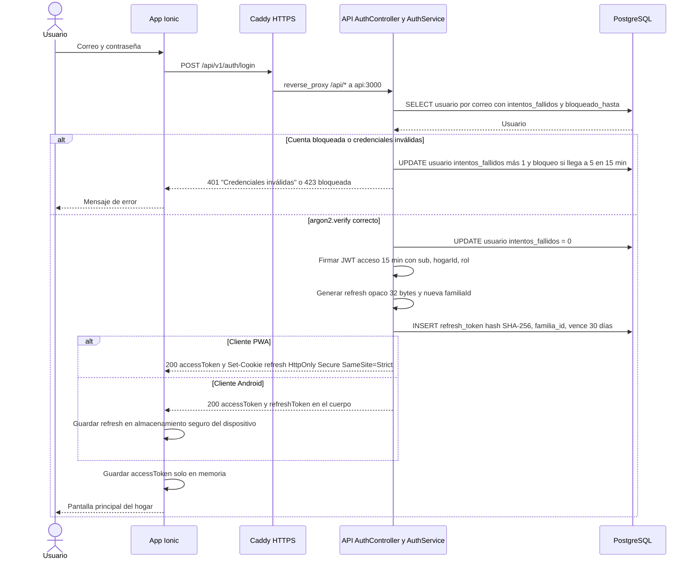
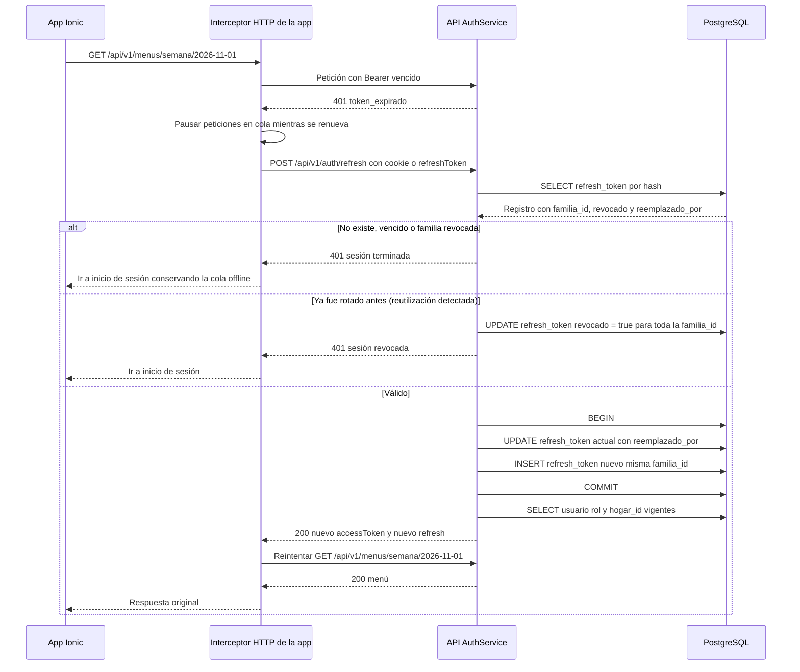
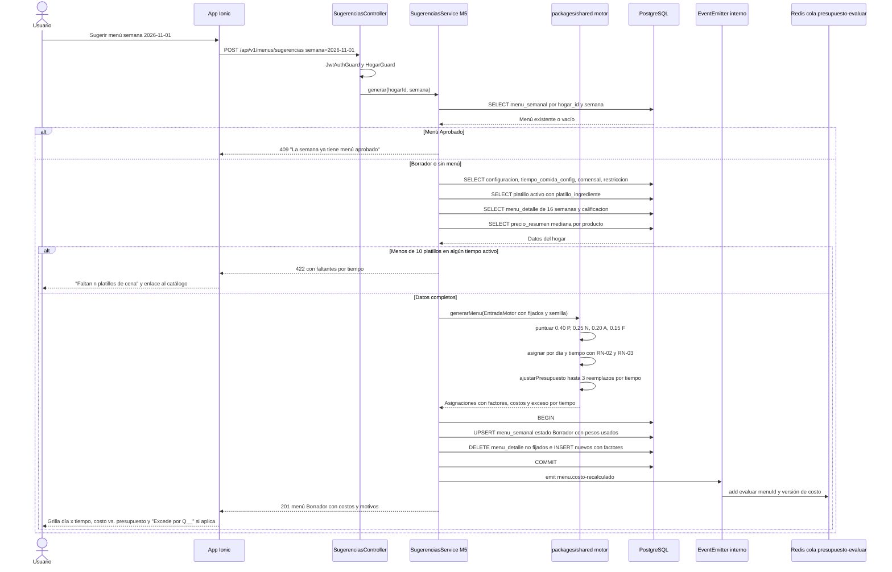
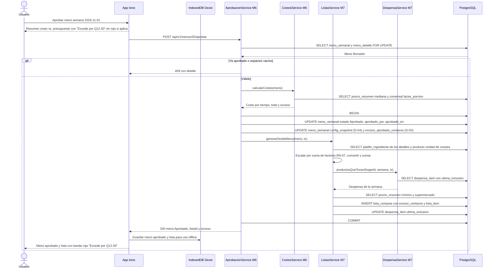
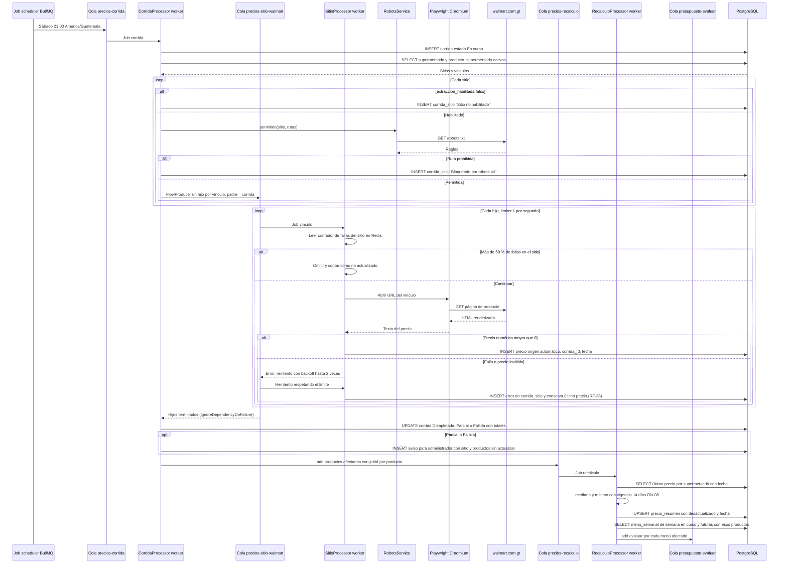
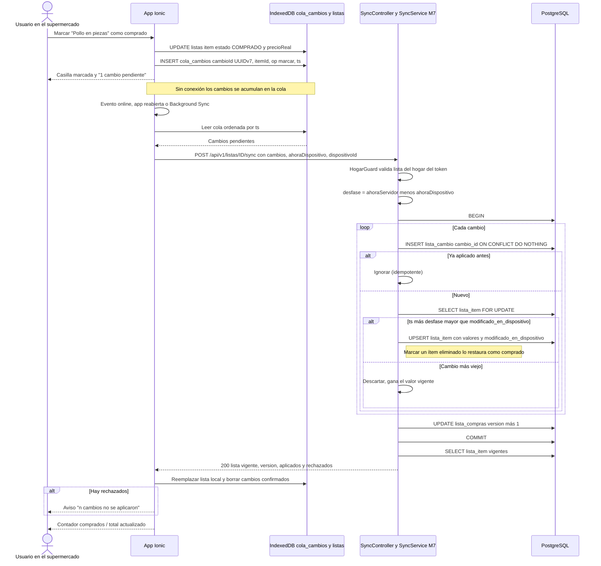
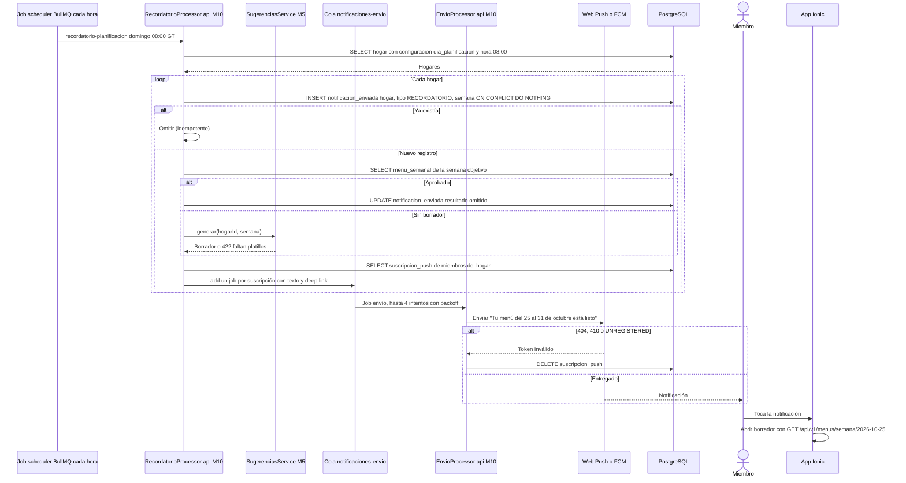
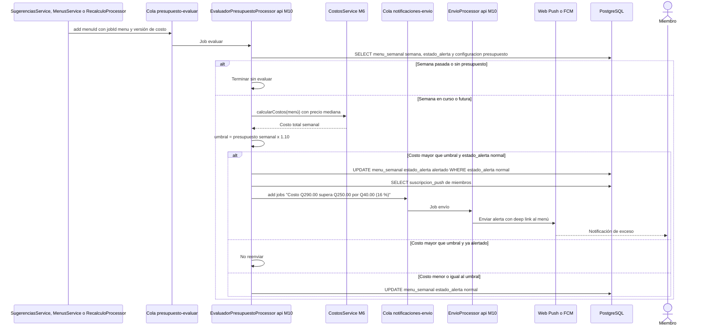

# Diagramas de secuencia técnicos — Menú Familiar

| Campo | Valor |
|---|---|
| Documento | SEC-MF-001 |
| Versión | 1.0 (para aprobación del PO) |
| Fecha | 2026-10-22 |
| Base | [arquitectura.md](arquitectura.md) · historias M01, M05–M08, M10 |
| Fase del ciclo de vida | 3. Diseño |

Nombres reales del diseño: servicios NestJS (`AuthService`, `SugerenciasService`…), colas BullMQ (`precios-corrida`…) y tablas PostgreSQL (`menu_semanal`…). Rutas con prefijo `/api/v1`. Todas las consultas de datos del hogar llevan `hogar_id` del token (RNF-06).

| # | Flujo | CU / RF | Sección |
|---|---|---|---|
| 1 | Inicio de sesión | CU-01.1 · RF-01 | [1.1](#11-inicio-de-sesión) |
| 2 | Renovación de token | ADR-004 | [1.2](#12-renovación-de-token-refresh) |
| 3 | Generar menú | CU-05 · RF-19–22 | [2](#2-generar-menú-semanal-cu-05) |
| 4 | Aprobar menú y generar lista | CU-06.2 → CU-07.1/07.2 · D-03 | [3](#3-aprobar-menú-y-generar-lista-cu-062--cu-07) |
| 5 | Corrida de precios | CU-09.1–09.3 · RF-33, RF-36, RF-38 | [4](#4-corrida-automática-de-precios-cu-09) |
| 6 | Sincronización offline | CU-07.3 · RF-30 · RNF-04 | [5](#5-sincronización-offline-de-la-lista-cu-073) |
| 7 | Recordatorio de planificación | CU-12.1 · RF-41 | [6.1](#61-recordatorio-de-planificación-cu-121) |
| 8 | Alerta de costo | CU-12.2 · RF-42 | [6.2](#62-alerta-de-costo-sobre-presupuesto-cu-122) |

## 1. Autenticación

### 1.1 Inicio de sesión

### 1.2 Renovación de token (refresh)

## 2. Generar menú semanal (CU-05)

## 3. Aprobar menú y generar lista (CU-06.2 → CU-07)

Con D-03 no hay diálogo extra: el exceso se muestra en rojo antes, durante y después de aprobar, y queda registrado en `menu_semanal.exceso_aprobado_centavos`.

## 4. Corrida automática de precios (CU-09)

Solo participan sitios con `supermercado.extraccion_habilitada = true` (D-07). Cada sitio tiene su cola con límite de 1 job por segundo (RNF-12).

## 5. Sincronización offline de la lista (CU-07.3)

## 6. Notificaciones (CU-12)

### 6.1 Recordatorio de planificación (CU-12.1)

### 6.2 Alerta de costo sobre presupuesto (CU-12.2)

