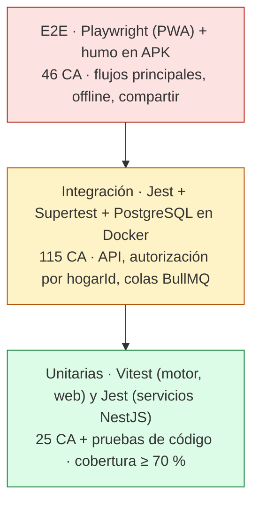
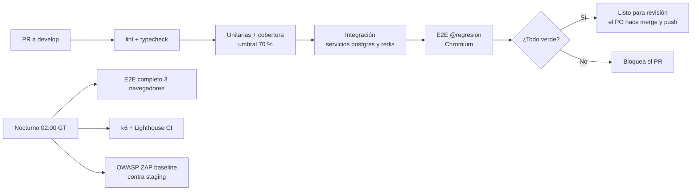
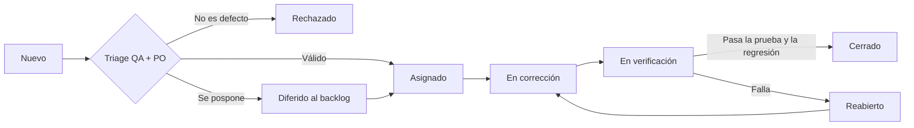

# Plan de pruebas — Menú Familiar

| Campo | Valor |
|---|---|
| Documento | PP-MF-001 |
| Versión | 1.1 (para aprobación del PO) |
| Fecha | 2026-10-22 |
| Estándar de referencia | IEEE 829 / ISO/IEC/IEEE 29119-3 (resumido) |
| Base | SRS-MF-001 v1.3 · CUH-MF-001 v1.1 · ARQ-MF-001 v1.0 · Decisiones D-01 a D-09 |
| Fase del ciclo de vida | 5. Pruebas (se ejecuta dentro de cada sprint S1–S6) |
| Documentos relacionados | [casos-de-prueba.md](casos-de-prueba.md) · [features/](features/) · [plantillas/](plantillas/) |

## 1. Objetivo y alcance

Verificar que cada historia cumple sus criterios de aceptación (`CA-nn.k`) y los RNF que cita, y que lo ya entregado no se rompe sprint a sprint.

| Dentro del alcance | Fuera del alcance |
|---|---|
| 44 historias (HU-01 a HU-44), **186 casos `PF-Mx-nn.k`** generados de los Gherkin | Sitios de Walmart, Paiz y La Torre en vivo (se prueban con páginas grabadas) |
| API NestJS, worker de precios, motor (`packages/shared`), PWA Ionic, APK Android | Infraestructura de Cloudflare, FCM y servicios SMTP (se usan dobles) |
| RNF-01 a RNF-13 (matriz §5) | Publicación en Google Play (PA-04: solo APK en v1) |
| Migraciones Prisma, semillas, respaldo y restauración | Precisión del OCR más allá de los tickets de muestra |

Trazabilidad: `RF-nn → CU-xx.y → HU-nn → CA-nn.k → PF-Mx-nn.k → features/HU-nn.feature`. El script [`scripts/extraer_casos.py`](scripts/extraer_casos.py) regenera los `.feature` y la tabla de casos; falla si hay IDs duplicados o faltantes, o si el número de casos no coincide con el de escenarios.

## 2. Estrategia por niveles

| Nivel | Qué cubre | Herramienta | Dónde vive | Cuándo corre |
|---|---|---|---|---|
| Unitaria | Motor (puntaje, RN-02 a RN-05), reparto RN-06, escalado RN-07, mediana/mínimo RF-36, componentes React, servicios con repositorios simulados | Vitest + Testing Library + fast-check; Jest en `apps/api` | `*.spec.ts` junto al código | Cada push y PR |
| Integración | Endpoints con base real, validaciones, permisos RN-10, aislamiento RNF-06, importación CSV/XLSX, worker con sitio simulado | Jest + Supertest, PostgreSQL 16 y Redis 7 en Docker, Prisma `migrate reset` por suite | `apps/api/test/**/*.e2e-spec.ts`, `apps/worker/test` | Cada PR |
| E2E | Flujos de usuario de punta a punta en la PWA, offline, accesibilidad | Playwright (Chromium en PR; Chromium, Edge, WebKit nocturno) + `@axe-core/playwright` | `apps/web/e2e/` ejecutando `docs/03-pruebas/features` vía `playwright-bdd` | PR (etiqueta `@regresion`) y nocturno (todo) |
| Aceptación (UAT) | RNF-07 y aceptación de historias por el PO | Guion de UAT + cronómetro | Servidor de casa (`staging`) | Revisión de cada sprint; UAT final en S6 |

Mapeo Gherkin → código: cada `PF` se implementa en el nivel indicado en [casos-de-prueba.md](casos-de-prueba.md). Los de nivel unitario o integración usan el ID en el nombre del test (`it('PF-M5-20.3 …')`) para que el reporte se cruce con la tabla.

### 2.1 Pipeline de CI (GitHub Actions)

## 3. Tipos de prueba

| Tipo | Enfoque | Herramienta | Criterio de aprobación |
|---|---|---|---|
| Funcional | Los 186 `PF` (106 funcionales, 59 negativos, 21 de límite) | Según nivel | 100 % de los `PF` de prioridad M y ≥ 90 % de S/C aprobados por sprint |
| Regresión | Suite acumulada `@regresion` (prioridad M) + casos del sprint (§8) | `--grep @regresion` | 100 % verde para cerrar sprint |
| Integración | Contratos API ↔ app (esquemas zod compartidos), API ↔ worker por BullMQ, eventos `menu.aprobado` | Jest + Supertest | Sin fallos |
| E2E | Recorridos: registrar → hogar → configurar → generar → aprobar → lista → marcar sin conexión | Playwright | Sin fallos en Chromium; fallos de Edge/WebKit se registran como defecto |
| Rendimiento | RNF-01: `POST /menus/generar` con 300 platillos. RNF-02: carga de pantallas en perfil 4G | k6 (umbral `p(95)<3000`) y k6 browser (LCP < 2 s) + Lighthouse CI ≥ 80 | Umbrales en verde en 3 corridas nocturnas seguidas |
| Seguridad | OWASP ZAP baseline (pasivo) contra staging; suite de autorización por `hogarId`: token del hogar B contra cada recurso del hogar A → 404/403; rol Miembro contra endpoints `@Roles('ADMIN')` → 403; JWT vencido → 401; hash argon2id; HTTPS y HSTS | ZAP `zap-baseline.py`, Jest + Supertest | 0 alertas High/Medium de ZAP sin justificar; 100 % endpoints cubiertos por la suite de autorización |
| Accesibilidad | Contraste AA, etiquetas, foco, texto escalado al 200 % | `@axe-core/playwright` en cada pantalla principal + Lighthouse accesibilidad | 0 violaciones serias/críticas de axe; Lighthouse ≥ 90 |
| Offline | Lista y menú aprobado sin red; cola de cambios idempotente; conflicto entre dispositivos (CA-30.x) | Playwright `context.setOffline(true)`; modo avión en Android | Datos consultables y editables sin red; sincroniza al reconectar sin duplicados |
| Compatibilidad | Matriz RNF-08 (§3.1) | Proyectos de Playwright + dispositivos reales | Humo de los flujos principales en toda la matriz |
| Respaldo y restauración | `pg_dump` diario + restic, retención 14 días; restaurar en contenedor limpio | Script `infra/scripts/probar-restauracion.sh` | Restauración < 30 min, conteos y checksums iguales al origen |
| UAT | RNF-07: planificar la semana en ≤ 5 min y ≤ 3 toques por cambio | Guion con cronómetro, PO y miembro del hogar | Ambos usuarios cumplen la meta; aceptación firmada |

### 3.1 Matriz de compatibilidad (RNF-08)

| Plataforma | Versión | Cómo | Frecuencia |
|---|---|---|---|
| Chrome escritorio y Android | Estable actual | Playwright `chromium` / dispositivo real | PR / sprint |
| Edge | Estable actual | Playwright `channel: msedge` | Nocturno |
| Safari macOS / iOS | 17+ | Playwright `webkit` + iPhone real del hogar | Nocturno / sprint |
| Android (APK Capacitor) | 10 (API 29) y 14 (API 34) | Emulador para humo + teléfono real | Sprint S4 en adelante |

## 4. Entornos

| Entorno | Composición | Datos | Uso |
|---|---|---|---|
| Local | `infra/compose.dev.yml`: PostgreSQL 16, Redis 7, API, worker, web (Vite) | Semilla de pruebas (§6) | Desarrollo y TDD |
| Pruebas efímero | `compose.test.yml` o servicios de GitHub Actions; base recreada por suite (`prisma migrate reset --force`) | Semilla mínima + fábricas por prueba | Integración y E2E en CI |
| Staging (servidor de casa) | Proyecto Compose `mf-staging` en el mismo servidor, base y Redis separados de producción, publicado por Cloudflare Tunnel en subdominio con acceso restringido | Copia anonimizada + 16 semanas del cuaderno | ZAP, k6, Lighthouse, UAT, revisión del sprint |
| Producción (servidor de casa) | `infra/compose.yml` | Reales | Solo humo post-despliegue y monitoreo RNF-03 |

Reglas: las pruebas de rendimiento nunca corren contra producción; la zona horaria del entorno es `America/Guatemala` y las pruebas con fechas congelan el reloj (domingo 2026-10-25 08:00).

## 5. Matriz RNF → prueba → herramienta → sprint

| RNF | Prueba | Herramienta | Sprint |
|---|---|---|---|
| RNF-01 Menú < 3 s | Benchmark del motor con 300 platillos + carga del endpoint (5 VU, 2 min) | Vitest bench, k6 | S3 (luego nocturno) |
| RNF-02 Pantallas < 2 s 4G | LCP en perfil 4G de Inicio, Semana, Lista; performance ≥ 80 | k6 browser, Lighthouse CI | S1 base, S3, S4, S6 |
| RNF-03 Disponibilidad 95 % | Monitor externo de la URL pública; informe mensual | Uptime Kuma + monitor externo | S6 (medición continua) |
| RNF-04 Offline | Modo avión con lista y menú aprobado; sincronización y conflicto | Playwright `setOffline`, Android real | S4 (lista), S3 (menú aprobado) |
| RNF-05 Seguridad de credenciales | Hash argon2id en BD, expiración JWT 15 min, refresh rotativo, HTTPS/HSTS, bloqueo de 5 intentos | Jest + Supertest, ZAP | S1 |
| RNF-06 Aislamiento por hogar | Suite de autorización por endpoint con dos hogares (Rosales y López) | Jest + Supertest | S1 y cada sprint (endpoints nuevos) |
| RNF-07 Usabilidad | Planificar la semana con cronómetro y conteo de toques | UAT | S3, S6 |
| RNF-08 Compatibilidad | Humo en la matriz §3.1 | Playwright, emulador y dispositivos | S1 web, S4 Android, S6 completo |
| RNF-09 Cobertura ≥ 70 % | Umbral en CI para `apps/api`, `apps/worker`, `packages/shared` (motor ≥ 90 %) | Jest/Vitest coverage (v8) | Todos |
| RNF-10 Un comando | `docker compose up -d` en máquina limpia + healthchecks verdes | Docker Compose | S1, S6 |
| RNF-11 Respaldo | Restauración del último respaldo; verificar 14 copias diarias | `pg_dump`, restic, script de restauración | S2 (primera), mensual |
| RNF-12 Legal | Intervalo ≥ 1 s entre solicitudes, robots.txt, sitio apagado por defecto | Jest + sitio simulado (nock / servidor local) | S5 |
| RNF-13 Accesibilidad | axe en cada pantalla, Lighthouse ≥ 90, texto al 200 % | `@axe-core/playwright`, Lighthouse CI | S1 y cada sprint |

## 6. Datos de prueba

| Conjunto | Contenido | Origen |
|---|---|---|
| Hogares y usuarios | "Familia Rosales" (Rene admin `rene@correo.com`, Ana miembro `ana@correo.com`; comensales con factor de porción 1.0, 1.0, 0.5, 0.75) y "Familia López" (`luis@correo.com`) para aislamiento | `packages/db/seed/pruebas.ts` |
| Platillos guatemaltecos | Pollo en crema, Pepián de pollo, Carne guisada, Tortitas de carne, Caldo de res, Pescado frito, Spaghetti con carne, Chile relleno, Hilachas, Jocón, Revolcado, Subanik, con proteína principal, ingredientes por porción base y costo | Semilla |
| Volumen RNF-01 | 300 platillos sintéticos con 6 proteínas y 5–12 ingredientes cada uno | Generador con semilla fija |
| Historial | **16 semanas del cuaderno** (abril 2025–2026) y lista de despensa de Q814.00 | `carga-inicial-cuaderno.xlsx` (D-06), sin datos personales |
| Precios | Walmart y Paiz con precios de 0–20 días de antigüedad (prueba de vigencia de 14 días), casos par/impar para mediana | Fixtures + páginas HTML grabadas por sitio |
| Tickets | 3 fotos de ticket legibles y 1 ilegible | `apps/worker/test/fixtures/tickets` |
| Configuración | Presupuesto Q250 solo almuerzo; Q700 con 20/50/30; Q500 con 60/40 | Semilla |

Las pruebas crean sus propios datos con fábricas y no dependen del orden de ejecución. La semilla es idempotente.

## 7. Criterios de entrada y salida por sprint

**Entrada general (cada sprint):** historias cumplen la DoR; features regenerados con `extraer_casos.py` sin inconsistencias; CI verde en `develop`; entorno de staging disponible.

**Salida general (cada sprint):** 100 % de los `PF` de prioridad M del sprint aprobados y ≥ 90 % de S/C; suite `@regresion` acumulada en verde; cobertura ≥ 70 % (RNF-09); 0 defectos críticos o altos abiertos; RNF del sprint verificados (§5); reporte de ejecución publicado; PO acepta en la revisión.

| Sprint | Entrada específica | Salida específica |
|---|---|---|
| S1 | CI, Docker de pruebas y semilla base listos (S0) | Suite de autorización RNF-06 para M01–M03; axe y Lighthouse base; `compose up` en un comando |
| S2 | Plantilla CSV y transcripción del cuaderno revisada por el PO (D-06) | 16 semanas cargadas y conciliadas (CA-18.x); primera prueba de restauración (RNF-11) |
| S3 | 16 semanas cargadas; 300 platillos sintéticos | RNF-01 p95 < 3 s; propiedades del motor (fast-check) en verde; UAT de planificación (RNF-07) |
| S4 | Menú aprobado estable (HU-25) | Offline y conflicto de lista (RNF-04); humo en APK Android 10 y 14 |
| S5 | PA-02 revisada; sitios apagados por defecto (D-07) | Worker contra sitio simulado; 1 req/s y robots.txt (RNF-12); ZAP sin alertas altas |
| S6 | Todos los módulos integrados | Regresión completa (186 casos); matriz RNF-08 completa; UAT final firmada; informe de uptime (RNF-03) |

## 8. Suite de regresión acumulada

Todo caso de prioridad **M** lleva `@regresion` y entra a la suite en el sprint en que se acepta su historia. Los casos S/C se ejecutan en su sprint y en la regresión completa previa a cada entrega (S3, S6).

| Sprint | Casos nuevos | Nuevos `@regresion` | `@regresion` acumulados | Casos totales acumulados |
|---|---|---|---|---|
| S1 | 47 | 40 | 40 | 47 |
| S2 | 17 | 17 | 57 | 64 |
| S3 | 40 | 28 | 85 | 104 |
| S4 | 33 | 26 | 111 | 137 |
| S5 | 34 | 22 | 133 | 171 |
| S6 | 15 | 0 | 133 | 186 |

M09 y M10 no tienen historias de prioridad M; QA propone agregar a la regresión CA-39.1 y CA-41.1 (flujo principal) al cerrar S6.

## 9. Gestión de defectos

| Severidad | Definición | Ejemplo | Prioridad típica |
|---|---|---|---|
| S1 Crítica | Pérdida de datos, fuga entre hogares, app inutilizable | Hogar B ve el menú del hogar A | P1: se corrige antes de cualquier otra tarea |
| S2 Alta | Falla un flujo principal sin alternativa | No se puede aprobar el menú | P1/P2: dentro del sprint |
| S3 Media | Falla con alternativa o cálculo menor incorrecto | Redondeo de Q0.01 en la lista | P2/P3: sprint actual o siguiente |
| S4 Baja | Cosmético o de texto | Tilde faltante en un mensaje | P4: backlog |

Se registran como GitHub Issues con la plantilla [reporte-defecto.md](plantillas/reporte-defecto.md) y etiquetas `defecto`, `sev:S1..S4`, `prio:P1..P4`, `M01..M10`. Cada defecto corregido agrega una prueba automatizada que lo reproduce. Campos mínimos: ID, título, severidad, prioridad, `PF`/`CA` relacionado, entorno y versión, pasos, resultado esperado y obtenido, evidencia.

## 10. Métricas

| Métrica | Fórmula | Meta | Fuente |
|---|---|---|---|
| Cobertura de código | Líneas cubiertas ÷ líneas (API, worker, `packages/shared`) | ≥ 70 % (motor ≥ 90 %) | Reporte de CI (RNF-09) |
| CA aprobados | `PF` aprobados ÷ `PF` del sprint | 100 % M, ≥ 90 % S/C | Reporte de ejecución |
| Cobertura de CA automatizada | `PF` con prueba automatizada ÷ total | ≥ 94 % (175 de 186 son "Sí") | casos-de-prueba.md |
| Defectos abiertos por severidad | Conteo al cierre del sprint | S1 = 0, S2 = 0, S3 ≤ 3 | GitHub Issues |
| Defectos escapados | Defectos encontrados en producción ÷ total del sprint | ≤ 10 % | GitHub Issues |
| Pruebas inestables | Pruebas con resultado distinto en reintento ÷ total | ≤ 2 % | Historial de CI |
| Duración del pipeline de PR | Minutos | ≤ 15 min | GitHub Actions |

## 11. Roles

| Rol | Responsable | Responsabilidades |
|---|---|---|
| Product Owner | Rene Rosales | Prioriza defectos, ejecuta UAT, acepta historias, hace merge y `git push` (R-04) |
| QA lead / arquitecto | Claude | Plan, casos, automatización E2E e integración, reportes, triage |
| Desarrollo | Claude / equipo | Pruebas unitarias, corrección de defectos, mantener cobertura |
| Usuaria de UAT | Miembro del hogar (esposa) | UAT de planificación, lista offline y notificaciones en Android |

## 12. Calendario por sprint (2 semanas)

| Momento | Actividad de pruebas | S1 | S2 | S3 | S4 | S5 | S6 |
|---|---|---|---|---|---|---|---|
| Día 1 (planificación) | Regenerar features; revisar CA; preparar datos | M01–M03 | M04 | M02, M03, M05, M06 | M06, M07 | M02, M07, M08 | M09, M10 |
| Días 2–8 | Unitarias e integración junto al código (TDD) | ✔ | ✔ | ✔ | ✔ | ✔ | ✔ |
| Días 6–9 | E2E del sprint, RNF del sprint (§5) | Seguridad, a11y | Restauración | k6 RNF-01, UAT | Offline, APK | ZAP, RNF-12 | Matriz completa |
| Día 9 | Regresión acumulada (§8) | 40 | 57 | 85 + completa | 111 | 133 | 186 completa |
| Día 10 (revisión) | Reporte de ejecución, UAT del PO, aceptación | ✔ | ✔ | ✔ | ✔ | ✔ | UAT final |

## 13. Riesgos

| ID | Riesgo | Prob. | Impacto | Mitigación |
|---|---|---|---|---|
| RP-01 | Capacidad: un solo desarrollador a medio tiempo frente a 804 h | Alta | Alto | Automatizar primero `@regresion`; pruebas S/C manuales si falta tiempo; replanificar tras S1 |
| RP-02 | Pruebas E2E inestables (offline, service worker) | Media | Medio | Datos aislados por prueba, reloj congelado, reintento 1 vez con registro de inestabilidad |
| RP-03 | Cambios en los sitios de supermercados | Alta | Medio | Páginas grabadas en CI; prueba de humo manual contra el sitio real antes de activar cada sitio (D-07) |
| RP-04 | Corte de luz o internet en el servidor de casa deja sin staging | Media | Medio | CI no depende de staging; ZAP/k6 se reprograman; UPS (RG-02) |
| RP-05 | Push, FCM y compartir nativo difíciles de automatizar (11 casos "Parcial") | Alta | Bajo | Dobles en CI + verificación manual en dispositivo en S4 y S6 |
| RP-06 | Inconsistencias entre Gherkin y decisiones del PO | Media | Medio | Corregir los CA antes de automatizar (ver §14) |
| RP-07 | Datos reales del cuaderno en pruebas | Baja | Medio | Solo montos y platillos; sin nombres ni correos reales en staging |

## 14. Observaciones sobre los criterios de aceptación

Los 186 CA tienen ID único, consecutivo y bajo la historia correcta; todas las historias tienen al menos 3. Las dos contradicciones con decisiones del PO detectadas en la versión 1.0 quedaron **resueltas** en las historias (SRS v1.3) y los casos se regeneraron:

| CA | Contradicción detectada | Decisión | Estado |
|---|---|---|---|
| CA-03.1 y narrativa de HU-03 (también supuestos de CU-03.2 y CU-07.1) | Comensales "adulto/niño" y "cada comensal = 1 porción"; no había CA para el factor de porción | D-02: factor de porción por comensal (0.25 a 2.0, pasos de 0.25) | Resuelta: HU-03 con factor y CA-03.5 (factor 0.5) y CA-03.6 (rango); CA-12.5 y CA-28.5 escalan con Σ factores |
| CA-25.2 (HU-25) | Exigía confirmar "¿Aprobar de todos modos?" | D-03: sin diálogo extra; exceso en rojo "Excede por Q__" | Resuelta: CA-25.2 aprueba directo y verifica el exceso en menú, aprobación y lista; CA-28.6 lo verifica en la lista |

RF-43 y RF-44 (SRS v1.3) agregan HU-43 (6 casos) y HU-44 (6 casos) en S4; su prueba en modo avión y la idempotencia del precio entran a la regresión (prioridad M).

## 15. Aprobación

| Rol | Nombre | Fecha | Visto bueno |
|---|---|---|---|
| Product Owner | Rene Rosales | | Pendiente |
| QA lead | Claude | 2026-10-22 | Elaborado |
